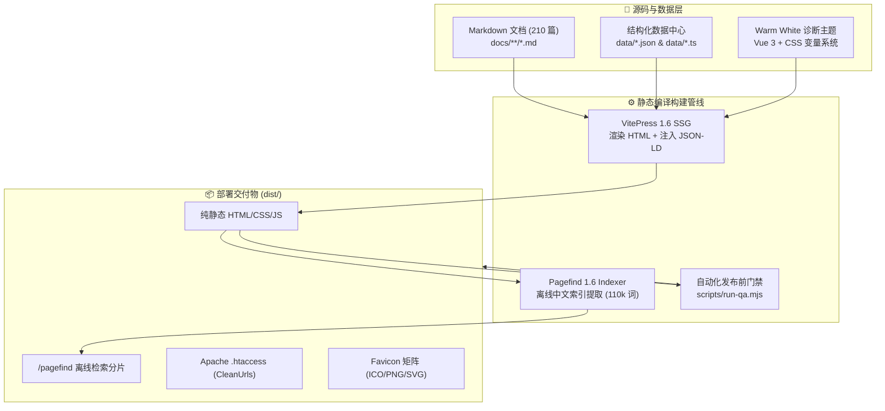

<div align="center">

  

  # 代理排障 (dailipaizhang.biz)

  **面向中文用户的专业代理客户端故障诊断与网络工具知识库**  
  *Warm White Diagnostic Knowledge Base · 极简·权威·数据驱动·零黑话*

  <p align="center">
    <a href="https://dailipaizhang.biz"></a>
    <a href="https://github.com/zlzlzl98698-dev/dailipaizhang.biz"></a>
    
    
    
    
    
    
  </p>

  <p align="center">
    <a href="#-项目定位与核心优势">核心定位</a> •
    <a href="#-知识体系与内容拓扑">知识体系</a> •
    <a href="#-技术架构与工程特色">技术架构</a> •
    <a href="#-自动化质量保证体系">QA 验收</a> •
    <a href="#-快速开始与本地开发">快速开始</a> •
    <a href="#-生产部署指南">生产部署</a>
  </p>

</div>

---

## 📖 项目定位与核心优势

**「代理排障」(`dailipaizhang.biz`)** 是一个专为中文用户打造的系统性代理客户端故障排查与网络协议知识库。

传统网络工具使用中，用户普遍面临**“报错信息晦涩、群友解答粗暴（重装/重启）、教程营销化泛滥、黑话门槛高”**等痛点。本项目基于纯静态架构（SSG）与权威技术标准，提供结构化、可复现、直接切中要害的实战诊断方案。

### 🌟 5 大核心特色

1. **⚡ 诊断优先（Answer-First）布局**
   - 彻底摒弃冗长铺垫。每篇排障指南前 150 字内直接给出「核心诊断结论」、「故障根因分类」与「1-2-3 快速自愈步骤」，助用户 30 秒解决问题。
2. **📚 RFC 标准与网络层机理溯源**
   - 严格引用 IETF 权威技术规范（SOCKS5 [RFC 1928](https://www.rfc-editor.org/rfc/rfc1928)、TLS 1.3 [RFC 8446](https://www.rfc-editor.org/rfc/rfc8446)、QUIC [RFC 9000](https://www.rfc-editor.org/rfc/rfc9000) 等）。不仅告诉用户“怎么做”，更解释清楚“为什么报错”。
3. **🗺️ 三维立体内容矩阵（210 篇可索引文档）**
   - **10 大一级专题柱石页**（深度 10,000–15,000 汉字，构建全局知识图谱）；
   - **60 个二级专题中心页**（深度 5,000–8,000 汉字，纵深覆盖各垂直场景）；
   - **31 家品牌实测独立专页 + 8 组横向横评对比**；
   - **24+ 实战排障手记**（覆盖 Clash Core 报错、TUN 网卡冲突、订阅解析失败、节点超时等高频故障）。
4. **🔍 毫秒级离线全文检索（Pagefind）**
   - 集成 Pagefind 扩展中文分词引擎，纯静态分片索引，零后端数据库，支持首字母即时搜索、跨词检索与空结果智能分流。
5. **🛡️ 严苛的 E-E-A-T、GEO 与外链风控隔离**
   - **商业链接零污染**：全站所有商业出站引流链接统一由组件封装，100% 携带 `rel="nofollow sponsored noopener noreferrer"` 与明确披露标识；
   - **结构化数据 100% 对齐**：注入 680+ 组 JSON-LD 标签（`WebSite`、`BreadcrumbList`、`FAQPage`、`TechArticle`、`HowTo` 等），问答数据与页面可见文本逐字吻合；
   - **无孤岛死链**：自动化工具确保 2.1 万+ 内部链接 0 处 404、0 处空 href。

---

## 🗺️ 知识体系与内容拓扑

全站划分 10 大核心知识领域，横向打通客户端、协议、节点与具体应用场景：

| 专题模块 | 路由路径 | 核心覆盖意图与知识范围 |
| :--- | :--- | :--- |
| **01 机场推荐** | `/airport/` | 31 家实测品牌全景横评、选型决策树、人群预算分级与稳定性辨识指南 |
| **02 价格与套餐** | `/pricing/` | 五大价格带全景还原、三维成本公式、年付跑路风险防范、倍率陷阱拆解 |
| **03 机场品牌** | `/brands/` | 31 家服务商实测专页、测速原图证据链、流媒体/AI 解锁追踪与避坑清单 |
| **04 VPN 与加速器** | `/vpn/` | 商业 VPN vs 代理协议架构对比、游戏加速器底层拓扑、全平台回国代理剖析 |
| **05 客户端软件** | `/clients/` | Clash Verge Rev、Sing-box、Surge、Shadowrocket 等主流客户端配置与排障 |
| **06 AI 与流媒体** | `/ai-media/` | ChatGPT Region Not Supported、Claude 封号风控、Netflix/Disney+ 分流规则 |
| **07 线路与节点** | `/routes/` | BGP 多线接入、IPLC/IEPL 专线拓扑、原生 IP vs 广播 IP 纯净度实测机制 |
| **08 使用教程** | `/guides/` | 路由器透明网关、Clash/Sing-box 订阅更新、多设备分流、局域网共享实战 |
| **09 故障排查** | `/troubleshooting/` | 核心错误代码速查、TUN 虚拟网卡劫持、DNS 泄漏、循环重定向自愈手册 |
| **10 风险与替代** | `/security/` | 翻墙法律红线辨析、机场跑路预警信号、自建节点被墙风险、备用应急方案 |

---

## 🛠️ 技术架构与工程特色



### 💻 核心技术选型

- **核心框架**：[VitePress 1.6.4](https://vitepress.dev/)（基于 Vite 与 Vue 3 的下一代超高速静态站点生成器）
- **主题风格**：自定义 **Warm White Diagnostic Theme**（以 `#F7F6F2` 暖白纸质底色与 `#182026` 深墨对比，降低长文技术阅读疲劳）
- **检索内核**：[Pagefind Extended 1.6.0](https://pagefind.app/)（支持浏览器端即时中文分词搜索，无服务依赖）
- **安全与链接**：集中化 `data/links.ts` 动态分发机制，彻底杜绝 Markdown 硬编码商业推广域名
- **代码规范**：TypeScript 5.x + Node.js ESM 纯原生脚本，零沉重外部构建插件

---

## 📁 目录结构

```text
dailipaizhang.biz/
├── docs/                          # 站点内容与文档源码
│   ├── .vitepress/
│   │   ├── config.mts             # VitePress 站点核心配置 (SEO、Sitemap、JSON-LD)
│   │   ├── nav.ts                 # 10 大一级专题与 60 个二级子项导航配置
│   │   └── theme/                 # 暖白技术手册主题
│   │       ├── components/        # 自定义交互组件 (排障树、数据矩阵、搜索弹窗等)
│   │       ├── styles/custom.css  # 全局视觉样式与色彩体系
│   │       ├── Layout.vue         # 站点布局包装器
│   │       └── index.ts           # 主题装配入口
│   ├── public/                    # 静态资产目录 (直接映射到网站根目录)
│   │   ├── .htaccess              # Apache 2.4 cleanUrls、301 规范化与 404 响应规则
│   │   ├── robots.txt             # 全局爬虫抓取许可与 Sitemap 声明
│   │   ├── favicon.ico            # 16/32/64 多分辨率标准 ICO
│   │   ├── favicon.png            # 32x32 现代浏览器 PNG 图标
│   │   ├── favicon.svg            # 矢量图标
│   │   └── images/                # 实测证据截图、测速图表、品牌头像
│   ├── index.md                   # 网站首页 (9 段式综合诊断面板)
│   ├── airport/                   # 专题 01: 机场推荐
│   ├── pricing/                   # 专题 02: 价格与套餐
│   ├── brands/                    # 专题 03: 机场品牌实测 (含 31 品牌独立页)
│   ├── vpn/                       # 专题 04: VPN 与加速器
│   ├── clients/                   # 专题 05: 客户端软件
│   ├── ai-media/                  # 专题 06: AI 与流媒体
│   ├── routes/                    # 专题 07: 线路与节点
│   ├── guides/                    # 专题 08: 使用教程
│   ├── troubleshooting/           # 专题 09: 故障排查实战 (24+ 篇精细诊断指南)
│   ├── security/                  # 专题 10: 风险与替代
│   ├── disclosure.md              # 商业推广透明度披露声明
│   ├── methodology.md             # 数据实测与证据分级方法论
│   └── about.md                   # 关于本站与合规政策
├── data/                          # 结构化数据源 (Single Source of Truth)
│   ├── brands.json                # 31 家实测品牌数据 (节点倍率、价格、解锁状态)
│   ├── links.ts                   # 唯一外链出口字典 (强制 rel=nofollow)
│   ├── clients.json               # 客户端平台支持矩阵与版本核验
│   ├── issue-map.json             # 交互式排障分流器与决策树配置
│   └── topic-map.json             # 知识体系拓扑结构映射
├── scripts/                       # 自动化测试与工程校验套件
│   ├── audit-urls.mjs             # 路由规范性与 Canonical 校验
│   ├── audit-keywords.mjs         # 标题/描述/关键词唯一性与互抢审计
│   ├── audit-brands.mjs           # 商业链接合规与无硬编码外链审计
│   ├── audit-content-quality.mjs  # 内容相似度与 DOM 结构检查
│   ├── validate-jsonld.mjs        # 结构化数据语法与可见文本对齐检查
│   ├── validate-links.mjs         # 全站内链死链与离线索引有效性验证
│   └── run-qa.mjs                 # 串联全量 QA 门禁控制脚本
├── reports/                       # 审计、实现与构建验收专业报告
├── package.json                   # 依赖与命令定义
├── tsconfig.json                  # TypeScript 配置
└── README.md                      # 项目自述文档
```

---

## 🚀 快速开始与本地开发

### 环境要求

- **Node.js**：`>= 20.0.0`（推荐使用 Node v22 或 v24）
- **包管理器**：`npm` / `pnpm` / `yarn`

### 本地初始化

```bash
# 1. 克隆代码仓库
git clone https://github.com/zlzlzl98698-dev/dailipaizhang.biz.git
cd dailipaizhang.biz

# 2. 安装依赖项
npm install

# 3. 启动本地实时开发预览（带热重载）
npm run dev
```

启动后可在浏览器打开 `http://localhost:5173/` 进行文档撰写与组件调试。

---

## 🛡️ 自动化质量保证体系 (QA)

项目配备了严格的自动化预检与发布门禁系统。每次生产构建或内容提交前，必须通过全部 6 项自动化测试：

```bash
# 执行完整生产构建 + 全套 QA 门禁校验
npm run build && npm test
```

### 单项校验工具清单

```bash
# 1. 验证 210 个页面路由真实存在、无孤立页、canonical 与 sitemap.xml 100% 吻合
npm run audit:urls

# 2. 检查 title、description、H1、primaryKeyword 唯一性，防止同词互抢 (Cannibalization)
npm run audit:keywords

# 3. 检查 31 家品牌结构化完整性，确保 0 Markdown 硬编码 AFF 且强制 rel=nofollow
npm run audit:brands

# 4. 检查内容厚度、DOM 差异度与防模板化风控
npm run audit:content-quality

# 5. 校验 680+ 条 JSON-LD 语法合法性，确保 Schema 问答与页面可见文本 100% 吻合
npm run validate:jsonld

# 6. 扫描全站 21,000+ 条链接防死链，验证离线搜索分片与关键静态文件
npm run validate:links
```

### 自动化 QA 运行效果

```text
=== dailipaizhang.biz QA Suite (full build + dist mode) ===
[PASS] audit:urls           — 210 页 canonical 与 sitemap.xml 100% 对齐
[PASS] audit:keywords       — 210 页 title/description/H1/关键词 100% 唯一，0 互抢冲突
[PASS] audit:brands         — 31 家品牌合规，50 处引流链接严格 rel=nofollow
[PASS] audit:content-quality— 209 页 FAQ 一致性达标，0 模板占位符
[PASS] validate:jsonld      — 683 组 JSON-LD 语法合规，与可见文本 100% 吻合
[PASS] validate:links       — 21,087 条内部链接与 573 张图片全量畅通，Pagefind 7/7 命中
Total: 0 error(s), 0 warning(s) in 5207ms
```

---

## 🌐 生产部署指南

项目构建生成的 `docs/.vitepress/dist/` 为纯静态站点产物，可部署于任何主流静态托管平台：

### 1. 静态构建

```bash
npm run build
```
输出目录为：`docs/.vitepress/dist`

### 2. 本地预览构建产物

```bash
npm run preview
# 本地服务将在 http://localhost:4173/ 启动
```

### 3. 服务器配置建议

#### Apache 2.4 (推荐直接复用项目内置规则)
项目已内置 `docs/public/.htaccess`，打包后将自动输出到 `dist/` 根目录：
- 启用 `mod_rewrite` 自动将无后缀 Clean URL（如 `/airport/index`）内部重写为 `.html`；
- 自定义 404 错误页 (`ErrorDocument 404 /404.html`)，绝不发生 Soft 404；
- 设置静态资源（图片、字体、CSS/JS）的缓存期（`Cache-Control: max-age=2592000`）。

#### Nginx
```nginx
server {
    listen 80;
    server_name dailipaizhang.biz;
    root /path/to/dailipaizhang.biz/docs/.vitepress/dist;
    index index.html;

    # Clean URLs 支持
    location / {
        try_files $uri $uri/ $uri.html =404;
    }

    # 错误页面
    error_page 404 /404.html;

    # 静态资源长期缓存
    location ~* \.(jpg|jpeg|png|gif|ico|webp|svg|woff2?)$ {
        expires 30d;
        add_header Cache-Control "public, no-transform";
    }
}
```

#### Cloudflare Pages / Vercel
- **Build command**：`npm run build`
- **Build output directory**：`docs/.vitepress/dist`
- **Node.js Version**：`20.x` 或以上

---

## ⚖️ 免责声明与商业透明度

1. **客观独立原则**：本知识库所有测试截图、延迟测速与解锁状态均为测试环境下的客观历史记录。网络环境受运营商路由调整与节点负载影响动态变化，数据仅供故障排查参考。
2. **商业透明度**：本站可能包含第三方服务商的返利链接（Affiliate Links）。我们在所有商业引流位置均公开标注推广标识，并严格配置 `rel="nofollow sponsored noopener noreferrer"`，坚决不参与任何虚假评分刷榜或暗箱导流。详见 [商业披露声明](https://dailipaizhang.biz/disclosure)。
3. **技术合规**：本知识库旨在普及网络诊断技术与协议排障知识，倡导健康、安全、合规的网络使用习惯。

---

## 📄 开源许可证

本项目源码基于 [MIT License](LICENSE) 许可协议开源。

文档、原创诊断方法论与知识图谱版权归 **代理排障 (dailipaizhang.biz)** 团队所有。

---

<div align="center">
  <sub>Built with ❤️ by the dailipaizhang.biz engineering team.</sub>
</div>
