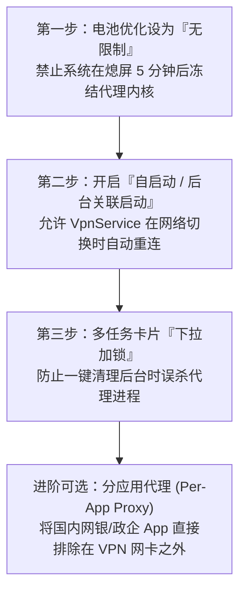

# 安卓代理软件导入订阅教程：v2rayNG / FlClash / Karing 实操与防杀后台配置

## 核心结论（Answer-First）

在 Android 手机与平板上配置代理服务，成功的关键在于**「选对合规客户端格式」**与**「打通国产系统后台保活」**两大环节。首先，务必认准 `arm64-v8a` 架构官方安装包，**严禁下载 Google Play 上已被第三方控制的同名 NekoBox 版本**，并淘汰已停更的旧版 `Clash for Android`；其次，按客户端内核匹配订阅格式（`FlClash / Clash Meta for Android` 导入 Clash YAML 订阅，`v2rayNG` 导入通用/Base64 订阅，`Karing / Hiddify` 支持多格式自动识别），所有测试均在直连状态下使用如 `https://sub.example.invalid/api/v1/client/subscribe?token=REDACTED` 的远端 URL 导入；最后，必须在安卓系统设置中将该应用的**电池优化设为「无限制」**并开启多任务卡片锁定，彻底根治锁屏 5 分钟自动断流顽疾。

---

## 一、适用系统与 Android 客户端安全选型红线

本教程适用于运行 **Android 10 至 Android 15**（含小米 HyperOS/MIUI、华为 HarmonyOS、OPPO ColorOS、vivo OriginOS、荣耀 MagicOS、三星 One UI 及原生 Pixel 类系统）的智能手机与安卓平板。

由于 Android 系统允许侧载安装 `.apk` 文件，且 Google Play 商店中存在大量重名李鬼软件，动手导入订阅前必须先对照本站 `data/clients.json` 审计清单（详见[安卓 VPN 与代理客户端专题](/vpn/android/)与[客户端大全](/clients/)）划清安全底线：

### 1.1 Android 端主流代理客户端对比与安全审计警告表

| 客户端名称 | 底层核心 | 适配的订阅链接格式 | 站内资料库（`data/clients.json`）明确标注的警告与适用人群 |
| :--- | :--- | :--- | :--- |
| **FlClash**（见 [Mihomo 专题](/clients/mihomo/)） | `Mihomo` | 标准 Clash YAML 订阅 | **主力推荐**。与桌面端界面高度统一，支持完整 Mihomo 规则分流与现代协议（VLESS / Hysteria 2 / AnyTLS）。 |
| **[Clash Meta for Android (CMFA)](/clients/clash-meta/)** | `Mihomo (Clash.Meta)` | 标准 Clash YAML 订阅 | **重度分流推荐**。需严格与早已停更的旧版 `Clash for Android (CFA)` 区分，切勿在旧版 CFA 中导入现代协议配置。 |
| **v2rayNG**（见 [Xray/Meta 专题](/clients/clash-meta/)） | `Xray` | 通用 Base64 / v2ray 节点订阅 | **轻量多协议推荐**。适合 Xray/VLESS 订阅用户；安装时应仅通过官方开源发布渠道验证 APK 签名，严防搜索引擎竞价仿冒包。 |
| **Karing / Hiddify**（见 [sing-box 专题](/clients/sing-box/)） | `sing-box` | 自动识别 Clash / sing-box / 通用多种格式 | **新手跨平台推荐**。自带极强的订阅格式自适应转换与简洁的一键连接面板，适合不懂区分 YAML 与 Base64 的新手。 |
| **[sing-box 官方客户端 (SFA)](/clients/sing-box/)** | `sing-box` | 原生 `sing-box JSON` 格式 | **进阶用户**。原生 SFA 客户端要求机场直接提供或转换为 `sing-box JSON` 订阅，直接粘贴 Clash YAML 链接会报解析错误。 |
| **NekoBox for Android** | `sing-box` | 多协议订阅 | **【重要安全警告】** 原始资料明确提示：NekoBox 官方项目已提示维护资源有限，且**特别警告绝对不要使用其名称下已被第三方控制的 Google Play 版本**！新手请直接改用 FlClash、Karing 或 v2rayNG。 |

---

## 二、准备事项：导入订阅前的三项必查清单

在打开手机客户端粘贴链接前，请先花 1 分钟核对以下三项准备事项，可避免 80% 的导入报错：

### 2.1 确认 APK 架构为 `arm64-v8a` 且系统时间准确

1. **APK 架构选择**：近 6 年出厂的绝大多数安卓手机与平板均为 64 位 ARM 处理器。在官方 GitHub Release 下载安装包时，优先选择文件名带有 **`arm64-v8a`**（或体积较大的 `universal` 通用包）的 `.apk`，不要误下给老旧 32 位电视盒子用的 `armeabi-v7a` 或给模拟器用的 `x86_64`。
2. **手机系统自动校时**：进入手机「设置 -> 系统和更新 -> 日期和时间」，确保开启了 **「自动设置日期和时间」** 与 **「自动设置时区」**，防止手机时间偏差超过 60 秒引发 TLS 证书校验失败（详见[时间不同步导致 TLS 报错排查](/troubleshooting/articles/time-sync-tls-cert-error)）。

### 2.2 核实所购机场的订阅交付体制与协议类型

根据本站[31 家机场品牌数据库](/brands/)核查：
- **第一类：支持第三方客户端导入通用订阅的品牌**（如[光速云](/brands/guangsuyun/)、[微风网络](/brands/weifeng/)、[星岛梦](/brands/xingdaomeng/)、[二猫云](/brands/ermao/)、[唯兔云](/brands/weitu/)、[U1S1](/brands/u1s1/)、[极连云](/brands/jilian/)、[光年梯](/brands/guangnian/)、[一翻云](/brands/yifan/)、[可信云](/brands/kexin/)、[速界](/brands/sujie/)、[梯子云](/brands/tiziyun/)等）。
- **第二类：仅支持官方专属客户端、不提供任何订阅 URL 的品牌**（共计 8 家：[飞猫云](/brands/feimao/)、[无忧链接](/brands/wuyou/) 2026-10 起、[Firefly](/brands/firefly/) 2026-10 起、[灵猫网络](/brands/lingmao/) 2026-10 起、[SOGO云](/brands/sogo/)、[闪跃](/brands/shanyue/)、[全球云](/brands/quanqiu/)、[隐形人](/brands/yinxingren/)）。购买这 8 家品牌的用户无需看下方的第三方订阅导入步骤，直接安装其官网安卓端登录账号即可。

### 2.3 准备脱敏规范的远端订阅链接（切勿用网页在线转换）

在手机浏览器登录机场用户面板，找到「便捷导入 / 订阅中心」：
- 如果你用的是 **FlClash / Clash Meta for Android / Karing**：点击「复制 Clash 订阅链接」；
- 如果你用的是 **v2rayNG**：点击「复制通用订阅链接（或 v2ray 订阅）」。
- 复制出来的链接形态类似于下方脱敏示例（**严禁将你自己的真实订阅链接粘贴到任何第三方公开网页订阅转换器中，谨防 Token 被后台日志截留盗刷**，详见[机场订阅安全教程](/guides/subscriptions/)）：

```text
https://sub.example.invalid/api/v1/client/subscribe?token=REDACTED
```

---

## 三、实际操作：三大主流 Android 客户端导入订阅与防杀后台全流程

在导入新订阅时，请先**关闭手机上正在运行的任何旧 VPN 或代理开关**，使用干净的家庭 Wi-Fi 或 5G 移动数据直连拉取订阅。

### 3.1 路径 A：在 FlClash / Clash Meta for Android 中导入 Clash 订阅

1. **新建远端配置（Profile）**：
   - 打开 **FlClash**（或 **Clash Meta for Android**），点击底部或主界面的 **「配置 (Profiles)」**。
   - 点击右下角的 **`+`（添加）** -> 选择 **「通过 URL 导入（URL / 从链接导入）」**。
2. **填写订阅参数**：
   - **名称（Name）**：填入品牌与套餐名（例如 `主力专线-月付`）。
   - **URL（配置地址）**：粘贴 `https://sub.example.invalid/api/v1/client/subscribe?token=REDACTED`。
   - **自动更新间隔（Auto Update）**：建议设为 **`1440` 分钟（24 小时）** 或更长，避免每次切网络都高频请求机场面板触发 Cloudflare 403 拦截。
3. **保存并选中激活**：
   - 点击右上角「保存/下载」图标。等待 2–5 秒下载并校验 YAML 规则集完成后，**务必点击一下刚刚生成的配置卡片**，使其前面出现选中勾号（Active）。
4. **开启规则模式并启动 VpnService**：
   - 返回主界面（Dashboard），确认代理模式处于 **`规则 (Rule)`**（不要选全局 Global）。
   - 点击右下角或中央的「启动 / 连接」按钮。首次启动时，Android 系统会弹出提示：「**FlClash 想要设置一个 VPN 连接，该连接可监控网络流量**」，点击 **「确定 / 始终允许」**。此时手机顶部状态栏会出现一个小钥匙或 `VPN` 图标。

### 3.2 路径 B：在 v2rayNG 中导入通用/Xray 订阅与开启绕过大陆分流

许多安卓老用户偏爱轻量省电的 **v2rayNG**，但因为 v2rayNG 不读取 Clash 的 YAML 规则表，**导入订阅后必须手动核对一次「预定义路由规则」，否则容易变成全局代理耗光国内流量**！

1. **添加订阅分组**：
   - 打开 **v2rayNG**，点击左上角「三横杠 `☰`」菜单 -> 点击 **「订阅分组设置 (Subscription group setting)」**。
   - 点击右上角的 **`+` 号** -> 在「备注」填写机场名称，在「可选地址 (url)」粘贴你的通用订阅链接 `https://sub.example.invalid/api/v1/client/subscribe?token=REDACTED`，确认勾选「启用更新」，点击右上角 `✔` 保存。
2. **拉取节点列表**：
   - 返回 v2rayNG 主界面，点击右上角「三点 `⋮`」菜单 -> 选择 **「更新订阅 (Update subscription)」**。此时主界面会刷出全部节点列表。
3. **关键一步：将路由分流设为「绕过局域网及大陆地址」**：
   - 点击左上角 `☰` -> 进入 **「设置 (Settings) -> 预定义规则 (Predefined rules) / 路由设置」**。
   - 确保选用 **`绕过局域网及大陆地址 (Bypass LAN & mainland China)`**（绝不要选「全局 Global」）。
4. **测试真连接延迟并启动**：
   - 返回主界面，点击右上角 `⋮` -> 选择 **「测试全部配置真连接延迟 (Real delay all)」**（不要只看 TCPing），点选一个返回绿色毫秒数（如 `120ms–350ms`）且倍率为 `1x` 的节点，点击底部圆形 **`V` 图标**启动连接。

### 3.3 路径 C：在 Karing / Hiddify 中一键导入多格式订阅

1. 打开 **Karing**，点击「添加配置 (Add Profile)」，直接将剪贴板中的 `https://sub.example.invalid/api/v1/client/subscribe?token=REDACTED` 粘贴进去。
2. Karing 会自动嗅探该链接返回的是 Clash YAML、sing-box JSON 还是 Base64 节点列表，并自动映射为内置的国内外分流规则。
3. 在主界面确保分流策略为「规则 (Rule / 国内直连)」，点击中央大按钮开启连接即可。

---

## 四、防杀后台核心实操：彻底解决 Android 锁屏断连与微信切后台掉线

为什么很多安卓用户刚点开代理时看 YouTube 很顺畅，把手机锁屏放口袋里 5 分钟、或者切到微信刷个朋友圈，再回浏览器就发现所有海外网页全部转圈打不开？

这是因为 Android 系统的 `VpnService` 虽然在前台有通知栏常驻，但**国内各大手机厂商的定制 ROM（小米/华为/OPPO/vivo/荣耀）拥有极其激进的后台省电墓碑机制**（详见[安卓 v2rayNG/Clash 频繁掉线与后台被杀排查](/troubleshooting/articles/android-v2rayng-clash-disconnect)）。要让代理客户端在全天候锁屏与 Wi-Fi/5G 切换中稳如泰山，必须完成以下三步系统级保活设置：



> **保活配置图说明**：上图展示了 Android 手机防止代理进程被系统省电策略强杀的三道必配防线。

### 4.1 各大安卓品牌 ROM 电池「无限制」与后台锁定操作表

请长按桌面上的代理客户端图标（FlClash / CMFA / v2rayNG / Karing）-> 点击 **「应用信息 (`ⓘ`)」**，按你的手机品牌执行以下设置：

| 手机品牌与系统 (ROM) | 第一项：电池与省电策略（必设） | 第二项：自启动与后台权限（必设） | 第三项：多任务界面加锁方法 |
| :--- | :--- | :--- | :--- |
| **小米 / Redmi (HyperOS / MIUI)** | 进入 `电量消耗 / 省电策略` -> 切换为 **「无限制（不限制后台行为）」** | 开启 **「自启动（后台自启动）」**；在 `设置 -> 电池 -> 右上角齿轮` 中将「锁屏后断开数据」设为「从不」 | 打开近期任务视图，**长按代理软件卡片** -> 点击「小锁」图标 |
| **华为 / 荣耀 (HarmonyOS / MagicOS)** | 进入 `电池 -> 应用启动管理` -> **关闭「自动管理」**，在弹窗中手动勾选 **「允许自启动」「允许关联启动」「允许后台活动」** 三项 | 进入 `设置 -> 电池 -> 更多电池设置` -> 开启 **「休眠时始终保持网络连接」** | 打开近期任务视图，将代理软件卡片**向下轻轻一拉**，顶部出现小锁图标 |
| **OPPO / 一加 / Realme (ColorOS)** | 进入 `耗电管理` -> 开启 **「允许完全后台行为」** 与「允许应用自启动」 | 关闭该应用的「后台冻结」与「异常耗电自动优化」 | 在多任务视图点击卡片右上角 `⋮` -> 选择 **「锁定」** |
| **vivo / iQOO (OriginOS)** | 进入 `电池 -> 后台耗电管理` -> 选择 **「允许后台高耗电」** | 在权限管理中开启 **「自启动」** 与「后台弹出界面」 | 在多任务视图点击卡片顶部应用名称右侧箭头 -> 点击 **「锁定」** |
| **三星 (One UI) / 原生 Pixel** | 进入 `电池` -> 将原本的「优化」改为 **「不受限制 (Unrestricted)」** | 进入 `设备维护 -> 电池 -> 后台使用限制`，将客户端加入 **「从不自动休眠的应用」** | 在多任务视图点击卡片顶部的软件图标 -> 选择 **「保持打开」** |

### 4.2 巧用「分应用代理（Per-App Proxy / Access Control）」规避国内网银与大流量误伤

Android 的 `VpnService` 提供了一个比桌面端系统代理更强大的原生特性——**按应用包名精确放行（分应用代理）**。

在 FlClash、Clash Meta for Android、v2rayNG 或 Karing 的「设置 -> 网络 / 访问控制 / 分应用代理」中：
- 建议启用 **「黑名单模式（绕过选中应用 / Exclude Selected Apps）」**；
- 将**手机银行、云闪付、12306、政务 App、企业微信/钉钉（打卡定位）、国内网盘（百度网盘/阿里云盘）以及王者荣耀/和平精英等国服游戏**勾选进去。
- **工程收益**：被勾选的国内 App 在安卓系统底层根本不会进入 `VpnService` 虚拟网卡，哪怕你的代理配置写错了规则、甚至海外节点彻底断流，这些国内关键 App 依然能 100% 走原生 5G/Wi-Fi 物理网卡直连，绝不触发网银异地代理风控，也绝不会偷跑一丁点机场套餐流量！

---

## 五、成功验证、常见错误与异常断网回滚步骤

### 5.1 成功验证三步检查

1. **看顶部状态栏与通知栏**：确认手机顶部有 `VPN` 或钥匙图标，下拉通知栏能看到代理客户端正在跳动的实时上下行速率（如 `↑ 1.2 KB/s  ↓ 45.0 KB/s`）。
2. **验国内直连与海外代理分流**：打开手机微信发送一张图片（应秒发且不增加境外节点流量），同时打开 Chrome 浏览器访问 `https://www.google.com` 或 YouTube App（应正常加载）。
3. **验锁屏保活**：将手机按电源键锁屏静置 10 分钟后解锁，立即刷新海外网页，确认无需手动重启代理软件即可秒开。

### 5.2 常见错误与高风险设置回滚步骤（应急必读）

在 Android 手机上配置代理，最危险的两个误操作是：**开启了系统 VPN 里的「屏蔽未通过 VPN 的连接」导致全手机断网**，以及**修改了客户端私有 DNS 导致关闭代理后也解析不了域名**。以下为您提供完整的回滚方法：

1. **回滚场景一：开启了「始终开启的 VPN + 屏蔽未通过 VPN 的连接」导致整机所有 App 断网**
   - **故障成因**：当你在 Android 系统的 VPN 设置里打开了「屏蔽未通过 VPN 的连接（Block connections without VPN / Lockdown mode）」后，一旦机场节点全部超时（`0B`）或你要直连更新订阅，安卓内核会拦截一切不经过该 VPN 的流量，导致微信和国内网站也彻底断网。
   - **30 秒回滚步骤**：
     1. 打开手机 **「系统设置 (Settings)」** -> 搜索 **「VPN」**（通常位于 `网络和互联网 -> VPN` 或 `更多连接设置 -> VPN`）。
     2. 找到你当前使用的客户端（如 FlClash / v2rayNG / Karing），点击右侧的 **「齿轮设置图标 `⚙️`」**。
     3. **立即关闭「屏蔽未通过 VPN 的连接」与「始终开启的 VPN」两个开关**（若无法继续使用，可点击下方的「忘记/删除 VPN 配置」）。此时手机物理网络将瞬间恢复正常直连。
2. **回滚场景二：误与安卓系统「私人 DNS（Private DNS）」冲突导致节点连不上**
   - **故障成因**：部分用户曾在安卓系统「更多连接 -> 私人 DNS（加密 DNS）」中手动填写了 `dns.adguard.com` 或海外 DoT 域名。当代理客户端开启 `Fake-IP` 模式接管 DNS 时，系统级的私人 DNS 会与客户端虚拟网卡发生抢占死锁，导致网页持续报 DNS 错误（详见[DNS 泄漏与劫持修复](/troubleshooting/articles/dns-leak-hijack-fix)）。
   - **30 秒回滚步骤**：
     1. 进入手机 **「系统设置 -> 网络和互联网（或更多连接设置） -> 私人 DNS (Private DNS)」**。
     2. 将其从「指定私人 DNS 提供商主机名」改回系统默认的 **「关闭 (Off)」** 或 **「自动 (Automatic)」**，点击保存。
     3. 切回代理客户端断开重连一次，并开关一次手机「飞行模式（间隔 5 秒）」以强制清空安卓系统的本地 DNS 缓存。
3. **回滚场景三：导入错误覆写配置导致客户端启动即崩溃闪退**
   - **30 秒回滚步骤**：不要卸载重装所有软件，先长按桌面客户端图标 -> 点击「应用信息 `ⓘ`」 -> 点击「存储和缓存」 -> 若仅需重置网络状态可先点击「清除缓存」；若因损坏的配置文件导致一打开就闪退，点击「清除存储空间（清除数据）」，重新导入一次正确的远端订阅链接即可还原。

---

## 六、常见问题（FAQ）

### 安卓手机下载代理软件时，为什么特别警告不要从 Google Play 下载 NekoBox，也不要再用旧版 Clash for Android？

根据本站 `data/clients.json` 原始资料安全审计，NekoBox 官方项目已明确发出重要安全警告：其维护资源有限，且特别警告用户「切勿使用其名称下已被第三方控制的 Google Play 商店版本」，以免遭遇恶意篡改或隐私泄露；而旧版 Clash for Android（简称 CFA）早已彻底停更，不支持现代 VLESS Reality 或 Hysteria 2 等新协议及新版覆写语法，安卓用户应改用活跃维护的 FlClash、Clash Meta for Android（CMFA）、v2rayNG 或 Karing。

### 为什么在 v2rayNG 里导入机场的 Clash 订阅链接后，刷不出任何节点或提示解析失败？

这是典型的订阅格式不匹配。v2rayNG 基于 Xray 内核，原生识别的是 Base64 编码节点列表（或标准 v2ray/Xray 通用订阅格式），无法直接解析包含复杂策略组与规则集的 Clash YAML 配置文件。遇到此情况，只需回到机场官网后台复制「通用订阅 / v2ray 订阅链接」导入 v2rayNG，或者改用原生支持 Clash YAML 的 FlClash、Clash Meta for Android 及支持全格式自动识别的 Karing / Hiddify。

### 安卓手机连上代理后当时能用，为什么锁屏熄屏 5 分钟或切到微信聊几句，再回浏览器就断网连不上了？

这是因为 Android 国产定制系统（如澎湃 HyperOS/MIUI、HarmonyOS、ColorOS、OriginOS）为了省电，会在手机锁屏或应用退到后台数分钟后，强行冻结或杀死后台运行的 VpnService 代理内核进程。一旦内核被杀而系统 VPN 状态未能及时重连，就会出现锁屏断网或状态栏钥匙图标消失的现象。

### 开启 Android 系统设置里的「始终开启的 VPN」和「屏蔽未通过 VPN 的连接」有什么风险，断网了怎么回滚？

在系统 VPN 设置中开启「始终开启的 VPN（Always-on VPN）」有助于系统在代理崩溃后尝试自动拉起服务；但如果同时勾选了「屏蔽未通过 VPN 的连接（Block connections without VPN）」，一旦你的机场节点全部超时、套餐流量耗尽或需要直连更新订阅时，整部手机的所有国内 App（包括微信和手机银行）都会被系统底层彻底断网！回滚方法是立刻进入「系统设置 -> 网络和互联网/更多连接 -> VPN」，点击客户端右侧齿轮关闭这两项开关。

### 为什么有些机场买完后在安卓手机上导入不了 v2rayNG 或 FlClash？

因为部分机场服务商采用纯闭源专属客户端体制。根据站内 31 家品牌数据库，飞猫云、无忧链接（2026年10月起）、Firefly（2026年10月起）、灵猫网络（2026年10月起）、SOGO云、闪跃、全球云、隐形人这 8 家品牌不提供第三方通用订阅链接，安卓用户只能下载其官方提供的专属 App 并用账号密码登录使用。

---

## 七、关联阅读与延伸排障入口

- **返回上级专题**：[机场订阅教程：Base64、Clash YAML 与 sing-box 格式原理与安全导入](/guides/subscriptions/)
- **同集群实操教程**：
  - [Windows 代理客户端配置教程：从校时、导入订阅到 Rule 模式与 TUN 切换](/guides/articles/windows-proxy-client-setup)
  - [iPhone 如何添加订阅与切区安全红线：禁登录系统 iCloud 与小火箭实操](/guides/articles/iphone-shadowrocket-add-sub)
  - [如何确认客户端分流与 DNS 设置已经生效：三项可验证检查路径](/guides/articles/verify-proxy-is-working)
- **安卓客户端与排障专题**：
  - [Clash Meta for Android 与 v2rayNG 专题](/clients/clash-meta/) ｜ [安卓 VPN 与代理工具专题](/vpn/android/)
  - [Android v2rayNG / Clash 频繁断开与后台被杀修复指南](/troubleshooting/articles/android-v2rayng-clash-disconnect)
  - [订阅链接更新超时（TLS/DNS）排查](/troubleshooting/articles/sub-tls-dns-timeout)
