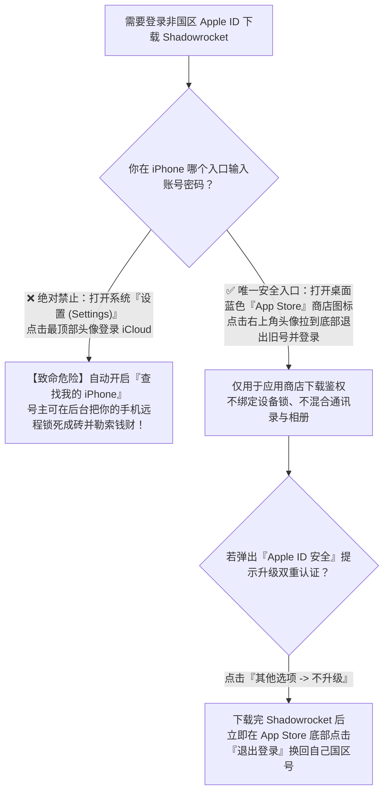

# iPhone 小火箭添加订阅教程：App Store 切区安全红线与 Shadowrocket 规则配置

## 核心结论（Answer-First）

在 iPhone 与 iPad（iOS / iPadOS）上配置 **Shadowrocket（俗称「小火箭」）**，必须在动手前死守一条不可妥协的安全铁律：**获取海外区应用时，绝对禁止在 iOS「系统设置」顶部的 iCloud 处登录任何他人共享的 Apple ID，严防「查找我的 iPhone」远程恶意锁机敲诈！**完成安全安装后，标准配置仅需四步：第一，确认机场支持第三方订阅（排除 8 家纯专属端品牌）；第二，点击小火箭右上角 `+` 号，将类型 explicitly 切换为 **`Subscribe`（订阅）** 后粘贴如 `https://sub.example.invalid/api/v1/client/subscribe?token=REDACTED` 的远端链接；第三，将首页「全局路由」锁定为**「配置（Config）」**以启用国内外智能分流；第四，通过「连通性测试」避开超时与 `0B` 节点，并掌握 iOS 系统 VPN 描述文件一键移除回滚流程。

---

## 一、适用系统与 iOS 客户端生态边界

本教程适用于运行 **iOS 15 / iOS 16 / iOS 17 / iOS 18 及对应 iPadOS 版本** 的 iPhone 与 iPad 设备。

由于 Apple 对中国大陆区（CN）App Store 的合规管理，所有具备跨境代理功能的通用客户端均仅在**非中国大陆区（如美国 US、中国香港 HK、日本 JP、新加坡 SG 等区服）App Store** 上架。根据本站 `data/clients.json` 审计清单（详见[Shadowrocket 与 iOS 客户端专题](/clients/shadowrocket/)与[移动端 VPN 与代理专题](/vpn/mobile/)），iOS 平台主流工具的协议与付费属性对比如下：

### 1.1 iOS / iPadOS 主流代理客户端协议兼容性与资料库警告表

| 客户端名称 | 核心与配置风格 | 定价与分发渠道（据 `data/clients.json`） | 协议兼容性与官方资料库核心警告 |
| :--- | :--- | :--- | :--- |
| **[Shadowrocket（小火箭）](/clients/shadowrocket/)** | 自研引擎（支持通用订阅、Clash 订阅与 `.conf` 规则模块） | 海外区 App Store 付费买断应用（实际售价以所属区服为准，美区常为 $2.99） | **iOS 普及率最高**。支持 VLESS（含 Reality）、Shadowsocks、Trojan、VMess、Hysteria 2、AnyTLS 等几乎全量协议；**切勿用共享账号登 iCloud**。 |
| **Stash** | Clash 兼容内核（原生支持 Clash YAML 与策略组覆写） | 海外区 App Store 付费应用（以所属区服为准） | 适合已在 Windows/macOS 使用 [Clash Verge Rev](/clients/clash-verge/) 并希望在 iPhone 上 100% 沿用同一套 Clash YAML 规则集的用户。 |
| **Quantumult X（圈 X）** | Quantumult X 引擎 | 海外区 App Store 付费应用（以所属区服为准） | 适合需要精细请求重写（Rewrite）、JS 脚本与自定义 DNS 的进阶用户；订阅通常需专用格式或转换。 |
| **Surge 5** | Surge 引擎 | App Store 下载，含高阶应用内购买（以区服及官网为准） | 定位 Apple 生态专业网络抓包与高级网络调试。 |
| **Karing / Hiddify / [sing-box (SFI)](/clients/sing-box/)** | `sing-box` 内核 | App Store（上架情况及地区限制以用户所属 App Store 地区为准） | Karing 与 Hiddify 对多订阅格式自动识别友好；原生 `sing-box (SFI)` 通常要求订阅提供或转为 `sing-box JSON` 格式。 |
| **Streisand** | Xray / sing-box 兼容 | 海外区 App Store（具体区服状态待核实） | 支持 VLESS、VMess、Trojan、Hysteria 等现代协议。 |
| **Potatso / OneClick** | 传统基础代理引擎 | 海外区 App Store | **【协议兼容性警告】** `data/clients.json` 明确提示：**Potatso 仅支持 Shadowsocks/SSR/SOCKS/HTTP(S) 等传统协议，不支持 VLESS 与 Hysteria 2**；**OneClick 仅标注支持 VMess/SS/Trojan**。若你购买的是纯 VLESS 机场（如[微风网络](/brands/weifeng/)、[无忧链接](/brands/wuyou/)、[闪电鼠](/brands/shandianshu/)等），导入 Potatso 会直接刷不出节点！ |

---

## 二、准备事项：切区安全铁律与订阅前置核查

在打开 Shadowrocket 之前，请务必逐条核对以下两项生命线级别的准备事项：

### 2.1 【最高安全红线】Apple ID 切区下载时的「禁登 iCloud 防锁机铁律」

许多新手为了省下注册外区 Apple ID 或购买 $2.99 正版软件的步骤，会在淘宝、拼多多、电报群或某些机场后台复制所谓的「免费共享美区 Apple ID」。**这是整个 iOS 代理使用中最容易导致财产重大损失的高危雷区！**



> **安全边界图说明**：上图清晰界定了 iOS 系统「设置（iCloud 系统级绑定）」与「App Store（仅商店下载鉴权）」的安全隔离边界。

- **标准最佳实践**：强烈建议自行使用个人邮箱注册一个独立的美国区或香港区 Apple ID，并通过苹果官网购买正规 App Store 礼品卡（Gift Card）兑换余额后自行购入正版 Shadowrocket。这样既拥有永久正版更新权限，又 100% 杜绝他人控制风险。
- **如果不慎已经在「系统设置 -> 顶部 iCloud」登录了陌生账号怎么办（紧急回滚）**：**立即在还能操作时点击系统设置底部「退出登录（Sign Out）」，输入密码关闭「查找我的 iPhone」**；切勿在未退出陌生 iCloud 账号的情况下重启手机或等待过夜！

### 2.2 核实所购机场是否支持 Shadowrocket 通用订阅

对照本站[31 家机场品牌数据库](/brands/)：
1. **检查是否为纯专属客户端品牌**：如[飞猫云](/brands/feimao/)、[无忧链接](/brands/wuyou/)（2026-10 起）、[Firefly](/brands/firefly/)（2026-10 起）、[灵猫网络](/brands/lingmao/)（2026-10 起）、[SOGO云](/brands/sogo/)、[闪跃](/brands/shanyue/)、[全球云](/brands/quanqiu/)、[隐形人](/brands/yinxingren/)等 8 家品牌在资料中明确标注不提供第三方订阅链接（或仅用专属客户端）。对于这类品牌，需核实其官方是否提供 iOS 端专属安装方案，无法直接导出订阅链接给 Shadowrocket。
2. **支持 Shadowrocket 订阅的品牌**：如[光速云](/brands/guangsuyun/)（明确列出支持 Shadowrocket 与 Clash 系列）、[微风网络](/brands/weifeng/)、[星岛梦](/brands/xingdaomeng/)、[二猫云](/brands/ermao/)、[唯兔云](/brands/weitu/)、[U1S1](/brands/u1s1/)、[极连云](/brands/jilian/)、[光年梯](/brands/guangnian/)、[一翻云](/brands/yifan/)、[可信云](/brands/kexin/)、[速界](/brands/sujie/)、[梯子云](/brands/tiziyun/)等，均可直接复制订阅链接导入小火箭。

---

## 三、实际操作：五步在 iPhone Shadowrocket 中添加订阅与配置分流规则

在开始添加订阅前，请先确保 iPhone 当前的旧 VPN 开关处于**关闭状态**，且系统「设置 -> 通用 -> 日期与时间」已开启**「自动设置」**。

### 步骤 1：从机场后台获取脱敏规范的订阅 URL（推荐手动复制，慎用网页一键跳转）

在 Safari 浏览器中登录你购买的机场后台面板：
- 找到「订阅中心 / 一键导入」区域，点击 **「复制 Shadowrocket 订阅链接」** 或 **「复制通用订阅链接」**（注：新版 Shadowrocket 同样原生支持直接解析绝大多数机场的 `Clash` 订阅链接，并会自动提取其中的节点列表与剩余流量信息）。
- 复制到剪贴板的地址结构应类似于下方脱敏示例（**切勿把包含你私人 Token 的链接发到任何第三方在线订阅转换网页**）：

```text
https://sub.example.invalid/api/v1/client/subscribe?token=REDACTED
```

*(提示：许多机场后台有一个「一键导入 Shadowrocket」按钮，它利用的是 `shadowrocket://add/sub://...` URL Scheme 跳转。但在部分第三方浏览器或微信内置浏览器中该跳转经常失效报错，因此**直接复制 HTTPS 订阅链接到小火箭内手动粘贴是最稳妥、成功率 100% 的标准做法**。)*

### 步骤 2：在 Shadowrocket 中选择 `Subscribe` 类型添加订阅

1. 打开 **Shadowrocket** 应用，在底部导航栏停留在第一个标签页 **「首页 (Home)」**。
2. 点击屏幕**右上角的「`+`（加号）」**，进入「添加节点」页面。
3. **最关键的一步**：点击第一行的 **「类型 (Type)」**（默认往往显示为 `Shadowsocks` 或 `VMess`），在弹出的类型列表最上方，点击选中 **`Subscribe`（订阅）**！
4. 返回上一层后，表单会变为仅含三个核心输入框：
   - **URL**：长按并粘贴刚才复制的 `https://sub.example.invalid/api/v1/client/subscribe?token=REDACTED`。
   - **备注 (Remarks)**：输入机场名称与套餐到期时间（例如 `光速云-月付168G`）。
   - **过滤器 (Filter)**：保持留空（除非你想用正则表达式屏蔽某些特定倍率或地区的节点）。
5. 点击**右上角的「保存（Save / 完成）」**。此时小火箭会自动通过直连网络请求该订阅地址，1–3 秒后首页下方就会展开完整的服务器节点列表，并显示「已用流量 / 总流量」及到期时间条。

### 步骤 3：配置订阅自动更新策略（防过期与防 WAF 封禁）

为了避免节点 IP 变更后手动更新繁琐，点击小火箭底部导航栏最右侧的 **「设置 (Settings)」** → 向下滑动找到 **「订阅 (Subscribe)」** 栏：
- 开启 **「打开时更新（Update on Open）」**（当你手动点开小火箭 App 界面时自动拉取最新节点）；
- 可按需开启 **「自动后台更新（Auto Background Update）」**；
- 确保 **「通过代理更新（Update via Proxy）」处于关闭状态**（绝大多数机场的订阅分发域名在国内可直连访问；若开启通过代理更新，一旦你当前选中的旧节点失效，就会陷入「节点挂了 → 无法通过节点更新订阅 → 拿不到新节点」的死循环，详见[订阅更新超时排查](/troubleshooting/articles/sub-tls-dns-timeout)）。

### 步骤 4：将首页「全局路由」锁定为 `配置 (Config)` 并更新自定义分流规则

返回 Shadowrocket **「首页」**，查看顶部的第二行 **「全局路由 (Global Routing)」**，这是决定你国内 App 会不会卡顿、套餐流量会不会被国内视频偷跑的核心开关：

| 全局路由选项 | 对应的代理分流逻辑 | 日常使用建议与风险说明 |
| :--- | :--- | :--- |
| **`配置 (Config)`** | 规则分流模式（相当于 Clash 的 `Rule`） | **【日常必须锁定此项】** 严格按照「配置」标签页中激活的规则文件（如 `default.conf`），让微信、抖音、淘宝、国内网银走 `DIRECT`（直连），仅海外被墙域名与 IP 走 `PROXY`（代理）。 |
| **`代理 (Proxy)`** | 全局代理模式（相当于 Clash 的 `Global`） | **仅限临时排障测试**。会将国内所有 App 流量也强行送往境外节点，导致国内加载变慢、网银触发异地登录拦截、且飞快耗尽机场套餐流量。 |
| **`直连 (Direct)`** | 全部流量直接连公网，不走任何代理节点 | 仅在无需翻墙但又不想关 VPN 开关时使用。 |
| **`场景 (Scene)`** | 按不同 Wi-Fi SSID 或蜂窝移动网络自动切换路由配置 | 适合进阶用户设置「在公司内网 Wi-Fi 下自动直连，在蜂窝 5G 下自动走配置分流」。 |

**如何更新或导入广告拦截与精细分流规则模块（`配置 Config` 标签页）**：
1. 点击小火箭底部第二个标签页 **「配置 (Config)」**。
2. 点击本地默认配置文件 `default.conf` 右侧的 **`ⓘ` 图标** -> 点击 **「更新 GEOIP 数据库」**，确保内置的中国大陆 IP 段（CN IP）识别处于最新状态。
3. 如需针对 OpenAI（ChatGPT）、Claude、Gemini 设置独立分流，可在 `default.conf` 中点击「编辑配置 -> 规则」，将 `DOMAIN-SUFFIX,openai.com`、`DOMAIN-SUFFIX,chatgpt.com`、`DOMAIN-SUFFIX,claude.ai`、`DOMAIN-SUFFIX,gemini.google.com` 指向你指定的**日本（JP）、新加坡（SG）或美国（US）节点或策略组**（详见[Shadowrocket 导入订阅与分流规则异常修复](/troubleshooting/articles/shadowrocket-import-rules)）。

### 步骤 5：执行「连通性测试」并首次授权 iOS VPN 描述文件

1. 回到小火箭 **「首页」**，点击中间的 **「连通性测试（Connectivity Test）」**。
   - **小贴士**：推荐在「设置 -> 测试方法」中将测试方式设为 **`CONNECT` 或 `URLTest (http://www.gstatic.com/generate_204)`**，不要选 `ICMP`，以便真实测试端到端代理隧道（详见[节点延迟低下载速度就快吗](/routes/articles/low-ping-vs-download-speed)）。
2. 在测出绿色毫秒数的节点中，点选一个 `1x` 倍率的香港、新加坡或日本节点（前面出现小黄点）。
3. 拨动最顶部的 **「未连接 (Not Connected)」总开关**。
4. **首次授权弹窗**：iOS 系统会弹出系统级确认框：「**“Shadowrocket”想添加 VPN 配置**」，点击 **「允许 (Allow)」**，并通过 Face ID / Touch ID 或锁屏密码验证。验证通过后，开关变为蓝色已连接，iPhone 状态栏或控制中心顶部显示 `VPN` 标识。

---

## 四、成功验证：在 iPhone 上确认国内外分流与 AI 节点正常

连接成功后，请按以下三步在 iPhone 上完成闭环验证（详细原理可参阅同集群文章[如何确认客户端分流与 DNS 设置已经生效](/guides/articles/verify-proxy-is-working)）：

1. **验证国内 App 直连不受影响**：打开微信发一条消息，或打开高德地图/淘宝，确认加载秒开，且不会弹出任何「异地登录」或「网络异常」提示。
2. **验证海外网页与流媒体代理生效**：打开 Safari 浏览器访问 `https://www.google.com` 或打开 YouTube App，确认视频正常加载（注意：若你购买的品牌在部分节点存在 YouTube 送中记录，如[光速云](/brands/guangsuyun/) 2026-08-19 实测中部分新加坡/台湾节点或[无忧链接](/brands/wuyou/) 2026-07-18 实测中的 `HKG-01` 节点显示 `送中(CN)`，可在小火箭列表里切换至其他未送中节点，详见[YouTube 送中自检](/ai-media/youtube/)）。
3. **使用小火箭内置「代理日志」精确核查命中规则**：
   - 点击小火箭底部第三个标签页 **「数据 (Data)」** -> 点击 **「代理日志 (Proxy Log) / 启用日志记录」**。
   - 刷新一下网页再回来看日志，你能清晰看到每一条域名请求后面标着 **`DIRECT`（国内直连）** 还是 **`PROXY`（走了具体哪个节点）**。验证完毕后记得随手关闭日志记录以节省 iPhone 内存。

---

## 五、常见错误与 iOS 网络异常回滚步骤（应急必存）

由于 iOS 系统对后台 NetworkExtension 扩展有极为严苛的 **15MB–50MB 内存硬上限（Memory Limit）**，一旦导入了体积过大的广告拦截规则集或开启了冲突设置，可能会导致小火箭后台进程被 iOS 系统静默强杀，进而引发 **「顶部 VPN 图标还在，但整部 iPhone 无论是微信还是 Safari 全部断网」** 的故障。

### 5.1 高频报错对照表

| 常见故障现象 | 根本技术原因 | 标准修复方法 |
| :--- | :--- | :--- |
| **点击更新订阅弹窗报错 `HTTP 403 / 503` 或 `Request timed out`** | 1. 开着已经失效的旧代理节点去更新订阅；2. 机场前端开启了 Cloudflare 防护盾拦截了默认 UA；3. 套餐已到期或 Token 已重置（详见[订阅 HTTP 状态码排障](/troubleshooting/articles/sub-http-401-403-404-503)）。 | 先关掉小火箭顶部的 VPN 总开关；在 `设置 -> 订阅 -> User-Agent` 中尝试切换 UA；切换 5G 蜂窝网络与家庭 Wi-Fi 对比测试。 |
| **用了一会儿突然全手机断网，微信一直显示「连接中...」** | 1. 导入了超大第三方去广告 `.conf` 规则集撑爆了 iOS NetworkExtension 内存上限导致内核崩溃；2. 当前选中的节点变成了 `0B` 死节点。 | 在「配置」页点击原厂 `default.conf` 选择「恢复默认配置」，卸载臃肿的数万条去广告重写模块；切换到其他编号节点。 |
| **能刷 YouTube 和网页，但 ChatGPT App 或 Gemini 打不开** | 当前选中的是**香港（HK）节点**（如光速云实测香港节点 OpenAI 多为 `仅APP(HK)`、Gemini 多为 `失败`），或者节点 IP 被 Google 判为送中。 | 将节点手动切换至**日本（JP）、美国（US）或未送中的新加坡（SG）节点**，清理一下 Safari 网站缓存或重开 AI App（详见[ChatGPT 排障](/ai-media/chatgpt/)）。 |

### 5.2 紧急回滚步骤：30 秒将 iPhone 网络 100% 还原至出厂直连状态

如果你在折腾小火箭的「按需连接（On Demand）」「TUN / UDP 转发」或「DNS 覆写」后，发现**即使在小火箭里关掉了开关，iPhone 依然上不了网（或者关掉开关 2 秒后它又自己弹回开启状态）**，请按以下三步彻底回滚：

1. **第一步：关闭「按需连接（Connect On Demand）」防止自动死灰复燃**
   - 打开 Shadowrocket -> 点击底部 **「设置 (Settings) -> 按需连接 (On Demand)」** -> 将 **「按需连接」开关彻底关闭**。
2. **第二步：在 iOS 系统设置中移除损坏的 VPN 配置描述文件（核心回滚动作）**
   - 打开 iPhone 桌面的 **「系统设置 (Settings)」** -> 点击 **「通用 (General)」** -> 向下滑点击 **「VPN 与设备管理 (VPN & Device Management)」** -> 点击 **「VPN」**。
   - 在 VPN 配置列表中找到 **「Shadowrocket」**，点击其右侧的蓝色 **`ⓘ`（信息图标）**。
   - 点击最底部的红色字 **「删除 VPN (Delete VPN)」** 并确认删除。
   - **效果**：此操作只会移除 iOS 系统网络层挂载的虚拟网卡钩子，**绝对不会删除你在小火箭 App 内部已经导入的机场订阅和节点列表**！下次你想重新使用时，只需打开小火箭拨动开关，系统会重新生成一份干净健康的 VPN 描述文件。
3. **第三步：刷新 iOS 系统 DNS 缓存与重置配置（终极兜底）**
   - 删除 VPN 描述文件后，下拉 iPhone 右上角控制中心，**打开「飞行模式」等待 5 秒后再关闭**，即可彻底清空 iOS 系统的本地 DNS 缓存。
   - 若小火箭内部的 `default.conf` 规则被改坏，进入小火箭底部「配置 (Config)」标签页，点击底部的 **「恢复默认配置 (Restore Default Config)」** 即可一键还原。

---

## 六、常见问题（FAQ）

### 为什么在 iPhone 上下载 Shadowrocket（小火箭）时，绝对不能在系统「设置」顶部的 iCloud 登录别人提供的共享 Apple ID？

这是 iOS 用户最核心的设备安全铁律。一旦你在 iPhone「系统设置（Settings）」最顶部的 Apple ID / iCloud 栏登录了来路不明的共享账号，该账号就会自动绑定「查找我的 iPhone（Find My）」。不法分子可在后台随时将你的手机标记为「丢失模式（Lost Mode）」并远程锁死成砖头，进而弹出一串联系方式向你敲诈数百至上千元解锁费。安全做法是自己注册美区/港区 Apple ID 并用官方礼品卡购买；即便临时借用账号，也只允许在桌面蓝色的「App Store 应用商店」内部登录，且下载完立刻退出。

### 在 Shadowrocket 里点击右上角「+」号添加订阅时，为什么粘贴了链接却提示无效或保存不了？

90% 的原因是忘记把第一行的「类型（Type）」从默认的某种单节点协议（如 Shadowsocks 或 VMess）切换为「Subscribe（订阅）」！Shadowrocket 点击加号后，必须先点第一行「类型」，在列表最上方选中「Subscribe」，然后再把订阅 URL 粘贴到下方的「URL」栏、填写「备注（Remarks）」后点击右上角保存，才能拉取整组节点列表。

### 小火箭首页的「全局路由（Global Routing）」里有配置、代理、直连、场景四个选项，日常应该选哪一个？

日常 99% 的时间都必须选择「配置（Config）」，这相当于桌面端 Clash 的「规则模式（Rule）」，小火箭会按照下方配置文件的分流规则实现国内微信、淘宝、高德地图直连，仅海外网站走代理；如果误选了「代理（Proxy）」，则相当于全局模式（Global），会让国内所有 App 都绕道境外节点，不仅导致国内视频卡顿、手机发烫耗电，还会飞快扣光机场套餐流量。

### 同样是 iPhone 代理软件，Potatso、OneClick 与 Shadowrocket、Stash、Quantumult X 有什么协议支持差异？

根据本站 `data/clients.json` 审计资料，Shadowrocket、Stash、Quantumult X（圈 X）、Surge、Streisand、Karing 与 sing-box（SFI）均对现代主流协议有良好适配；而免费的传统工具 Potatso 仅支持 Shadowsocks/SSR/SOCKS/HTTP(S) 等老协议，完全不支持 VLESS 与 Hysteria 2；OneClick 资料标注支持 VMess/SS/Trojan，在使用主打 VLESS 或 Hysteria 2 的机场（如微风网络、无忧链接、一翻云等）前必须先核实协议兼容性。

### 开启小火箭或修改了里面的 DNS / 按需连接（On Demand）后，关闭开关发现 Safari 连百度都打不开，怎么快速回滚？

这是因为 iOS 系统的 NetworkExtension 虚拟网卡进程卡死，或者开启了「按需连接」导致关掉开关后又被系统后台自动拉起。只需两步即可 100% 回滚：第一，进入小火箭「设置 -> 按需连接」将其彻底关闭；第二，打开 iPhone「系统设置 -> 通用 -> VPN 与设备管理 -> VPN」，找到 Shadowrocket 点击右侧「ⓘ」号，选择「删除 VPN」，再开关一次 iPhone 飞行模式即可立即恢复纯净直连。

---

## 七、关联阅读与延伸排障入口

- **返回上级专题**：[机场订阅教程：三大格式原理、专属端限制与安全导入](/guides/subscriptions/) ｜ [Shadowrocket 与 iOS 代理客户端专题](/clients/shadowrocket/)
- **同集群实操教程**：
  - [Windows 代理客户端配置教程：从校时、导入订阅到 Rule 模式与 TUN 切换](/guides/articles/windows-proxy-client-setup)
  - [Android 如何导入订阅与防杀后台：v2rayNG / FlClash / Karing 实操](/guides/articles/android-import-subscription-guide)
  - [如何确认客户端分流与 DNS 设置已经生效：三项可验证检查路径](/guides/articles/verify-proxy-is-working)
- **小火箭专项排障**：
  - [Shadowrocket 导入订阅与分流规则异常修复指南](/troubleshooting/articles/shadowrocket-import-rules)
  - [订阅返回 HTTP 200 但节点列表为空排查](/troubleshooting/articles/sub-http-200-empty)
  - [套餐流量耗尽、订阅过期与陈旧节点缓存区分](/troubleshooting/articles/quota-expired-vs-stale-config)
