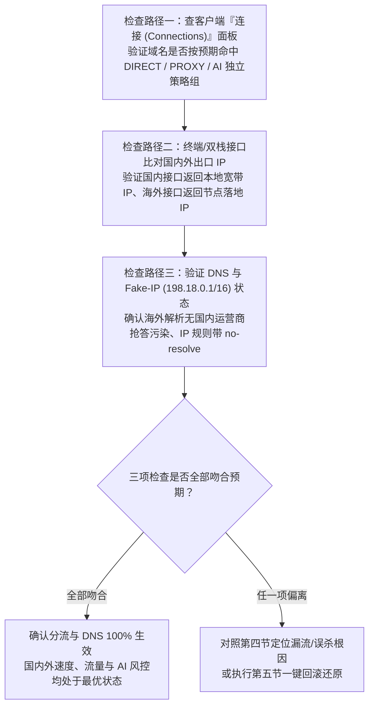

# 怎么确认代理分流设置生效：国内外 IP、客户端规则日志与 DNS/Fake-IP 三项可验证检查路径

## 核心结论（Answer-First）

判断代理客户端的**分流规则（Split Routing）**与 **DNS 防污染配置**是否真正生效，绝不能仅凭「能不能打开 Google」这一单一表象，而必须验证**「国内流量 100% 直连不漏流、海外流量精准命中目标策略组、域名解析零本地污染」**三大闭环。最可靠的标准工程验证法包含**三项可重复检查路径**：第一，通过客户端**「连接（Connections）/ 代理日志」面板**实时审查域名命中的规则链（`DIRECT` vs `PROXY`）；第二，通过命令行或双栈探测接口同时核对**国内出口 IP（须为本地 ISP）与海外出口 IP（须为所选节点地区）**；第三，通过 `nslookup` 与无 `no-resolve` 排查确认 **`Fake-IP (198.18.0.1/16)` 或远端 DNS** 已接管解析。一旦验证发现误杀或死锁，应立即执行覆写剥离与 DNS 缓存刷新回滚。

---

## 一、适用系统与需要验证分流的核心场景

本指南适用于 **Windows 10/11、macOS（Intel / Apple Silicon）、Linux、Android 与 iOS/iPadOS** 全平台主流规则代理客户端，包括 **[Clash Verge Rev](/clients/clash-verge/)、FlClash、Clash Nyanpasu、Clash Mi、[Clash Meta for Android](/clients/clash-meta/)、[v2rayN](/clients/v2rayn/)、v2rayNG、Karing、Hiddify、[sing-box](/clients/sing-box/) 以及 [Shadowrocket（小火箭）](/clients/shadowrocket/) / Stash / Quantumult X**。

在以下四种典型场景下，你必须执行一次完整的分流与 DNS 生效验证（详见[分流规则配置总览](/guides/split-routing/)与[DNS 与 Fake-IP 配置教程](/guides/dns-setup/)）：

1. **刚导入新机场订阅或刚切换客户端模式（如从系统代理切到 TUN 模式）后**：防止因客户端误处于 `Global（全局）` 模式，导致国内下载或看 B 站/抖音在后台疯狂消耗你的机场套餐流量（尤其是带有 `2x–5x` 倍率的专线节点，详见[线路倍率与测速耗流解析](/routes/multipliers/)）。
2. **为 ChatGPT / Claude / Gemini 单独配置了 AI 独立分流规则后**：由于香港节点普遍存在 OpenAI `仅APP(HK)` 或 Gemini `失败` 的地区限制（详见本站[光速云](/brands/guangsuyun/) 2026-08-19 归档实测证据），你需要确认访问日常网页时走的是低延迟香港节点，而访问 AI 域名时真的被准确分流到了日本、新加坡或美国节点。
3. **遇到「大部分外网能上，唯独某几个特定网站打不开或特别慢」时**（详见[特定网站打不开排障](/troubleshooting/articles/specific-sites-unreachable)）。
4. **开启代理后出现「国内微信电脑版发不出图片、内网 NAS/打印机连不上、国内网银提示异常风险」时**（详见[Fake-IP 原理与局域网冲突修复](/troubleshooting/articles/fake-ip-explained-fix)）。

---

## 二、准备事项：执行验证前的三项基线核对

在开始三项验证路径前，请先花 30 秒确认客户端的基础状态处于标准基线，排除低级开关失误：

1. **确认出站模式为「规则模式」**：
   - 在 Clash Verge Rev / FlClash / Stash 中，确认选中了 **`Rule（规则）`**；
   - 在 Shadowrocket 中，确认首页「全局路由」选中了 **`配置（Config）`**；
   - 在 v2rayN / v2rayNG 中，确认路由模式选中了 **`绕过大陆（Bypass Mainland）`**。
2. **确认已关闭浏览器的干扰插件与独立安全 DNS（DoH）**：
   - 许多用户过去在 Chrome 或 Edge 里装过 `SwitchyOmega` 等代理扩展，如果扩展还处于启用状态，浏览器流量会被扩展强行劫持，根本不遵守你在客户端里改的开关（详见[跨客户端表现不一致排查](/troubleshooting/articles/cross-client-inconsistency)）。
   - 同时建议在验证期间使用浏览器的 **「无痕/隐私窗口（Incognito Window）」**，避免旧的浏览器 HSTS 或 DNS 缓存干扰验证结果。
3. **确认测试订阅配置已正常激活且当前节点非 `0B` 死节点**：
   - 确保你从脱敏示例 `https://sub.example.invalid/api/v1/client/subscribe?token=REDACTED` 拉取的 Profile 处于绿色激活态，且主策略组选中的节点已通过 `URLTest (generate_204)` 真连接延迟测试。

---

## 三、实际操作：三项可验证检查路径（从日志、出口 IP 到 DNS 全闭环）

下面我们按照网络请求在代理内核中的真实流转顺序（**域名嗅探/DNS 解析 → 规则表自上而下匹配 → 物理网卡/代理隧道出站**），执行三项 100% 可量化、可复现的验证检查。



> **验证路径图说明**：上图展示了从「内核规则匹配日志 → 双栈真实出口 IP → 底层 DNS/Fake-IP 解析」的三维交叉验证闭环。

---

### 检查路径一：通过客户端「实时连接面板（Connections）」核对规则命中链

这是所有排障工程师最直接、最权威的第一检查手段——**直接看代理内核自己打印的实时路由判定表**，无需借助任何外部网站。

#### 1. 操作步骤（以 Clash Verge Rev / FlClash / Web 面板为例）
1. 点击客户端左侧菜单的 **「连接 (Connections)」**（Shadowrocket 用户点击底部 `数据 -> 代理日志 -> 启用日志记录`；v2rayN 用户查看底部的 `日志输出` 窗口）。
2. 打开浏览器无痕窗口，依次打开以下四个代表不同分流层级的测试目标：
   - **目标 A（国内主流网站）**：访问 `https://www.baidu.com` 或 `https://www.bilibili.com`
   - **目标 B（局域网私有地址）**：访问你的路由器后台（如 `http://192.168.1.1`）或本地服务
   - **目标 C（常规海外网站）**：访问 `https://www.google.com` 或 `https://github.com`
   - **目标 D（海外 AI 平台）**：访问 `https://chatgpt.com` 或 `https://claude.ai`
3. 切回客户端「连接 (Connections)」面板，在顶部的**搜索过滤框**中分别输入上述域名，观察每一条连接记录的 **「规则 (Rule)」** 与 **「链路 (Chains)」**。

#### 2. 正确的「生效标准」对照表

| 测试访问目标 | 连接面板「规则 (Rule)」列预期显示 | 连接面板「链路 (Chains)」列预期显示 | 若显示异常代表什么故障？ |
| :--- | :--- | :--- | :--- |
| **A. 国内网站 (`bilibili.com`)** | `GeoSite(cn)` / `DOMAIN-SUFFIX,bilibili.com` / `RuleSet(cn)` | **`DIRECT`（直连）** | 若链路显示为某个海外节点名，说明 **国内分流失效（或处于 Global 全局模式）**，正在白白消耗机场套餐流量！ |
| **B. 局域网 (`192.168.x.x`)** | `IP-CIDR(192.168.0.0/16)` / `GeoIP(private)` | **`DIRECT`（直连）** | 若走到了代理节点，会导致局域网 NAS、打印机、投屏彻底连不上。 |
| **C. 海外常规站 (`github.com`)** | `GeoSite(github)` / `GeoSite(geolocation-!cn)` / `MATCH` | **`香港/新加坡主力节点 -> 主代理策略组`** | 若显示 `DIRECT`，说明该海外域名被漏判为直连，会因为连接超时而打不开。 |
| **D. AI 平台 (`chatgpt.com`)** | `GeoSite(openai)` / `DOMAIN-SUFFIX,chatgpt.com` / `RuleSet(AI)` | **`日本/美国/新加坡指定节点 -> AI 专属策略组`** | 若链路显示落在了 **香港（HK）节点**，会导致网页版 ChatGPT 被拒（`仅APP(HK)`）或 Gemini 报错地区不支持！ |

---

### 检查路径二：通过命令行比对「国内出口 IP」与「海外出口 IP」（零隐私泄漏只读测试）

看过了客户端内部面板后，我们再从**外部目标服务器的视角**，验证数据包真正到达公网时的源 IP 地址是否实现了「国内归国内、海外归海外、AI 归支持区」。

为什么不推荐随便百度搜一个充满弹窗广告的第三方「IP 查询网站」？因为很多第三方分流检测网页本身引用的脚本域名混乱，甚至会记录你的浏览器指纹。最干净、最准确的验证方式是在终端（Windows PowerShell 或 macOS/Linux Terminal）执行以下**只读 `curl` 三连测命令**：

```powershell
# 适用系统: Windows 10 / 11 (PowerShell)
# 目的: 依次通过本地代理端口 (示例为 127.0.0.1:7890，请按实际端口修改) 查询国内站点、海外通用站点与 OpenAI 边缘节点看到的真实出口 IP 及国家码
# 风险等级: 低（纯只读 HTTP 请求公开回显文本，不修改任何系统或客户端配置）

Write-Host "=== 1. 测试国内目标 (IPIP.net) 看到的出口 IP（预期：你家本地宽带的国内省市 IP） ==="
curl.exe -x http://127.0.0.1:7890 -s https://myip.ipip.net

Write-Host "`n=== 2. 测试海外通用目标 (ipinfo.io) 看到的出口 IP（预期：你当前选中的主力代理节点国家，如 HK/SG/JP） ==="
curl.exe -x http://127.0.0.1:7890 -s https://ipinfo.io/json | Select-String '"ip"|"country"|"org"'

Write-Host "`n=== 3. 测试 OpenAI 域名 (chatgpt.com) 看到的出口地区（预期：loc=JP/US/SG 等非 CN/HK 的支持区） ==="
curl.exe -x http://127.0.0.1:7890 -s https://chatgpt.com/cdn-cgi/trace | Select-String "ip=|loc=|colo="
```

*(注：macOS 与 Linux 用户请将 `curl.exe` 替换为 `curl`，将 `| Select-String ...` 替换为 `| grep -E "ip|country|org|loc|colo"`。)*

#### 输出结果的黄金判读标准：
1. **第一条输出（`myip.ipip.net`）**：
   - **必须返回**：`当前 IP：xxx.xxx.xxx.xxx 来自于：中国 某某省 某某市 电信/联通/移动`。
   - 这证明当请求发往 `.cn` 或国内 IP 段时，代理内核准确执行了 **`DIRECT` 直连分流**，完全没有绕道海外。
2. **第二条输出（`ipinfo.io/json`）**：
   - **必须返回**：`"country": "HK"`（或你当前选中的主力节点地区，如 `"SG"`、`"TW"`、`"JP"`），以及海外机房的 `"org"` 信息。
   - 这证明海外通用流量已经成功走通了你的**主力低延迟代理节点**。
3. **第三条输出（`chatgpt.com/cdn-cgi/trace`）**：
   - 重点看 **`loc=`** 这一行！如果你已经配置了 AI 独立分流规则（将 OpenAI 分流到日本或美国节点），即便你第二条主力节点显示 `"country": "HK"`，这第三条输出也应该显示 **`loc=JP`、`loc=US` 或 `loc=SG`**！
   - 如果第三条输出显示 `loc=HK` 或 `loc=CN`，说明你的 **AI 独立分流规则尚未生效（或者被排在前面的通用规则提前截胡了）**，直接打开 ChatGPT 或 Gemini 网页端就会遇到地区限制报错（详见[ChatGPT 地区不支持排障](/ai-media/chatgpt/)与[Gemini 地区失效排查](/ai-media/gemini/)）。

---

### 检查路径三：验证 DNS 解析与 `Fake-IP (198.18.0.1/16)` 防泄漏状态

很多用户会遇到一种诡异的现象：「前两项检查里 IP 分流明明看着对，为什么我用浏览器打开某些海外网站还是会跳反诈拦截页、或者连接速度慢得像蜗牛、或者看 YouTube 被莫名其妙『送中』？」

90% 的罪魁祸首是 **DNS 解析污染与 DNS 泄漏（DNS Leak）**（详见[DNS 劫持与泄漏修复指南](/troubleshooting/articles/dns-leak-hijack-fix)）。我们可以通过以下两步验证 DNS 配置是否真正生效：

#### 1. 在终端用 `nslookup` 验证 Fake-IP（针对开启了 TUN 模式的用户）

当你开启了客户端的 **TUN 模式（虚拟网卡）** 时，现代内核（Mihomo / sing-box / Shadowrocket TUN）默认采用 **`Fake-IP`（虚假 IP 映射）** 机制来彻底阻断本地 DNS 污染。

打开 Windows PowerShell（或 macOS/Linux 终端），执行以下只读域名解析命令：

```powershell
# 适用系统: Windows 10 / 11 (PowerShell)
# 目的: 在开启 TUN 模式下，测试系统默认 DNS 对海外被屏蔽域名与国内域名的解析返回值
# 风险等级: 低（纯只读 DNS 查询，不修改任何网络设置）
nslookup www.youtube.com
nslookup www.baidu.com
```

- **开启 TUN + Fake-IP 时的正确生效输出**：
  - 查询 `www.youtube.com` 时，返回的 `Address` 应该落在 **`198.18.0.x` 至 `198.19.255.255`** 网段内（例如 `198.18.0.25`）。看到 `198.18.x.x` 就说明 **Fake-IP 拦截已 100% 生效**——你的电脑根本没有向国内电信/移动运营商暴露你要访问 YouTube 的真实 DNS 查询，而是把域名直接塞进加密隧道交给了海外落地机解析！
  - 查询 `www.baidu.com`（或命中 `fake-ip-filter` 白名单的国内/局域网域名）时，如果配置了国内域名直连解析，则会返回真实的国内公网 IP，确保国内应用不受假 IP 干扰。
- **如果开启了 TUN 模式，查询 `www.youtube.com` 却返回了 `0.0.0.0`、`127.0.0.1` 或某个奇怪的 Facebook/黑洞 IP**：
  - 说明客户端的 **DNS 劫持（`dns-hijack`）尚未生效**，你的电脑仍然在绕过虚拟网卡、直接向国内运营商的 `114.114.114.114` 或光猫 DNS 发起明文查询并遭到了抢答污染！

#### 2. 在仅开启「系统代理（未开 TUN）」时核对 `no-resolve` 防泄漏

如果你只开了「系统代理（System Proxy）」而没开 TUN 模式，终端里的 `nslookup` 走的是系统网卡直连，不会走系统代理端口。此时要确认浏览器有没有发生 DNS 泄漏，只需回到**检查路径一的客户端「连接 (Connections)」面板**：
- 点击面板上的任意一条海外网站（如 `www.google.com` 或 `api.openai.com`）连接详情；
- 检查其 **「目标 IP (Destination IP)」** 是否为空、或者命中规则是否为 **`GeoSite / DOMAIN-SUFFIX`（纯域名规则直接送入代理，不在本地解析 IP）**。
- **核心排查点**：如果你的配置文件里把 `GEOIP,CN,DIRECT` 放在前面，且**忘记在末尾加上 `,no-resolve` 参数**，客户端为了判断 `google.com` 是不是中国 IP，就会被迫在本地发起一次 DNS 解析！因此，在客户端「配置/规则」中核查所有 `IP-CIDR` 与 `GEOIP` 规则末尾均带有 **`no-resolve`**，是确认 DNS 防泄漏生效的关键指标（详见[分流规则匹配顺序与 no-resolve 原理](/guides/split-routing/)）。

---

## 四、成功验证汇总表：一眼判断你的代理处于什么段位

完成以上三项检查后，你可以对照下表给自己的当前配置打分：

| 检查维度 | ✅ 完美生效状态（绿灯） | ⚠️ 半生效/亚健康状态（黄灯） | ❌ 分流失效/高危状态（红灯） |
| :--- | :--- | :--- | :--- |
| **1. 国内流量走向** | `Connections` 显示 `DIRECT`，`ipip.net` 返回本地宽带 IP | 部分国内冷门站或游戏更新误走代理节点 | 全部国内站走代理（误开 `Global` 全局模式，疯狂烧套餐流量） |
| **2. 海外常规流量走向** | `Connections` 显示命中主力低延迟 `1x` 节点，`ipinfo` 返回对应海外区 | 命中了 `2x–5x` 高倍率节点，或落入 `0B` 死节点打不开 | 显示 `DIRECT` 直连超时，或被浏览器插件劫持 |
| **3. AI / 流媒体专项分流** | `chatgpt.com/cdn-cgi/trace` 显示 `loc=JP/US/SG`，避开香港与送中节点 | 跟随主策略组走香港节点，导致 ChatGPT 仅 APP / Gemini 报错 | 开启了短间隔 `url-test` 让 AI 请求在多国 IP 间乱跳触发封号 |
| **4. DNS 与 Fake-IP 状态** | TUN 下海外域名返回 `198.18.x.x`，IP 规则全带 `no-resolve` | 浏览器开启了第三方 DoH 导致偶尔绕过客户端规则 | 明文 DNS 泄漏给本地运营商，触发抢答污染或 CDN 调度回流 |

---

## 五、常见错误与修改分流/DNS 后的紧急回滚步骤

许多用户在尝试自己编写自定义分流规则（Prepend Rules）、开启 Merge/Script 覆写脚本或修改 `dns:` 配置块后，最常遇到的错误就是：**语法缩进写错一个空格导致 Mihomo/sing-box 内核直接无法启动**，或者**误把 `MATCH` 兜底规则改成了 `REJECT` / 错误节点导致全网断流**（详见[Clash Verge / Mihomo YAML 配置解析失败修复](/troubleshooting/articles/clash-verge-mihomo-yaml-fail)）。

### 5.1 常见分流配置错误速查

1. **错误一：新增的自定义分流规则明明写对了，却死活不生效**
   - **原因**：代理规则遵循**「自上而下、命中即停（First-Match Wins）」**铁律！如果你把自己写的 `DOMAIN-SUFFIX,chatgpt.com,日本节点` 加在了配置文件的最底部（放在了 `MATCH,主代理组` 或大范围 `GEOSITE,geolocation-!cn,香港节点` 的**下面**），请求在上面就已经被通用规则截胡了，根本走不到你写的那一行。
   - **修复**：所有自定义特殊分流规则（无论走直连还是走特定国家节点），都必须使用 **前置规则（`prepend-rules`）** 放在规则列表的**最顶部**！
2. **错误二：关闭了 Fake-IP 或退出 TUN 模式后，原本访问过的网站突然全部打不开**
   - **原因**：在开启 Fake-IP 期间，你的操作系统或浏览器把 `github.com` 对应到了虚拟 IP `198.18.0.25` 并缓存在了本地内存中。当你关掉 TUN 或切换回 Redir-Host 模式后，`198.18.0.25` 失去了虚拟网卡的接收，但系统还在傻傻地往这个假 IP 发包。
   - **修复**：每次开关 Fake-IP 或 TUN 模式后，只需执行一次下方的 **刷新系统 DNS 缓存命令** 即可秒恢复。

### 5.2 标准化回滚步骤：30 秒剥离错误分流覆写并还原纯净网络

如果你在修改分流规则或 DNS 设置后导致网络异常，请严格按以下四步无损回滚，**切勿盲目重装系统或关闭杀毒软件**：

1. **第一步：停用自定义覆写（Merge / Script / Override）并还原原始订阅**
   - 打开 Clash Verge Rev / FlClash / Stash 的 **「订阅 (Profiles)」** 页面；
   - 将你刚才开启的自定义 `Merge`（扩展配置）或 `Script`（覆写脚本）右键点击 **「停用 (Disable)」**；
   - 右键点击机场原始订阅卡片，选择 **「更新 (Update)」**，让客户端重新从远端拉取一份未经本地篡改的原厂规则配置。
2. **第二步：退回最稳妥的「系统代理 + Rule 模式」基准**
   - 在客户端设置中先**关闭「TUN 模式」**，仅保留 **「系统代理 (System Proxy)」**，并将出站模式重新点回 **`Rule（规则）`**。
3. **第三步：在终端一键清空残留的 Fake-IP 与系统 DNS 缓存（必做）**
   - 根据你的操作系统，复制执行对应的安全只读/清理命令：

```powershell
# 适用系统: Windows 10 / 11 (PowerShell 或 CMD)
# 目的: 【回滚清理】清空 Windows 本地缓存的 Fake-IP (198.18.x.x) 及陈旧 DNS 记录，迫使系统重新发起真实解析
# 风险等级: 低（系统内置标准缓存刷新指令，零副作用）
ipconfig /flushdns
```

```bash
# 适用系统: macOS (Terminal 终端)
# 目的: 【回滚清理】刷新 macOS 系统级 DNS 缓存并重启 mDNSResponder 服务
# 风险等级: 低（系统标准 DNS 缓存清理）
sudo dscacheutil -flushcache && sudo killall -HUP mDNSResponder
```

4. **第四步：清理浏览器内部 Socket 池与 DNS 缓存**
   - 如果终端已经恢复正常，但 Chrome / Edge 浏览器里个别标签页还卡在旧状态，无需清空你的浏览器账号密码——只需在浏览器地址栏输入 `chrome://net-internals/#dns`（或 `edge://net-internals/#dns`）点击 **`Clear host cache`**，再切换到左侧 `#sockets` 点击 **`Flush socket pools`**，刷新网页即可立即恢复。

---

## 六、常见问题（FAQ）

### 为什么我已经能正常打开 Google 和 YouTube 了，还要专门验证「分流与 DNS 设置」是否生效？

因为「能打开外网」不等于「分流正确」！如果客户端误处于 Global（全局）模式，或者分流规则顺序写反，你的微信、B站、淘宝、Steam 国区下载也会全部绕道境外节点，不仅导致国内网银触发异地风控、看国内视频卡顿，更会在几小时内把昂贵的机场套餐流量（尤其是 2x–5x 高倍率节点流量）偷跑殆尽；反过来，若 DNS 分流未生效导致发生 DNS 泄漏，海外 CDN 则会把你调度到错误国家甚至触发 YouTube 送中。

### 在 Clash Verge Rev 或 FlClash 的「连接（Connections）」面板里，怎么看一条请求到底走没走代理？

点开左侧「连接（Connections）」面板，在顶部搜索框输入你正在访问的域名（如 `baidu.com`、`github.com` 或 `chatgpt.com`），重点看该行记录的「规则（Rule）」和「链路（Chains）」两列：若显示 `GeoSite(cn) -> DIRECT` 或 `GeoIP(CN) -> DIRECT`，代表已正确走本地宽带直连；若显示 `GeoSite(geolocation-!cn) -> 节点名称 -> 代理组`，代表已正确通过指定代理节点出站。

### 在终端运行 `nslookup www.google.com` 时，返回了 `198.18.0.x` 这样奇怪的 IP，是不是中毒或被劫持了？

不是中毒，这恰恰说明你的 TUN 模式或 Fake-IP 增强模式已经完美生效！`198.18.0.0/15`（常见为 `198.18.0.1/16`）是 IETF 专门保留用于网络基准测试的虚拟地址段。Mihomo（Clash.Meta）与 sing-box 内核利用该网段实现 Fake-IP 机制：当本地应用请求域名时，内核立刻秒回一个 `198.18.x.x` 假 IP 骗过应用直接发包，随后内核把原始域名直接带到海外落地节点去解析，从而根除本地 DNS 污染并大幅降低网页首屏延迟。

### 为什么我的分流规则明明写了海外走代理，但在浏览器里测试却发现部分海外网站还是直连或者打不开？

常见原因有三个：第一，Chrome 或 Edge 浏览器开启了自带的「安全 DNS（DoH）」或安装了第三方代理扩展（如 SwitchyOmega），绕过了客户端的本地 DNS 与系统代理端口；第二，分流规则中的 `GEOIP,CN,DIRECT` 没有加 `no-resolve` 参数，导致海外域名在本地触发了被污染的 DNS 解析并误命中直连；第三，客户端本地的 GeoIP / GeoSite 数据库（`.mrs` 或 `.dat`）损坏或过于陈旧。

### 修改分流覆写（Override）或 DNS 配置后，发现国内微信发不出图、网银打不开甚至全盘断网，怎么一键回滚？

首先在客户端「订阅（Profiles）」界面关掉刚启用的自定义 Merge 扩展配置或 JavaScript 覆写脚本，点击原始机场订阅卡片重新激活；其次在客户端设置中关闭 TUN 模式并关闭系统代理；最后在终端执行 `ipconfig /flushdns`（Windows）或 `dscacheutil -flushcache`（macOS）清空被 Fake-IP 污染的本地 DNS 缓存，即可在 15 秒内还原至初始正常状态。

---

## 七、关联阅读与延伸排障入口

- **返回上级专题**：[分流规则配置指南：匹配顺序、防误杀与 AI 独立分流](/guides/split-routing/) ｜ [DNS 与 Fake-IP 配置教程](/guides/dns-setup/)
- **同集群实操教程**：
  - [Windows 代理客户端配置教程：从校时、导入订阅到 Rule 模式与 TUN 切换](/guides/articles/windows-proxy-client-setup)
  - [Android 如何导入订阅与防杀后台：v2rayNG / FlClash / Karing 实操](/guides/articles/android-import-subscription-guide)
  - [iPhone 如何添加订阅与切区安全红线：Shadowrocket 实操](/guides/articles/iphone-shadowrocket-add-sub)
- **深度排障专题**：
  - [Fake-IP 原理详解及局域网/微信/游戏冲突修复](/troubleshooting/articles/fake-ip-explained-fix)
  - [DNS 泄漏、污染与劫持检测及修复方案](/troubleshooting/articles/dns-leak-hijack-fix)
  - [特定网站打不开（其余正常）的分流与 DNS 排查](/troubleshooting/articles/specific-sites-unreachable)
  - [同一订阅在不同客户端表现不一致的原因排查](/troubleshooting/articles/cross-client-inconsistency)
