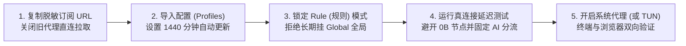

# Windows 代理客户端配置教程：从系统校时、导入订阅到 Rule 模式与系统代理/TUN 切换

## 核心结论（Answer-First）

在 Windows 10 与 Windows 11 系统上配置代理客户端，标准工程路径应遵循**「五步递进、随时可回滚」**原则：第一步，核对系统 CPU 架构（`x64` vs `ARM64`）并执行 **NTP 系统时钟同步**（误差须控制在 `30 秒` 以内）；第二步，确认机场服务商交付模式（区分通用订阅与专属客户端），在开源客户端中以 **HTTPS 远端配置方式导入订阅** 并设置 `24 小时+` 更新间隔；第三步，将代理出站模式锁定为 **`Rule`（规则分流）** 并通过真连接测试（URLTest）避开 `0B` 死节点；第四步，日常网页优先启用低侵入的**「系统代理」**，仅在终端或游戏场景按需启用**「TUN 虚拟网卡模式」**；第五步，掌握注册表代理清理与 DNS 缓存刷新回滚命令，**全程严禁关闭 Windows Defender 与系统防火墙**。

---

## 一、适用系统与客户端环境边界

本教程适用于运行 **Windows 10（1903 及以上版本）** 与 **Windows 11（21H2 / 22H2 / 23H2 / 24H2）** 的台式机与笔记本电脑。根据本站 `data/clients.json` 客户端资料库审计（详见[客户端大全与选型指南](/clients/)与[客户端安装教程](/guides/installation/)），Windows 平台当前主流客户端分为两大阵营：

### 1.1 Windows 主流通用开源客户端对比矩阵

| 客户端名称 | 底层代理内核 | 核心优势与适用场景 | 站内资料库维护与环境注意项 |
| :--- | :--- | :--- | :--- |
| **[Clash Verge Rev](/clients/clash-verge/)** | `Mihomo (Clash.Meta)` | 界面直观、规则分流强大、支持服务模式（Service Mode）一键开启 TUN，适合绝大多数新手与进阶桌面用户。 | 界面依赖微软 **Edge WebView2 Runtime**；精简版 Win10 若缺失会导致白屏（详见[启动白屏排查](/troubleshooting/articles/clash-verge-startup-fail)）。 |
| **FlClash**（见 [Mihomo 专题](/clients/mihomo/)） | `Mihomo` | 采用 Flutter 跨平台 UI，在 Windows 与 Android 上界面操作逻辑高度统一，内存占用温和。 | 下载时注意区分 Windows `amd64 (x64)` 与 `arm64` 安装包。 |
| **[v2rayN](/clients/v2rayn/)** | `Xray / sing-box` 多核心 | 节点批量管理、多协议（VLESS / Shadowsocks / Hysteria 2 / Trojan）兼容性与底层日志调试极强。 | 依赖 **.NET Desktop Runtime**；下载时务必选择含核心完整包（With-Core），避免报[核心加载失败](/troubleshooting/articles/v2rayn-core-load-fail)。 |
| **Hiddify / Karing**（见 [sing-box 专题](/clients/sing-box/)） | `sing-box` | 支持多种订阅格式自动识别与跨全平台（Win/Mac/iOS/Android）统一配置。 | 适合需要在桌面端与移动端无缝同步 sing-box 路由规则的用户。 |
| **Clash Nyanpasu / Clash Mi** | `Mihomo / 多内核` | Clash Nyanpasu 强化了 Merge/Script 脚本配置链；Clash Mi 提供简洁跨平台 YAML 支持。 | 适合熟悉标准 Clash YAML 规则体系的用户。 |
| **Mihomo Party** | `Mihomo` | 具备配置与分流管理功能。 | **【维护状态警告】** `data/clients.json` 明确提示：应单独关注其项目维护状态，不宜未经核实就作为新手首选主力客户端，多用于历史教程排障或迁移场景。 |

> **渠道防伪声明**：本站严格遵守零虚构 URL 准则，所有开源客户端的 `officialUrl` 在未经独立核实前均标为「待核实（官方 GitHub 发布渠道）」。用户下载时切勿点击搜索引擎顶部的竞价推广广告站或来历不明的网盘破解包。

---

## 二、准备事项：配置前必做的三项低风险前置检查

90% 的新手在 Windows 上遇到「软件打不开」「订阅拉不下来」「节点全红超时」，其实都发生在导入订阅之前。动手配置前，请先花 2 分钟完成以下三项前置准备：

### 2.1 检查一：确认本机架构并规范解压/安装路径

1. **确认处理器架构**：绝大多数 Intel 酷睿与 AMD 锐龙电脑均为 `x64`（即 `amd64`）；仅搭载高通骁龙（Snapdragon X Elite/Plus）的 Windows 笔记本需选择 `arm64` 版本。
2. **便携版（Portable ZIP）解压铁律**：如果你下载的是免安装 `.zip` 便携版（如 v2rayN 或 Clash Verge Rev Portable），**绝对禁止在压缩包预览窗口里直接双击 `.exe` 启动**，也**不要把绿色便携版直接解压到需要管理员特权才能写入的 `C:\Program Files\` 目录**！
   - **正确做法**：在 `D:\Tools\ClashVerge\` 或 `C:\Users\<你的英文用户名>\Apps\v2rayN\` 等**纯英文、无空格、无特殊符号且当前用户拥有完整读写权限**的文件夹中完整解压后再运行。

### 2.2 检查二：校准 Windows 系统时钟（防范 TLS 证书与协议鉴权失败）

无论是通过 HTTPS 拉取机场订阅，还是连接 `VLESS`、`Trojan`、`Hysteria 2` 节点，客户端与服务器都会核对 UTC 时间戳。一旦你的 Windows 电脑系统时间比标准时间快或慢超过 **60 秒**（常见于台式机主板 CMOS 电池没电，或刚从 Linux/macOS 双系统切换回 Windows），连接就会立刻失败（详见[系统时间不同步导致证书报错与节点连不上](/troubleshooting/articles/time-sync-tls-cert-error)）。

打开 Windows PowerShell，执行以下只读命令查看当前时间与时区状态：

```powershell
# 适用系统: Windows 10 / 11 (PowerShell)
# 目的: 查看当前系统本地时间、UTC 时间及 Windows 时间服务状态，排查双系统时区偏移
# 风险等级: 低（纯只读查询，不修改系统设置）
Get-Date; [System.TimeZoneInfo]::Local.DisplayName; w32tm /query /status
```

- **校准操作**：如果发现时间不准，右键点击 Windows 任务栏右下角的时间 -> 选择 **「调整日期和时间」** -> 确保时区设为 **`(UTC+08:00) 北京，重庆，香港特别行政区，乌鲁木齐`** -> 开启「自动设置时间」并点击下方的 **「立即同步」**。

### 2.3 检查三：确认所购机场是否提供「第三方通用订阅链接」

在去机场后台复制订阅链接前，请先对照本站[31 家机场品牌数据库](/brands/)核实该品牌的客户端策略：
- **仅限专属客户端（不提供第三方订阅链接）的品牌**：如[飞猫云](/brands/feimao/)、[无忧链接](/brands/wuyou/)（2026年10月起）、[Firefly](/brands/firefly/)（2026年10月起）、[灵猫网络](/brands/lingmao/)（2026年10月起）、[SOGO云](/brands/sogo/)、[闪跃](/brands/shanyue/)、[全球云](/brands/quanqiu/)、[隐形人](/brands/yinxingren/)。如果你购买的是这类品牌，直接下载其官方专属客户端用账号密码登录即可，无需也无法导入 Clash Verge Rev 或 v2rayN。
- **支持通用订阅导入的品牌**：如[光速云](/brands/guangsuyun/)、[微风网络](/brands/weifeng/)、[星岛梦](/brands/xingdaomeng/)、[二猫云](/brands/ermao/)、[唯兔云](/brands/weitu/)、[U1S1](/brands/u1s1/)、[极连云](/brands/jilian/)、[光年梯](/brands/guangnian/)、[一翻云](/brands/yifan/)、[可信云](/brands/kexin/)、[速界](/brands/sujie/)、[梯子云](/brands/tiziyun/)等，请在官网仪表盘点击「一键导入 Clash」或「复制通用订阅链接」。

---

## 三、实际操作：五步完成 Windows 代理客户端标准配置

下面以 Windows 桌面端最常用的 **Clash Verge Rev / FlClash（Mihomo 内核代表）** 与 **v2rayN（Xray/sing-box 多核心代表）** 为例，演示从导入订阅到分流上网的完整标准操作。



> **配置流程图说明**：上图为 Windows 代理客户端从订阅导入到网络接管的五步标准工作流。

### 步骤 1：以直连状态安全导入订阅链接（Profiles / 订阅分组）

在导入新订阅前，**务必先确认客户端当前的「系统代理」和「TUN 模式」处于关闭状态**（避免通过已经失效的旧代理节点去下载新订阅，造成「代理套娃死锁」超时，详见[订阅链接超时排查](/troubleshooting/articles/sub-tls-dns-timeout)）。

假设你从机场后台复制的订阅链接格式如下（**注意：切勿将包含真实 Token 的订阅链接发到公开论坛或第三方在线订阅转换网站**）：

```text
https://sub.example.invalid/api/v1/client/subscribe?token=REDACTED
```

1. **在 Clash Verge Rev / FlClash 中导入**：
   - 点击左侧导航栏的 **「订阅 (Profiles)」**。
   - 在顶部输入框中粘贴上述订阅 URL，或者点击 **「新建 (New)」**，将类型设为 `Remote（远端配置）`：
     - **名称（Name）**：填写易于识别的品牌名与到期日（如 `主力机场-202612到期`）。
     - **订阅链接（Subscription URL）**：粘贴 `https://sub.example.invalid/api/v1/client/subscribe?token=REDACTED`。
     - **User-Agent（可选但关键）**：默认留空或设为 `clash.meta` / `mihomo`（这样机场面板才会下发完整的 `VLESS`、`Hysteria 2`、`AnyTLS` 等现代协议节点；若误设为老旧的 `ClashForWindows`，面板可能会过滤掉现代协议，详见[机场订阅格式与 UA 原理](/guides/subscriptions/)）。
     - **自动更新间隔（Update Interval）**：填写 **`1440`（分钟，即 24 小时）** 或 `2880`（48 小时）。**切忌设为 15 分钟或 30 分钟**，高频请求极易触发机场前端 Cloudflare 防火墙拦截导致返回 HTTP 403/429（详见[订阅 HTTP 401/403/404/503 修复](/troubleshooting/articles/sub-http-401-403-404-503)）。
   - 点击保存并点击卡片选中该配置（确保卡片边框亮起激活状态）。
2. **在 v2rayN 中导入**：
   - 点击顶部菜单栏 **「订阅分组 (Subscription Group) -> 订阅分组设置」** -> 点击「添加」。
   - 填入别名与订阅地址 `https://sub.example.invalid/api/v1/client/subscribe?token=REDACTED`，保存后点击顶部 **「订阅分组 -> 更新当前订阅（不通过代理）」**。

### 步骤 2：锁定「规则模式（Rule）」与理解三大出站模式

点击客户端左侧的 **「代理 (Proxies)」**（v2rayN 用户查看底部状态栏的路由模式），你会看到三种核心出站模式（详见[Clash 配置模式与策略组教程](/guides/clash-setup/)）：

- **`Rule`（规则模式 —— 日常 99% 场景必须锁定此项）**：客户端根据订阅自带的分流规则表（`GEOSITE,cn` / `GEOIP,CN`），让国内网站（微信、淘宝、B站、网银、Steam 国区下载）走本地宽带 **`DIRECT`（直连）**，仅将被阻断的海外网站（Google、GitHub、YouTube、AI 平台）送入代理节点。既保证国内网速不降，又节省宝贵的机场套餐流量。
- **`Global`（全局模式 —— 仅限排障临时使用，用完即关）**：不分国内外，把所有经过代理端口的流量强行发往同一个海外节点。长期开启会导致国内网页极慢、网银触发异地风控报警、且国内看视频飞快耗光机场流量。
- **`Direct`（直连模式）**：所有流量不走代理直接出站，相当于临时暂停翻墙。

### 步骤 3：执行「真连接延迟测试（URLTest）」并选定节点

在「代理 (Proxies)」界面展开主节点选择组：
1. 点击右上角的 **「延迟测试（闪电或 Wi-Fi 图标）」**。这会通过代理隧道向 `http://www.gstatic.com/generate_204` 或 `https://cp.cloudflare.com/generate_204` 发送极轻量的 `HTTP 204` 空响应请求，几乎不消耗流量。
2. **避开两类问题节点**：
   - **避免盲信排第一的最低延迟死节点**：如本站实测图揭示，个别节点可能出现入口握手仅 `16ms` 但实际无下行流量的 `0B` 故障（如光速云 08-11 图中的 `HK 02` 或宇宙云 08-11 图中的 `香港 01`）。如果选了某个绿字节点却打不开网页，立即换同地区的 `03`、`04` 等相邻编号节点（详见[已连接但无法上网排查](/troubleshooting/articles/connected-no-internet)）。
   - **看清节点后缀倍率**：留意节点名称末尾是否有 `2x`、`3x`、`5x` 倍率标记，日常主策略组优先选择 **`1x`（1 倍率）** 的香港、台湾、新加坡或日本节点。
3. **AI 策略组独立指向非香港节点**：如果订阅中包含专门的 `OpenAI / ChatGPT / AI / Gemini` 策略组，请将该子策略组手动固定到**日本（JP）、新加坡（SG，避开送中节点）或美国（US）节点**，不要让 AI 流量走香港节点（避免触发 OpenAI `仅APP(HK)` 或 Gemini 地区报错）。

### 步骤 4：开启「系统代理（System Proxy）」或按需切换「TUN 模式」

选好节点后，代理内核只是在本地 `127.0.0.1:7890`（或 `7897`、`10808`）端口等待连接，你还需要在客户端「设置 (Settings)」中打开流量接管开关（详见[TUN 模式与系统代理的核心区别](/troubleshooting/articles/tun-vs-system-proxy)）：

| 接管方式 | 工作原理与系统改动范围 | 适用人群与场景 | 开启建议 |
| :--- | :--- | :--- | :--- |
| **系统代理 (System Proxy)** | 修改当前 Windows 用户的注册表 `Internet Settings\ProxyServer`，通知 Chrome / Edge / 微信等主流桌面软件主动把流量发给本地代理端口。 | **90% 日常办公、浏览器查资料、看流媒体视频、网页版 AI 对话。** | **新手默认只开这一项即可**，最稳定、不装虚拟网卡驱动、随开随关。 |
| **TUN 模式 (虚拟网卡)** | 调用 `Wintun` / `sing-tun` 在 Windows 网络连接中创建一张三层虚拟网卡，通过系统路由表在底层拦截机器所有 TCP/UDP IP 数据包。 | **命令行开发（Git/WSL/终端）、不走系统代理的桌面软件（Telegram 默认/Adobe/特定外服游戏）。** | 需先在客户端设置中安装并启用 **Service Mode（服务模式）** 或以管理员权限启动（详见[TUN 模式教程](/guides/tun-mode/)）。 |

> **安全边界警告**：在安装客户端 Service Mode 或首次开启系统代理/TUN 时，如果 Windows Defender 防火墙弹出「Windows 安全中心警报：是否允许 mihomo.exe / xray.exe 通过专用和公用网络通信」，请勾选 **「专用网络」和「公用网络」并点击「允许访问」**。**绝不要听信任何非官方教程去关闭 Windows Defender 病毒和威胁防护或禁用整个系统防火墙！**

---

## 四、成功验证：两项只读检查确认 Windows 代理已正常接管

开启「系统代理」后，不要只凭感觉去刷网页。打开 Windows PowerShell，运行以下两条零风险只读命令，10 秒即可确认配置是否 100% 成功：

```powershell
# 适用系统: Windows 10 / 11 (PowerShell)
# 目的: 1. 查询 Windows 注册表当前系统代理开关 (ProxyEnable) 与端口 (ProxyServer)；2. 验证国内外分流是否同时正常工作
# 风险等级: 低（纯只读查询注册表与 HTTP 状态码，不改动任何配置）
Get-ItemProperty -Path "HKCU:\Software\Microsoft\Windows\CurrentVersion\Internet Settings" | Select-Object ProxyEnable, ProxyServer
```

1. **核对注册表输出**：
   - 当你在客户端打开「系统代理」时，上方命令应输出 `ProxyEnable : 1`，且 `ProxyServer` 显示为客户端监听地址（如 `127.0.0.1:7890` 或 `127.0.0.1:7897`）。
2. **核对客户端实时日志（Connections / 连接面板）**：
   - 打开浏览器分别访问一个国内网站（如 `https://www.baidu.com`）和一个海外网站（如 `https://www.google.com`）。
   - 切回客户端左侧的 **「连接 (Connections)」** 面板：你应该能看到国内域名对应的规则链末尾显示 **`DIRECT`（直连）**，而 `google.com` 对应的规则链末尾显示你刚才选中的**海外节点名称**（更详细的分流与 DNS 生效验证方法，请继续阅读同集群文章[如何确认客户端分流与 DNS 设置已经生效](/guides/articles/verify-proxy-is-working)）。

---

## 五、常见错误与高风险操作回滚步骤（应急必存）

在 Windows 上使用代理客户端，最怕遇到的高风险故障就是：**关闭软件或卸载软件后，整台电脑突然连百度、微信等所有国内网站都打不开了（浏览器报错 `ERR_PROXY_CONNECTION_FAILED` 或 `代理服务器拒绝连接`）**，或者开启 TUN 模式后网络彻底死锁。

以下为您提供完整的常见错误对照与 **30 秒紧急回滚还原命令**：

### 5.1 高频配置错误速查表

| 常见错误现象 | 根本技术原因 | 标准修复动作 |
| :--- | :--- | :--- |
| **导入订阅提示 `YAML syntax error` 或 `invalid configuration`** | 误把纯 v2ray `Base64` 节点订阅当成 Clash YAML 导入了不支持自动转换的客户端，或者机场订阅链接已过期返回了 HTML 报错页（详见[YAML 解析失败修复](/troubleshooting/articles/clash-verge-mihomo-yaml-fail)）。 | 在机场官网复制明确标注「Clash / Mihomo 专用」的订阅链接，或换用支持全格式识别的客户端；在无痕浏览器直连测试订阅是否返回 200 正常文本。 |
| **客户端已开系统代理，但浏览器还是打不开任何外网** | 浏览器安装了第三方代理扩展（如 SwitchyOmega / 某购物比价插件）抢占了浏览器的代理控制权，或者 v2rayN 底部状态栏选在了「清除系统代理」。 | 打开浏览器 `edge://settings/system` 或 `chrome://settings/system`，检查「打开计算机的代理设置」上方是否提示「正由其他扩展程序控制」，停用冲突插件（详见[v2rayN 系统代理失效排查](/troubleshooting/articles/v2rayn-system-proxy-fail)）。 |
| **开启 TUN 模式后微信发不出图、局域网打印机/NAS 连不上** | Fake-IP 虚拟 IP 池（`198.18.0.1/16`）拦截了企业内网或微信特定长连接域名，或 TUN 严苛路由（`strict-route`）阻断了局域网网段（详见[Fake-IP 原理与冲突修复](/troubleshooting/articles/fake-ip-explained-fix)）。 | 先关闭 TUN 模式退回「系统代理」测试；若必须用 TUN，在 DNS 设置的 `fake-ip-filter` 中补齐局域网与微信白名单（详见[DNS 与 Fake-IP 配置教程](/guides/dns-setup/)）。 |

### 5.2 紧急回滚步骤：一键清除残留系统代理与重置 Windows 网络栈

如果你因为客户端崩溃闪退、强制关机或开启 TUN 模式报错导致 Windows 无法上网，请严格按以下**从轻到重**的三级回滚步骤将系统 100% 还原至纯净直连状态：

1. **第一级回滚（图形界面 5 秒还原）**：
   - 若客户端还能打开：在客户端设置中先关闭 **「TUN 模式」**，再关闭 **「系统代理」**，然后正常右键托盘图标点击「退出 (Quit)」。
   - 若客户端已卸载或打不开：按 `Win + I` 打开 Windows 系统设置 -> 点击 **「网络和 Internet」** -> 点击 **「代理 (Proxy)」** -> 在「手动设置代理」栏下，将 **「使用代理服务器」开关拨到「关 (Off)」** 并点击保存。
2. **第二级回滚（PowerShell 命令行强制清除注册表代理残留与刷新 DNS）**：
   - 打开 Windows PowerShell，直接复制执行以下命令，强制把系统代理开关置为 `0` 并清空污染的本地 DNS 缓存：

```powershell
# 适用系统: Windows 10 / 11 (PowerShell)
# 目的: 【回滚命令】强制关闭当前用户的 Windows 注册表系统代理开关，清空残留代理地址并刷新系统 DNS 缓存
# 风险等级: 低（仅将当前用户代理设置恢复为系统默认直连状态，不影响任何业务文件）
Set-ItemProperty -Path "HKCU:\Software\Microsoft\Windows\CurrentVersion\Internet Settings" -Name ProxyEnable -Value 0
Set-ItemProperty -Path "HKCU:\Software\Microsoft\Windows\CurrentVersion\Internet Settings" -Name ProxyServer -Value ""
ipconfig /flushdns
Write-Host "系统代理已成功回滚关闭，DNS 缓存已刷新！"
```

3. **第三级回滚（针对 TUN 虚拟网卡卡死或 WinHTTP 全局残留的管理员重置）**：
   - 如果执行完第二级回滚后，命令行或部分软件仍然断网，检查「控制面板 -> 网络和共享中心 -> 更改适配器设置」中是否还残留有名为 `Meta`、`Clash` 或 `sing-tun` 的虚拟网卡。以**管理员身份**打开 PowerShell 执行以下系统网络栈重置并重启电脑（详见[TUN 模式不生效与断网修复](/troubleshooting/articles/tun-not-working)）：

```powershell
# 适用系统: Windows 10 / 11 (需以管理员身份运行 PowerShell)
# 目的: 【深度回滚】重置 WinHTTP 系统级代理与 Winsock 目录，彻底清除虚拟网卡异常路由残留（执行后需重启电脑生效）
# 风险等级: 中（重置系统网络套接字状态，重启后物理网卡将恢复出厂默认直连路由）
netsh winhttp reset proxy
netsh winsock reset
ipconfig /flushdns
```

---

## 六、常见问题（FAQ）

### Windows 电脑配置代理客户端前，为什么要先检查系统时间是否准确？

现代代理协议（如 VLESS-TLS、VLESS-Reality、Trojan、Hysteria 2）以及订阅链接的 HTTPS 接口均严格依赖 TLS 证书时间戳校验。当 Windows 系统时间因主板电池亏电或双系统时区冲突导致偏差超过 60–90 秒时，不仅拉取订阅会报 TLS 握手错误，连接节点也会全部超时返回 0B。

### 为什么在 Clash Verge Rev 或 v2rayN 里粘贴订阅链接后提示解析失败，或者买完机场根本找不到订阅地址？

首先核查该机场是否属于「仅限官方专属客户端」品牌（据站内数据库，飞猫云、无忧链接 2026-10 起、Firefly 2026-10 起、灵猫网络 2026-10 起、SOGO云、闪跃、全球云、隐形人等不提供第三方通用订阅链接，只能登录其官方客户端使用）；若确认提供订阅仍解析失败，多为订阅格式不匹配（如把 Base64 链接当本地 YAML 文件导入）或开启了旧代理套娃拉取订阅。

### 日常使用 Windows 代理客户端时，应该开「系统代理（System Proxy）」还是「TUN 模式（虚拟网卡）」？

90% 的日常浏览器上网、看流媒体与办公场景，只需开启「系统代理（System Proxy）」即可，它通过修改 Windows Internet 选项注册表工作，无需管理员特权且兼容性最好；只有当你需要代理不遵循系统代理设置的命令行终端（Git/Docker/SSH）、UWP 应用或 PC 独立客户端游戏时，才需要开启「TUN 模式」。

### 看到教程说打不开客户端或开启 TUN 失败时要「彻底关闭 Windows Defender 杀毒软件和防火墙」，可以照做吗？

绝对不可以。任何要求用户彻底关闭 Windows Defender 实时保护或系统防火墙的操作都具有极高安全风险。官方开源客户端（如 Clash Verge Rev、FlClash、v2rayN）在核对 SHA256 校验值无误后，均可在开启系统防护的前提下正常运行；若启用 TUN 模式需要网络权限，只需在客户端内按规范安装服务模式（Service Mode）并在 Windows 防火墙弹窗中勾选允许通信即可。

### 关闭代理客户端或电脑异常蓝屏重启后，发现国内网页也全部打不开（提示代理服务器拒绝连接），怎么快速回滚恢复？

这是因为客户端非正常退出时未能自动清除 Windows 注册表中的系统代理残留（`ProxyEnable` 仍为 `1`，将所有流量指向已关闭的 `127.0.0.1:7890`）。只需重新打开客户端并正常关闭一次「系统代理」开关，或者在系统设置「网络和 Internet -> 代理」中将「使用代理服务器」手动关掉，再执行 `ipconfig /flushdns` 即可立即恢复直连。

---

## 七、关联阅读与延伸排障入口

- **返回上级专题**：[客户端安装教程：Win x64/ARM64、macOS 芯片区分与安全渠道](/guides/installation/)
- **同集群实操教程**：
  - [如何确认客户端分流与 DNS 设置已经生效：三项可验证检查路径](/guides/articles/verify-proxy-is-working)
  - [Android 如何导入订阅与防杀后台：v2rayNG / FlClash / Karing 实操](/guides/articles/android-import-subscription-guide)
  - [iPhone 如何添加订阅与切区安全红线：Shadowrocket 实操](/guides/articles/iphone-shadowrocket-add-sub)
- **客户端与排障专题**：
  - [Clash Verge Rev 客户端专题](/clients/clash-verge/) ｜ [v2rayN 客户端专题](/clients/v2rayn/)
  - [Clash Verge Rev 无法启动与 WebView2 白屏排查](/troubleshooting/articles/clash-verge-startup-fail)
  - [v2rayN 核心加载失败修复](/troubleshooting/articles/v2rayn-core-load-fail)
  - [v2rayN 系统代理不生效与浏览器扩展冲突修复](/troubleshooting/articles/v2rayn-system-proxy-fail)
