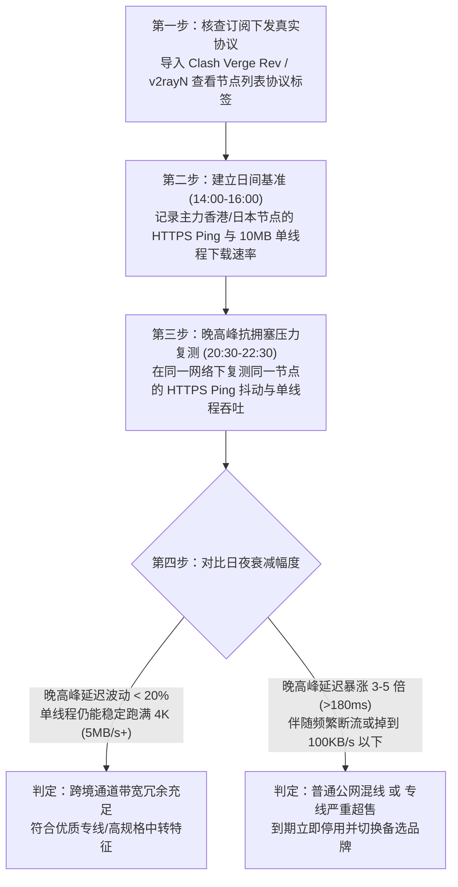

# 如何识别虚假与未经验证的专线宣传：比对 2026-10-19 趋同表与 0B/晚高峰实测证据

## 核心结论（Answer-First）

在跨境代理市场中，「IEPL/IPLC 专线」「晚高峰零丢包」「2Gbps 独享带宽」「全原生住宅 IP」已成为几乎所有商家的标配宣传词，但其中大量宣称属于**未经验证的商业包装（Unverified Vendor Claims）**。识别虚假或夸大专线宣传的核心方法论有四条：第一，**拒绝采信无截图、无工具、无时间戳的纯文本测速表格**（如原始资料中 15 家品牌数值高度雷同的 `2026-10-19` 非晚高峰表格）；第二，**核对「宣传文案协议」与「真实测速图/订阅下发协议」是否自相矛盾**；第三，**严格区分「凌晨/午间低峰快照」与「20:30–22:30 晚高峰实测」**；第四，**警惕缺乏节点清单、无任何实测证据且规格高度复制的超低价年付同质盘**。

---

## 一、概念定义：什么是「已实测证据（Measured）」与「未经验证宣传（Vendor / Unverified）」？

为什么许多用户看了网上的「机场评测软文」或商家落地页后，满怀期待地买下「顶级 IEPL 专线套餐」，一到晚上 9 点却卡得连网页都刷不出来？根本原因在于：绝大多数推广文章把**商家自己编写的营销文案（Vendor Data）**直接当成了**客观事实（Measured Fact）**呈现给读者。

在本站[测试方法论与证据分级规范](/methodology)中，我们对所有线路、带宽与解锁数据实行严格的四级证据隔离。要识破未经验证的专线宣传，首先需要掌握这套证据分级标尺：

### 1.1 四级证据可信度标尺

| 证据等级标识 | 判定标准与必备要素 | 在本站品牌库中的典型实例 | 选购参考权重 |
| :--- | :--- | :--- | :--- |
| **1. 实验室/本地实测 (`measured`)** | 具备本地归档的**原始测速或解锁截图**（如 `MAI-TEST-BOT` 或 `Miaoko` 原图），图内清晰记录测试工具版本、运营商后端（如珠海联通 5G/9G、广西移动、长沙电信、河北联通）、实际协议及逐节点明细（含 `0B` 或 `送中` 瑕疵）。 | 2026-08-11 批次 15 家入库品牌截图、[微风网络](/brands/weifeng/) `2026-07-19` 原图、[无忧链接](/brands/wuyou/) `2026-07-18` 双图、[光速云](/brands/guangsuyun/) `2026-08-19` 三网与流媒体 5 图。 | **最高（核心核验依据）**，但仍须注意单次快照的测试时段局限。 |
| **2. 历史归档记录 (`historical`)** | 来自早期归档（如 `2026-08-09` 历史档案），曾有文字测试摘要或历史价格表，但缺乏近 30 日最新原图、部分套餐截图遮挡或当前入口有效性待复核。 | [灵动云](/brands/lingdong/)（含 2026-07-20/21 站长文字测试摘要，定制流量截图遮挡）、[浪网](/brands/langwang/)、[边缘节点 EdgeNova](/brands/edgenova/)。 | **仅作历史档案对比**，严禁在不复核当前状态下直接盲买。 |
| **3. 商家/资料声明 (`vendor`)** | 仅来源于品牌宣传文案、推广清单介绍或**无原始截图支撑的文本表格**（如「晚高峰 0 丢包」「2000Mbps 带宽」「完美解锁」及 `2026-10-19` 五地文本测速表）。 | 全部 31 家品牌的套餐定价、线路名称宣称（IEPL/IPLC），以及 [Firefly](/brands/firefly/)、[暮光加速](/brands/muguang/)、[闪跃](/brands/shanyue/) 等无独立实测图品牌的文本参数。 | **低（必须先打问号）**，需用户以最小月付自行验证后方可采信。 |
| **4. 待核实 / 数据缺失 (`unverified`)** | 原始资料中明确留空、标注「—」、协议未明或前后严重冲突的字段。 | [隐形人](/brands/yinxingren/)（10-19 测速表全为 `—`）、[榴莲云](/brands/liulianyun/)（协议未统一提供）、[宇宙云](/brands/yuzhou/)（当期套餐待补充）。 | **零权重（风险警示项）**。 |

---

## 二、技术原理与审计拆解：虚假或夸大专线宣传的四大典型破绽

通过对站内收录的 31 家独立品牌原始资料、19 张 `speedtests/` 测速图与 5 张 `evidence/` 专项图进行交叉比对（完整清单见[品牌深度评测目录](/reviews/)与[机场排行榜数据口径说明](/airport/airport-ranking/)），我们总结出未经验证的专线宣传最常露出的四个技术破绽。

### 2.1 破绽一：无截图、无工具说明且跨品牌「高度趋同」的文本测速表

在《32家机场品牌清单.txt》原始资料中，有 **15 家品牌**附带了一份标注为 `测速（2026-10-19 原文标注，非晚高峰）` 的五地（香港、台湾、新加坡、日本、美国）文本表格。很多不明就里的新手看到表格里写着「香港 22ms / 529Mbps」，就会以为这是实验室严谨测出来的专线实力。

然而，当我们把这 15 家品牌的 `2026-10-19` 表格数据放在同一张审计表里横向比对时，惊人的规律浮现了：

| 品牌名称与线路定位宣称 | 10-19表：香港 (延迟/带宽) | 10-19表：台湾 (延迟/带宽) | 10-19表：新加坡 (延迟/带宽) | 10-19表：日本 (延迟/带宽) | 10-19表：美国 (延迟/带宽) |
| :--- | :--- | :--- | :--- | :--- | :--- |
| **[光速云](/brands/guangsuyun/)**（宣称 IEPL/IPLC 双线路） | `22ms / 529Mbps` | `41ms / 114Mbps` | `46ms / 387Mbps` | `57ms / 135Mbps` | `143ms / 18Mbps` |
| **[飞猫云](/brands/feimao/)**（明确标**非顶级专线定位**） | `21ms / 526Mbps` | `41ms / 116Mbps` | `45ms / 413Mbps` | `54ms / 138Mbps` | `178ms / 14Mbps` |
| **[微风网络](/brands/weifeng/)**（宣称 IEPL 专线） | `25ms / 546Mbps` | `40ms / 115Mbps` | `43ms / 384Mbps` | `54ms / 131Mbps` | `167ms / 17Mbps` |
| **[星岛梦](/brands/xingdaomeng/)**（宣称 IEPL 专线） | `27ms / 504Mbps` | `41ms / 103Mbps` | `44ms / 411Mbps` | `57ms / 136Mbps` | `177ms / 18Mbps` |
| **[无忧链接](/brands/wuyou/)**（未标专线，主打直连/无倍率） | `23ms / 531Mbps` | `41ms / 107Mbps` | `42ms / 418Mbps` | `55ms / 147Mbps` | `145ms / 17Mbps` |
| **[二猫云](/brands/ermao/)**（正文写**少了新加坡**，表格却有） | `22ms / 481Mbps` | `41ms / 118Mbps` | **`46ms / 407Mbps`** | `53ms / 143Mbps` | `134ms / 17Mbps` |
| **[唯兔云](/brands/weitu/)**（宣称 IPLC 专线） | `27ms / 500Mbps` | `37ms / 100Mbps` | `44ms / 414Mbps` | `56ms / 147Mbps` | `179ms / 17Mbps` |
| **[Firefly](/brands/firefly/)**（宣称 IPLC 专线，无任何实测图） | `27ms / 547Mbps` | `39ms / 135Mbps` | `42ms / 445Mbps` | `57ms / 147Mbps` | `143ms / 30Mbps` |
| **[暮光加速](/brands/muguang/)**（宣称 BGP 调度，无实测图） | `26ms / 509Mbps` | `40ms / 107Mbps` | `43ms / 419Mbps` | `53ms / 150Mbps` | `160ms / 19Mbps` |
| **[U1S1](/brands/u1s1/)**（宣称 IPLC 2000Mbps 带宽） | `24ms / 538Mbps` | `39ms / 107Mbps` | `46ms / 414Mbps` | `57ms / 133Mbps` | `134ms / 20Mbps` |
| **[灵猫网络](/brands/lingmao/)**（明确标**中转优化线路**） | `22ms / 492Mbps` | `40ms / 109Mbps` | `46ms / 409Mbps` | `57ms / 147Mbps` | `164ms / 19Mbps` |
| **[一翻云](/brands/yifan/)**（宣称全节点 IEPL 2Gbps 0丢包） | `23ms / 477Mbps` | `40ms / 117Mbps` | `42ms / 390Mbps` | `53ms / 136Mbps` | `180ms / 20Mbps` |
| **[SOGO云](/brands/sogo/)**（宣称 IEPL 专线） | `22ms / 521Mbps` | `39ms / 119Mbps` | `45ms / 402Mbps` | `55ms / 142Mbps` | `156ms / 18Mbps` |
| **[闪跃](/brands/shanyue/)**（宣称 IPLC 纯专线，无实测图） | `23ms / 548Mbps` | `38ms / 110Mbps` | `44ms / 383Mbps` | `53ms / 144Mbps` | `143ms / 18Mbps` |
| **[全球云](/brands/quanqiu/)**（宣称 IPLC/IEPL 2Gbps+） | `25ms / 489Mbps` | `37ms / 117Mbps` | `45ms / 430Mbps` | `55ms / 133Mbps` | `138ms / 18Mbps` |

**专业审计揭示的三大异常点**：
1. **数值窄幅高度抱团**：不管该品牌宣称的是「2Gbps 物理 IEPL 专线」「企业级 IPLC」，还是明确标注「中转优化线路（灵猫网络）」「非顶级专线定位（飞猫云）」，15 家品牌的香港延迟全都死死卡在 **`21–27ms`**、带宽全部卡在 **`477–548Mbps`**；日本延迟全部卡在 **`53–57ms`**、带宽全部卡在 **`131–150Mbps`**；美国带宽全部卡在 **`14–30Mbps`**。在真实的跨境网络中，15 家不同机房、不同架构的机场绝不可能在五个地区同时测出如此整齐划一的区间。
2. **内部自相矛盾铁证**：最典型的是 **[二猫云](/brands/ermao/)**——其介绍正文明确写道：「节点覆盖香港、日本、美国，**比不少同类机场少了新加坡这一站**」；但紧挨着正文的 `2026-10-19` 测速表里，却凭空多出了一行 **「新加坡：46ms / 407Mbps」**！这直接证明该组文本表格存在模板化批量填充或口径失真。
3. **测试方法论完全黑盒**：没有测试软件名称、没有测试机所在城市与运营商、没有具体到小时分钟的时间戳、没有原始图片。因此，**凡是仅向你展示此类整齐划一的文本表格而拿不出原始测速图的宣传，一律视为未经验证的营销参考（`vendor`）**。

### 2.2 破绽二：宣传文案的「现代抗封锁协议」与实测截图的「Shadowsocks」不符

许多机场在宣传专线时，喜欢绑定高大上的现代协议名称（如 `VLESS`、`VLESS-Reality`、`Hysteria 2`、`Trojan`）来证明自己技术领先。但当我们核对 `2026-08-11` 批次的 `MAI-TEST-BOT` 原始测速截图时，却发现了大面积的 **「文案协议 vs 实测图协议」不一致**：

- **文案写 `Trojan`，实测图显示 `Shadowsocks`**：[星岛梦](/brands/xingdaomeng/)、[唯兔云](/brands/weitu/)。
- **文案写 `VLESS`，实测图显示 `Shadowsocks`**：[二猫云](/brands/ermao/)、[光年梯](/brands/guangnian/)、[SOGO云](/brands/sogo/)、[可信云](/brands/kexin/)、[速界](/brands/sujie/)。
- **文案写三协议（`Hysteria 2 / VLESS-Reality / SS`），实测图仅测 `Shadowsocks`**：[一翻云](/brands/yifan/)。
- **文案主写 `VLESS`，不同批次实测图分别出现 `Shadowsocks`（54/62 节点）与 `Vless + AnyTLS`（70 节点）**：[光速云](/brands/guangsuyun/)。

**客观工程解释与核验建议**：
在 IEPL/IPLC 内网专线架构下，因为跨境段不经过公网国际出口防火墙（GFW），许多机场为了降低服务器 CPU 加解密开销，确实喜欢在专线内部继续使用极其轻量的 `Shadowsocks (SS)` 协议。但这暴露出不少品牌的**宣传文案与实际默认下发的订阅节点存在脱节**。作为用户，不能光听宣传说支持 VLESS 或 Hysteria 2，必须在导入订阅后打开客户端节点详情，亲眼确认节点列表里的协议标签是否与宣传一致。

### 2.3 破绽三：用「凌晨 0 点/上午低峰测速图」包装「晚高峰 0 丢包」

即使商家拿出了真实的 `MAI-TEST-BOT` 或 `Miaoko` 原始测速截图，你第一眼要看的也不是最右边的峰值速度，而是图片底部或顶部的**具体测试时间戳（Timestamp）**！

让我们看看站内 19 张本地测速图的时间分布：
- **真正的晚高峰（`20:00–23:00 CST`）黄金样本（仅 4 家）**：
  - [无忧链接](/brands/wuyou/)：`2026-07-18 21:40:48 CST` 与 `21:47:23 CST`
  - [宇宙云](/brands/yuzhou/)：`2026-08-11 21:04:24 CST`
  - [U1S1](/brands/u1s1/)：`2026-08-11 22:33:29 CST`
  - [极连云](/brands/jilian/)：`2026-08-11 22:46:50 CST`
  - *(注：另有傍晚时段的 [微风网络](/brands/weifeng/) `2026-07-19 18:38:20 CST` 与 [灵猫网络](/brands/lingmao/) `2026-08-11 18:45:40 CST`，以及未入 31 家品牌库的隔离测速实体 `快狸 kuaili` `19:52:22 CST`。)*
- **凌晨与日间非高峰时段样本**：
  - **[一翻云](/brands/yifan/)**：测速图拍摄于 **`2026-08-11 00:21:30 CST`（凌晨零点二十一分）**；
  - **[星岛梦](/brands/xingdaomeng/)**：测速图拍摄于 **`2026-08-11 01:48:13 CST`（凌晨一点四十八分）**；
  - **[飞猫云](/brands/feimao/)**（`08:52:30`）、**[二猫云](/brands/ermao/)**（`10:45:27`）、**[唯兔云](/brands/weitu/)**（`13:55:08`）、**[光速云](/brands/guangsuyun/)**（`14:32:56`）、**[光年梯](/brands/guangnian/)**（`14:38:04`）、**[可信云](/brands/kexin/)**（`15:32:35`，日期截断）、**[速界](/brands/sujie/)**（`15:39:36`）、**[全球云](/brands/quanqiu/)**（`15:50:43`）、**[SOGO云](/brands/sogo/)**（`16:12:48`）。
- **文件名与图内真实日期不符或缺失时间戳样本**：
  - [微风网络](/brands/weifeng/)本地文件名为 `weifeng-20260811.png`，但图内实际印刷的测试时间戳为 **`2026-07-19 18:38:20 (CST)`**；
  - [光速云](/brands/guangsuyun/) `2026-08-19` 归档目录下的 5 张 Miaoko 三网与流媒体图，**图片底部均被裁剪或未印出具体测试日期时间戳**（仅按归档文件夹记录为 2026-08-19，标记 `dateConfidence: "archive-folder-only"`）。

> **核心防坑法则**：凌晨 1 点和下午 2 点的跨境网络处于全天最空闲的低谷期，此时的测速图只能证明「该机场在当时确实有这批节点且带宽上限能跑到这个数」，**绝对不能用来证明它在晚上 9 点的黄金晚高峰不会拥塞丢包**！

---

## 三、实际影响与使用场景：遇到「未经验证的专线宣传」该如何决策？

当你掌握了上述审计逻辑后，面对市场上不同价格档位的「IEPL/IPLC 专线」机场，就可以按以下三类场景做出清醒的风险管控决策：

### 3.1 警惕「5.6 元年付 IEPL 同质化模板集群」

在站内品牌库第 21 至 26 位中，存在一个高度雷同的低价集群：**[闪电鼠](/brands/shandianshu/)、[大佬云](/brands/dalaoyun/)、[云界线](/brands/yunjiexian/)、[榴莲云](/brands/liulianyun/)、[环球梯](/brands/huanqiuti/)**（以及同风格的 14 元档 **[神行加速](/brands/shenxing/)**）。它们具备以下共同特征：
1. **宣传规格高度复制**：全部宣称「IEPL 专线 + 年付折合约 5.6 元/月（60GB/月） + 季付及以上 7 折 + 自研客户端与第三方订阅双支持」（仅榴莲云未标明 VLESS 协议）。
2. **零实测证据与零节点明细**：无任何测速截图、无五地表格、无具体节点数量与地区分布、无流媒体与 AI 测试记录。
3. **推广链接格式批量异常**：[云界线](/brands/yunjiexian/)同时存在详表与总表邀请码不一致及链接缺少 `#` 的错误；[环球梯](/brands/huanqiuti/)链接缺少 `#`；[榴莲云](/brands/liulianyun/)链接在 `#/` 前缺少斜杠 `/`（详见[品牌官网与推广链接核验专题](/brands/official-sites/)）。

**应对建议**：真正的跨境 IEPL 物理专线每月每 Mbps 的机房租赁成本极为高昂。年付仅 67 元左右（合 5.6 元/月）的套餐，即便底层真的接入了某种共享专线入口，其**带宽超售复用比也必然处于极限状态**，且必须一次性绑定季付或年付。对于把网络稳定性放在第一位的主力用户，应坚决避开无实测图的低价年付绑定，切勿被「5.6 元用 IEPL 专线」的口号诱导（详见[长期预付年付机场套餐风险](/security/articles/long-term-prepaid-risks)）。

### 3.2 正确看待实测图中的「0B / 极低速异常节点」

反过来，如果一家机场公开的实测截图里出现了 1–2 个 `0B/0B` 或几 `KB/s` 的节点（例如[光速云](/brands/guangsuyun/) 08-11 图中的 `HK 02 = 0B`、08-19 图中的 `美国02 = 1.60KB/s`；[微风网络](/brands/weifeng/) 07-19 图中的 `台湾02 = 0.00B`、`日本05 = 8.00KB/s`；[宇宙云](/brands/yuzhou/) 08-11 图中的 `香港01 = 0.00B`），这反而证明**该测速截图未经人为修图美化，保留了真实的原始测试状态**！

在实际使用这类有实测证据支撑的品牌时，用户需要做的是：导入订阅后，**不要盲目开启不带健康检查的全局自动选节点**，而是手动排查并避开处于维护或假死状态的单点编号（详见[部分地区节点超时排查](/troubleshooting/articles/nodes-partial-region-timeout)）。

---

## 四、用户本地四步核验法：购买首月如何亲自验明「真假专线」？

无论商家宣传得多么天花乱坠，只要你坚持**「首月月付试错（控制在 15–27 元以内）」**，就能在购买后的 48 小时内，用以下四步在本地电脑上验明正身：



> **核验流程图说明**：上图为用户端在无运营商底层权限时，通过「协议核对 + 日夜基线比对」识别伪专线与超售专线的标准SOP。

### 实操只读验证命令（日间 vs 晚高峰各跑一次）

在 Windows PowerShell 中，分别在下午 `15:00` 和晚上 `21:30`，针对同一个宣称 IEPL 专线的香港或日本节点，连续执行 5 次轻量级 HTTPS 首包延迟与 10MB 单线程吞吐探测：

```powershell
# 适用系统: Windows 10 / 11 (PowerShell)
# 目的: 连续 5 次测试当前代理端口 (127.0.0.1:7890) 的真实 HTTPS 首包耗时 (TTFB) 与 2MB 轻量吞吐速率，用于对比白天与晚高峰的稳定性方差
# 风险等级: 低（纯只读探测，5 次共仅消耗约 10MB 流量，不修改任何系统配置）
1..5 | ForEach-Object {
  curl.exe -x http://127.0.0.1:7890 -o NUL -s -w "Run $_ -> HTTP:%{http_code} | TTFB:%{time_starttransfer}s | Total:%{time_total}s | Speed:%{speed_download} B/s`n" "https://speed.cloudflare.com/__down?bytes=2097152"
  Start-Sleep -Seconds 2
}
```

- **真专线且带宽充裕的表现**：无论是下午 15:00 还是晚上 21:30，5 次请求的 `TTFB` 都非常平稳（例如始终稳定在 `0.18s–0.32s` 之间，极少出现某一次突然卡到 `3.0s` 或返回 `HTTP:000` 超时），且 `Speed` 维持在数 `MB/s` 以上。
- **伪专线（公网直连/劣质公网中转冒充）或极限超售的表现**：下午 15:00 测得 `TTFB` 为 `0.25s`，一到晚上 21:30，5 次测试中有 2–3 次 `TTFB` 飙升到 `2.5s–5.0s` 甚至超时失败，下载速率跌至几十 `KB/s`。一旦连续两天晚高峰复现此特征（且排除了本地 Wi-Fi 干扰），即可确认其所谓「晚高峰 0 丢包 IEPL 专线」系夸大宣传。

---

## 五、常见误区：识别虚假专线时的三个反方向误判

1. **误判一：「某品牌只有 10-19 测速表、没有 08-11 截图，就说明它一定跑路了」**
   - **纠正**：无独立测速截图（如 [Firefly](/brands/firefly/)、[暮光加速](/brands/muguang/)、[闪跃](/brands/shanyue/)、[隐形人](/brands/yinxingren/)、[梯子云](/brands/tiziyun/)）仅代表**当前缺乏第三方实测证据（标为 `vendor`）**，不代表已停运；但在无实测图前绝不应购买长周期套餐，且须注意 Firefly、闪跃、隐形人等仅支持专属客户端。
2. **误判二：「测试时发现国内入口 IP 在阿里云/腾讯云机房，说明它是假专线」**
   - **纠正**：如[IEPL 专线原理](/routes/iepl/)所述，商用 IEPL/IPLC 机场均需在国内公网云机房（如粤、苏、浙 BGP 云主机）部署前置入口机接收全国流量，再经内网打入 IEPL 接入点。**入口为国内公网云主机完全符合正规专线的四段式拓扑**。
3. **误判三：「只要测速图印了时间戳，就 100% 反映当前状态」**
   - **纠正**：仍须核查**文件名与图内时间是否一致**（如微风网络文件名为 `20260811` 但图内实为 `2026-07-19`）、**日期是否截断**（如可信云图底仅见 `15:32:35 (CST)`），以及**测试后是否发生策略变更**（如[无忧链接](/brands/wuyou/)与[灵猫网络](/brands/lingmao/)自 2026 年 10 月起改用专属客户端）。

---

## 六、常见问题（FAQ）

### 为什么本站把 15 家品牌的「2026-10-19 非晚高峰五地测速表」全部标为 vendor（商家参考资料），而不作为实验室实测排名依据？

因为经过本站跨品牌方法论审计，这 15 家品牌（无论是宣称顶级 IEPL/IPLC 专线的品牌，还是定位非顶级专线的轻快直连品牌）在 2026-10-19 文本表格中的五地数据呈现出反常的高度趋同：香港延迟全部落在 21–27ms、下载全部在 477–548Mbps；台湾全部在 37–41ms / 100–135Mbps；日本全部在 53–57ms / 131–150Mbps；美国全部在 134–180ms / 14–30Mbps。且该表格完全缺失原始截图、测速工具版本、运营商后端与并发线程参数，不具备独立实测证明力。

### 为什么有好几家机场在宣传文案里写着「VLESS 协议」或「Trojan 协议」，但 2026-08-11 的原始测速截图里却显示为 Shadowsocks？

审计发现，星岛梦、唯兔云（文案写 Trojan）、二猫云、光年梯、SOGO云、可信云、速界（文案写 VLESS）等品牌在 2026-08-11 的 MAI-TEST-BOT 实测截图中，协议列均显示为 Shadowsocks；光速云亦存在文案主写 VLESS 而多批次实测图涵盖 Shadowsocks、Vless 与 AnyTLS 的情况。这通常是因为机场在不同套餐等级、不同订阅 User-Agent 下发了不同协议，或宣传文案更新与实际后端节点池脱节。因此绝不能仅看宣传文字判断协议，必须以导入订阅后的真实节点列表与实测截图为准。

### 宣称「全线 IEPL 专线、晚高峰 0 丢包、单节点 2Gbps 带宽」的品牌，单张凌晨或白天的测速图能证实这个承诺吗？

不能。例如站内部分品牌宣称「晚高峰 0 丢包、2000Mbps 带宽」，但其留存的 2026-08-11 测速图拍摄于凌晨 00:21 或 01:48、上午 08:52、下午 14:38 等非晚高峰低负载时段。在凌晨和白天，即便是普通的公网 BGP 中转也能跑出极低延迟与数百兆带宽；只有工作日晚间 20:30–22:30 国际出口拥塞高峰期的连续实测，才能检验专线是否掺假或严重超售。

### 为什么有些标称「IEPL 专线 + VLESS + 年付约 5.6 元/月」的品牌会被归入高同质化未核实集群？

站内收录的闪电鼠、大佬云、云界线、榴莲云、环球梯 5 家品牌，在原始资料中均标称「IEPL 专线、年付约 5.6 元/月（60GB/月）、季付及以上 7 折」，不仅价格与规格几乎一模一样，连品牌资料正文都明确承认「与同档位其他几个品牌规格几乎相同，无独有差异化卖点」；同时这 5 家品牌全部缺乏独立测速截图与具体节点地区明细，其中 3 家的推广链接还存在缺 `#` 或缺 `/` 的格式异常，属于典型的未经验证同质化宣传。

### 普通用户买了一家宣称 IEPL 专线的机场后，如何用最简单的方法在 48 小时内识破它是不是「公网冒充专线」？

只需执行两项核查：第一，在白天 14:00 和晚高峰 21:30 分别对同一香港/日本主力节点运行连续 50 次真连接延迟测试（URLTest / HTTPS Ping）与 10MB 单线程下载测试，若晚高峰延迟比白天暴涨 3 倍以上且伴随明显断流丢包，说明跨境段大概率混用了普通公网出口；第二，检查国内入口 IP 是否频繁在廉价非 BGP 单线机房变动，或存在大量低延迟但 0B 无吞吐的假活节点。

---

## 七、关联阅读与延伸排障入口

- **返回上级专题**：[IEPL 专线原理：跨境二层内网架构、成本复用比与晚高峰抗拥塞实测辨别](/routes/iepl/) ｜ [测试方法论与证据分级规范](/methodology)
- **同集群深度解析**：
  - [IEPL 和 IPLC 有什么区别：二层以太网 vs 点对点专线架构](/routes/articles/iepl-vs-iplc-differences)
  - [节点延迟低是否意味着下载速度快：RTT vs HTTPS Ping 与 32 线程测速](/routes/articles/low-ping-vs-download-speed)
  - [原生 IP 和机房 IP 有什么区别：Miaoko IPType/IPRisk 解读与解锁边界](/routes/articles/native-ip-vs-datacenter-ip)
- **避坑与核验延伸**：
  - [机场排行榜：实测快照口径与拒绝商业置顶冒充客观排名](/airport/airport-ranking/)
  - [机场避坑指南：年付诱导与虚假绝对化话术识别](/security/avoid-pitfalls/)
  - [长期预付年付机场套餐有哪些风险](/security/articles/long-term-prepaid-risks)
  - [更换机场服务前应该检查什么](/security/articles/checklist-before-switching-airport)
