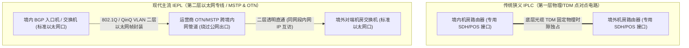

# IEPL 和 IPLC 有什么区别：二层以太网与点对点专线架构及机场宣传辨析

## 核心结论（Answer-First）

在电信运营商网络工程中，**IPLC（国际私有租用电路）**是广义的跨境点对点专用通信电路统称，传统上多基于 SDH/TDM 物理时隙隔离；而**IEPL（国际以太网专线）**则是基于现代 MSTP/OTN 光传输网、直接向客户交付**OSI 二层以太网接口（Layer 2 Ethernet）**的专线形态。在跨境代理实际应用中，两者的跨境段同样绕过民用公网国际出口、物理时延均低至数毫秒；决定用户晚高峰是否卡顿的核心变量并非 IEPL 与 IPLC 的名义差异，而是机场服务商的**真实带宽复用比（超售程度）**、**国内前置 BGP 入口抗攻击能力**以及**海外落地 IP 的纯净度**。

---

## 一、概念定义：从运营商产品目录看 IPLC 与 IEPL 的真实含义

用户在浏览[机场推荐与选型清单](/airport/airport-recommendation/)时，常看到「全线 IEPL 专线」或「纯 IPLC 物理专线直连」的宣传。要穿透营销话术，首先需回到基础电信运营商（中国电信、中国联通、中国移动国际 CMI）的政企专线定义。

### 1.1 什么是 IPLC（International Private Leased Circuit）

**IPLC（国际私有租用电路）**是电信运营商向跨国金融机构、外贸及研发中心提供的点对点（Point-to-Point）跨境专用通信电路。其经典特征是**物理层或时分复用层（TDM，Time Division Multiplexing）的端到端固定时隙独占**：例如租用深港 100Mbps IPLC，运营商便在跨境光缆 SDH 传输设备上划分物理隔离通道，不论民用公网（163 骨干网）晚高峰如何拥堵，该通道仅传输租用方内部数据，不与公网路由交汇。

### 1.2 什么是 IEPL（International Ethernet Private Line）

**IEPL（国际以太网专线）**则是随着云计算机房全面转向以太网（Ethernet）交换架构而普及的现代专线形态。传统 SDH/PDH 接口接入现代服务器需购置昂贵的协议转换板卡；为此，运营商在底层 SDH、MSTP 或现代 OTN 光传送网管道之上引入以太网封装（EoS / EVPL），直接向两端机房交付标准的**OSI 第二层（数据链路层）以太网接口**。深港两地交换机犹如插在同一局域网（LAN/VLAN）内，可直接配置同网段私有 IP（如 `10.10.1.1` 与 `10.10.1.2`）进行无路由跳数的二层内网通信。

### 1.3 站内 31 家品牌数据库中的专线宣传分布

根据本站[31 家机场品牌数据库](/brands/)与原始资料审计报告（详见[测试方法论与数据分级](/methodology)），各品牌在线路宣传（`vendor` 声明）上的用词分布如下：

| 线路宣传口径分类 | 站内代表品牌实例（基于 `data/brands.json`） | 原始资料声明特征与核查状态 |
| :--- | :--- | :--- |
| **同时提及 IEPL 与 IPLC** | [光速云](/brands/guangsuyun/)、[全球云](/brands/quanqiu/) | 光速云主标「IEPL 专线 / 企业级内网专线（双线路架构）」，部分文案提及 IPLC；全球云标「IPLC/IEPL 专线中转」。 |
| **主打 IEPL 专线口径** | [微风网络](/brands/weifeng/)、[星岛梦](/brands/xingdaomeng/)、[二猫云](/brands/ermao/)、[宇宙云](/brands/yuzhou/)、[极连云](/brands/jilian/)、[光年梯](/brands/guangnian/)、[一翻云](/brands/yifan/)、[SOGO云](/brands/sogo/)、[可信云](/brands/kexin/)、[速界](/brands/sujie/)、[梯子云](/brands/tiziyun/)、[灵动云](/brands/lingdong/)、[浪网](/brands/langwang/) 及 5.6 元集群（[闪电鼠](/brands/shandianshu/)、[大佬云](/brands/dalaoyun/)、[云界线](/brands/yunjiexian/)、[榴莲云](/brands/liulianyun/)、[神行加速](/brands/shenxing/)、[环球梯](/brands/huanqiuti/)） | 共 19 家品牌以 IEPL 为核心标签，覆盖年付折合 5.6 元/月至月付 25 元以上多档定价。 |
| **主打 IPLC 专线口径** | [唯兔云](/brands/weitu/)、[Firefly](/brands/firefly/)、[U1S1](/brands/u1s1/)、[闪跃](/brands/shanyue/)、[隐形人](/brands/yinxingren/)、[边缘节点 EdgeNova](/brands/edgenova/) | 共 6 家品牌优先使用「IPLC 专线」字样（详见[IPLC 专线专题](/routes/iplc/)）。 |
| **标注 BGP / 中转优化 / 轻快连接** | [飞猫云](/brands/feimao/)、[无忧链接](/brands/wuyou/)、[暮光加速](/brands/muguang/)、[灵猫网络](/brands/lingmao/) | 飞猫云定位「轻快连接、非顶级专线」；暮光加速强调「BGP 智能调度」；灵猫网络标「中转优化线路」。 |

可见：**在商业机场宣传语境下，「IPLC」常作跨境内网专线的泛称，而「IEPL」则是上游供应链中最常采购的二层以太网专线交付形式。**

---

## 二、技术原理：OSI 模型分层、封装机制与跨境路由拓扑

### 2.1 物理层与数据链路层：TDM 硬时隙 vs 二层以太网 VLAN

传统狭义 IPLC 与现代 IEPL 的核心差异集中在**OSI 第一层（物理层）与第二层（数据链路层）的复用与交付机制**：

> **原理图说明**：上图为电信传输网逻辑概念对比图，展示传统 TDM IPLC 与现代二层以太网 IEPL 在接口交付及协议封装上的工程差异，非特定服务商物理机房拓扑。

1. **工作层级与接口标准化**：
   - **传统 IPLC（Layer 1 / TDM）**：工作在物理层与时分复用层，协议开销极低、抖动近乎为零，但难以在普通云服务器上通过软件切分多条逻辑子通道。
   - **现代 IEPL（Layer 2 / Ethernet）**：工作在数据链路层，支持 IEEE 802.3 以太网帧与 802.1Q / QinQ VLAN 标签。上游专线批发商租下 10Gbps 深港或沪日 IEPL 主干后，可通过交换机划分出数百个独立 VLAN 子通道，按 100Mbps–500Mbps 灵活分销给下游机场。
2. **公网网关隔离机制（两者共同优势）**：
   - 无论 IPLC 还是 IEPL，数据包跨越国境线时**均不经过民用公网国际出口路由器（AS4134 / AS4837 / AS9808 等国际关口）**，从而规避了晚高峰民用宽带国际出口队列拥塞。

### 2.2 技术参数全维度对比表

| 对比维度 | 传统狭义 IPLC（国际私有租用电路） | 现代 IEPL（国际以太网专线） | 普通公网 BGP 中转（非专线基准） |
| :--- | :--- | :--- | :--- |
| **OSI 工作层级** | 第一层（物理层 / TDM 时分复用层） | 第二层（数据链路层 / Ethernet 以太网层） | 第三层（网络层 / 公网 IP 路由转发） |
| **底层承载网技术** | SDH / SONET 固定时隙电路 | MSTP / OTN / Metro Ethernet（EoS / EVPL） | 民用或商用公网骨干网（163 / 4837 / CMI / CN2） |
| **机房交付形态** | 点对点专用电路接口，需配套路由器板卡 | 标准以太网接口 / VLAN 虚拟二层内网直通 | 标准公网 IP 地址，通过公网路由寻址 |
| **深港段理论物理延迟** | 约 `2–6 ms`（光速物理距离极限） | 约 `3–8 ms`（含二层交换微秒级开销） | 白天 `10–25 ms`，晚高峰可劣化至 `80–200 ms+` |
| **带宽切分与扩容弹性** | 低（需调整物理时隙，施工周期长） | 极高（支持通过 VLAN 与 QoS 按 Mbps 弹性切分） | 极高（按云主机公网带宽计费调整） |
| **晚高峰抗公网出口拥塞** | 极强（物理时隙硬隔离） | 极强（专网通道隔离，受限于租用方购买上限） | 弱至中等（受制于公网国际出口队列丢包） |

---

## 三、实际影响：为什么「真 IEPL/IPLC」也会出现卡顿、0B 或解锁失败？

一条完整的代理请求必须走完**四段串联链路**，而 IEPL/IPLC 仅保护**第三段（跨境段）**：

### 3.1 四段式木桶效应：国内前置入口与带宽复用比（超售）

1. **第一段（本地宽带 → 国内前置入口机）**：用户宽带先经国内公网连向机场设在广东、江苏、浙江等地的国内 BGP 入口机。若入口机为廉价单线机房，跨网用户在进入专线前即已丢包。
2. **第二段（国内前置入口 → 专线境内端 PoP）**：一旦国内入口机遭遇同行 DDoS 攻击或云厂商合规清退，整条链路在门口即被掐断（详见[节点全部超时排查指南](/troubleshooting/articles/nodes-all-timeout)）。
3. **第三段（跨境 IEPL/IPLC 专网管道）**：虽然专网不惧公网拥堵，但**总容量有严格上限**。若机场仅租用 `500Mbps` 深港 IEPL 却超售给上万名用户，晚高峰 21:00 管道同样会被塞满排队丢包（详见[晚高峰高延迟与丢包定位](/troubleshooting/articles/high-latency-packet-loss-peak)）。
4. **第四段（海外落地机房 → 目标网站）**：远端日本、新加坡、美国节点多以**香港机房为国际中转枢纽（Hub）**，再经国际海缆转发至目标落地机房。

### 3.2 实测证据复盘：专线架构下的 0B 死节点与极低速异常

根据本站实验室归档的真实测速截图（`measured`）：
- **[光速云](/brands/guangsuyun/)**：`2026-08-11 14:32:56 CST` MAI-TEST-BOT（珠海联通 5Gbps，32 线程，Shadowsocks 54 节点）截图中，`HK 03–19` 均速达 `54.43–75.07 MB/s`，但**`HK 02` 节点 RTT 仅 16ms、HTTP 延迟 39ms，均速与最大速度却为 `0B/0B`**，`HK 20` RTT 达 `201ms`；`2026-08-19` 归档批次珠海联通 9Gbps 单线程 Vless 70 节点图中，香港均速 `375–424 MB/s`，但**`美国02` 仅 `1.60 KB/s`**。
- **[微风网络](/brands/weifeng/)**：图内时间戳 `2026-07-19 18:38:20 CST` 的 Miaoko 50 节点 Vless 实测图中，香港 15 节点均速 `468.91–546.20 MB/s`（FullCone），但**`台湾 02` 为 `0.00B/0.00B`，`日本 05` 仅 `8.00 KB/s`**。
- **[宇宙云](/brands/yuzhou/)**：`2026-08-11 21:04:24 CST` 晚高峰实测图中，香港 `02–15` 均速 `470–550 MB/s`，但**`【香港】01` 为 `0.00B/0.00B`，`【新加坡】07` 仅 `9.60 KB/s`**。

这证明：**IEPL/IPLC 只能保证跨境主干道不断，无法避免具体海外落地机宕机或进程假死**。当前端入口正常响应握手而后端落地转发中断时，就会产生「延迟 16ms 绿字、速度 `0B`」的假活节点（详见[部分地区节点超时与单点故障排查](/troubleshooting/articles/nodes-partial-region-timeout)）。

### 3.3 专线与流媒体/AI 解锁完全脱钩

**IEPL/IPLC 属于传输通道属性，与 Netflix、YouTube、ChatGPT、Claude、Gemini 解锁成功率无因果关系。**例如在[光速云](/brands/guangsuyun/) `2026-08-19` 归档的 Miaoko 解锁实测图中，香港专线节点 OpenAI 多显示为**`仅APP(HK)`**、Gemini 多为**`失败`**；70 节点图中**新加坡 `01–10`、台湾 `01–06` 与 `08–10` 及多条电信前缀节点的 YouTube 显示为 `送中(CN)`**（详见[YouTube 送中原因与自检](/ai-media/youtube/)与[ChatGPT 节点兼容性实测](/ai-media/chatgpt/)）。目标平台仅检查海外落地机最后一跳公网 IP 的信誉与归属（详见[原生 IP 和机房 IP 有什么区别](/routes/articles/native-ip-vs-datacenter-ip)）。

---

## 四、使用场景：不同用户群体如何选择专线方案？

### 4.1 场景一：对实时交互延迟与晚高峰丢包高度敏感的场景
- **典型业务**：RDP/SSH 远程终端、AI 编程助手（Cursor / Claude API）流式响应、语音会议与外服游戏（详见[香港低延迟节点解析](/routes/hong-kong/)与[低延迟节点真相](/routes/low-latency/)）。
- **选型策略**：避开年付折合几元钱的高复用盘，优先在月付 `18–35 元`（`100GB–200GB`）且有本地实测图的品牌中按月试错，如[光速云](/brands/guangsuyun/)（极速版 ¥25/月 168GB）、[微风网络](/brands/weifeng/)（乘风 ¥27/月 200GB，实测香港 FullCone）、[一翻云](/brands/yifan/)（轻享版 ¥20/月 150GB，宣称 Hysteria 2/VLESS-Reality/SS 三协议）或[二猫云](/brands/ermao/)（白猫 ¥20/月 130GB）。

### 4.2 场景二：大流量 4K 视频流媒体与日常综合浏览
- **选型策略**：重点核对持续吞吐带宽与**节点计费倍率（优先确认 1 倍率，详见[线路倍率计费与测速差异](/routes/multipliers/)）**。在[Clash Verge Rev](/clients/clash-verge/)或[Shadowrocket](/clients/shadowrocket/)中配置[分流规则](/guides/split-routing/)：日常视频走香港/新加坡 1x 专线节点，AI 域名独立分流至日本或美国节点。

### 4.3 场景三：极低预算备用或轻度图文查阅
- **选型策略**：站内标注「IEPL 专线 + VLESS + 年付约 5.6 元/月（60GB/月）」的平价集群（[闪电鼠](/brands/shandianshu/)、[大佬云](/brands/dalaoyun/)、[云界线](/brands/yunjiexian/)、[榴莲云](/brands/liulianyun/)、[环球梯](/brands/huanqiuti/)）在原始资料中高度同质化且无独立测速图（详见[平价机场专题](/pricing/budget/)），受限于极低客单价，带宽复用比必然极高，仅可作轻度认知参考，不宜期待主力级晚高峰独占吞吐。

---

## 五、常见误区：破除关于 IEPL 与 IPLC 的四大认知陷阱

### 误区一：「IPLC 是真物理专线，IEPL 只是虚拟伪专线，选 IPLC 一定比 IEPL 好」
**事实澄清**：IEPL 底层同样运行在运营商 MSTP/OTN 物理光缆专网之上，只是交付端采用更适配现代云交换机的二层以太网接口。评判好坏应看**是否有真实可核验的晚高峰测速与解锁表现**（详见[如何识别未经验证的专线宣传](/routes/articles/how-to-spot-unverified-iepl)），而非比较缩写。

### 误区二：「只要是 IEPL/IPLC 专线，所有节点一定都是 1 倍率不限速」
**事实澄清**：因专线带宽昂贵，不少机场会将专线节点设为 `2x–5x` 流量倍率。虽然[星岛梦](/brands/xingdaomeng/)、[唯兔云](/brands/weitu/)、[无忧链接](/brands/wuyou/)、[灵猫网络](/brands/lingmao/)等在资料中声明「1 倍流量」，但导入任何订阅后仍须先检查节点后缀倍率，切忌在高倍率节点频繁跑多线程测速（详见[客户端测速与实际下载体感差异及倍率计算](/troubleshooting/articles/bandwidth-multiplier-speedtest-diff)）。

### 误区三：「用了 IEPL 专线机场，就可以直接用公开网页在线订阅转换工具」
**事实澄清**：IEPL 仅保护入口到落地的传输，而你的订阅链接包含账户最高鉴权 Token。粘贴到第三方公开在线转换站会导致 Token 被后台日志截留盗刷。请务必在本地客户端使用覆写功能，并保持 `https://sub.example.invalid/api/v1/client/subscribe?token=REDACTED` 的脱敏安全习惯（详见[机场订阅安全导入教程](/guides/subscriptions/)与[账号与订阅安全防护](/security/account-security/)）。

### 误区四：「15 家机场 2026-10-19 测速表香港都在 21–27ms、500Mbps，说明它们都是同级顶级专线」
**事实澄清**：原始清单中 15 家品牌的 `2026-10-19（非晚高峰）` 文本表格数值高度趋同（香港均在 `21–27ms / 477–548Mbps`），且无原始截图、无工具版本与运营商后端说明。本站已将其降级标注为 `dataStatus: "vendor"`，**绝不能凭该无图文本表判定专线质量**。

---

## 六、常见问题（FAQ）

### 机场宣传里同时写着 IEPL 和 IPLC，到底哪一种在晚高峰更快更稳？

对终端代理用户而言，真正决定晚高峰体验的并非底层电路采用 IEPL 还是 IPLC 封装，而是服务商采购的「跨境物理带宽总量」与「在线用户复用比（超售比）」。两者在物理层同样绕过公网国际出口网关，深港跨境物理延迟均在 3–8ms 左右；若一条 100Mbps 的真 IPLC 被超售给数千名重度视频用户，晚高峰照样会因入口队列打满而丢包限速。

### 为什么现在市面上绝大多数专线机场都标称 IEPL，而越来越少单独标传统 TDM IPLC？

因为现代云计算机房与 IDC 交换机全面采用以太网（Ethernet）接口。IEPL 直接在二层交付标准 RJ45 或光纤以太网帧，机房无需额外购置昂贵的 SDH/PDH 协议转换设备即可通过 VLAN 灵活切分带宽；而传统狭义 IPLC 基于时分复用（TDM）点对点电路，施工周期长、单 Mbps 租金高且扩容不够灵活，因此在商业代理供应链中，二层以太网架构的 IEPL 成为了绝对主流。

### 只要购买了标有 IEPL 或 IPLC 专线的机场套餐，是不是就永远不会出现全节点超时断连？

不是。跨境代理链路包含「本地宽带→国内前置 BGP 入口→跨境内网专线→海外落地机房」四个串联环节。IEPL 与 IPLC 仅保护第三段跨境传输通道不受公网国际出口拥塞影响；一旦第一、二段的国内前置入口服务器遭遇 DDoS 攻击、机房断电、欠费停机或合规清退，用户的流量根本无法进入专线入口，客户端照样会出现全节点超时。

### 用了 IEPL 或 IPLC 专线后，看 YouTube 就不会送中、用 ChatGPT 和 Gemini 就不会报错吗？

不会自动解决。IEPL 和 IPLC 只负责把加密数据包从境内快速传送到境外机房，属于传输层面的「高速公路」；而流媒体区域判定与 AI 平台风控，完全取决于数据包离开海外落地服务器时的「最后一跳出口公网 IP 信誉与 GeoIP 归属」。例如站内光速云 2026-08-19 归档实测中，尽管搭载高速专线，其部分香港节点访问 OpenAI 仍显示仅 APP 可用，部分新加坡与台湾节点访问 YouTube 仍被判定送中（CN）。

### 普通用户没有运营商机房权限，怎样在本地电脑验证一家机场的专线是不是公网混线？

最可靠的方法是执行「晚高峰连续 7 天基线比对」。在工作日晚间 20:30–22:30 国际出口最拥堵的窗口期，对比同一节点的日间与夜间连接表现：真正的内网专线在晚高峰期间，其底层握手延迟波动极小，不会随着公网国际出口拥堵而出现 RTT 翻倍暴涨；如果某节点白天延迟 25ms，一到晚上 21:00 就飙升到 180ms 以上并伴随持续 15% 以上的丢包，则极可能是普通公网中转冒充专线或专线入口严重超售。

---

## 七、关联阅读与延伸排障入口

- **返回上级专题**：[IEPL 专线原理：跨境二层内网架构与成本复用比](/routes/iepl/) ｜ [IPLC 专线专题：点对点架构与稳定性误区澄清](/routes/iplc/)
- **同集群深度解析**：
  - [如何识别未经验证的专线宣传：比对 2026-10-19 趋同表与 0B 证据](/routes/articles/how-to-spot-unverified-iepl)
  - [节点延迟低是否意味着下载速度快：RTT vs HTTPS Ping 与 32 线程测速](/routes/articles/low-ping-vs-download-speed)
  - [原生 IP 和机房 IP 有什么区别：Miaoko IPType/IPRisk 解读与解锁边界](/routes/articles/native-ip-vs-datacenter-ip)
- **实战故障排查**：
  - [晚高峰高延迟、丢包与卡顿定位指南](/troubleshooting/articles/high-latency-packet-loss-peak)
  - [部分地区节点超时与单点 0B 异常排查](/troubleshooting/articles/nodes-partial-region-timeout)
  - [全部节点突然超时连不上的分层诊断](/troubleshooting/articles/nodes-all-timeout)
