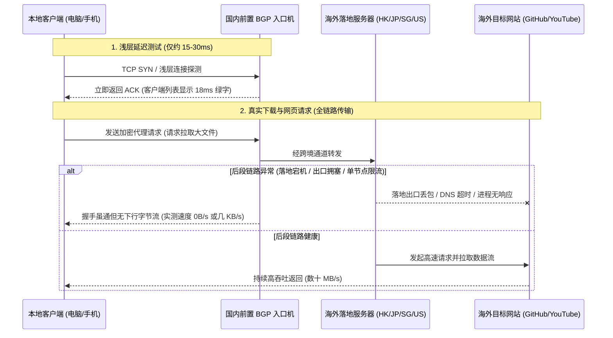

# 节点延迟低下载速度就快吗：RTT vs HTTPS Ping 与 32 线程测速体感落差解析

## 核心结论（Answer-First）

**节点延迟低（Ping 值小）绝不自动等于下载速度快。**在代理网络工程中，延迟（Latency）衡量的是极小探测包往返一趟的时间（单位 `ms`），相当于「车道的长度与限速」；而下载速度（Throughput）衡量的是每秒能持续传输的数据容量（单位 `MB/s` 或 `Mbps`），相当于「车道的宽度与是否堵车」。当机场国内前置入口响应极快（RTT 仅 `15–25ms`），但跨境专线带宽超售拥塞、海外落地服务器进程假死（导致 `0B` 吞吐）、服务端对单连接做 QoS 限速，或者测速工具用 **32 线程并发跑分** 掩盖了单线程 TCP 丢包时，用户就会频繁遭遇「列表一片绿油油低延迟，实际刷网页发粘、单线程下载极慢」的严重落差。

---

## 一、概念定义：拆解代理测速中的四类「延迟」与两类「速度」

在排查[连接慢与高延迟丢包](/troubleshooting/slow-network/)问题时，90% 的误判都源于把不同测试工具里的「延迟」和「速度」混为一谈。要弄清楚为什么低延迟节点下载依然慢，首先必须明确你在客户端或测速图上看到的数字究竟测量了什么。

### 1.1 四类延迟指标的测量边界对比

在[Clash Verge Rev](/clients/clash-verge/)、[v2rayN](/clients/v2rayn/)、[Shadowrocket](/clients/shadowrocket/)等主流客户端，以及实验室归档的 `MAI-TEST-BOT` 和 `Miaoko（喵速）` 测速截图中，常见的延迟指标分为四个完全不同的层级：

| 延迟指标名称 | 测试协议与动作层级 | 实际测量的网络路段 | 能否反映真实网页/下载体感？ |
| :--- | :--- | :--- | :--- |
| **1. ICMP Ping** | OSI 第三层（网络层 `echo request`） | **仅本地设备 → 机场国内入口服务器 IP** | **完全不能**。即使海外落地机房彻底拔网线，只要国内入口机开机，ICMP Ping 依然是绿色的 `15ms`。 |
| **2. TCP Ping（TCPing）** | OSI 第四层（传输层 `SYN -> SYN/ACK` 三次握手） | **多数仅测量本地 → 国内中转入口端口**（部分透明转发除外） | **极易产生假绿误导**。只证明国内入口端口未被封禁，无法得知后端代理协议鉴权是否通过、境外节点是否存活。 |
| **3. TLS RTT（单次数据交换延迟）** | OSI 第五/六层（代理协议握手 / TLS 加密层单次往返） | 本地 → 国内入口 → 跨境专线 → 海外落地代理服务端口单次交换 | **中等参考价值**。能反映端到端物理距离与隧道基础耗时（如 Miaoko 图中标注「TLS RTT：单次数据交换延迟」），但未包含远端目标网站请求。 |
| **4. HTTPS Ping / URLTest（真连接延迟）** | OSI 第七层（应用层完整 HTTPS `GET /generate_204` 请求） | **全链路**：本地 → 入口 → 专线 → 海外落地 → 目标海外 DNS 解析 → 目标测试站 TLS 握手与 HTTP 首包返回 | **最具网页体感参考价值**（Miaoko 图中标注「HTTPS延迟：单次请求体感延迟」），但仍不代表大文件持续下载带宽。 |

### 1.2 两类速度指标的单位与并发差异

除了延迟口径不同，测速图上的「速度」与你日常下载时的「速度」也存在两个维度的巨大鸿沟：

1. **计量单位的 8 倍换算差（`Mbps` vs `MB/s`）**：
   - 运营商宽带、Speedtest.net 以及本站在 `2026-10-19` 归档的文本参考表中，使用的是**比特每秒（`Mbps`，Megabits per second）**；
   - 而浏览器下载栏、Steam 下载器以及 `MAI-TEST-BOT` / `Miaoko` 原始测速截图中，使用的是**字节每秒（`MB/s`，Megabytes per second）**。
   - 由于 `1 Byte = 8 bits`，加上协议帧头开销，**`100 Mbps` 的带宽实际最大下载速度大约只有 `11.5–12.5 MB/s`**（详见[客户端测速与实际下载速度差异及倍率计算](/troubleshooting/articles/bandwidth-multiplier-speedtest-diff)）。
2. **并发模型差异（32 线程并发聚合 vs 单线程 TCP 流）**：
   - 实验室实测截图（如 `MAI-TEST-BOT 2.0.0-dev` 或 `Miaoko 4.3.3 / 喵速 4.7.0 [A11-32]`）明确标注采用了 **32 线程（32 Threads）** 并发压测，目的是在短短几秒内测出节点服务器网卡的极限总吞吐上限；
   - 而普通用户在浏览器直接点击下载安装包、加载网页图片或观看单路视频流时，绝大多数情况下仅建立 **1 到 4 个并发 TCP 连接**。

---

## 二、技术原理：为什么「20ms 低延迟」与「高速下载」会严重背离？

从计算机网络传输层（TCP / QUIC）与代理链路架构来看，一个节点之所以会出现「延迟极低但下载极慢（甚至 `0B`）」，主要由以下四大工程机制决定。

### 2.1 机制一：四段式代理链路的「前段秒回、后段断流（假绿死节点）」

现代商业机场（无论是公网 BGP 中转还是[IEPL/IPLC 专线](/routes/iepl/)）几乎都采用「国内中转入口 + 境外落地出口」的分段架构：



> **时序图说明**：上图展示了分段代理架构中「前端握手延迟极低」与「后端实际数据吞吐中断或限流」并存的技术原理。

当国内入口服务器（或专线对端网口）处于正常监听状态，但海外落地服务器上的代理核心进程卡死、落地机房上游国际带宽欠费限速、或者落地机向目标网站发起 DNS 解析时超时，客户端在测延迟时就已经在前半段拿到了极快的响应，而在真正请求下载字节流时却在后半段卡死。

### 2.2 机制二：TCP 拥塞控制与丢包惩罚（Mathis 公式）

许多用户以为：「只要节点 Ping 值只有 25ms，下载大文件就一定飞快。」然而在 TCP 协议中，决定单线程持续下载速度的不仅有 RTT，还有**丢包率（Packet Loss，$p$）**。根据著名的 **Mathis TCP 吞吐量上限近似公式**：

$$\text{Max Throughput} \approx \frac{\text{MSS}}{\text{RTT} \times \sqrt{p}}$$

- 当一条深港节点在白天空闲时，`RTT = 25ms`（$0.025\text{s}$），且丢包率极低（例如 $p = 0.0001$，即万分之一），单连接 TCP 拥塞窗口（cwnd）可以迅速扩张，轻松跑出几百 Mbps 的单线程高速。
- 但到了晚高峰 `20:30–22:30`，如果该机场的专线或中转入口发生超售拥塞，虽然**没丢掉的那几个探测包测出来的 RTT 依然是 `25–35ms`**，但只要链路出现了 **$3\%–5\%$ 的随机队列丢包**，传统 TCP 拥塞控制算法就会频繁触发「乘性减半（Multiplicative Decrease）」，把发送窗口死死压在地板上，导致单线程下载速度瞬间暴跌到 `200 KB/s–500 KB/s`（详见[晚高峰高延迟、丢包与卡顿定位](/troubleshooting/articles/high-latency-packet-loss-peak)）。

### 2.3 机制三：服务端单连接 QoS 限速 vs 32 线程并发叠加

为了防止个别用户用多线程下载工具（如 IDM 或 BT 下载）把整台共享节点母鸡的带宽占满，不少机场会在节点服务端配置基于单条 TCP 流（Per-Connection / Per-Flow）的令牌桶限速。

举例来说，假设某节点服务端限制**单条 TCP 连接最高只能跑 `1.5 MB/s`（约 `12 Mbps`）**：
- 当测速机器人开启 **32 线程并发** 测速时，32 条独立 TCP 流同时拉取数据，面板上合成出来的总平均速度可以高达 `$1.5 \times 32 = 48 \text{ MB/s}$（约 `384 Mbps`）`，看起来非常亮眼；
- 但当你自己用浏览器单线程下载一个 GitHub Release 压缩包，或者用命令行 `git clone`、`pip install` 拉取代码时，因为只有 **1 条 TCP 连接**，你的下载速度就会被死死卡在 `1.5 MB/s` 以内。

---

## 三、实际影响：站内实测图中的「低延迟但 0B / 极低速」与「RTT vs HTTP 背离」铁证

为了用客观数据印证上述原理，我们直接调取本站实验室归档的 `2026-07` 至 `2026-08` 真实测速截图（`dataStatus: "measured"`），看看真实节点在测试中是如何表现出「延迟与速度脱钩」的。

### 3.1 实测案例一：RTT 与 HTTP 延迟双低，但下载速度为 0B 或几 KB（死节点/断流）

在站内多张含完整时间戳的原始测速图中，均出现了延迟表现极佳、但实际吞吐量为 `0B` 或仅几 `KB/s` 的节点：

| 品牌名称与实测批次 | 测速环境与图中协议 | 异常节点名称 | 图中实测延迟（RTT / HTTP） | 图中实测均速 / 最大速度 | 同图正常节点对照基准 |
| :--- | :--- | :--- | :--- | :--- | :--- |
| **[光速云](/brands/guangsuyun/)** (`2026-08-11 14:32:56 CST`) | MAI-TEST-BOT，珠海联通 5Gbps，32 线程，`Shadowsocks` | `香港 02` (`HK 02`) | RTT **`16ms`** / HTTP **`39ms`** | **`0B` / `0B`** | 同图 `HK 03–19` 均速达 `54.43–75.07 MB/s` |
| **[光速云](/brands/guangsuyun/)** (`2026-08-19` 归档批次) | Miaoko，珠海联通 9Gbps，单线程，`Vless` | `美国 02` (`US 02`) | TLS RTT 与 HTTPS 延迟已响应 | 均速仅 **`1.60 KB/s`** | 同图香港单线程均速达 `375–424 MB/s` |
| **[微风网络](/brands/weifeng/)** (`2026-07-19 18:38:20 CST`) | Miaoko 4.3.3，珠海联通 9Gbps，32 线程，`Vless` | `台湾 02` / `日本 05` | 台湾02与日本05握手已响应 | 台湾02为 **`0.00B`**；日本05仅 **`8.00 KB/s`** | 同图香港 01–15 均速达 `468.91–546.20 MB/s` |
| **[宇宙云](/brands/yuzhou/)** (`2026-08-11 21:04:24 CST`) | Miaoko 4.3.3，珠海联通 9Gbps，32 线程，`Vless` | `【香港】01` / `【新加坡】07` | 晚高峰探测响应存在 | 香港01为 **`0.00B`**；新加坡07仅 **`9.60 KB/s`** | 同图香港 02–15 均速达 `470–550 MB/s` |
| **[无忧链接](/brands/wuyou/)** (`2026-07-18 21:40:48 CST`) | Miaoko 4.3.3，珠海联通 9Gbps，32 线程，`Vless` | `新加坡 SIN-02` | 晚高峰握手正常 | 均速仅 **`17.59 KB/s`** | 同图其余新加坡节点均速 `94–352 MB/s` |
| **[可信云](/brands/kexin/)** (`2026-08-11 15:32:35 CST` 批次) | MAI-TEST-BOT，珠海联通 5Gbps，32 线程，`Shadowsocks` | `JP 07` / `US 05` | 节点连通未超时 | `JP 07` 仅 **`12.61 KB/s`**；`US 05` 仅 **`688.93 KB/s`** | 同图香港节点均速 `28–53 MB/s` |

> **实测启示**：如果用户在客户端中开启了仅按延迟高低排序的自动选节点（或者只看列表里 `HK 02` 显示 `16ms` 就手动点上去），就会正好踩中 `0B/0B` 的死节点，导致整个浏览器出现「已连接代理但完全无法上网」的故障（详见[已连接但无法上网排障](/troubleshooting/articles/connected-no-internet)与[部分地区节点超时排查](/troubleshooting/articles/nodes-partial-region-timeout)）。

### 3.2 实测案例二：底层 RTT 很低，但应用层 HTTP/HTTPS 延迟暴涨数十倍

再看[可信云](/brands/kexin/) `kexin-20260811.png` 与[光速云](/brands/guangsuyun/)不同批次测试中的另一组典型现象——**底层 RTT 与上层 HTTP(S) 延迟的剧烈分化**：

- 在可信云实测截图中，部分新加坡与日本节点的底层网络 **RTT 仅在 `50–80ms` 区间**（说明从珠海联通测试机到机场入口及专线对端的物理链路很通畅），但其右侧的 **HTTP 延迟却飙升至 `1829ms` 甚至 `2231ms`**！
- 为什么会相差近 30 倍？因为当代理请求到达海外落地服务器后，落地机需要替你向目标网站发起 DNS 解析并完成远端 TLS 握手。如果落地机配置的海外上游 DNS 响应极慢、落地机 CPU 满载排队，或者落地机出口 IP 被目标 CDN 限流校验，用户在实际打开网页时就会感受到长达 **2 秒以上的首屏白屏等待（高 TTFB）**，哪怕客户端列表上显示的节点 RTT 只有几十毫秒。

---

## 四、使用场景：哪些业务该看「低延迟」，哪些业务该看「持续下载带宽」？

理解了延迟与下载速度的解耦关系后，我们在日常选节点和配置[客户端分流规则](/guides/split-routing/)时，就应该按具体应用场景采取截然不同的优先级：

### 4.1 优先看「低 RTT + 低抖动 + 0 丢包」的场景（对峰值大带宽不敏感）

- **典型场景**：
  1. **AI 对话与代码补全**（ChatGPT 网页交互、Claude 连续问答、Cursor IDE 实时代码提示）：每次传输的文本数据量只有几 KB 到几十 KB，根本不需要 500Mbps 的下载带宽；它最怕的是 HTTPS 首包延迟（TTFB）超过 1500ms 或者连接中途丢包重置。
  2. **SSH 远程终端、网页高频点击浏览、即时通讯（Telegram / Discord 语音）与外服游戏**：敲击一个键盘指令需要立刻回显，要求端到端 RTT 稳定在 `30–80ms` 以内且抖动（Jitter）极小（详见[香港节点专题](/routes/hong-kong/)与[日本节点专题](/routes/japan/)）。
- **选节点方法**：优先选择物理距离近（香港、台湾、日本、新加坡）、晚高峰 HTTPS Ping 稳定在 `150–400ms` 以内、且 UDP NAT 类型良好的节点；对于 AI 业务，由于香港节点常受地区限制（如光速云实测香港 OpenAI 仅 APP 可用、Gemini 失败），应通过分流规则将 AI 域名固定到延迟次低且解锁稳定的**日本或新加坡节点**。

### 4.2 优先看「单线程持续吞吐 + 1x 低倍率」的场景（对几十毫秒延迟差不敏感）

- **典型场景**：
  1. **流媒体 4K/8K 超高清视频播放**（YouTube 4K 60fps、Netflix 4K HDR）：视频播放器自带缓冲区（Buffer），节点延迟是 `30ms` 还是 `160ms` 仅影响点击播放那一瞬间的起播快慢（相差不到 0.15 秒）；真正决定画面会不会卡住转圈的，是节点能否持续稳定提供 **`35 Mbps–80 Mbps`（即 `4.5 MB/s–10 MB/s`）以上的单连接/少连接下行吞吐量**。
  2. **大体积文件下载**（GitHub Release、Docker 镜像拉取、HuggingFace 模型下载、海外网盘）：完全看重持续传输带宽与**套餐流量倍率**。
- **选节点方法**：即便美国节点的物理延迟高达 `140–180ms`，只要其国际海缆带宽充裕且倍率低（如 `1x` 或 `0.5x`），用来跑后台大文件下载反而比拥挤的高倍率近端节点更划算（详见[线路倍率计费机制](/routes/multipliers/)）。

---

## 五、常见误区与本地低消耗实测验证方法

### 5.1 常见三大认知误区

1. **误区一：「每天打开客户端先点一下『全部节点测速』，挑数字最大的那个用」**
   - **风险提示**：在客户端或第三方测速软件中对 50–70 个节点跑一轮 32 线程带宽测速，短短几分钟就会消耗 **`10GB–20GB` 的真实流量**（例如本站归档的 `guangsuyun-20260811.png` 底部明确记录单次 54 节点测速**消耗流量 `19.4GB`**，`kexin-20260811.png` 55 节点测速**消耗流量 `10.5GB`**）。如果其中包含 `2x–5x` 倍率节点，跑一次测速就会扣掉你小半个月的套餐额度！
2. **误区二：「只要把策略组设成 `url-test`（自动选择最低延迟），客户端就能永远连在最快的节点上」**
   - **风险提示**：如果 `url-test` 的测试间隔过短或探测包过小，它极容易把前文提到的「入口握手 16ms、但后端吞吐 `0B` 或限速 `8KB/s`」的半死节点当成最优节点自动切过去，还会因为频繁切换出口 IP 导致 Claude / ChatGPT 账号触发风控封禁（详见[Clash 配置模式与策略组](/guides/clash-setup/)）。
3. **误区三：「节点延迟低但下载慢，一定是机场限速了，跟我的本地分流和 DNS 没关系」**
   - **风险提示**：很多时候节点本身很快，但由于本地客户端 DNS 配置不当（未开启 Fake-IP 或未给 IP 规则加 `no-resolve`），导致海外下载站的 CDN 把你的香港/日本节点错误调度到了欧洲或南美服务器，甚至触发了 YouTube / Google CDN 的「送中（CN）」反向回流，从而让跨洲单线程下载速度暴跌（详见[DNS 劫持与污染修复](/troubleshooting/articles/dns-leak-hijack-fix)）。

### 5.2 本地终端单线程「延迟 + 吞吐」10MB 极低消耗验证法（只读安全命令）

想知道当前选中的低延迟节点**真实的单线程下载速度和首包体感延迟**，无需跑几十 GB 的多线程测速脚本。打开电脑终端（Windows PowerShell 或 macOS/Linux Terminal），执行以下仅消耗 **`10MB` 流量**的只读命令：

```powershell
# 适用系统: Windows 10 / 11 (PowerShell)
# 目的: 通过本地代理端口 (示例为 127.0.0.1:7890) 单线程拉取 10MB 测试包并直接丢弃到空设备 NUL，输出真实首包延迟与单线程下载速率
# 风险等级: 低（纯只读网络探测，不写盘、不改任何系统设置，仅消耗 10MB 流量）
curl.exe -x http://127.0.0.1:7890 -o NUL -s -w "HTTP_Code:%{http_code} | Connect:%{time_connect}s | TLS_Handshake:%{time_appconnect}s | TTFB(HTTPS_Ping):%{time_starttransfer}s | Total:%{time_total}s | SingleThread_Speed:%{speed_download} Bytes/s`n" "https://speed.cloudflare.com/__down?bytes=10485760"
```

*(注：macOS 与 Linux 用户请将命令开头的 `curl.exe` 改为 `curl`，将 `-o NUL` 改为 `-o /dev/null`，并将末尾的 `` `n `` 改为 `\n`。)*

**如何根据输出结果在 10 秒内定位瓶颈：**
- **看 `TTFB(HTTPS_Ping)`**：如果 `Connect` 只有 `0.002s`（本地到客户端端口），但 `TTFB` 高达 `2.500s` 以上，说明节点在跨境握手或海外落地请求目标网站时存在严重的**首包卡顿**，刷网页和用 AI 会明显感觉慢半拍。
- **看 `SingleThread_Speed`**：将返回的 `Bytes/s` 数值除以 `1048576` 即为真实的单线程 `MB/s` 下载速度。
  - 若达到 **`5,242,880 Bytes/s`（即 `5.0 MB/s ≈ 40 Mbps`）以上**：说明该节点的单线程持续吞吐非常健康，看 4K 视频和日常下载完全流畅；如果你下某个特定网站依然慢，那是该目标网站自身的服务器限速。
  - 若 `TTFB` 很短（如 `0.25s`），但 `SingleThread_Speed` 只有 **`100,000 Bytes/s`（约 `100 KB/s`）甚至卡死超时**：说明该节点存在严重的**晚高峰丢包、海外落地出口拥塞或服务端单连接限速**，应立即在客户端切换到同地区其他编号节点或跨区节点。

---

## 六、常见问题（FAQ）

### 为什么客户端列表里节点延迟显示 18ms 绿字，点开网页却转圈五六秒甚至打不开？

因为部分客户端列表默认测量的仅是「本地设备到机场国内前置中转入口」的 TCP 握手延迟，甚至在连接断开后出現「假绿死节点」（例如站内光速云 2026-08-11 实测中的 HK02 节点，RTT 仅 16ms、HTTP 延迟 39ms，但实际下载吞吐量为 0B/0B）。前端入口响应快不代表跨境隧道和海外落地服务器到目标网站的后半段链路畅通。

### 测速截图里的「RTT / TLS RTT」和「HTTP(S) 延迟 / HTTPS Ping」有什么本质区别？

RTT（或 Miaoko 图底标注的 TLS RTT）测量的是单次底层数据交换或加密握手的往返耗时；而 HTTPS Ping（或 HTTP 延迟）测量的是建立完整代理链路后，向远端测试目标（如 Google 或 Cloudflare `generate_204`）发送真实 HTTP/HTTPS 请求并收到首字节响应（TTFB）的全链路体感耗时。若海外落地机房发生 DNS 解析卡顿或出口拥塞，就会出现 RTT 仅 60ms、但 HTTP 延迟高达 1800ms 以上的背离现象。

### 为什么测速图显示节点峰值能跑 500MB/s（约 4Gbps），我自己用浏览器下载文件却只有 2MB/s？

站内归档的 MAI-TEST-BOT 与 Miaoko 测速图大多运行在珠海联通 5Gbps 或 9Gbps 机房骨干宽带上，且开启了 32 线程并发拉取测速专用 CDN 文件；而家庭用户在本地浏览器或终端下载普通海外文件时，通常属于单线程（1 个 TCP 连接）传输，且受限于本地宽带上限、单连接 QoS 限速、TCP 拥塞窗口爬坡以及目标网站服务器本身的出站限速。

### 延迟（Ping 值）和带宽（吞吐量）在 TCP 协议里到底是怎么互相影响的？

根据 TCP 带宽时延积（BDP）与拥塞控制算法（如 Cubic 或 BBR），单线程 TCP 的理论最大吞吐量受制于「接收窗口大小 ÷ 往返延迟 RTT」以及丢包率（Packet Loss）。当 RTT 较低（如香港 25ms）且 0 丢包时，TCP 窗口能极快爬升跑满带宽；但即便 RTT 只有 25ms，只要晚高峰链路存在 3%–5% 的持续丢包，或服务端设置了单连接限速，下载速度依然会断崖式跌至几百 KB/s。

### 普通用户怎么在不消耗几个 GB 套餐流量的前提下，真实检验一个低延迟节点的下载速度？

切勿在客户端频繁点击全节点多线程带宽测速（一次 50 节点 32 线程测速动辄消耗 10GB–20GB 流量，遇高倍率节点扣费更惊人）。正确做法是在命令行使用 `curl` 配合代理端口拉取一个 10MB 的 Cloudflare 测速样本包，同时观测 `time_starttransfer`（TTFB 首包延迟）与 `speed_download`（单线程真实字节速率），每次仅消耗 10MB 即可摸清真实体感。

---

## 七、关联阅读与延伸排障入口

- **返回上级专题**：[低延迟节点真相：ICMP/TCP/TLS RTT/HTTPS Ping 延迟区别与测速虚高陷阱](/routes/low-latency/)
- **同集群深度解析**：
  - [IEPL 和 IPLC 有什么区别：二层以太网 vs 点对点专线架构](/routes/articles/iepl-vs-iplc-differences)
  - [如何识别未经验证的专线宣传：比对 2026-10-19 趋同表与 0B 证据](/routes/articles/how-to-spot-unverified-iepl)
  - [原生 IP 和机房 IP 有什么区别：Miaoko IPType/IPRisk 解读与解锁边界](/routes/articles/native-ip-vs-datacenter-ip)
- **实战故障排查**：
  - [为何客户端测速与实际下载/网页体感差异大及倍率计算详解](/troubleshooting/articles/bandwidth-multiplier-speedtest-diff)
  - [晚高峰高延迟、丢包与卡顿定位指南](/troubleshooting/articles/high-latency-packet-loss-peak)
  - [部分地区节点超时与单点 0B 异常排查](/troubleshooting/articles/nodes-partial-region-timeout)
