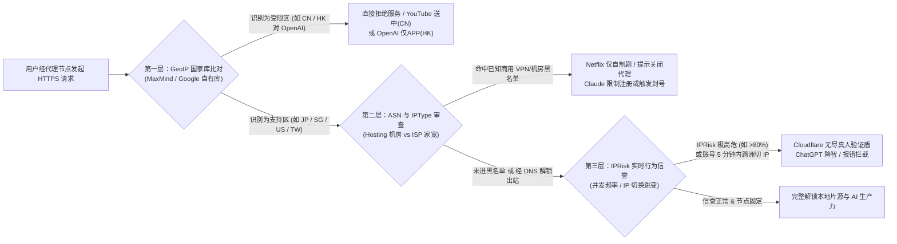

# 原生 IP 和机房 IP 有什么区别：Miaoko IPType/IPRisk 解读与流媒体 AI 解锁边界

## 核心结论（Answer-First）

在跨境网络与 IP 画像体系中，**「原生 IP（Native IP）」与「机房 IP（Datacenter / Hosting IP）」根本不是一对反义词，而是两个不同维度的分类标签。**「原生 IP」的对立面是**「广播 IP（Broadcasted IP）」**，衡量的是该 IP 段在 RIR（区域互联网注册管理机构）登记的注册国家与当前服务器物理所在机房是否一致；而「机房 IP」的对立面是**「住宅/商宽 IP（Residential / ISP IP）」**，衡量的是该 IP 所属 ASN 的持有者是云计算数据中心还是当地民用宽带运营商。在商业机场生态中，绝大多数宣称的「原生 IP 节点」实际上是**「本地注册的机房数据中心 IP」**，或者是通过**「机房 IP + 后端 DNS 分流解锁」**实现的软解锁；理解这一边界，才能读懂本站 Miaoko 实测图中的 `IPType`、`IPRisk` 以及流媒体跨区与 YouTube 送中现象。

---

## 一、概念定义：理清 IP 画像的「两大正交维度」与四象限分类

新手在挑选主打流媒体或 AI 解锁的机场（见[AI 与流媒体解锁兼容性总览](/ai-media/compatibility/)）时，最容易掉进商家宣传文案的文字游戏里。例如，站内[微风网络](/brands/weifeng/)标注「多地原生 IP 节点」，[Firefly](/brands/firefly/)标注「原生 IP 节点」，[闪跃](/brands/shanyue/)标注「原生 IP 解锁」，而[一翻云](/brands/yifan/)更是直接宣称「原生住宅 IP」（以上均属品牌方 `vendor` 声明）。

为什么很多用户连上所谓的「原生 IP」后，用 IP 检测工具一查，上面却赫然写着 **`Datacenter（机房）`** 和 **`高风险（High Risk）`**？因为你必须从两个互相垂直的维度来剖析一个 IP 地址：

### 1.1 维度一：按地域归属一致性划分 —— 原生 IP vs 广播 IP

全球 IPv4 地址由五大区域互联网注册管理机构（如亚太地区的 `APNIC`、北美的 `ARIN`、欧洲的 `RIPE NCC`）负责分配。
- **原生 IP（Native IP）**：指该 IP 地址段在 RIR 的 **WHOIS 原始注册国家/地区（Registered Country）**，与这台服务器当前**物理放置并发起 BGP 路由宣告（BGP Announcement）的机房所在地**完全一致。例如：一段在 APNIC 注册归属于日本本土企业的 IP，被部署在东京 Equinix 机房的服务器上对外提供服务，它的注册地与物理地都是 `JP`，这就叫日本原生 IP。
- **广播 IP（Broadcasted IP / 非原生 IP）**：由于 IPv4 地址早已枯竭，许多跨国云服务商（如搬瓦工、Akamai/Linode、Vultr 或各类香港/台湾廉价 VPS 商家）会把自己手头在**美国（US）、英国（GB）或西班牙（ES）注册的 IPv4 地址段**，通过 BGP 协议「广播（宣告）」到位于**香港、日本、台湾或新加坡**的物理机房去使用。
  - **结果**：你连接这台香港或台湾服务器时，物理延迟确实只有 `20–40ms`（因为机器真在香港/台湾），但当流媒体或 AI 平台查询老旧 WHOIS 注册库时，会认为你是一个「美国人/英国人/西班牙人」，从而导致地区解锁错乱或被判定为代理伪装。

### 1.2 维度二：按 ASN 使用主体属性划分 —— 住宅/商宽 IP vs 机房 IP

每一个公网 IP 都隶属于一个 **自治系统号（ASN，Autonomous System Number）**。全球 IP 情报数据库（如 IPinfo、MaxMind、Ipdata、ipapi）会根据该 ASN 的主营业务，将 IP 标记为不同的 `usageType`（即 Miaoko 测速图中的 **`IPType`**）：
- **住宅/家宽 IP（`isp` / `Residential`）**：ASN 持有者是当地合规的民用宽带接入运营商（例如台湾中华电信 HiNet、香港 HKT 网上行、日本 NTT OCN 家庭宽带、美国 Comcast / AT&T）。这类 IP 分配给真实家庭路由器，信誉分最高，但在商业代理中带宽极小、价格极其昂贵（通常仅出现在 600 元/月以上的独享定制方案或需要自建链式代理落地）。
- **机房/数据中心 IP（`hosting` / `Datacenter` / `IDC`）**：ASN 持有者是云服务商或数据中心托管商（如 AWS、Google Cloud、阿里云国际、Datacamp、 Akamai、Misaka、Dmit、GSL Networks 等）。**商业机场 98% 以上的共享节点都运行在数据中心机房服务器上，因此它们的 `IPType` 天然就是「机房」。**

### 1.3 代理节点 IP 属性四象限矩阵表

将这两个维度交叉组合，我们就得到了代理节点 IP 的真实四象限图谱：

| IP 组合象限 | 注册地 vs 物理机房 | ASN 主体类型 (`IPType`) | 在商业机场中的真实占比 | 典型流媒体与 AI 解锁表现 |
| :--- | :--- | :--- | :--- | :--- |
| **1. 原生住宅/本土商宽 IP** | 一致（本土注册 + 本土机房） | `ISP / Residential`（宽带运营商） | **极罕见（`< 2%`）**，多见于高价私人定制档（如[光速云](/brands/guangsuyun/) 680元定制档宣称独享原生IP，需线下核实） | 几乎通杀所有本土限制级流媒体（如日本 Abema/赛马娘、台湾动画疯）、TikTok 运营及高风控金融/AI 站点。 |
| **2. 原生机房数据中心 IP** | 一致（本土注册 + 本土机房） | `Hosting / Datacenter`（数据中心机房） | **主流优质节点（约 `30%–50%`）**，多数机场口中的「原生 IP」实指此类 | 只要未被滥用拉黑，可直连解锁当地 Netflix 非自制剧、Disney+ 与 ChatGPT；若多人滥用导致高风险，仍可能触发 Cloudflare 验证码。 |
| **3. 广播机房 IP + DNS 软解锁** | 不一致（如美/欧注册 IP 广播到港/台/新机房） | `Hosting / Datacenter`（数据中心机房） | **最常见（约 `40%–60%`）**，高性价比大带宽机场的主力落地 | 节点本身是广播机房 IP，但机场在后端挂了 DNS 分流解锁：测速图上流媒体显示全绿，但有时会出现「台湾节点解出英国 `GB` 或西班牙 `ES` 区」的跨区痕迹。 |
| **4. 劣质广播机房 IP（无解锁/送中）** | 不一致或网段已被严重污染 | `Hosting / Datacenter`（甚至被标为 `Proxy/VPN`） | **常见于超低价粗放节点** | Netflix 仅能看自制剧（Originals Only）或直接报错代理；YouTube 被 Google 判定为 `送中(CN)`；OpenAI / Claude 直接封禁。 |

---

## 二、技术原理：目标平台如何识别你的 IP？Miaoko 实测图字段深度拆解

为什么有的机房 IP 能看 Netflix、能用 ChatGPT，有的却连网页都进不去？这就涉及到海外平台的三层 IP 审查机制，以及我们如何正确判读实验室归档的 **Miaoko 流媒体与 AI 实测图**。

### 2.1 海外流媒体与 AI 平台的三层风控漏斗



> **流程图说明**：上图展示了目标网站从「地理位置（GeoIP）→ 自治系统类别（ASN/IPType）→ 实时欺诈风险分（IPRisk）」的三层递进风控逻辑。

1. **第一层：GeoIP 地理位置库（重点解决「你在哪个国家」）**：
   - 大多数中小型网站直接购买商业 `MaxMind GeoLite2 / GeoIP2` 或 `IPinfo` 数据库；
   - **特例是 Google（掌控 YouTube 与 Gemini）**：Google 拥有全球最庞大的自有主动位置修正系统。如果某个香港、台湾或新加坡机房 IP 下，有大量开启了手机 GPS 定位或携带中文环境特征的设备持续连入，Google 就会将该 IP 在其内部库中强制改判为 **`中国大陆（CN）`**——这就是著名的 **「IP 送中」** 现象（详见[YouTube 送中排查专题](/ai-media/youtube/)与[Gemini 节点失败排查](/ai-media/gemini/)）。
2. **第二层：ASN 类型与 DNS 分流劫持（重点解决「机房 IP 怎么看流媒体」）**：
   - Netflix 和 Disney+ 对已知的大型云服务器 ASN（如 AWS、阿里云、DigitalOcean）封锁极严。
   - 为了在不采购昂贵原生小机房带宽的前提下让大带宽机房节点也能看流媒体，机场运维普遍采用 **「DNS 解锁（SNI Proxy 分流解锁）」** 技术：当你在节点 A（`2Gbps` 大带宽机房广播 IP）上请求 `netflix.com` 时，落地机内部的 DNS 会把 Netflix 的鉴权域名偷偷解析到机场租用的另一台极小带宽的「原生干净小鸡 B」上完成身份校验。
3. **第三层：IPRisk 欺诈风险评分（Scamalytics / IPQS）**：
   - 反欺诈数据库会实时统计某一个 IP 地址在过去 24 小时内发起了多少次跨账号登录、是否有爬虫行为、是否暴露了公开代理端口，从而给出一个 `0%–100%` 的风险值（即 Miaoko 图中的 **`IPRisk`**）。

### 2.2 逐项读懂 Miaoko 实测图：`IPType`、`IPRisk` 与解锁状态列

在本站归档的[光速云](/brands/guangsuyun/) `2026-08-19` 批次 5 张 Miaoko 实测截图（位于 `/images/evidence/guangsuyun/`）及[无忧链接](/brands/wuyou/) `2026-07-18` 流媒体实测图（`/images/speedtests/wuyou-2.jpg`）中，包含以下核心列，读懂它们就能一眼看穿节点的真实底色：

- **`IPType`（IP 类型列）**：
  - 在光速云三网（广西移动、长沙电信、河北联通 62 节点）与珠海联通（70 节点）的 Miaoko 截图中，你能看到绝大多数香港、日本、新加坡、美国、台湾节点的 `IPType` 均明确标注为 **`机房`**。这直接证实了：**即便是主力大牌机场，其承载日常高并发流量的节点池也以数据中心机房 IP 为主，而非民用家宽。**
- **`IPRisk`（风险评分列）**：
  - 图中节点普遍呈现 **`高危(79%)`**、**`高危(89%)`** 甚至 **`极高危(100%)`** 的橙色或红色标签，仅有少数节点显示 `低危` 或 `中危`。
  - **客观解读**：在共享机场（几百上千人共用同一个出口 IP）中，`IPRisk` 显示高危是**行业常态**，不代表该节点被墙或不能用；但它意味着你在使用该节点访问挂载了高安全级别 Cloudflare WAF 的网站或登录风控严格的海外银行/AI 账号时，更容易遇到验证码质询。
- **`OpenAI` / `Gemini` / `YouTube` / `Netflix` / `Disney+`（业务实测列）**：
  - **`解锁(XX)`**（绿色）：代表测试当时成功访问该服务，括号内的两字母代码（如 `HK`、`SG`、`TW`、`JP`、`US`、`GB`）代表**目标平台识别出来的该 IP 所属国家/地区**。
  - **`送中(CN)`**（红色/粉色）：代表该境外节点 IP 已被目标平台（主要是 YouTube / Google）拉入中国大陆归属库，失去海外免广告或地区特性。
  - **`仅APP(HK)`**（黄色/蓝色）：常见于香港节点访问 OpenAI，代表网页端被拒或受限，仅移动端 API 探测通过。
  - **`自制`**（黄色）：代表 Netflix 识别出了该节点为代理/机房 IP，仅允许观看 Netflix 自家投资拍摄的原创剧（Originals），屏蔽了第三方版权动漫与电影。

---

## 三、实际影响：站内实测证据揭示的「原生宣称 vs 真实解锁」三大反差

如果只听信宣传页上的「全线原生 IP，完美支持所有流媒体与 AI」，实际使用中极易踩坑。以下是本站审计报告中的三组真实证据（`measured` & `historical`）：

### 3.1 反差一：宣传全面支持流媒体，实测大批新加坡/台湾节点 YouTube「送中(CN)」

- **证据来源**：
  1. **[光速云](/brands/guangsuyun/) `2026-08-19` 归档批次** `guangsuyun-miaoko-streaming-ai.jpg`（珠海联通 9Gbps，70 节点 Vless + AnyTLS）：虽然资料宣称全面支持 YouTube，但实测图中，**`新加坡 01–10`、`台湾 01–06` 与 `08–10`，以及 `电信-台湾01/02`、`电信-新加坡01`、`电信-日本01` 等十余个节点的 YouTube 列均显示为 `送中(CN)`**。
  2. **[无忧链接](/brands/wuyou/) `2026-07-18 21:47:23 CST`** `wuyou-2.jpg`（50 节点御三家实测）：其余 49 个节点正常解锁，但 **`香港 HKG-01` 节点的 `INTL_youtube` 列显示为 `送中(CN)`**。
  3. **[灵动云](/brands/lingdong/) `2026-07-20/21` 历史实测摘要**（2026-08-09 档案）：明确记录「新加坡/台湾 YouTube 送中」。
- **实际影响**：连上被「送中」的节点后，不仅 YouTube Premium 后台播放与免广告特权可能失效，且因 Google 内部共享位置定位库，**所有在 YouTube 显示 `送中(CN)` 的节点，访问 Google Gemini 或 AI Studio 时几乎都会同步报错「您所在的国家/地区不支持此服务」**。

### 3.2 反差二：节点名字叫「台湾」，实测 Netflix 解锁地区却跳到「英国(GB)」或「西班牙(ES)」

- **证据来源**：在[光速云](/brands/guangsuyun/) `2026-08-19` 的 Miaoko 流媒体截图中，部分标注为 **台湾（TW）** 的节点，其 `Netflix` 解锁列显示为 **`解锁(GB)`（英国区）**，且多条台湾节点 `Disney+` 显示 **`失败`**；在[灵动云](/brands/lingdong/)历史测试记录中，也记载了 **「台湾落地实测 Netflix / Disney+ 识别偏欧 `ES`（西班牙区）」**。
- **实际影响**：这是典型的**广播 IP 或跨区 DNS 解锁后遗症**。用户为了看含繁体中文字幕的台湾区独占动漫选中「台湾节点」，结果因该节点使用了欧洲注册广播 IP 或欧洲出口 DNS 解锁，点开 Netflix 却只有英文字幕或西语配音，找不到台湾本土片源（详见[Netflix 原创剧与全区解锁及跨区偏差专题](/ai-media/netflix/)）。

### 3.3 反差三：香港专线即便 IP 再好，也跨不过 OpenAI 与 Gemini 的「行政区划锁」

- **证据来源**：在光速云三网（移动/电信/联通）62 节点 Miaoko 实测图中，香港专线节点的 `OpenAI` 列多显示为 **`仅APP(HK)`**，`Gemini` 列大面积显示为 **`失败`**；反倒是部分新加坡、马来西亚、土耳其节点显示 Gemini `解锁`。
- **实际影响**：OpenAI 与 Google Gemini 在服务条款层面**直接将中国香港（HK）排除在支持地区列表之外**。越是纯正的香港本土原生 IP，访问 ChatGPT 网页版和 Gemini 越会被直接拦截；除非机场在后端配置了将 AI 域名二次转发到新加坡、日本或美国的链式分流解锁。

---

## 四、使用场景与本地自检：如何按需验证节点的真实 IP 属性？

### 4.1 三大业务场景的 IP 选型指南

1. **常规网页检索、GitHub 开发、YouTube 4K 视频**：**完全不需要真原生/家宽 IP**，选择带宽大、延迟低的香港或新加坡机房 IP 节点（避开标 `送中(CN)` 的编号即可）。
2. **Netflix / Disney+ 追繁体中文字幕新番**：需要**地区码识别正确的本土解锁节点**，确认解锁括号里的地区码为 `(TW)`、`(HK)` 或 `(SG)`，而非跳到 `(GB)` 或 `(ES)`。
3. **ChatGPT / Claude / Gemini 重度生产力与 TikTok 运营**：ChatGPT 与 Gemini 重点要求 **非港/非送中的支持区 IP（优先日本 `JP`、美国 `US`、新加坡未送中节点 `SG`）**；Claude 对机房 ASN 污染敏感（详见[Claude 防封出站策略](/ai-media/claude/)）。务必在客户端中使用[分流规则配置](/guides/split-routing/)将 AI 域名固定到单一日本或美国节点。

### 4.2 本地命令行 10 秒核验节点出口 IP 与 ASN 归属（只读操作）

切换新节点后，直接在终端执行以下只读 `curl` 命令查询 `ipinfo.io` 公开接口：

```powershell
# 适用系统: Windows 10 / 11 (PowerShell)
# 目的: 通过本地代理端口 (示例 127.0.0.1:7890) 查询当前节点出口公网 IP、地理国家码及所属 ASN 运营商/机房名称
# 风险等级: 低（纯只读查询公开 JSON 接口，不修改任何本地配置）
curl.exe -x http://127.0.0.1:7890 -s https://ipinfo.io/json
```

*(注：macOS / Linux 用户请将 `curl.exe` 替换为 `curl`。)*

- **`"country": "JP"` / `"TW"` / `"SG"`**：核对返回国家代码是否与所选节点一致。若选「台湾 01」却返回 `"GB"` 或 `"US"`，说明是未完成地理库修正的**跨国广播 IP**。
- **`"org": "AS60068 Datacamp Limited"` / `"AS9009 M247"`**：看到知名托管机房名称即为标准**数据中心机房 IP（Hosting）**；若看到 `"AS3462 Chunghwa Telecom"` 或 `"AS4760 HKT Limited"`，则具备本土运营商（ISP）属性。

---

## 五、常见误区：识别关于「原生 IP」的三大营销陷阱

### 误区一：「只要机场简介写着『全线原生住宅 IP』，月付 20 元就能买到真家宽」
**事实澄清**：合规民用家宽上传带宽极小且严禁 24 小时跨国代理商用。在月付 `15–35 元` 的共享机场中，宣称「全节点原生住宅 IP」（已被审计报告标记为 `vendor` 待核实）在成本上不可能全线铺开。遇到此类宣传一律按「机房 IP + DNS 解锁」预期实测，切勿盲目大额年付（详见[机场避坑指南](/security/avoid-pitfalls/)）。

### 误区二：「Miaoko 测速图里 `IPRisk` 显示高危(89%)，说明这家机场不能用」
**事实澄清**：只要一个 IP 有数十人共用（所有大众商业机场均为共享 IP），反欺诈库就会将其 `IPRisk` 拉高到 `70%–100%`。若需 `0%` 低风险独享住宅 IP，需自行采购海外静态住宅代理并通过客户端 `dialer-proxy`（链式代理）挂载出站。

### 误区三：「节点今天测出来能解锁 Netflix 和 Gemini，以后这一年就永远能解锁」
**事实澄清**：流媒体和 AI 封锁库每日动态更新。站内主打 AI 场景的[速界](/brands/sujie/)在资料中诚实提示：「**AI 可用性受 IP、地区和平台规则影响，不应承诺永久稳定支持所有 AI 平台**」；[可信云](/brands/kexin/)也主动说明「**AI 与流媒体目前缺乏统一实测数据**」。因此有刚需的用户务必养成**按月付费、配置多地区备用策略组**的习惯。

---

## 六、常见问题（FAQ）

### 很多机场宣传「全节点原生 IP」，原生 IP 就等于家庭住宅宽带 IP（家宽）吗？

绝对不等于。这是代理行业最普遍的概念混淆。「原生 IP vs 广播 IP」讨论的是 IP 的注册国家与当前服务器物理所在国家是否一致；而「住宅 IP（ISP/Residential）vs 机房 IP（Hosting/Datacenter）」讨论的是该 IP 所属自治系统（ASN）的运营主体是当地民用宽带运营商还是数据中心机房。机场节点 95% 以上的所谓「原生 IP」，本质上都是「注册地与机房所在地一致的本地机房 IP（Native Datacenter IP）」，而非昂贵的民用家庭宽带。

### 为什么在 Miaoko 实测图里，许多显示解锁 Netflix 和 Disney+ 的节点，IPType 一栏却显示「机房」且 IPRisk 显示「高危(89%)」？

因为流媒体平台（如 Netflix、Disney+）与风控反欺诈数据库（如 Scamalytics、IPinfo）的拦截逻辑不同。由于同一代理节点 IP 有数百名用户共享并发访问，反欺诈库会因高频连接将其 IPRisk 标为「高危」且识别 ASN 为「机房」；但许多机场会在落地机房配置「DNS 解锁（分流解锁）」将该节点的流媒体鉴权请求转发给另一台专门用于解锁的干净小主机，从而实现在「高危机房 IP」上照样看非自制剧。

### 为什么有些台湾或新加坡节点看 YouTube 会显示「送中(CN)」，或者看 Netflix 被识别成英国(GB)、西班牙(ES)？

这是因为该节点的出口 IP 属于跨区广播 IP，或者其网段被大量中国大陆用户在不规范环境下长期使用，导致 Google 的地理位置数据库（GeoIP）将该 IP 的常驻人群归属地动态修正为了中国大陆（CN）；而识别成 GB（如站内光速云 2026-08-19 实测中部分台湾节点 Netflix 显示 GB）或 ES（如灵动云 2026-07-20/21 历史实测中台湾落地 Netflix/Disney+ 识别为 ES），则是因为落地机使用了跨国广播 IP 或接入了指向欧洲出口的第三方 DNS 解锁服务。

### 访问 ChatGPT、Claude 和 Gemini 时，原生 IP 和机房 IP 对封号与报错有什么实际影响？

三大 AI 平台的风控侧重点各不相同：OpenAI（ChatGPT）和 Google（Gemini）首先严格校验 GeoIP 国家/地区（例如香港哪怕是顶级本土原生 IP，OpenAI 网页端也会拦截或仅限 APP，Gemini 也会直接失败，而 Google 还会联动送中库拦截被判 CN 的 IP）；Anthropic（Claude）则对机房 ASN 的并发滥用与「短时间内频繁跨国切换节点 IP」极为敏感，一旦同一机房 ASN 下爆发批量违规请求或你的账号在港/日/美 IP 间秒切，极易触发连坐封号。

### 普通用户应该如何查询自己当前连接的节点到底是原生 IP、广播 IP 还是 DNS 解锁？

最稳妥的核验方法是组合比对：第一，查看该 IP 的自治系统号（ASN）归属类别是 `isp`（宽带商）还是 `hosting`（数据中心）；第二，比对 RIPE/APNIC/ARIN 的 WHOIS 注册国家（Country）与 MaxMind/IPinfo 的物理定位国家是否一致；第三，直接访问目标业务（如 Netflix 非自制剧、YouTube Premium 页面或 Gemini 网页端），以真实业务可用性为准，而不是迷信测速图上的单一绿标。

---

## 七、关联阅读与延伸排障入口

- **返回上级专题**：[线路与节点原理解析总览](/routes/) ｜ [AI 与流媒体解锁兼容性总览](/ai-media/compatibility/)
- **同集群深度解析**：
  - [IEPL 和 IPLC 有什么区别：二层以太网 vs 点对点专线架构](/routes/articles/iepl-vs-iplc-differences)
  - [节点延迟低是否意味着下载速度快：RTT vs HTTPS Ping 与 32 线程测速](/routes/articles/low-ping-vs-download-speed)
  - [如何识别未经验证的专线宣传：比对 2026-10-19 趋同表与 0B 证据](/routes/articles/how-to-spot-unverified-iepl)
- **流媒体与 AI 专项排查**：
  - [ChatGPT 节点解锁实测与仅 APP 排障](/ai-media/chatgpt/)
  - [Claude 账号防封与静态节点策略](/ai-media/claude/)
  - [Gemini 地区报错与送中联动排查](/ai-media/gemini/)
  - [Netflix 全区解锁与跨区识别偏差](/ai-media/netflix/)
  - [YouTube 送中（CN）成因与 5 步自检](/ai-media/youtube/)
