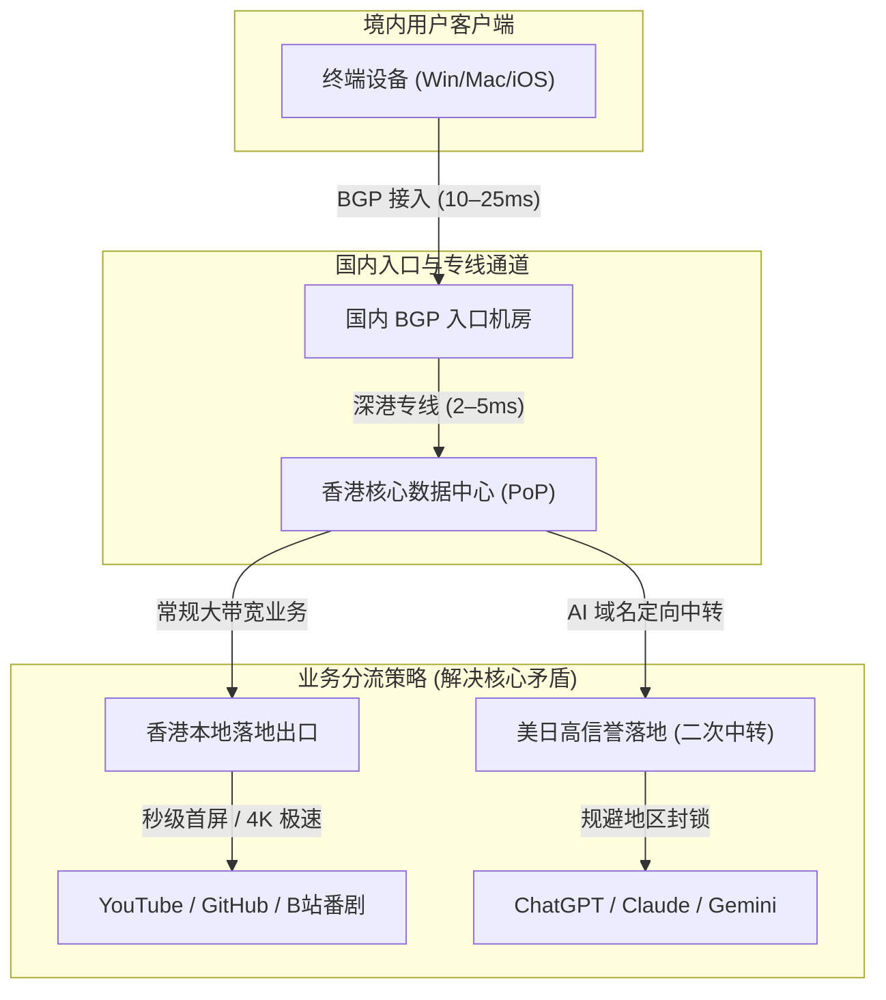

# 香港节点分析：低 RTT 吞吐优势、0B 故障实测与 AI 解锁及 YouTube 送中破局

在绝大多数跨境网络用户的客户端节点列表里，**香港节点**（HK）永远占据着无可撼动的主力位置。凭借与中国大陆地理距离极近的天然物理优势，优质的香港专线节点往往能跑出 **`14ms–33ms`** 的极低 RTT（往返时延），网页打开几乎与国内站点无异，4K 甚至 8K 超高清流媒体拖拽进度条几乎零缓冲。

然而，香港节点也是日常排障中遭遇“离奇故障”与“体验割裂”最为集中的区域：为什么明明延迟低至 16ms 且 HTTP 延迟正常，实测下载速度却诡异地停留在 **`0B`**？为什么看视频飞快，一打开 ChatGPT 或 Claude 却频频被拦截？为什么部分香港节点在 YouTube 上会被判定为 **`送中(CN)`**？

本专题基于实验室保留的光速云、宇宙云、无忧链接等多份实测测速截图与网络工程数据，全景拆解香港节点的工程价值、单节点故障实证与精细化分流策略。

---

## 一、香港节点的网络工程地位：为什么它是中文代理的绝对基石？

### 1.1 物理距离与海底/陆地光缆直埋优势

网络时延的第一制约因素是光在光纤介质中的物理传播速度。光在石英玻璃光纤中的折射率约为 1.47，每传输 1,000 公里单向耗时约 5 毫秒，往返 RTT 增加约 10 毫秒。
- **深港边界陆缆直连**：从深圳特区穿越罗湖、落马洲至香港新界，陆地光缆物理直线距离仅数十公里。通过合规深港专线传输，跨境单向延迟通常在 **`2ms–4ms`** 之间；即使加上华南、华中乃至华东地区的国内中转，终端到达香港核心机房的物理 RTT 也能轻松控制在 **`15ms–35ms`** 范围。
- 与日本节点（直连通常 50–80ms）和美西节点（物理极限 130–180ms）相比，香港节点在 TCP 握手（1 个 RTT）与 TLS 1.3 握手（1 个 RTT）耗时上具备压倒性的物理优势，网页首包响应（TTFB）极其利落。

### 1.2 HKIX（香港互联网交换中心）的枢纽地位

香港拥有全亚洲最为发达的互联网基础设施之一，其中坐落于香港中文大学的 **HKIX（Hong Kong Internet eXchange）** 是亚太地区吞吐量极大的公网互联枢纽：
- 全球各大内容分发网络（CDN，如 Cloudflare、Akamai、Fastly）、顶级科技巨头（Google、Microsoft、AWS）以及一级国际运营商（Tier 1）均在香港部署有大型数据中心和边缘节点。
- 香港至全球各地的海底光缆（如 SJC、APG、ASE、TGN-IA）出海带宽极其充沛。因此，机场将香港作为流量落地中心或二级中转调度站，具有无可替代的带宽经济性与互联效率。



> **架构图说明**：上图为网络工程逻辑概念示意，用于展示香港节点在代理网络中的流量路径分流模型，非特定服务商物理网络拓扑。

---

## 二、实验室实测数据复盘：香港节点的超低 RTT 与真实吞吐表现

在本站实验室归档的原始实测证据包中，香港节点的高性能在多个批次的数据中得到了确凿验证：

### 2.1 光速云 2026-08-11 实测表现（MAI-TEST-BOT 32 线程，珠海联通 5Gbps 后端）

根据 `guangsuyun-20260811.png`（测试时间 14:32:56 CST，54 节点 Shadowsocks）记录：
- **基线 RTT 极其平直**：`HK 03` 至 `HK 19` 共 17 个主力香港节点，延迟 RTT 集中在 **`14ms–33ms`** 之间（其中大部分稳定在 16ms、18ms、19ms、20ms）；
- **HTTP 响应极其迅捷**：对应的 HTTP 端到端体验延迟集中在 **`34ms–54ms`**；
- **高下行吞吐能力**：主力香港节点的平均下载速度普遍在 **`54.43MB/s–75.07MB/s`**（折合带宽约 435Mbps–600Mbps），最大峰值速度突破 **`78.81MB/s`**（折合带宽约 630Mbps）。
- 这种高吞吐低延迟特性，直接印证了香港节点作为拉取大文件、观看 4K/8K 视频首选主力的天然优势。

### 2.2 2026-10-19 品牌非晚高峰表格数据横向对照

在 31 家品牌资料中的 15 家附带的 2026-10-19 非晚高峰表格测速中，香港节点同样呈现出高度趋同的低延迟特征：
- 15 家品牌的香港节点延迟全部落在 **`21ms–27ms`**，下行速度标注在 **`477Mbps–548Mbps`** 之间；
- 对比同批次测试中台湾节点的 37–41ms、新加坡节点的 42–46ms、日本节点的 53–57ms 以及美国节点的 134–180ms，香港节点在数字面板上呈现出绝对的领跑态势。

---

## 三、不可忽视的单节点异常实证：0B 失联与 201ms 异常延迟

然而，在耀眼的低延迟数字背面，原始测试截图忠实地记录了严重违背常规认知的单节点故障。**盲目迷信列表里的低延迟数字，是导致客户端频繁断网的最大元凶**。

### 3.1 光速云 HK02 与宇宙云香港 01 的「0B 故障」双重实证

在两份不同测试工具、不同服务商的原始截图中，记录到了完全相同的“幽灵节点”现象：

| 测试样本来源 | 节点名称 | 协议显示 | 延迟 RTT / TLS RTT | HTTP / HTTPS 延迟 | 平均下载速度 | 最大速度 | 故障性质定性 |
|---|---|---|---|---|---|---|---|
| **光速云实测** (`guangsuyun-20260811.png`) | HK｜香港｜02 | Shadowsocks | **16ms** | **36ms** | **0B** | **0B** | **死节点假绿**：握手正常但无任何数据流通过 |
| **宇宙云实测** (`yuzhou-20260811.png`) | 【香港】01 | VLESS | **91ms** | **446ms** | **0.00B** | **0.00B** | **同批次唯一 0B**：同图 02–15 均速高达 500MB/s |

这两份实证数据揭示了深刻的网络排障原理：
1. **握手与转发完全解耦**：客户端测速工具在计算 RTT 时，通常仅测试本地到国内入口机房、或入口机房到专线对端的轻量 TCP/TLS 握手。握手成功即标记为“低延迟绿色”。但一旦境外落地服务器上的代理服务端程序崩溃、出口网络欠费宕机或宿主机网络配置错误，数据流根本无法完成转发，最终表现为 **`0B`**。
2. **自动选路陷阱**：Clash 等客户端内置的 `url-test` 自动测速机制，往往默认选择延迟最小的节点。若不加防御，客户端极易把用户所有流量自动切换至像 `HK02` 这样延迟仅 16ms 却完全无法上网的死节点，导致整机断网。

### 3.2 光速云 HK20 节点 201ms 异常延迟剖析

在 `guangsuyun-20260811.png` 中，前 18 个香港节点延迟均在 14–33ms 之间，唯独第 19 个节点 **`HK｜香港｜20` 的 RTT 陡增至 `201ms`**（HTTP 延迟更是高达 `408ms`）：
- 这一现象有力证明了**同一品牌节点列表中存在承载链路异构**；
- 201ms 的往返时延，在物理上意味着该节点的流量根本没有走深港专线直达，极可能是通过公网备用线路绕道美西或欧洲中转后再返回香港。如果用户误选了该节点，原本期望的低延迟体验将荡然无存。

### 3.3 避开 01/02 热门编号的实测规律

在日常使用中，用户普遍习惯顺手选择排在最顶部的 `香港 01` 或 `香港 02`。这导致几乎所有机场的前两个节点负载极度集中。结合上述实测中 `HK01`、`HK02` 频现 0B 故障的实证，**日常选点应主动避开首位编号，优先选择 `05` 至 `15` 等中间编号节点**，网络稳定性和抗抖动能力通常显著更优。

---

## 四、香港节点的核心痛点与矛盾：AI 地区限制与 YouTube「送中」

### 4.1 为什么香港节点极速却被主流 AI 拒之门外？

这是香港节点在当下时代最突出的核心矛盾：
- **平台官方合规政策**：OpenAI（ChatGPT）、Anthropic（Claude）以及 Google（Gemini）在其官方公布的支持国家与地区清单中，**默认均不包含中国香港**。如果使用纯粹的香港原生住宅或机房 IP 访问其官方网页端，对方的 WAF 规则会立即依据 IP 库定位触发地理拦截。
- **实测证据印证**：
  - 在 `guangsuyun-miaoko-streaming-ai.jpg`（三网多运营商测试）中，香港专线节点（ASN 归属 `AS32167 HK-LSHIY`）在 `AI_openai` 这一栏普遍显示为 **`仅APP(HK)`**，而在 `Gemini` 一栏几乎全军覆没显示为红色 **`失败`**；
  - **什么是「仅APP(HK)」？** 这说明由于移动端 App 采用的 API 校验策略与网页端严格的 Cloudflare 防火墙不同，香港 IP 能够通过 iOS/Android 客户端完成对话，但使用 PC 浏览器访问网页版依然会被无情阻断。
- **服务端的二次转发补丁**：部分技术实力雄厚的机场会在香港节点后端部署 DNS 智能分流规则，当检测到客户端在请求 `*.openai.com` 时，悄悄将该请求通过内网转发至后置的日本或美国落地节点。这也是为什么在某些测试中香港能显示“解锁(US/JP)”，但这种补丁高度脆弱，一旦目标域名规则变动便会瞬间失效。

### 4.2 YouTube「送中（CN）」现象深度剖析

除了 AI 限制，香港节点另一个常见困扰是 YouTube 定位异常被判定为中国大陆境内：
- **实测案例佐证**：在站内保留的无忧链接 `wuyou-2.jpg` 实测截图中，**`香港HKG-01` 节点在 `INTL_youtube` 一栏明确显示为红色的 `送中(CN)`**。
- **Google 送中机制机理**：Google 依靠复杂的地理定位算法（GLIF）维护内部 IP 归属库。若某个香港机房 IP 段被大量未关闭定位的设备频繁访问，或者该 IP 曾被关联至内地区域的广告投放与搜索行为，Google 会主动将该 IP 判定为“中国大陆地区访问”。
- **送中的三大实质危害**：
  1. 移动端 YouTube 无法使用后台画中画（PIP）和息屏后台播放功能；
  2. 哪怕开通了 YouTube Premium 会员，送中节点下依然可能被强制插入视频广告；
  3. YouTube Music 提示地区版权不支持，无法播放歌曲。

---

### 4.3 落地 ASN 与 IP 纯净度分析：以 AS32167（HK-LSHIY）为例

在实验室留存的 `guangsuyun-miaoko-cmcc-gx.jpg` 截图中，香港专线 01 至 20 节点的自治系统编号（ASN）全部清晰显示为 **`HK-LSHIY-USER-CONTENT-AS32167`**。

这一工程细节揭示了香港落地服务器的底层网络属性：
- **商宽广播 IP 的双刃剑特性**：该 ASN 属于典型的香港本地商业宽带与机房互联网络，其优势在于与各大国际 CDN（如 Fastly、Cloudflare、Akamai）的本地互联极其紧密，网络跳数少，丢包率极低，非常适合支撑大流量的数据吞吐。
- **中等欺诈分（IPRisk = Medium 30）的深层影响**：实测图显示，该段 IP 在主流风控数据库中的风险分被评估为 Medium（30）。这一中等风险分虽然完全不影响 Google 搜索、YouTube 4K 和日常代码托管访问，但在面对极度敏感的金融风控（如海外银行登录、Stripe 支付风控）以及 AI 网页端封控时，便会触发额外的风控拦截或人机验证挑战。
- 用户在处理高敏感度业务时，应当理解专线落地 IP 的风控属性，避免在重要海外账户登录时频繁跨地区切换 IP。

## 五、适用场景与不适用场景决策矩阵

| 业务场景 | 香港节点适用度 | 关键原因与工程依据 | 替代优化建议 |
|---|---|---|---|
| **YouTube 4K/8K 视频** | **极高（主力）** | 低 RTT 带来极快首包，充沛带宽支撑高码率缓冲 | 避开如 `wuyou-2` 所示的单点送中节点 |
| **日常 Google 搜索与网页** | **极高（主力）** | TCP+TLS 握手仅需十余毫秒，页面响应利落如内网 | 配合规则分流，直连国内白名单 |
| **GitHub 代码克隆与开发** | **极高（主力）** | 跨境大文件下行吞吐稳定，Git 协议交互不卡顿 | 绑定低倍率香港主力节点 |
| **Bilibili 港澳台限制番剧** | **高（专属）** | 香港原生 IP 原生支持港区独家版权内容 | 配合媒体分流策略组 |
| **ChatGPT 网页端交互** | **低（不推荐）** | 官方名单未包含香港，频繁弹窗或需要二级转发 | 强制分流至日本或美西高信誉节点 |
| **Anthropic Claude 对话** | **极低（禁止）** | Claude 对香港 IP 封控极严，极易导致账号封禁 | 切换至纯净美国或欧洲节点 |
| **Google Gemini 办公** | **低（常失败）** | 站内多份 Miaoko 实测显示香港节点 Gemini 几乎全红 | 切换至新加坡或美国专用节点 |
| **日区独占手游/流媒体** | **不适用** | DMM、AbemaTV 等平台严格限制本土日本原生 IP | 换用原生 [日本节点](/routes/japan/) |

---

## 六、客户端精细化分流配置实战（让香港跑日常，美日跑 AI）

要在日常使用中完美兼顾香港节点的高吞吐与海外 AI 工具的高可用，必须建立**动静分离的规则分流体系**：

### 6.1 Clash Verge Rev / Mihomo 策略组规划

在客户端配置文件中，建立至少两个核心代理策略组：
1. **`Proxy / 节点选择`**：默认选择香港优质节点（如 `HK 05`–`HK 15`），接管所有的常规海外流量；
2. **`AI Services / 人工智能`**：单独收容日本、新加坡或美国的高纯净度节点。

在规则集（Rules）中进行定向剥离：
```yaml
rules:
  # 将 OpenAI 及其 CDN 域名强制导向 AI 策略组
  - DOMAIN-SUFFIX,openai.com,AI Services
  - DOMAIN-SUFFIX,chatgpt.com,AI Services
  - DOMAIN-SUFFIX,oaistatic.com,AI Services
  - DOMAIN-SUFFIX,oaiusercontent.com,AI Services
  # 将 Claude 域名强制导向 AI 策略组
  - DOMAIN-SUFFIX,anthropic.com,AI Services
  - DOMAIN-SUFFIX,claude.ai,AI Services
  # 将 Google Gemini 强制导向 AI 策略组
  - DOMAIN-SUFFIX,gemini.google.com,AI Services
  - DOMAIN-SUFFIX,bard.google.com,AI Services
  # 其他未命中规则的海外流量默认走香港主力
  - GEOIP,CN,DIRECT
  - MATCH,Proxy
```

通过这套配置，你在看 YouTube 4K 或拉代码时享受香港 20ms 的极速快感，而在向 ChatGPT 发送提问时，流量无缝切换至美日节点，彻底告别报错（详细规则配置可参考 [分流规则配置指南](/guides/split-routing/)）。

<AffiliateCta slug="guangsuyun" />

---

## 常见问题

### 香港节点延迟那么低、看 4K 视频那么流畅，为什么打开 ChatGPT 或 Claude 经常被拒？

这是地理物理距离优势与海外 AI 平台服务政策之间的结构性矛盾。香港距离中国内地极近，深港专线 RTT 常低至 14–33ms，非常适合大带宽吞吐；但 OpenAI、Anthropic（Claude）和 Google Gemini 的官方服务地区名单默认均不包含中国香港。如果机场未在服务端部署针对 AI 域名的二级转发，香港原生 IP 直接请求就会被平台 WAF 拦截并提示地区不支持。

### 为什么光速云 HK02 和宇宙云香港 01 两个节点在实测中延迟极低却显示为 0B？

这是代理网络中典型的「死节点假绿」故障。测速脚本探测到的十余毫秒延迟，仅代表客户端到国内中转入口服务器完成握手的耗时。若香港后端的落地 VPS 宕机、容器代理进程崩溃或端口被运营商阻断，虽然入口能正常响应测速握手包，但无法建立实际的数据通信管道，导致下行吞吐为 0B。客户端若开启基于延迟的自动选路，会误选此类故障节点导致断网。

### 测速图上出现的 OpenAI「仅APP(HK)」是什么意思？和完全解锁有什么区别？

在光速云 Miaoko 三网实测截图中，香港专线节点（AS32167）的 OpenAI 项普遍标注为「仅APP(HK)」。这意味着该节点的香港 IP 无法直接通过浏览器访问 ChatGPT 网页端（会被 Cloudflare 拦截或阻断），但 OpenAI 移动端 App（iOS/Android）对 API 接口的网络判定策略略微宽松，允许该 IP 完成 App 内的对话与登录。它并不代表网页端完全解锁。

### 什么是 YouTube「送中（CN）」？为什么像无忧链接的香港节点也会出现送中？

YouTube「送中」是指 Google 的地理位置定位算法（GLIF）根据该 IP 段的历史访问行为、关联设备语言及 GPS 探测数据，错误地将该海外节点的 IP 判定为位于中国大陆境内。在无忧链接 2026-07-18 实测截图中，香港 HKG-01 节点即被标为「送中(CN)」。送中会导致 YouTube 无法后台画中画播放、被强制推送内地区域广告且可能无法使用 Premium 会员权益。

### 为什么同一个机场的香港节点，有的延迟只有 16ms，有的（如光速云 HK20）却飙升到 201ms？

多数机场为了成本控制与线路冗余，会在同一个订阅列表内采用混合承载架构。编号靠前的主力节点（如 HK01–19）通常走昂贵的深港 IEPL/IPLC 物理专线，因此 RTT 低至 14–33ms；而编号靠后的冷门或备用节点（如 HK20）可能混用了普通公网中转、或者因主用线路故障被自动切换到了跨洋绕美公网备份线路，从而导致延迟突增 10 倍。

### 日常使用代理客户端时，如何既享受香港节点的极速网页体验，又顺畅使用 AI 工具？

最优雅的解决方案是在客户端（如 Clash Verge Rev、Mihomo、Shadowrocket）中开启「规则分流（Rule）」。将默认出站代理策略组（Proxy）指定为香港节点，承担日常 Google 搜索、YouTube 4K、GitHub 与技术文档浏览；同时单独设立 AI 策略组，利用规则将 OpenAI、Claude、Gemini 相关域名强制分流到日本、新加坡或美国的高信誉节点。

### 在机场长达十几二十个香港节点的列表里，应该遵循怎样的选点规律？

第一，坚决避开排在最前面的 01 和 02 节点，绝大多数用户默认顺着列表点击，导致前两个节点常年处于高并发拥塞状态；第二，手动选择编号位于中后段（如 05–15）的节点，负载更加均衡；第三，在客户端测速时若发现某个节点 RTT 正常但打开任何网页均超时，应立即判定为类似 HK02 的 0B 故障节点并手动切换。
