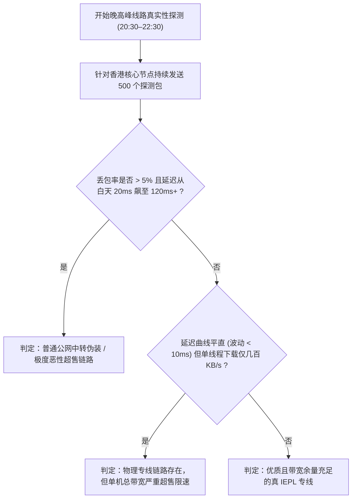

# IEPL 专线原理：跨境二层内网架构、成本复用比与晚高峰抗拥塞实测辨别

在跨境代理网络与排障分析中，**IEPL 专线**（International Ethernet Private Line，国际以太网专线）常被包装为“晚高峰零丢包、超低延迟”的黄金标准。从月付不足 6 元的极简年付套餐，到每月标价高达 680 元的定制独享专线，站内收录的 31 个品牌中有超过七成宣称搭载 IEPL。然而用户在实际使用中却频繁遭遇严重分化：有人晚高峰 4K 视频秒开，有人却连网页都打不开；更有甚者，测速软件显示延迟仅 16ms，实测吞吐却显示为 **`0B`**。

本专题基于实验室对 31 个品牌资料、实测截图与网络传输物理层原理，拆解 IEPL 专线的底层架构、商业账本、多段式链路瓶颈与辨别伪专线的方法论。

---

## 一、核心工程概念：什么是真正意义上的 IEPL 专线？

### 1.1 物理层与二层以太网承载模型

在电信运营商（如中国电信、中国联通、中国移动国际 CMI）标准定义中，**IEPL 是运营商基于 SDH、MSTP 或现代 OTN 光传送网，向企业客户提供的跨国跨地区端到端以太网二层（Layer 2）专有信道**。与公网连接相比，IEPL 具备三大物理特征：

1. **带宽时隙硬隔离**：运营商在底层光缆或 OTN 管道中开辟专属时隙，不论公网民用宽带如何拥堵，专线物理带宽在跨境段绝不与其他公网流量争抢。
2. **二层透明以太网封装**：交付标准以太网接口，境内入口与境外香港机房交换机犹如通过私有内网直连，中间不经过公网路由器的逐跳转发。
3. **确定性的超低物理时延**：路由路径由物理陆缆/海缆走向固定锁定（如深圳至香港光缆距离仅数十公里），光信号传输速度恒定，粤港 IEPL 跨境物理时延通常稳定在 3–8ms。

```mermaid
graph LR
  subgraph Local["境内客户端环境"]
    U["终端用户设备"] -->|"本地宽带接入"| ISP["本地电信/联通/移动"]
  end
  subgraph Domestic["国内中转与接入网"]
    ISP -->|"公网中转 / BGP 路由"| Entry["国内入口服务器 (BGP机房)"]
    Entry -->|"内网尾纤互联"| PopIn["IEPL 境内接入点 (PoP)"]
  end
  subgraph Backbone["跨境私有物理专线 (核心段)"]
    PopIn ===|"私有海底光缆 / 跨境陆缆 (无公网拥塞)"| PopOut["IEPL 境外对端机房 (香港 PoP)"]
  end
  subgraph Overseas["海外落地与出口枢纽"]
    PopOut -->|"本地高速交叉互联"| HKHub["香港核心落地服务器"]
    HKHub -->|"国际公网 BGP / 优质海缆"| Global["亚太/美欧落地 (日本/新加坡/美国)"]
    Global -->|"最后一条公网请求"| Target["目标网络服务 (Google/OpenAI/YouTube)"]
  end
```

> **架构图说明**：上图为网络工程逻辑概念示意，用于说明 IEPL 代理流量四段式传输模型与数据流动环节，非特定机场物理网络部署。

### 1.2 为什么普通公网中转晚高峰严重卡顿，而 IEPL 能保持平稳？

普通公网中转的跨境数据必须经过民用公网国际出口网关。晚高峰 20:30–22:30 是全国宽带集中出海时段，国际出口队列剧烈拥塞，丢包率往往从白天的 0.5% 飙升至 15%–40%。根据 TCP 拥塞控制机制，丢包会触发窗口减半，导致下载速度断崖式下跌。而真正的 **IEPL 专线完全绕开了公网国际出口网关**，数据包在境内接入点即进入专网电路，因此在晚高峰依然能维持极低的物理丢包率。

---

## 二、代理流量三段式拓扑拆解：为什么专线也会卡顿与断连？

许多用户误以为“只要买了 IEPL 专线就能全程无阻”。在网络工程中，完整的代理连接由四个串联环节组成，专线仅覆盖中间跨境段：

### 2.1 第一段：本地设备 ↔ 国内中转入口服务器（本地最后一公里）

这是绝大多数非专线原因导致的卡顿根源：
1. **本地家庭宽带抖动**：家用 Wi-Fi 信号衰减、路由器过热、光猫 NAT 性能不足，均会在最前端产生数十毫秒延迟与随机丢包。
2. **跨省跨运营商互联延迟**：例如北方移动宽带连接华南电信单线入口，跨越数千公里的骨干网互联互通瓶颈会引入显著延迟与丢包。优质机场通常采用昂贵的三网 **BGP（Border Gateway Protocol）** 机房就近接入。

### 2.2 第二段：国内入口点 ↔ 跨境私有专线通道（专线核心段）

国内入口机解密客户端请求后，将流量送入绑定的 IEPL 电路。该段物理时延极低（粤港段通常为 3–8ms）。**该区段唯一的瓶颈是服务商超售**：若机场采购 1Gbps 专线却放进 3Gbps 流量，专线交换机队列同样会溢出丢包。

### 2.3 第三段：境外对端机房 ↔ 落地服务器与目标网站（二级辐射网络）

数据到达香港核心机房后，访问香港本地资源延迟极低；但访问日本、美国等节点时，多数机场采用星型中转拓扑：**「深港 IEPL 进入香港 → 香港国际海缆分流至日本/美西」**。受光速与跨洋海缆物理距离限制，香港到美西的 RTT 必然在 110–140ms 之间，所谓“美国专线 20ms”在物理上绝不可能成立。

### 2.4 当国内入口遭遇攻击或维护时，IEPL 为何同样会秒级全红？

在多层架构中，**国内入口机房暴露在公网上，是天然的单点脆弱面**：
1. **DDoS 流量攻击**：国内入口遭遇大流量攻击导致机房黑洞牵引，用户流量根本进不去机房大门，更无法进入内网专线。
2. **域名解析与安全检测阻断**：订阅配置中的国内入口域名若遭遇 DNS 污染或 IP 被封禁，客户端便会表现为全节点超时。
3. **国内 IDC 维护**：机房临时断电或配合网络整治，专线系统失去境内端点。相关排查可参考 [所有节点超时排查](/troubleshooting/articles/nodes-all-timeout) 与 [晚高峰高延迟与丢包排障](/troubleshooting/articles/high-latency-packet-loss-peak)。

---

## 三、价格分层真相：为什么 5.6 元年付与 680 元月付均自称 IEPL？

在站内整理的 31 家品牌中，宣称 IEPL 的品牌数量极多（如光速云、微风网络、极连云、光年梯、一翻云、SOGO云、可信云、速界、二猫云、闪电鼠、大佬云、云界线、榴莲云、环球梯、梯子云、灵动云、浪网等）。然而翻开套餐账本，价格从年付折合 **5.6 元/月** 跨越到 **680 元/月**。

### 3.1 运营商专线采购的真实物理账本

合规跨境专线按 **「独享带宽（Mbps）+ 电路长度 + 端口费」** 按月计费。一条合规企业级 1Gbps 深港 IEPL 专线，月租成本高达数万元至十余万元人民币，外加国内 BGP 高防、机柜电力与境外国际带宽成本，硬性支出极为高昂。

### 3.2 5.6 元极简集群的高复用模型

站内 5 家同质化品牌（闪电鼠、大佬云、云界线、榴莲云、环球梯）均打出 5.6 元/月招牌。审计其套餐可发现：
1. **强制年付锁定**：必须一次性支付约 67 元以上年费；
2. **流量上限严苛**：月配额死锁在 **`60GB/月`**；
3. **超高复用比**：服务商将有限专线带宽切碎卖给海量轻度用户，一旦晚高峰并发上升，人均可用带宽骤降，极易触发限速或丢包。

### 3.3 20–35 元主流月付档：动态冗余与弹性调度

如 [光速云](/brands/guangsuyun/)（极速版 ¥25/月 168GB）、[唯兔云](/brands/weitu/)、[极连云](/brands/jilian/)（¥18/月 100GB）、[光年梯](/brands/guangnian/)（¥18/月 110GB）等，支持灵活单月付，提供 100GB–268GB 流量，复用比控制更为健康，且配备多入口与主备线路切换。

### 3.4 600–680 元定制独享档：企业级专线与原生独立 IP

如光速云定制版（标价 ¥680/月，500GB）或隐形人定制档，面向跨境电商防关联、跨境视频会议等严苛场景，提供端到端独享带宽资源与独立海外原生 IP。

### 3.5 专线成本与证据状态横向对照表

| 品牌/档位类别 | 代表品牌 | 宣称线路类型 | 月均实付门槛 | 月度流量配额 | 估算复用比 | 站内实验室证据状态 |
|---|---|---|---|---|---|---|
| **5.6元年付极简集群** | 闪电鼠、大佬云、云界线、榴莲云、环球梯 | 宣称全线 IEPL 物理专线 | ~¥5.6（年付锁定） | 60GB/月 | 极高（> 1:100） | 无 08-11 实测图，按品牌资料声明（vendor）管理 |
| **入门性价比档** | 极连云、光年梯、二猫云 | 宣称 IEPL / 优质专线 | ¥18–¥20/月 | 100GB–150GB | 中高（约 1:40） | 留存 2026-08-11 MAI-TEST-BOT 实测证据 |
| **主流性能档** | 光速云、唯兔云、一翻云、SOGO云 | 宣称 IEPL 专线/企业内网双架构 | ¥25–¥35/月 | 168GB–268GB | 中等（约 1:20） | 留存 2026-08-11 实测及多网 Miaoko 交叉证据 |
| **高端定制独享档** | 光速云定制版、隐形人定制档 | 宣称独享原生 IP + 独立带宽 | ¥600–¥680/月 | 500GB/月 | 极低（接近 1:1–1:3 独享） | 线下/工单人工交付，品牌资料标注 |

---

## 四、实测证据视角：如何从测速曲线、RTT 方差与「0B 节点」辨别线路成色？

### 4.1 为什么本站规范严禁单凭白天测速断定是真专线？

根据本站实验室依据《测速实测资料说明》（README 第五条）：**「单张测速图片不能单独证明节点使用 IEPL、IPLC 或原生 IP」**。白天非高峰期公网出口负载极低，普通中转也能跑出 20ms 与数百兆满速。**检验专线成色，必须依托晚高峰 20:30–22:30 的高负载监测**。

### 4.2 晚高峰 RTT 方差与持续丢包探测法

辨别真伪专线最有效的方法，是在白天（14:00）与晚高峰（21:30）分别向节点发送 500 次探测包，对比 RTT 方差与丢包率：

- **真专线**：白天 RTT 22ms，晚高峰依然保持在 22ms–28ms，丢包率持续低于 0.5%，延迟分布集中。
- **混线伪专线**：白天 25ms，晚高峰飙升至 90ms–180ms，伴随持续 5%–15% 丢包，波形剧烈抖动。

### 4.3 实测案例深度复盘：光速云 08-11 实测中的 HK02=0B 与 HK20=201ms 启示

本站归档的 `guangsuyun-20260811.png`（2026-08-11 14:32:56 CST，MAI-TEST-BOT 32 线程，珠海联通 5Gbps 后端）揭示了关键排障现象：

| 节点序号 | 节点名称 | 协议显示 | 延迟 RTT | HTTP 延迟 | 平均下载速度 | 最大速度 | 状态与排障启示 |
|---|---|---|---|---|---|---|---|
| 1 | HK｜香港｜02 | Shadowsocks | **16ms** | **36ms** | **0B** | **0B** | **低延迟但零吞吐**：典型死节点，入口握手正常但后端转发失效 |
| 2 | HK｜香港｜03 | Shadowsocks | 16ms | 49ms | 73.96MB/s | 76.35MB/s | 正常专线性能（约 591Mbps），下行充裕 |
| 19 | HK｜香港｜20 | Shadowsocks | **201ms** | **408ms** | 63.84MB/s | 68.03MB/s | **同地区延迟陡增 10 倍**：疑似跨洋中转或公网备用线路混用 |

- **「低延迟不等于可通信」**：`HK 02` RTT 仅 16ms，客户端若开启基于 Ping 的自动选路，会直接选中该死节点造成断网。
- **「同品牌节点混用多重链路」**：`HK 20` 延迟飙升至 201ms 说明同一机场不同节点可能采用完全不同的承载路径。

### 4.4 32 线程并发跑分与单线程网页体感的巨大鸿沟

测试工具（如 `MAI-TEST-BOT`）默认开启 **32 线程并发**，轻度丢包被多连接掩盖，依然能跑出 70MB/s 漂亮数据；而日常浏览、AI 对话和视频多基于单连接，遇到丢包单线程吞吐会骤降至几百 KB/s。详见 [客户端测速与体感速度差异排查](/troubleshooting/articles/bandwidth-multiplier-speedtest-diff)。

---

## 五、IEPL 专线的核心价值与客观局限性（能力边界清单）

### 5.1 IEPL 专线真正能做到的三件事

1. **规避公网国际出口晚高峰拥塞**：跨境段丢包率极低（优质线路可维持 < 0.2%）。
2. **锁定高确定性 RTT 基线**：单向传输时延固定，杜绝公网随机绕路。
3. **消除跨境公网特征审查风险**：内网传输不经过公网国际网关，抗干扰能力极强。

### 5.2 IEPL 专线绝对解决不了的四大痛点

1. **无法防御国内入口故障**：入口机房遭 DDoS、断电或封禁时专线同样瘫痪。
2. **无法改变海外落地 IP 风控**：专线只负责搬运数据，OpenAI 或 Netflix 是否拒签完全看落地 IP 信誉（参考 [ChatGPT 地区不支持排查](/ai-media/chatgpt/)）。
3. **无法打破跨洋物理时延**：香港到欧美海缆物理距离固定，美国节点延迟不可能低于 130ms。
4. **无法解决本地最后一公里劣化**：家庭 Wi-Fi 信号弱或本地宽带拥堵，专线无能为力。

---

## 六、用户选型、策略组配置与日常故障排障指南

### 6.1 专线机场选型四步验证法

1. **优先月付试错**：拒绝一次性大额年付绑定，先行月付实测。
2. **晚高峰体感验收**：在 21:00 晚高峰实测 4K 流畅度与 AI 交互响应。
3. **扫描剔除 0B 节点**：手动核验节点，排查类似 `HK02` 假绿死节点。
4. **关注主备冗余设计**：确认是否配备异地多入口（参考 [机场备选容灾方案](/security/alternatives/)）。

### 6.2 客户端策略组与容灾配置建议

在 [Clash Verge Rev](/clients/clash-verge/)、[Mihomo](/clients/mihomo/) 或 [Shadowrocket](/clients/shadowrocket/) 中：
- **禁用粗暴的 `url-test`**：避免自动选中低延迟 0B 死节点，改用手动选择或配置健康检查。
- **业务分流规划**：大流量媒体走低倍率香港专线，高风控 AI 走日本/美国节点（参考 [分流规则配置指南](/guides/split-routing/)）。

<AffiliateCta slug="guangsuyun" />

---

## 常见问题

### 同样都标称 IEPL 专线，为什么有的年付折合 5.6 元/月，有的月付要 25 元甚至 680 元？

国际以太网专线的物理电路按 Mbps 独享带宽和跨境距离向电信运营商按月支付昂贵租金。低价 5.6 元集群通常采用极高复用比将少量带宽切碎分摊给海量轻度用户，月流量锁死在 60GB 且晚高峰挤压限速；20–35 元主流月付档提供更合理的动态冗余与 150GB 左右配额；而 600–680 元定制档则提供独享带宽与独立落地原生 IP，二者底层资源池完全不是同一量级。

### 仅凭一张白天测速 20ms RTT、500Mbps 的跑分截图，能证明该节点使用了真 IEPL 专线吗？

绝对不能。根据本站实验室数据规范，单张测速图片仅代表当时测试链路的瞬时表现。在白天公网空闲时段，靠近华南的优质国内 BGP 公网中转甚至直连，同样能跑出 20ms 的 RTT 与几百兆下行速度。要验证是否为真 IEPL 专线，必须在晚高峰 20:30–22:30 的重度拥塞窗口下，持续监测连续 7 天的丢包率与 RTT 方差是否维持平直基线。

### 为什么用了 IEPL 专线机场，遇到国内入口维护或攻击时所有节点依然会全部超时？

因为代理链路是端到端四段串联结构：本地设备到国内入口服务器、国内入口到专线境内端点、跨境内网专线通道、海外落地机房到目标网站。IEPL 专线仅能保护中间的跨境传输段；如果机场位于国内的前置 BGP 入口服务器遭遇大流量 DDoS 攻击、机房断电或运营商合规清退，流量根本无法送入专线通道，终端就会表现为全节点秒级全红超时。

### IEPL 专线能彻底解决 OpenAI 提示地区不支持或 YouTube 送中（CN）的问题吗？

不能。IEPL 属于 OSI 二层/三层的数据传输隧道，仅负责快速、稳定地把数据包跨境送达海外机房。目标服务商（如 OpenAI、Anthropic、Google、Netflix）是否允许访问，完全由数据包出隧道后最后一跳的「海外落地服务器 IP 属性与信誉库」决定。即使专线物理延迟低至 15ms，若落地节点分配了被机房标记的广播 IP 或被拉黑的 ASN，依然会被拦截或判定送中。

### 测速图上明明显示 RTT 仅 16ms 且 HTTP 延迟正常，为什么速度会出现 0B 或几 KB？

测速脚本测得的低延迟通常仅代表本地与国内入口机、或入口机到海外对端握手成功的连通耗时。若海外落地服务器上的代理转发服务崩溃、出口网络欠费宕机、或者机场后端对该节点实施了单节点阻断，就会出现握手响应极快但实际无任何下行字节流传输的「死节点假绿」现象，例如光速云实测中的 HK02=0B 案例。

### 多数 IEPL 机场所谓的「日本、新加坡、美国专线」，物理上到底是怎么走的？

绝大多数商用 IEPL 机场并不具备直达全球每一座城市的独立物理专线，而是采用以「深港 IEPL」为轴心的星型中转拓扑。国内用户的流量首先通过深港以太网专线低延迟进入香港核心机房，再由香港机房借助充裕的国际公网海缆或国际骨干网中转分流至日本、新加坡、台湾、美国或欧洲机房。因此远端节点的最终延迟受跨洋海缆物理距离制约。

### 普通用户如何避免买到混用普通公网中转冒充 IEPL 的「假专线」机场？

第一，坚决避开缺乏实测依据且必须一次性年付的不知名廉价平台，优先选择支持按月付款的品牌；第二，购买后立即在晚高峰 21:00 前后使用连续 Ping 或 MTR 监测节点 RTT 波动，若延迟从白天的 25ms 剧烈飙升至 150ms 以上并伴随 15% 以上丢包，通常为公网混线或严重超售；第三，在客户端配置多个不同入口或备用服务，避免单一故障导致断网。
