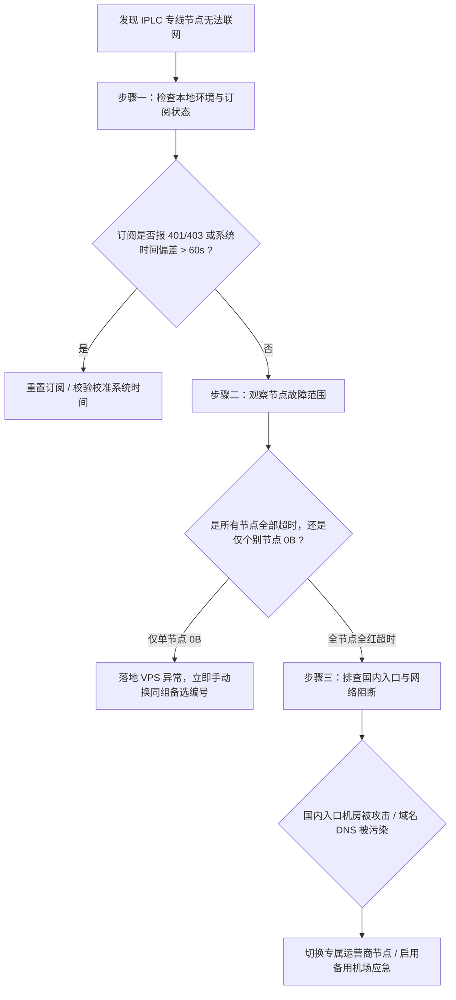

# IPLC 专线详解：点对点私有电路架构、与 IEPL 差异及三网晚高峰波动真相

在国际网络互联与代理基础设施的术语库中，**IPLC**（International Private Leased Circuit，国际私有租赁电路）历来被视为商业专线金字塔的顶端。在各大机场的宣传资料中，“纯正 IPLC 专线”、“点对点内网穿梭”、“晚高峰零丢包、永不掉线”等高调承诺屡见不鲜。

然而，在日常网络运维和排障实践中，许多花费高额预算购买了 IPLC 节点的用户依然会遭遇无法忽视的痛点：为什么白天流畅平稳的专线，一到晚上 9 点依然会出现网页打不开？为什么不同运营商的宽带连接同一个 IPLC 机场，体验会天差地别？为什么测速软件里明明标着极低的 20ms 延迟，实际测速却赫然显示为 **`0B`**？

本专题结合网络传输工程规范、站内收录的 31 个品牌资料以及实验室归档的实测证据，深入剖析 IPLC 专线的底层架构特征、三网入口优化瓶颈与常见选型误区。

---

## 一、底层工程原理：什么是真正意义上的 IPLC 跨境私有电路？

### 1.1 传统 IPLC 的物理定义与承载方式

在国际电信联盟与跨国电信运营商的经典体系中，**IPLC 是指由电信运营商在两个国家或地区之间，向特定商业客户提供的专属、点对点（Point-to-Point）、全透明物理/逻辑租赁电路**。

IPLC 的技术血统非常古老且底层：
1. **基于 TDM 时分复用骨干承载**：传统 IPLC 电路通常基于 SDH（同步数字体系）、SONET 或现代 OTN（光传送网）波分复用体系搭建。运营商在海缆或陆地光缆的核心传输层，为租户分配专属的物理时隙或固定波长（Lambda）。
2. **纯粹的点对点端到端通道**：经典的 IPLC 就像一条拉在两台固定路由器之间的物理专线，其服务边界非常明确——境内 A 端机房网线接入，境外 B 端机房网线接出。中间不经过任何公共互联网路由节点，也不存在跨公网自治系统（AS）的 BGP 协商。
3. **极高等级的电信级 SLA 约束**：由于具备独享物理带宽和固定物理路径，合规商业 IPLC 享有电信运营商最高优先级的服务等级协议（SLA），其可用性承诺通常达到 99.9% 甚至 99.99%，抖动（Jitter）与时延被严格控制在极小范围内。

### 1.2 IPLC 与 IEPL 的全景技术对比

在今天的代理行业日常语境中，许多服务商往往将 IPLC 与 IEPL 混为一谈，甚至合称为“内网专线”。但在严谨的网络工程维度上，两者在承载协议、组网灵活性与商业交付上存在明确分野：

| 比较维度 | 传统 IPLC（国际私有租赁电路） | 现代 IEPL（国际以太网专线） | 对代理终端用户的实际影响 |
|---|---|---|---|
| **底层承载机制** | 传统 SDH / SONET / OTN 物理时分复用电路 | 现代以太网封装（Ethernet over OTN / MPLS） | 两者在跨境物理段均与公网隔离，晚高峰抗拥塞性能在物理层无实质优劣 |
| **拓扑连接形式** | 严格的**点对点（Point-to-Point）**连接 | 支持**点对多点（E-Tree）与多点互联（E-LAN）** | IEPL 更易于机场在香港端一次性互联多家亚太落地机房，组网调度更灵活 |
| **接口交付形式** | 早期常交付 E1/DS3/STM-1 等电信接口，现代转换为以太网 | 直接交付标准以太网电口/光口（GE/10GE），支持 802.1Q VLAN | 服务商部署 IEPL 的设备开销和接入复杂度通常低于传统底层 IPLC |
| **带宽调整弹性** | 物理时隙分配相对刚性，带宽扩容或降级流程周期长 | 支持通过软件定义网络（SDN）实现灵活的带宽按需突发（Burst） | IEPL 服务商更容易根据用户流量高峰动态调整电路吞吐冗余 |
| **采购成本门槛** | 传统外企与金融机构高规格电路，价格高昂且审批严苛 | 商业以太网标准化产品，采购渠道更丰富，复用成本略低 | 同等带宽下，真正的纯 IPLC 物理电路采购月租通常高于同规格 IEPL |

> **架构图说明**：上图为网络工程逻辑概念示意，用于展示典型的 IPLC 点对点专线与多线 BGP 入口协同工作的全链路数据流动，非特定机场的物理网络拓扑。

---

## 二、必须澄清的四大“IPLC 专线神话与认知盲区”

在代理选型与日常排障中，服务商的营销话术经常诱导用户建立不切实际的预期。以下四个认知盲区是导致用户产生挫败感的核心原因：

### 误区 1：“IPLC = 绝对永不掉线、绝对零丢包”

**真相：IPLC 保护的只是跨境中间那一条光缆，无法保护整条链条的前后端。**

根据本站《测速实测资料说明》（README 第八条）的硬性规定：**不能写“使用 IEPL/IPLC，所以一定不会受到网络波动影响”**。
一条完整的代理链路涉及本地、入口机房、专线、落地机房四个环节：
- 如果国内入口机房遭遇了数百 Gbps 的大流量 DDoS 攻击导致被运营商黑洞牵引，用户流量在境内第一步就被完全拦截，根本进不去专线。
- 如果海外落地机房的物理母机硬件故障、Docker 容器崩溃或者出网 IP 被封禁，专线哪怕延迟只有 5ms，整个节点依然会秒级断网。
- 如果用户本地的系统时间偏差超过 60 秒，或者客户端配置了错误的 TUN 路由，也会在本地直接引发 TLS 握手失败。

### 误区 2：“只要上了 IPLC，全球所有节点（美西/欧洲）都能做到 20ms 超低延迟”

**真相：光速在光纤中的传播存在不可逾越的物理极限。**

很多初学者看到机场宣传页上写着“全线 IPLC 20ms”，便误以为选择美国、英国节点也能拥有 20ms 的超快响应：
- 常见的 IPLC 专线绝大多数是 **深港专线（深圳 ↔ 香港）** 或 **沪日专线（上海 ↔ 东京）**。深港距离仅数十公里，专线单向延迟在数毫秒级，加上国内入口跳数，测出 15–25ms 属于正常物理表现。
- 当你访问 **美国西海岸（如洛杉矶、圣何塞）** 节点时，流量在香港出专线端点后，必须借由香港机房的跨太平洋海底光缆（单向物理距离超过 11,000 公里）飞跃大洋抵达美西。由于光在二氧化硅玻璃光纤中的折射率约为 1.47，光信号在光缆中的传播速度约为每秒 20 万公里。
- 仅单向光纤物理传播与中继放大就需要约 55–65ms，往返 RTT 物理极限至少为 110–130ms，加上前后端路由中转，**真实的美国节点 RTT 绝不可能低于 130ms**（站内归档的 2026-10-19 档案中，各 IPLC 品牌的美国节点延迟普遍在 134–180ms 之间）。所谓“美国专线 20ms”若非把入口 Ping 伪装成落地延迟，就是直接伪造了测试数据。

### 误区 3：“IPLC 节点天然拥有极高解锁权重，100% 搞定 ChatGPT 与流媒体”

**真相：专线管的是传输通道，目标平台审核的是落地 IP 信誉。**

很多用户花大价钱购买 IPLC 是为了使用 ChatGPT、Claude 或观看 Netflix 4K。然而：
- 专线通道只负责把加密的数据包以最快速度搬运到香港机房；
- 当数据包离开香港机房，以公网 IP 地址向 OpenAI 或 Netflix 发起 HTTPS 请求时，对方的 WAF（Web 应用防火墙）和风控引擎审核的是该公网 IP 的 **ASN 归属、数据中心标签（Data Center vs Residential 家宽）以及历史滥用行为分（IPRisk / Fraud Score）**。
- 一条极尽奢华的 IPLC 专线，如果后端挂载的是廉价机房被成千上万黑产共用的滥用 IP 段，打开 ChatGPT 照样会弹出“Access Denied”或“地区不支持”（具体技术细节见 [ChatGPT 无法访问排查](/ai-media/chatgpt/) 与 [流媒体与 AI 解锁兼容性](/ai-media/compatibility/)）。

### 误区 4：“十几二十元月付就能买到独立独享 IPLC”

**真相：低价月付套餐一定是多用户共享带宽池，资源复用比决定了真实晚高峰体感。**

合规企业级独享跨境专线价格极其昂贵（站内光速云、暮光加速、隐形人等品牌的企业级定制独享档月付普遍标价在 **¥600–¥680/月**）。十几元或二十几元每月的平民套餐，服务商必然采用数百倍甚至上千倍的高复用比模型将带宽切片售卖。在非高峰期体验极好，但在晚高峰大并发时段，共享带宽池必然发生竞争性拥塞。

---

## 三、站内资料审计：宣称 IPLC 的品牌文案边界与证据状态对照

在站内收录的 31 个品牌档案中，明确宣称搭载 IPLC 的服务商包括：[唯兔云](/brands/weitu/)、[Firefly](/brands/firefly/)、[U1S1](/brands/u1s1/)、[闪跃](/brands/shanyue/)、[全球云](/brands/quanqiu/)、[隐形人](/brands/yinxingren/)、[EdgeNova](/brands/edgenova/) 等。

对这些品牌的宣传文案进行严谨审计，可以建立清晰的证据分类界限：

| 品牌名称 (`slug`) | 品牌资料宣传文案描述 | 宣称线路定位 | 实际留存测试与证据状态 | 关键需核对与注意事项 |
|---|---|---|---|---|
| **唯兔云** (`weitu`) | 宣称全线 IPLC 专线，支持专属客户端与通用订阅 | 全线纯 IPLC | 留存 2026-08-11 MAI-TEST-BOT 实测图，协议显示 Shadowsocks（54 节点） | 资料文案写 Trojan，测速图显示 Shadowsocks，协议口径存在差异 |
| **Firefly** (`firefly`) | 资料标注 Lite / Plus / Blaze / Nova 阶梯套餐，宣称高速 IPLC | 核心段 IPLC | 2026-10 资料显示转为专属客户端，不提供通用订阅 | 历史档案与当前版本存在邀请码冲突，无通用订阅转换需防锁定 |
| **U1S1** (`u1s1`) | 宣称全节点 1x 倍率，涵盖亚太优质 IPLC 跨境专线 | 亚太 IPLC 专线 | 留存 2026-08-11 实测图（22:33:29 CST 晚高峰，54 节点 SS） | 介绍正文提及 1000GB 一次性大包，但当期套餐价格表未收录该包 |
| **闪跃** (`shanyue`) | 文案强调“纯 IPLC 专线中转，晚高峰零丢包” | 纯 IPLC 专线 | 2026-10-19 非晚高峰表格测速（HK 23ms，美西 140ms） | 缺少独立测速原始截图，数据属于品牌资料声明（vendor） |
| **全球云** (`quanqiu`) | 资料注明“IPLC / IEPL 专线中转”，提供全节点解锁 | IPLC/IEPL 混用 | 留存 2026-08-11 实测图（15:50:43 CST，54 节点 Shadowsocks） | 双优惠码冲突（qqy7777 vs qq88），起步价存在年付与月付口径差异 |
| **隐形人** (`yinxingren`) | 资料宣称白银纪元起步，主打企业级专线与 1 小时修复 | 高端专线保障 | 2026-10-19 测速表五地数据全为“—”，缺乏公开测速图 | 双优惠码冲突（yxr888 vs moon80），套餐流量存在 100G vs 144G 冲突 |
| **EdgeNova** (`edgenova`) | 2026-08-09 历史档案记录，标称轻量版 15 元/72GB | 历史 IPLC 档案 | 属于 2026-08-09 历史记录，当前有效性待核实 | 缺少当期统一实测与流媒体解锁数据，按 historical 状态管理 |

---

## 四、BGP 三网入口优化与跨运营商路由实测解析

很多用户在选购专线机场时只关注跨境段叫不叫 IPLC，却严重忽视了国内前置入口机房的网络质量。**在网络工程中，国内入口网关的质量直接决定了整条专线的可用性下限。**

### 4.1 为什么国内 BGP 入口能够决定用户体感？

中国内地的宽带网络格局由中国电信、中国联通、中国移动三大运营商鼎立主导。由于历史结算机制与骨干网架构限制，三大运营商之间的跨网互联互通始终存在流量结算壁垒。
- **单线入口的悲剧**：如果机场只租用了一台廉价的广州电信服务器作为入口，全国所有联通和移动用户发出的数据包，必须先经过跨网互联节点挤进电信骨干网。每到晚高峰，互联节点队列严重堵塞，移动用户的端到端丢包率甚至能飙升到 20% 以上，哪怕后面的 IPLC 专线空得跑风，用户依然觉得巨卡。
- **三网 BGP 优化的工程价值**：真正的优质机场会在国内核心节点部署三网 BGP 动态路由机房。机房通过自治系统（AS）同时与中国电信（AS4134/AS4809）、中国联通（AS4837/AS9929）、中国移动（AS9808/AS58453）建立 BGP 对等互联（Peering）。电信用户走电信骨干网进、联通走联通骨干网进、移动走移动骨干网进，在本地就近吸纳流量后，通过高速内网合流送入专线。

### 4.2 从光速云 3 张 Miaoko 实测图看三网真实差异

本站归档的 `docs/public/images/evidence/guangsuyun/` 目录下留存了同一批次（2026-08-19 归档）光速云在三大运营商环境下的 Miaoko 实测证据：
1. **`guangsuyun-miaoko-cmcc-gx.jpg`（广西移动@2Gbps，62 节点 Shadowsocks）**：
   - 移动网络下，香港专线 01–20 的平均下载速度集中在 **37.00MB/s–52.04MB/s** 之间，TLS RTT 集中在 **22ms–32ms**，HTTPS 延迟集中在 **86ms–112ms**。整张图展现出极强的下行吞吐均衡性，没有出现移动宽带常见的跨网暴跌。
2. **`guangsuyun-miaoko-telecom-cs.jpg`（长沙电信@2Gbps，62 节点 Shadowsocks）**：
   - 电信骨干环境下，香港专线延迟表现同样极为优异，RTT 集中在 **24ms–35ms**，全节点网络抖动极小。
3. **`guangsuyun-miaoko-unicom-hb.jpg`（河北联通@2Gbps，62 节点 Shadowsocks）**：
   - 在该张联通测试图中，绝大多数香港专线节点维持在正常水平，但个别节点在跨省长距离调度中，**HTTPS 延迟飙升至 1200ms 以上**（例如在珠海联通单线程图中，更有节点如 `JP02` 测得 HTTPS 延迟 3020ms）。

这一组三网对照实测强有力地证明：**即使是同一家服务商、同一批专线节点，在不同省份、不同运营商的物理网络环境下，其实测体验也会产生巨大方差**。

### 4.3 珠海联通图中出现的「电信 AnyTLS 专用节点」技术解析

在 `guangsuyun-miaoko-streaming-ai.jpg` 实测图中，节点列表末尾赫然出现了以 `电信-HK香港01`、`电信-台湾01`、`电信-日本01` 为命名前缀的独立节点（协议标注为 `AnyTLS`）：
- 这一命名特征在网络工程中具有明确含义：**机场服务商针对中国电信骨干网的特殊 QoS 限制与路由拥塞，专门开辟了独立的电信定向接入入口**。
- 当普通混合入口在电信网络下受到干扰时，电信宽带用户手动切换至带有 `电信-` 前缀的专用节点，能够强制走专门优化过的电信 ChinaNet/CN2 管道直达专线端点，绕开公共大池子的拥挤。

---

## 五、IPLC 专线节点突发故障的四步排查定位 SOP

当你手里使用着标称 IPLC 的机场节点却突然遇到断网时，切忌盲目乱点客户端设置，建议严格执行以下标准排障流程：

### 步骤一：核查本地基础条件与订阅有效性

1. **核验系统本地时间**：在 Windows、macOS 或移动设备上打开时间设置，确认与标准北京时间完全同步（误差必须在 60 秒以内）。由于现代代理协议（如 VLESS、Shadowsocks-AEAD、AnyTLS）依赖时间戳进行防重放攻击验证，时间偏差过大会导致所有连接在第一步即被服务器主动丢弃（参考 [时间同步与 TLS 证书排障](/troubleshooting/articles/time-sync-tls-cert-error)）。
2. **刷新订阅看状态码**：在客户端手动点击更新订阅。若返回 `HTTP 401/403`，说明套餐流量耗尽或账号过期；若返回 `HTTP 200` 但节点列表为空，说明订阅域名被解析劫持（参考 [订阅失败 401/403/503 排查](/troubleshooting/articles/sub-http-401-403-404-503) 与 [订阅空响应排查](/troubleshooting/articles/sub-http-200-empty)）。

### 步骤二：区分「全节点全红」与「单节点 0B」

- **如果是全节点同一秒全部超时**：
  绝非单个海外机房问题，必定是**国内入口机房发生大面积断网、遭到大流量 DDoS 攻击，或者你本地的系统代理/TUN 模式陷入路由环路**。先重启客户端清除虚拟网卡，尝试关闭 TUN 模式使用标准系统代理（参考 [TUN 模式失效排查](/troubleshooting/articles/tun-not-working)）。
- **如果只是个别节点显示 0B 或几 KB**：
  如同光速云实测中的 `HK 02=0B` 现象，专线链路完全正常，仅该节点的落地容器无网络转发权限。**直接在客户端手动选择 `03`、`04` 等其他编号节点即可瞬间恢复**。

### 步骤三：避开首尾节点高负载陷阱

机场用户普遍具有“懒人心理”，超过 60% 的人在节点列表里会下意识直接点击排在最顶部的 `香港 01` 或 `02`。这导致任何机场排在前面的 1–2 个节点永远处于超高负载状态。在遇到卡顿或丢包时，**主动向下滚动，选择编号在中间或偏后的节点（如 `HK 07`–`HK 15`）**，往往能避开人流高峰。

### 步骤四：启用多线容灾与备用应急策略组

没有任何一家专线机场能够做到物理层面的 100% 永不断线。建立健康的跨境网络习惯，必须准备不同入口架构的备用配置：
- 在日常主力配置中选用性能优良的主流月付专线；
- 准备一个轻量月付或[不限时流量包](/pricing/non-expiring/)作为紧急备灾手段（参考 [应急备用方案指南](/security/alternatives/)）；
- 在客户端配置分流策略，不要让单一节点的故障瘫痪整个办公环境。

<AffiliateCta slug="guangsuyun" />

---

## 常见问题

### IPLC 和 IEPL 到底有什么核心区别，普通用户能用出体感差异吗？

IPLC 传统上是基于 SDH 或 OTN 物理层直接交付的跨国点对点私有电路，路由完全固定且逻辑结构极度纯粹；IEPL 则是基于以太网封装交付的二层专线，具备更灵活的多点接入与 VLAN 划分能力。在现代商用代理领域，二者在跨境段均具备脱离公网国际出口、晚高峰极低丢包与平直 RTT 的物理特性；终端用户体验的差异并不取决于名字叫 IPLC 还是 IEPL，而取决于国内入口机房的 BGP 质量、跨境总带宽余量以及落地节点的维护水平。

### 为什么用了昂贵的 IPLC 专线，在晚高峰依然会遇到卡顿甚至节点全部超时？

代理链路是一个由四个串联环节构成的链条：本地网络到国内入口机房、国内入口机房到专线端点、跨境内网专线段、海外落地机房到目标网站。IPLC 仅能保证第三段跨境光缆不受公网拥塞影响。如果第一段本地 Wi-Fi 抖动、第二段国内 BGP 入口机房遭遇大流量 DDoS 攻击或运营商断纤、第四段海外落地服务器宕机，整个代理链路依然会彻底中断，表现为客户端全部节点秒级超时。

### 为什么不同运营商（电信、联通、移动）使用同一家 IPLC 机场，测速和延迟差距极大？

因为国内用户的流量必须先经过本地宽带抵达机场在国内布置的前置入口机房。如果机场仅部署了华南电信单线入口，北方移动或联通用户就必须跨省跨网访问，骨干网互联互通瓶颈会引入 40–80ms 额外延迟与高峰期丢包。从站内光速云多网实测截图可见，同一套专线在长沙电信下 HTTP 延迟仅 90ms 左右，而在河北联通下部分节点延迟却高达 1200ms，充分证明三网优化入口对最终体感的决定性作用。

### 很多机场宣称拥有「日本 IPLC」或「美国 IPLC」，真的有直达美西的物理专线吗？

绝大多数民用机场宣称的日美专线并非国内直达美西的独立物理电路，而是以「深港 IPLC」或「沪日 IPLC」为核心的混合中转网络。流量通过内网专线进入香港核心机房后，再通过香港机房充裕的跨洋海缆国际骨干网中转至美国西海岸。受太平洋海底光缆一万公里的光速物理极限限制，从国内经香港中转至美国的真实 RTT 必然在 130–180ms 之间，所谓“美国专线 20ms”属于违背物理常识的虚假宣传。

### 为什么站内实测中部分 IPLC 节点 RTT 只有二十几毫秒，速度却显示为 0B？

测速脚本测出的几十毫秒 RTT，通常仅反映了本地到国内入口服务器、或入口机到海外对端握手成功的连通耗时。若海外落地服务器上的代理核心进程崩溃、容器网络无响应、或者落地 VPS 欠费停机，链路虽然能迅速完成握手响应，但实际无法回传任何网页数据，从而在测速表格中记录为 0B。这种情况必须通过手动切换其他可用节点排除。

### 站内品牌中哪些明确标注了 IPLC 专线？其宣传资料该如何理性看待？

站内收录的品牌中，唯兔云、Firefly、U1S1、闪跃、全球云、隐形人、EdgeNova 等均在资料中宣称搭载 IPLC。理性看待这些文案的关键在于区分「品牌资料声明（vendor）」与「本站实验室实测（measured）」。例如闪跃标称全线纯 IPLC，全球云标称 IPLC/IEPL 智能中转，但在缺乏长周期晚高峰实测数据佐证前，不得将其视为永不故障的免死金牌，选型时仍应遵循月付试错原则。

### 普通用户在使用 IPLC 专线机场时，应该如何配置客户端策略组以防止断网？

建议在客户端（如 Clash Verge Rev、Mihomo、v2rayN）中避免使用纯粹基于 Ping 值的粗暴 url-test 自动选路，防止自动选中延迟低但无吞吐的 0B 死节点。同时，应配置手动切换策略组，将日常大带宽浏览分配给低倍率香港主力节点，将重要业务分配给日本或美西高信誉节点，并准备一条异地入口或备用机场作为紧急容灾。
