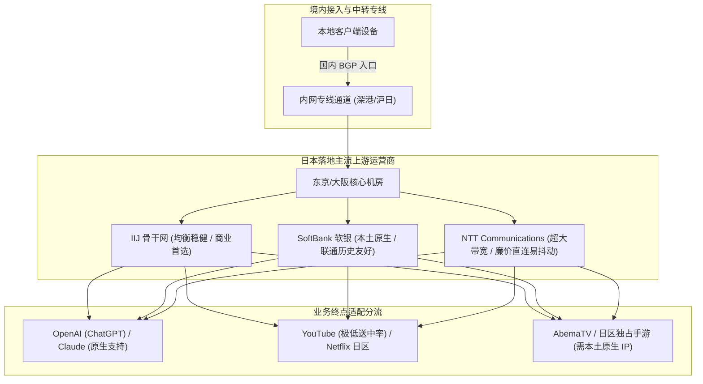

# 日本节点落地分析：IIJ/软银/NTT 路由、8KB 异常实测与 AI 流媒体全能适配

在跨境网络与科学上网的区域版图中，如果说香港节点是追求极致响应的“冲锋枪”，那么**日本节点**（JP）则是整个亚太地区当之无愧的“全能压舱石”。

与香港节点相比，日本节点虽然在物理 RTT 上略高（通常分布在 **`50ms–80ms`** 之间），但它几乎完美规避了香港节点的两大硬伤：它原生处于 OpenAI 与 Anthropic 的官方服务白名单之内，同时在实测中极少遭遇 YouTube 大面积“送中”判定。然而，日本节点在日常运维中同样存在令人费解的异常：为什么有些日本节点明明延迟只有 80ms，实际测速却断崖式暴跌至 **`8.00KB/s`** 或 **`12.61KB/s`**？为什么看 Netflix 极其顺畅，打开 AbemaTV 却全线飘红？

本专题基于实验室保留的微风网络、可信云、光速云等多份实测图片与网络工程数据，深度拆解日本节点的骨干路由差异、单节点劣化实证与场景适配策略。

---

## 一、日本节点的亚太枢纽定位：为什么它是全能型平衡节点？

### 1.1 50–80ms 延迟区间的物理与工程本质

从中国大陆东部沿海（如上海、青岛）至日本九州或关东地区（东京/千叶），直线地理距离在 1,000 至 2,000 公里左右。
- **直连海缆路径**：通过中日直达海底光缆（如 SJC2、APG、NCP、TPE），从上海直达日本千叶南房总登陆站的物理单向传输耗时仅需约 12–18ms，往返 RTT 在 25–40ms 之间。
- **专线中转星型路径**：然而在现代专线中转机场架构中，绝大多数服务商采用 **「国内入口 → 深港专线 → 香港核心机房 → 香港至日本海缆 → 东京落地机房」** 的星型拓扑。从深圳到香港约 5ms，从香港经由亚太海缆（如 APG、SJC）北上折返至东京需要约 30ms，加上前后端服务器转发与 TLS 握手，端到端最终呈现的 RTT 通常稳定在 **`50ms–80ms`**。
- **体感平衡点**：在人机工程学中，低于 100ms 的网络往返时延在人类感官中几乎察觉不到明显停顿。50–80ms 的日本节点在网页滑动、敲击终端 SSH、加载图片时依然能提供极佳的跟手感。

> **架构图说明**：上图为网络工程逻辑概念示意，用于展示日本节点在上游骨干网与下游业务承载中的流动模型，非特定服务商物理网络拓扑。

### 1.2 为什么日本是解决「香港 AI 不可用」与「新台送中」的最佳避风港？

正如 [香港节点分析](/routes/hong-kong/) 中所揭示的，香港节点虽然速度最快，但因地缘政治与平台政策原因，OpenAI、Anthropic 与 Google 均未将其纳入原生开放区，直接访问频频被拒；而新加坡与台湾节点在实测中又存在大面积 YouTube 送中（CN）的高危隐患。

在此背景下，**日本节点成为了整个代理生态中最为均衡的避风港**：
1. **AI 白名单全面覆盖**：日本是美系主流 AI 实验室（OpenAI、Anthropic）在亚洲首批设立办公室与数据中心的重点地区，对来自日本 IP 的访问请求审核极为顺畅；
2. **YouTube 定位极其稳定**：日本作为亚洲庞大的独立文化与消费市场，Google 的地理定位算法对日本 IP 的判定高度清晰，极少发生将日本 IP 误判为中国大陆的“送中”闹剧；
3. **避开香港晚高峰拥挤**：由于超过 70% 的轻度用户将客户端默认锁在香港，晚高峰时段主动将流量分流至日本节点，往往能避开共享入口的拥堵。

---

## 二、常见日本上游运营商与路由特征：IIJ / 软银 / NTT / CMI

在查看机场节点备注或机房服务器资料时，常能见到 `IIJ`、`SoftBank (软银)`、`NTT` 或 `CMI` 字样。它们分别代表了日本主流的骨干网络上游服务商：

| 日本上游网络 | 核心技术背景与运营商定位 | 骨干网工程特性与路由优势 | 在专线/中转机场下的实际体感 |
|---|---|---|---|
| **IIJ (Internet Initiative Japan)** | 日本最早的商业 ISP，互联网基础设施建设元老 | 路由极其规整，亚太互联互通策略保守但严谨，极少发生随机绕路 | 综合稳定性极高，日常网页浏览与 AI 对话极少抖动，商用落地首选 |
| **SoftBank (软银 / BBTEC)** | 日本三大巨头之一，拥有庞大的本土家宽与移动网络 | 历史上与中国联通（China Unicom）建有极其宽裕的直接互联互通通道 | 直连环境下联通用户体验极佳；在专线中转下常被用于提供高质量本土原生 IP |
| **NTT Communications** | 全球一级（Tier 1）电信运营商，国际带宽极为庞大 | 亚太机房出入口带宽极其廉价且充沛，但公网直连互联路由晚高峰极易拥塞 | 普通直连晚高峰丢包偏高；**但在内网专线或优质 BGP 中转加持下**，能发挥超大吞吐优势 |
| **CMI (中国移动国际)** | 中国移动在海外自建的国际骨干传输网 | 在日本东京、大阪建有核心 PoP 点，与移动国内骨干（AS9808）直连 | 移动宽带直连日本的最佳通道，延迟可压制在 45–60ms，抗抖动极强 |

---

## 三、单节点异常实测复盘：为什么 70ms 节点会沦落到「8.00KB/s」？

在对原始实测截图的深度排查中，实验室捕捉到了两组极具警示意义的单节点严重劣化样本。这种现象比彻底断网的“0B 死节点”更具欺骗性：**测速软件显示延迟正常且连接通畅，实际通信却被死死卡死在几 KB 无法动弹**。

### 3.1 实测案例一：微风网络日本 05 节点的「8.00KB/s」断流

在 `weifeng-20260811.png`（图内真实时间戳为 2026-07-19 18:38:20 CST，Miaoko 50 节点 VLESS 测速）记录中：
- 节点列表第 35 项 **`日本 05`**：
  - **`TLS RTT = 137ms`**，**`HTTPS延迟 = 708ms`**；
  - 然而其 **平均速度仅为 `8.00KB`**，**最高速度仅为 `80.00KB`**！
  - 对比同图中 `日本 04` 平均速度高达 257.97MB/s、`日本 06` 平均速度高达 208.59MB/s，`日本 05` 发生了灾难性的吞吐塌陷。

### 3.2 实测案例二：可信云 JP07 节点的「12.61KB/s」微速死锁

在 `kexin-20260811.png`（测试时间 15:32:35 CST，MAI-TEST-BOT 32 线程）记录中：
- 节点列表第 42 项 **`JP｜日本｜07`**：
  - **`延迟RTT = 87ms`**，**`HTTP延迟 = 523ms`**；
  - 测速结果显示 **平均速度仅为 `12.61KB`**（最大速度 75.68KB）；
  - 对比同图中其他日本节点普遍在 30MB/s–43MB/s 的均速，该节点完全失去了承载网页通信的能力。

| 实测图片来源 | 异常节点名称 | 测得 RTT | 测得 HTTP/TLS 延迟 | 平均下载速度 | 最大下行速度 | 故障技术定性 |
|---|---|---|---|---|---|---|
| **微风网络实测** (`weifeng`) | 日本 05 | 137ms | 708ms | **8.00KB/s** | 80.00KB/s | 单机出口流量耗尽触发宿主惩罚性限速 |
| **可信云实测** (`kexin`) | JP｜日本｜07 | 87ms | 523ms | **12.61KB/s** | 75.68KB/s | 单端口遭受运营商持续 QoS 丢包压制 |

### 3.3 技术根源剖析：为什么单节点没有彻底断开，却跌至 KB 级？

为什么会出现“延迟测得出来，但速度只有几 KB”的病态现象？网络工程上有三大典型诱因：
1. **落地 VPS 流量配额耗尽触发 QoS 降速**：许多廉价境外云主机（如某些小厂商的月付几美元机器）每月仅包含 1TB–2TB 高速流量。一旦当月流量被机场用户刷爆，云厂商不会直接关机，而是触发惩罚性限速，将网卡强制锁定在 **64Kbps 或 128Kbps（对应 8KB/s–16KB/s）**。
2. **特定端口遭遇深度报文检测（DPI）干扰**：服务商为该节点分配的服务端端口可能已被运营商防火墙列入临时风控列表，对该端口发起的 TCP 流进行激进的随机丢包限制，导致 TCP 拥塞窗口永远无法放大。
3. **落地服务器虚拟网卡队列死锁**：在多核心宿主机上，单台 VPS 的 VirtIO 网卡中断处理线程被打满，导致大量数据包在内核缓冲区被直接丢弃。

遇到此类节点，用户在日常使用中会表现为“连接似乎连上了，但打开任何网页都无限加载超时”。**必须在客户端中将其标记为不可用并手动排除**。

---

## 四、业务解锁与风控特征：AI、流媒体与二次元专属生态

### 4.1 OpenAI 与 Claude 原生友好性

在 `guangsuyun-miaoko-streaming-ai.jpg`（三网 Miaoko 实测）中，日本节点的 AI 解锁表现展现出极高的一致性：
- `JP日本01` 至 `JP日本10` 共 10 个节点中，除 `JP03` 显示 `N/A` 外，其余 9 个节点的 `AI_openai` 全部清晰呈现为绿色的 **`解锁(JP)`**。
- 这证明在未对域名进行复杂二级转发的情况下，日本节点的原生公网 IP 能够直接被 OpenAI 的地域核验机制所接纳，用户可以顺畅登录 ChatGPT 网页版进行复杂对话。

### 4.2 为什么 Google Gemini 依然频繁出现「失败」？

然而在同一份截图中，日本节点在 `Gemini` 一栏却几乎全军覆没显示为红色 **`失败`**：
- **Google 的双重风控机制**：Google 针对旗下 Gemini（以及 Bard）实施了极为严苛的反欺诈风控。Google 拥有全球最为庞大的 IP 库与设备指纹数据，它能够轻而易举地分辨出某个日本 IP 究竟来自家庭宽带（ISP/Residential）还是来自租金廉价的数据中心（Data Center / Hosting）。
- 绝大多数商用机场为了追求带宽性价比，采购的均为机房广播 IP。这类 IP 虽然地理位置位于日本，但机房标签会导致直接被 Google 风控系统拦截。要稳定使用 Gemini，通常需要切换至具有极低欺诈分（LOW 1）的专用节点。

### 4.3 日区二次元与流媒体生态：AbemaTV 的严苛门槛

除了常规的 `Netflix (JP)` 与 `YouTube Premium (JP)`，日本节点最重要的价值在于承载独特的二次元文化服务：
- **巴哈姆特动画疯**：在实测中，日本节点大多能顺畅开启中文字幕番剧；
- **Dazn 体育直播**：实测显示日本节点在 `INTL_dazn` 上多能呈现绿色 `解锁(JP)`；
- **为什么 AbemaTV 频频全线飘红？**
  在 `guangsuyun-miaoko-streaming-ai.jpg` 中，`JP日本02–10` 的 `JP_abema` 项全部显示为红色 **`失败`**。
  这是因为 AbemaTV 平台对代理 IP 采取了“宁可错杀、绝不放过”的激进封锁策略。非日本本土真实住宅光纤（如 NTT FLET'S、KDDI au 光、SoftBank 光）的机房 IP，几乎 100% 会被列入黑名单。如果日常有观看 Abema 的刚需，切忌轻信普通机场“全节点解锁”的宣传，必须寻找明确标注提供日本原生家宽或通过住宅代理中继的特定节点。

---

## 五、亚太与欧美核心枢纽横向矩阵：日本 vs 新加坡 vs 台湾 vs 美国

结合站内实测中留存的自治系统（ASN）数据与多维度测试指标，四大常用海外节点的工程画像可总结如下：

| 节点区域 | 代表 ASN 归属 | 典型 RTT 区间 | AI 工具支持度 | 流媒体与二次元特性 | 关键风险与选型定位 |
|---|---|---|---|---|---|
| **日本节点** (`JP`) | `AS401243 US-KOMI-NET` / 本地机房 | **`50ms–80ms`** | **高**：OpenAI/Claude 原生支持；Gemini 常失败 | Netflix/Dazn 极佳；AbemaTV 常失败；YT 极少送中 | **亚太全能主力**：兼顾速度与海外主流业务，香港晚高峰最佳替代 |
| **新加坡节点** (`SG`) | `AS401243 US-KOMI-NET` | **`45ms–65ms`** | **极高**：OpenAI 与 Gemini 双解锁率极高 | 东南亚流媒体全开；**但实测 10 节点全送中** | **AI 生产力利器**：文字与代码办公首选，但看 YouTube 易送中 |
| **台湾节点** (`TW`) | `AS398993 TW-Peg Tech` | **`35ms–55ms`** | **中**：部分服务支持，风控波动较大 | 巴哈姆特动画疯最佳；Disney+ 易失败；YT 易送中 | **二次元看番专属**：延迟优于日本，适合繁体中文独占资源 |
| **美国节点** (`US`) | `AS138415 US-Yancy` | **`130ms–180ms`** | **最高**：LOW(1) 极低风险分，所有 AI 通行无阻 | 全球版权最全；Netflix/Disney+ 美区原生支持 | **高风控终极底牌**：延迟虽高但信誉极纯，金融支付与注册首选 |

---

## 六、日本节点的日常选型与排障实战建议

### 6.1 识别“假日本”（警惕 160ms+ 跨洋绕路）

在客户端订阅更新后，若发现某个标注为 `日本 01` 的节点测出来的 RTT 长期维持在 **`160ms–220ms`**：
1. 使用路由追踪工具（如 NextTrace）对该节点落地 IP 发起追踪；
2. 若发现流量从中国出发后，先横跨太平洋抵达了美国洛杉矶或圣何塞，再通过跨太平洋海缆折返回东京，说明该节点属于严重的公网绕路或直接是美西机房广播的虚假定位 IP；
3. 此类节点在日常使用中首包极慢，应直接弃用。

### 6.2 快速剔除类似 8KB 的劣化死锁节点

- 在客户端中如果遇到某个日本节点连接后长时间转圈，但在节点列表里又没有亮红灯：
- 在浏览器中尝试直接下载一个体积适中的测试文件（如 GitHub Release 安装包）；
- 若下载速度被精准死锁在几 KB 且完全没有速度爬升波形，说明该节点已被上游云厂商限速或单端口遭受干扰，立即手动切换同组其他日本编号节点。

<AffiliateCta slug="guangsuyun" />

---

## 常见问题

### 日本节点的基础延迟为什么通常在 50–80ms，但很多人反而把它当成日常主力备用？

物理传输距离决定了中国大陆直连或经深港专线中转至日本东京/大阪的物理 RTT 通常在 50–80ms 之间，虽然高于香港的 20ms，但仍在极佳的人性化交互响应阈值内。最核心的优势在于：日本是 OpenAI（ChatGPT）、Anthropic（Claude）和主流海外流媒体的官方原生支持区域，且在实测中极少像新加坡或台湾节点那样大面积遭遇 YouTube「送中(CN)」判定，是全网公认兼顾速度、AI 与流媒体的黄金平衡区。

### 为什么微风网络和可信云的实测截图中，部分日本节点会跌落到 8.00KB/s 或 12.61KB/s？

在微风网络 2026-07-19 实测中，日本 05 节点平均速度仅 8.00KB/s；在可信云 2026-08-11 实测中，JP07 节点平均速度仅 12.61KB/s。这种并非彻底断线（0B）却缩水至 KB 级的现象，通常属于单节点严重劣化。其技术成因多为：落地 VPS 的月度公网高速流量耗尽触发了机房的惩罚性限速（降至 64/128Kbps）、单机端口被运营商实施了高并发 QoS 丢包压制、或者母机网络虚拟网卡队列过载。

### 日本节点常见的 IIJ、软银（SoftBank）和 NTT，在代理网络中有什么本质区别？

IIJ 路由规整、亚太互联极其均衡，在晚高峰表现出极高的连通稳定性；SoftBank（软银 / BBTEC）早年在中国联通直连环境下享有极高声誉，如今在中转专线架构下常用于提供高质量本土原生 IP；NTT 作为全球一级（Tier 1）国际大骨干，带宽极其充沛且价格低廉，但如果采用普通公网直连晚高峰丢包偏高，必须经过专线或优质中转才能发挥其吞吐优势。

### 为什么日本节点在实测中 OpenAI 大面积解锁，但 Google Gemini 却频现失败？

在光速云 Miaoko 三网实测截图中，日本 01–10 节点除个别节点外全部绿色解锁 OpenAI；但在 Gemini 一栏却绝大多数显示为红色失败。这是因为 Google 对 Gemini 部署了基于数据中心 IP 欺诈度的高风控过滤机制。多数机场使用的日本机房商业广播 IP 虽然能通过 OpenAI 的区域校验，却无法通过 Google 严苛的住宅属性风控。

### 为什么日本节点看 Netflix 和动画疯很顺利，但打开 AbemaTV 却频繁报错？

AbemaTV 是日本本土对 IP 属性审核极其严苛的流媒体平台，其后台部署了深度反代理黑名单，不仅核验地理位置，还严格要求访问者 IP 必须归属于 NTT、KDDI、J:COM 等本土家庭宽带（ISP/Residential）。在光速云实测截图中，日本 02–10 节点的 JP_abema 项全部显示为红色失败，普通机房广播 IP 很难稳定解锁 AbemaTV。

### 在新加坡、台湾、日本和美国四个核心枢纽中，应该如何根据业务场景选择？

追求极低延迟与常规开发，优先选香港（20ms）；追求 AI 办公、避免 YouTube 送中且兼顾日漫二次元，优先选日本（60ms）；追求多国版权流媒体解锁且不在意送中风险，可选中继新加坡或台湾；而对于极高敏感度的金融支付、海外开户或对抗严苛账号风控，建议选择原生纯净的美国低欺诈分节点。

### 为什么有些标称「日本」的节点，测出来的延迟却高达 160ms 以上？

这种节点极可能是「假日本」或遭遇了跨境路由绕路。部分廉价服务商采购了美西圣何塞机房的廉价服务器，仅仅通过 BGP 宣告广播了一个地理位置标注为日本的 IP，流量实际横跨太平洋往返美西；或者中转服务器将流量拉到美国清洗后再返回东京。只要日本节点延迟超过 140ms 且吞吐极低，应判定为劣质绕路节点并果断弃用。
