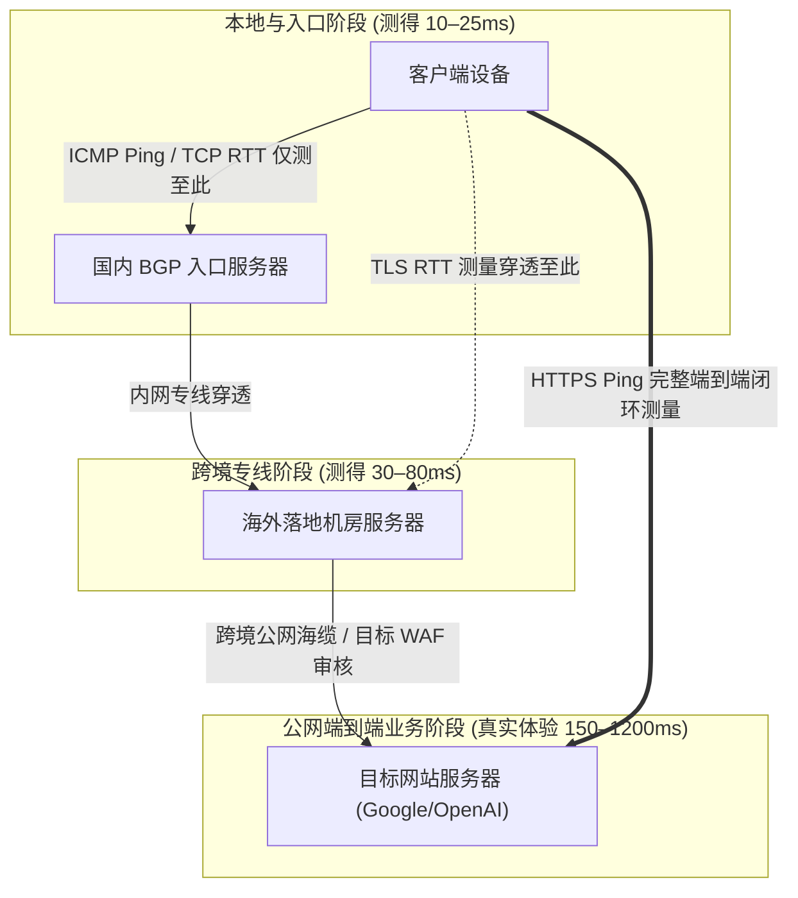

# 低延迟节点真相：ICMP/TCP/TLS RTT/HTTPS Ping 延迟区别与测速虚高陷阱

在挑选跨境网络代理与排查网络故障时，绝大多数用户都有一个根深蒂固的直觉：**“节点列表里的延迟数字越低越好，几十毫秒的绿色节点一定比上百毫秒的黄色节点更快”**。

然而在现实网络环境中，这种“数字唯上”的直觉往往会引发巨大的认知落差：为什么在客户端界面看着“绿油油的 22ms”，点开一个普通的海外技术文档却要原地转圈好几秒？为什么同一个品牌，在某个测试机器人的表格里显示全线 20ms，在另一款专业检测工具里却赫然显示高达 1400ms 的 HTTPS 延迟？为什么测速软件里明明测出了 16ms 的超低延迟，实际测速吞吐却诡异地停留在 **`0B`**？

本专题结合网络传输工程的四层度量体系、实验室保留的光速云与可信云实测截图，深度拆解四类延迟指标的测量原理、测速虚高陷阱以及科学的选线排障方案。

---

## 一、延迟认知盲区：为什么客户端列表里“绿油油的 20ms”大多是假象？

### 1.1 代理架构与直连架构的时延测量根本区别

在直连公网环境下，客户端向服务器发起 Ping 探测，数据包沿着公网路由直达目标主机后原路返回，此时测得的往返耗时（RTT）相对真实。但在现代 **多层代理网络（用户 ↔ 国内入口机房 ↔ 跨境专线 ↔ 海外落地机房 ↔ 目标网站）** 架构中，数据传输被严格切碎为多个独立阶段。

如果不加区分，把测量第一段的“局部轻量延迟”当成“端到端全链路业务体验延迟”，就会落入严重的认知陷阱。

### 1.2 四类常见延迟指标的定义、测量链路与欺骗性全景剖析

在不同客户端与测速工具中，“延迟”二字背后可能代表着四种完全不同的网络测量口径：

| 延迟度量指标 | 常见测量工具/位置 | 实际测量的网络路径区间 | 核心工程定义与测量机制 | 为什么极易产生“虚假低延迟”错觉 |
|---|---|---|---|---|
| **ICMP Ping** | 命令行 `ping` 节点域名，部分极简客户端 | 本地客户端 ↔ 国内入口服务器 IP | 发送 ICMP Echo 请求，依赖目标网络层协议栈响应 | **最不靠谱**：只测到了家门口的国内中转机。哪怕海外专线断纤、落地机死机，国内机房照样回你 `15ms`！ |
| **TCP RTT** | 早期客户端列表 Ping、简易测速表 | 本地客户端 ↔ 国内中转入口端口 | 建立 TCP 三次握手（SYN → SYN/ACK → ACK）的耗时 | 依然只反映国内入口连通性，并未穿透跨境隧道建立海外端到端通信 |
| **TLS RTT** | Miaoko / MiaoSu 等专业测速工具 | 本地客户端 ↔ 专线对端/落地节点 | **单次数据交换延迟**（测试图底部注释原话），完成 TLS 加密握手耗时 | 穿透了专线隧道完成对端握手，但尚未向具体业务网站（如 Google）发送 HTTP 请求 |
| **HTTPS Ping / 体验延迟** | Clash `url-test`、Miaoko `HTTPS延迟`、MAI-TEST-BOT | 本地客户端 ↔ 代理全链路 ↔ **真实海外目标网站** | **单次请求体验延迟**（官方注释原话），包含隧道建连、目标网站 HTTP 请求与首包返回（TTFB） | **最贴近真实网页体感**。受目标服务器地理位置、CDN 缓存及连接复用状态强烈影响 |



> **架构图说明**：上图为网络工程逻辑概念示意，用于展示四类延迟探测指标在代理链条中所覆盖的实际测量区间，非特定服务商物理网络拓扑。

---

## 二、同一品牌的“延迟罗生门”：实测数据深度对比

为了彻底搞清楚不同测试口径造成的巨大数值鸿沟，我们对比实验室归档的同一个服务商（光速云）在两套不同专业脚本下的实测表现：

### 2.1 光速云两套测试工具实测数据横向对照

- **测试样本 A：`guangsuyun-20260811.png`（MAI-TEST-BOT 2.0.0-dev，32 线程，珠海联通 5Gbps 后端）**：
  - 香港主力节点 `延迟RTT` 集中在 **`14ms–33ms`**；
  - 对应的 `HTTP延迟` 集中在 **`34ms–54ms`**；
  - 下行平均吞吐维持在 **`54MB/s–75MB/s`**（约 430–600Mbps）。
- **测试样本 B：`guangsuyun-miaoko-streaming-ai.jpg`（Miaoko 主端 4.3.3，珠海联通 9Gbps 单线程，已核实 TLS 证书）**：
  - 香港主力节点 `TLS RTT` 普遍显示为 **`228ms–287ms`**；
  - 对应的 `HTTPS延迟` 普遍显示为 **`1415ms–1648ms`**！

**为什么同一家服务商、同一个地区的节点，在不同测试下延迟相差了 30 倍？**

网络工程原理深度解析：
1. **连接复用 vs 冷启动全链路握手**：MAI-TEST-BOT 在连续并发测试时，通常在底层保持并复用了已经建好的 TCP/TLS 长连接，测出的只是在已建连接上发送轻量 GET 请求的增量时间；而 Miaoko 采用更加严格的冷启动流程，从本地建立代理连接、穿透隧道、向目标服务器发起完整的 TLS 1.3 握手并验证证书链，端到端耗时自然大幅上升。
2. **测试目标服务器地理位置差异**：MAI-TEST-BOT 访问的是距离测试后端极近的特定优化测速点；而 Miaoko 访问的是受严格风控保护、带有真实业务逻辑的海外流媒体与 AI 验证服务器，目标服务器的处理排队耗时同样被计算在 HTTPS 延迟之内。

### 2.2 可信云高抖动实测案例：为什么 RTT 63ms，HTTP 延迟会飙到 1829ms？

在 `kexin-20260811.png`（测试时间 15:32:35 CST，MAI-TEST-BOT 32 线程，珠海联通 5Gbps 后端）实测截图中，记录到了极具代表性的延迟严重撕裂案例：

| 节点序号 | 节点名称 | 协议显示 | 延迟 RTT | HTTP 延迟 | 延迟撕裂倍数 | 真实网络瓶颈定性 |
|---|---|---|---|---|---|---|
| 28 | SG｜新加坡｜03 | Shadowsocks | **63ms** | **1829ms** | **高达 29 倍** | 入口与专线正常，新加坡落地机公网出口拥塞 |
| 43 | JP｜日本｜08 | Shadowsocks | **99ms** | **2231ms** | **高达 22 倍** | 前段专线 99ms，海外端到端请求超时边缘 |

这一组实测数据充分证明：**绝不能仅看 RTT**！
- 新加坡 03 节点的 RTT 仅 63ms，在列表里呈现极具诱惑力的低延迟；然而一旦发起真实的 HTTP 请求，耗时竟然飙到了接近 2 秒（1829ms）！
- 这说明数据包在境内入口和专线段跑得飞快，但一出新加坡落地机房，在向目标网站公网路由转发时遭遇了极度严重的丢包、拥塞或 DNS 递归解析停滞。如果用户选了这个节点，日常打开网页会遭遇极其明显的卡顿与白屏。

---

## 三、死节点假绿：光速云 HK02 的 0B 启示与自动选路风险

在日常使用中，最隐蔽、破坏力最强的不是亮红灯超时的节点，而是**“测速显示绿色超低延迟，实际通信吞吐为 0B”的假绿死节点**。

### 3.1 光速云 HK02 的 0B 实证剖析

在 `guangsuyun-20260811.png` 实测图中：
- 节点列表第 1 项 **`HK｜香港｜02`**：
  - **`延迟RTT = 16ms`**，**`HTTP延迟 = 36ms`**；
  - 无论从哪一个延迟指标来看，这都是一个近乎完美的顶级节点；
  - 然而在平均速度与最大速度两栏中，赫然记录着 **`0B / 0B`**！

**为什么 16ms 的超低延迟节点会吐不出一个字节？**
- 测速机器人发起的轻量 HTTP 204 握手探测包由国内入口服务器直接响应或完成了前置网关握手；
- 但后端真正负责承载 Shadowsocks/VLESS 数据流的境外落地容器已崩溃、或者母机网卡发生了 ARP 冲突导致无法向外网转发数据包；
- 探测探针收到了 HTTP 状态码完成计时，但在进入真正的压测大流量拉取阶段时，连接立即被对端重置（RST），导致实际传输数据量为零。

### 3.2 为什么 Clash 的默认 `url-test` 会被 0B 节点精准俘获？

许多用户习惯在 Clash Verge Rev 或 Mihomo 中创建 `url-test`（自动选择最低延迟节点）策略组。然而标准的 `url-test` 逻辑非常单纯：它每隔一定周期向指定 URL 发送探测包，记录响应时间，并**无脑自动切换至毫秒数最小的节点**。

由于 `HK02` 仅响应握手且耗时仅 16ms，客户端的自动测速算法会立刻判定该节点为“全列表最优节点”，并强行将所有浏览器流量导向它。结果便是：**客户端明明显示节点绿灯且处于工作状态，用户的浏览器却所有网页全部报错 ERR_CONNECTION_CLOSED，造成整机实质性断网**。

---

## 四、32 线程高并发跑分 vs 真实单线程网页体感的巨大鸿沟

除了指标口径与假绿节点，另一个导致“测速与体感严重背离”的技术根源在于**并发线程数**。

### 4.1 32 线程并发拉取的粉饰效应

在专业测速图中（如 MAI-TEST-BOT 标注的 `线程=32`），测试脚本的工作机制是在瞬间向服务端发起 32 条并发 TCP 连接，全力拉取数据切片：
- 假设某条专线存在 **3%–5% 的丢包**，并且偶发抖动；
- 在单条 TCP 连接中，丢包会导致拥塞控制算法（如 Cubic）立即将发送窗口削减 50%，导致连接瞬间失速；
- 但在 32 线程模式下，连接 A 遭遇丢包降速的同时，连接 B、C、D 正在全力爬升，32 条连接此起彼伏，在宏观聚合带宽图上依然能够拉出一条超过 500Mbps 的平整曲线。

### 4.2 真实业务的单连接物理现实

用户在实际使用代理时，绝大多数高频场景均基于**单连接或极少数长连接**：
- 在网页中浏览文章、加载前端 JavaScript 脚本包与 CSS 样式表；
- 与 ChatGPT 或 Claude 进行流式打字机交互（基于单条长轮询 HTTP/SSE 连接）；
- 观看实时视频直播或参与跨国视频会议；
- 在这些场景中，客户端无法通过并发连接掩盖丢包。一旦链路存在微小的丢包率，单线程吞吐量会从理论上的几十兆骤降至几百 KB/s，引发网页渲染阻塞、视频降码率甚至转圈缓冲。详见 [测速与体感速度差异排查](/troubleshooting/articles/bandwidth-multiplier-speedtest-diff)。

---

## 五、三大业务场景下的选点铁律：以场景定指标

在日常选点与排障中，用户应当彻底摒弃“以单一 RTT 论英雄”的落后观念，针对不同业务诉求对齐核心度量指标：

| 核心业务场景 | 首要关注核心指标 | 次要容忍指标 | 推荐节点类型与选点逻辑 |
|---|---|---|---|
| **网页交互、AI 办公与后台管理** | **HTTPS 体验延迟 (TTFB)** | 最大下行极限吞吐 | 优先选冷启动 HTTPS 延迟低于 150ms 的节点（如稳定香港或日本），首屏展开极快 |
| **超清 4K 视频、大文件与镜像下载** | **平均下行持续吞吐量** | 初始建连延迟 (允许 100ms+) | 优先选带宽池充裕、经过专线承载的主力香港或亚太大带宽节点 |
| **在线竞技游戏、跨国语音与会议** | **UDP NAT 类型与抖动 (Jitter)** | 单连接最高下载速度 | 优先选支持 FullCone NAT、抖动方差小于 5ms 的优质 IPLC/IEPL 专线节点 |

---

## 六、客户端精准选线与延迟优化实战配置指南

要破除测速虚高、规避死节点并提升日常网络体感，建议在代理客户端中实施以下三项工程级优化：

### 6.1 测速 URL 的标准化修改

坚决替换客户端默认的测速链接，改用全球高可用的权威无内容 204 验证端点：
```yaml
# 推荐测速地址（具备全球 Anycast 路由与极佳抗干扰性）
proxy-providers:
  my-provider:
    type: http
    url: "https://your-subscription-url"
    interval: 3600
    health-check:
      enable: true
      url: https://cp.cloudflare.com/generate_204
      interval: 300
```
- `https://cp.cloudflare.com/generate_204`：借助 Cloudflare 全球数百个边缘节点，能精准穿透代理测量全链路握手时延；
- `https://www.gstatic.com/generate_204`：Google 官方轻量探测端点，同样极其稳定。

### 6.2 启用统一延迟（Unified Delay）修正显示

在 [Clash Verge Rev](/clients/clash-verge/) 或 [Mihomo](/clients/mihomo/) 设置中，务必打开 **「统一延迟（Unified Delay）」** 开关：
- 未开启该开关时，客户端列表测出的数字包含了本地客户端核心调度、DNS 查询以及操作系统应用层转发的内部杂项耗时，导致显示的延迟数字偏大且波动剧烈；
- 开启后，内核统一扣除本地开销，精确计算代理通道纯净的端到端握手耗时，列表数字更加平稳真实。

### 6.3 优化自动测速组的容差与检测频率

在策略组配置中，避免配置过短的切换间隔，设置合理的 `tolerance`（容差）：
```yaml
proxy-groups:
  - name: "Auto-Fallback"
    type: fallback
    url: 'https://cp.cloudflare.com/generate_204'
    interval: 600
    # 设置 50ms 容差：只有备选节点比当前节点快 50ms 以上时才切换，杜绝因轻微波动频繁断流
    tolerance: 50
    proxies:
      - "HK｜香港｜05"
      - "HK｜香港｜08"
      - "JP｜日本｜01"
```

通过这一容灾配置，既能在主用节点彻底失效时自动降级切换，又能避免因测速脚本几十毫秒的细微波动导致正在进行的 TCP 连接频繁中断（更多配置细节见 [Clash 配置指南](/guides/clash-setup/)）。

<AffiliateCta slug="guangsuyun" />

---

## 常见问题

### 为什么客户端节点列表上显示绿油油的 20ms，打开一个网页却要转圈好几秒？

客户端列表默认展示的通常仅是本地设备到国内中转入口服务器的轻量 TCP 建连延迟，甚至部分简陋工具只是 ICMP Ping 入口机 IP。它只测量了“你到国内机房门口有多快”，完全没有测量从境内入口、经过跨境专线、再由海外落地机房请求目标网站的全链路往返耗时。一旦境外落地拥塞或遭遇风控，前端测出的 20ms 对实际打开网页没有任何参考价值。

### 测速图底部注释的「TLS RTT」与「HTTPS Ping」到底各测了哪一段？

根据实验室归档的实测图注释，TLS RTT 定义为「单次数据交换延迟」，通常指完成 TLS 加密握手或底层数据单次往返的耗时；而 HTTPS Ping（或 HTTPS 延迟）定义为「单次请求体感延迟」，包含建立完整代理隧道、向真实目标测试服务器（如 Google/Cloudflare）发起 HTTPS GET 请求并等待首包响应头（TTFB）返回的全部耗时。因此同一节点 TLS RTT 为 220ms 时，HTTPS Ping 达到 1000–1500ms 属于正常的端到端全链路耗时。

### 为什么光速云在两种不同工具测试下，香港节点延迟从 16ms 暴增到 1400ms？

在 2026-08-11 MAI-TEST-BOT 测试中，测试端位于珠海联通机房且采用多线程复用连接，测出的 RTT 仅 14–33ms，HTTP 延迟仅 34–54ms；而在 2026-08-19 归档的 Miaoko 单线程测试中，测试脚本要求对目标真实站点执行冷启动全链路 TLS 证书校验与 HTTPS 探测，且测试机所处网络环境不同，测出的是端到端完整请求体验延迟。二者测试口径、测试目标与连接状态完全不同，不能直接进行横向数字对比。

### 为什么可信云实测中 SG03 节点 RTT 仅 63ms，HTTP 延迟却飙升到了 1829ms？

在可信云 2026-08-11 实测截图中，新加坡 03 节点的网络 RTT 仅 63ms，但 HTTP 延迟高达 1829ms，日本 08 节点更是高达 2231ms。这属于典型的「前段通畅、后段拥塞」故障：本地到国内入口的内网专线极其顺畅，但海外落地机房在向目标服务器发起请求时，遭遇了严重的海外公网路由丢包、DNS 解析停滞或单机并发排队，导致端到端首包耗时严重劣化。

### 测速图上像光速云 HK02 那样 RTT 仅 16ms 但速度为 0B 的节点，会带来什么风险？

这属于极具破坏性的「死节点假绿」故障。由于中转入口服务器处于开机状态，能秒级响应握手探测包，因此在客户端列表里显示为低延迟绿灯；但海外落地 VPS 已经死机或代理进程崩溃，无法传输任何实际数据。如果客户端开启了按延迟自动切换的 url-test 机制，客户端会自动选定这个 16ms 的死节点，瞬间导致整台电脑或手机断网。

### 32 线程测速跑满 500Mbps，为什么用起来看高清视频或打游戏依然频繁卡顿？

像 MAI-TEST-BOT 这类 32 线程测速机器人，是在短时间内强行建立 32 条并发 TCP 连接同时下载数据。链路上哪怕存在 5% 的严重丢包，32 条连接此消彼长，依然能在宏观上拼凑出很高的聚合下载带宽；然而日常看实时直播、加载网页或玩游戏，走的多是单条长连接或 UDP 语音流，单条连接一旦遇到丢包就会触发拥塞控制剧烈降速，多线程跑分无法反映单连接抗丢包韧性。

### 日常在 Clash 或 v2rayN 中，应该如何设置测速 URL 才能看到更真实的延迟？

第一，坚决避开服务商自定义的国内测试链接，统一修改为全球标准的空内容探测地址，如 `https://www.gstatic.com/generate_204` 或 `https://cp.cloudflare.com/generate_204`；第二，在 Clash Verge Rev 或 Mihomo 中开启「统一延迟（Unified Delay）」开关，让客户端扣除本地到内核的转发开销，显示更贴近真实握手的延迟；第三，在自动测速组中设置 50ms 以上的容差，避免节点频繁跳跃。
