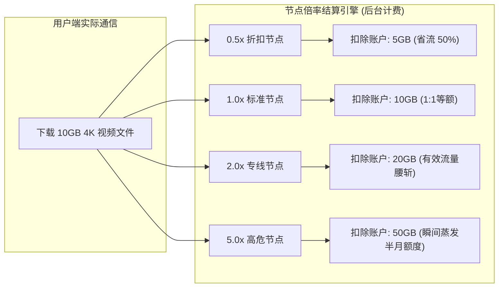
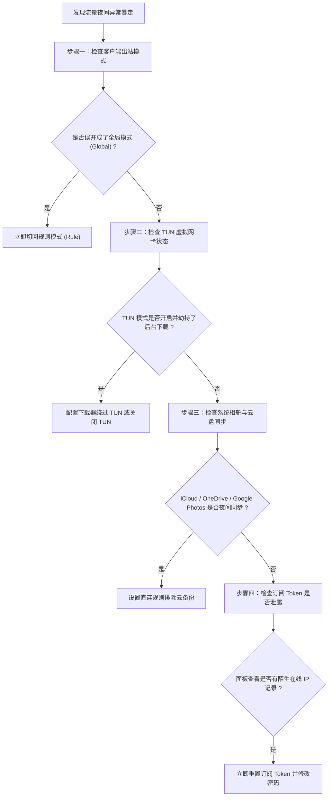

# 机场线路倍率解析：0.5x–10x 计费公式、19.4GB 测速耗流警示与偷跑排查

在跨境网络代理的日常使用与选型过程中，很多新手在查看套餐时只盯着“价格多少钱”和“每月包含多少 GB 流量”。当看到一个标价仅需十几元却包含“1000GB/月”的套餐时，往往会欣喜若狂地立即下单。

然而，一旦将订阅导入客户端，许多人便遭遇了冰冷的现实：明明才看了两部 4K 电影，面板上的流量进度条却猛然消耗了上百 GB；或者明明只用了一周，一个月的生活费流量便已见底。翻开节点列表仔细观察，才在节点名称末尾发现诸如 **`[2x]`**、**`[3x]`** 甚至 **`[5x]`** 的微小标记。

这就是代理行业中最为普遍却又常被新手忽视的**「节点倍率（Multiplier）机制」**。更令人心惊的是，许多用户为了检验网络，在客户端里反复点击“全部节点测速”，却不知道单次高并发测速就能在后台吃掉高达 **`19.4GB`** 的昂贵流量。

本专题基于实验室归档的光速云、可信云等真实测速截图及账本审计数据，全面拆解倍率计费数学模型、测速耗流陷阱与异常跑流排障策略。

---

## 一、核心计费逻辑：什么是节点倍率？（乘数效应与数学公式）

### 1.1 节点倍率的本质：后台面板的结算乘数

在网络工程与代理面板（如常见的 SSPanel-Uim、V2Board 等）后台逻辑中，**节点倍率本质上是服务商在结算数据库中设置的一个浮点数乘数（Rate Multiplier），它只参与账户剩余流量的扣减运算，与该节点的网络加速性能没有任何正向联系**。

很多缺乏常识的用户会顾名思义地误以为：
- “标 `2x` 的节点，网速是不是比 `1x` 快一倍？” —— **完全错误**。
- “标 `0.5x` 的节点，是不是网速被限速了一半？” —— **完全错误**。

真实情况是：**只要你通过标有倍率的节点传输数据，后台计费系统在记录你的出入站字节数时，会自动乘以该倍率系数后再扣除你的账户余额**。

### 1.2 扣费数学公式与不同倍率档位对比表

标准计费公式如下：
$$\text{面板扣除流量} = (\text{用户上传字节数} + \text{用户下载字节数}) \times \text{节点倍率}$$

为了让大家直观感受倍率对有效流量的惊人吞噬力，我们以实际传输 **10GB 数据**（例如观看一场 4K 体育直播）为例，对比不同倍率档位的账本真相：

| 节点标注倍率 | 实际传输 10GB 时后台扣费 | 有效可用流量折算（以 100GB 套餐为例） | 常见节点属性与技术定位 | 选型与日常使用建议 |
|---|---|---|---|---|
| **`0.1x` / `0.2x`** | 仅扣除 **1GB / 2GB** | 相当于享受 **500GB–1000GB** 实际传输量 | 普通公网闲时中转、冷门非高峰落地机房 | **省流神仙节点**：适合挂机拉取大型软件镜像、系统更新或离线资源 |
| **`0.5x`** | 扣除 **5GB** | 相当于享受 **200GB** 实际传输量 | 二线中转线路、大带宽非原生 IP 节点 | 日常大体积 YouTube 视频与长视频观看的优质备选 |
| **`1x`（无倍率基准）** | 扣除 **10GB** | 真实可用 **100GB**（1:1 等额结算） | 标准主力专线节点、常规落地中转 | **最透明的选型基准**：日常浏览与办公的核心主力，计算单 GB 成本无陷阱 |
| **`1.5x` / `2x`** | 扣除 **15GB / 20GB** | 实际仅能传输 **50GB–66GB**（有效流量腰斩） | 采购成本较高的深港/沪日 IPLC 专线、部分原生 IP | 日常网页与轻量办公无妨，看 4K 长视频前务必切回 1x |
| **`3x` / `5x`** | 扣除 **30GB / 50GB** | 实际仅能传输 **20GB–33GB**（缩水超 70%） | 极高成本的本土家庭宽带（原生住宅 IP）、特定游戏专线 | **高危流耗区**：严禁用来挂载大文件下载或运行自动测速，仅用于严格风控业务 |
| **`10x`（极端倍率）** | 瞬间扣除 **100GB** | 传输 10GB 即直接**烧光 100GB 全月额度**！ | 稀缺冷门小国落地（如南美/非洲）、企业特供超低延迟极点 | **极度危险**：仅供紧急登录海外银行开户、轻量发送验证码等极低频场景 |



> **架构图说明**：上图为网络工程逻辑概念示意，用于展示用户实际物理数据量在经过不同倍率节点结算时的乘数膨胀模型，非特定服务商物理网络拓扑。

---

## 二、实证数据警示：单次测速吞噬 10.5GB–19.4GB 的账单刺客

在日常排障工单中，许多用户最常问的一句话是：“我今天刚充值的 50GB 流量，在客户端里测了几次速，怎么什么都没看就只剩下 10GB 了？”

答案就隐藏在本站实验室归档的原始测速截图中。

### 2.1 光速云与可信云实测图中的“耗流实锤”

在各大测速机器人生成的报告底部，通常用不起眼的小字印着整场测试的技术参数。我们调取两张具有公信力的原始实测截图：

1. **光速云实测图：`guangsuyun-20260811.png`（2026-08-11 14:32:56 CST）**：
   - 测试环境：MAI-TEST-BOT 2.0.0-dev，珠海联通 5Gbps 后端，32 线程并发，共测试 54 个节点；
   - **截图底部核心参数明确标注**：**`消耗流量 = 19.4GB`**！
   - 整场测速耗时仅 381 秒（约 6 分钟），短短 6 分钟便实打实地从测试账户中跑掉了 **19.4GB** 流量！
2. **可信云实测图：`kexin-20260811.png`（测试时间 15:32:35 CST）**：
   - 测试环境：MAI-TEST-BOT，珠海联通 5Gbps 后端，32 线程并发，共测试 55 个节点；
   - **截图底部核心参数明确标注**：**`消耗流量 = 10.5GB`**！
   - 耗时 889 秒，跑掉了 **10.5GB** 流量。

### 2.2 致命的“高倍率测速乘数效应”

上述 19.4GB 与 10.5GB 的流量消耗，还只是在 **1x 基准倍率** 下统计的物理出网字节数！
- 试想一下：如果一个机场的节点列表中，包含了 10 个 2x 节点和 5 个 3x 节点；
- 当你在客户端中随手点击一次“全量测速”时，测速脚本会无差别地对每一个节点全力拉取并发数据；
- 经过倍率放大后，**短短几分钟的单轮测速，后台扣除的套餐总流量将瞬间突破 40GB–60GB**！如果你的套餐原本只有 60GB（如常见的低价年付小包），仅仅测速一次，整个月的套餐便宣告当场暴毙。

### 2.3 MB/s 与 Mbps 的 8 倍换算常识（破除读数误解）

在阅读测速图与排查带宽时，用户切忌混淆大小写字母 **`B`**（Byte，字节）与 **`b`**（bit，比特）：
- 存储和文件体积通常以字节为单位：**`1 Byte = 8 bits`**；
- 网络运营商销售的宽带以比特为单位：例如家庭千兆宽带是指 **`1000 Mbps`**；
- **换算公式**：$$\text{宽带速率 (Mbps)} = \text{下载速度 (MB/s)} \times 8$$
- 例如在光速云实测截图中，香港节点的平均速度显示为 **`73.96 MB/s`**，换算为电信带宽等于：$73.96 \times 8 \approx 591.68 \text{ Mbps}$；
- 很多用户在测速看到“75 MB/s”便以为自己只跑了 75 兆宽带，实际上该节点已经跑满了接近 600 兆的物理带宽。

---

## 三、行业话术与真实账本：全线 1 倍率宣称 vs 高倍率暗坑

### 3.1 站内明确宣称「全节点 1x」的品牌基准

在站内收录的 31 个品牌资料审计中，有一批品牌在特色文档中明确承诺了 **全线 1x 或全节点 1 倍率**：
- [光速云](/brands/guangsuyun/)（极速版资料明确标明全节点 1x 计费）；
- [星岛梦](/brands/xingdaomeng/)（核心特色标明全节点 1 倍率，无虚标倍率）；
- [唯兔云](/brands/weitu/)（资料标明全节点 1x，无套路计费）；
- [无忧链接](/brands/wuyou/)（资料标明全节点 1x）；
- [灵猫网络](/brands/lingmao/)（资料特色标注全节点 1x 真实计费）；
- [U1S1](/brands/u1s1/)（资料特色标明全节点 1x 倍率）。

这类明确承诺全节点 1x 的品牌，在日常使用中账本最为透明，用户消耗的每一兆流量都与真实传输完全等价，极少出现“莫名扣费”的纠纷。

### 3.2 为什么部分机场必须设置 2x–5x 高倍率？

从商业成本角度客观分析，并非所有设置高倍率的服务商都是恶意套路：
1. **跨境专线采购溢价**：一条合规的深港 IEPL/IPLC 专线，其独享带宽采购单价可能是普通公网 BGP 隧道的 3–5 倍。部分机场采用“混合套餐”模式，普通公网节点设为 1x，而高质量专线节点设为 1.5x–2x 以平衡账目。
2. **原生住宅 IP（Residential IP）按量计费**：能够完美解锁严苛流媒体与风控平台的外国家庭宽带 IP，上游机房通常按照 **$2–$5/GB** 的高昂单价向机场主结算。设置 3x–5x 倍率是防范极少数用户拿昂贵家宽去挂 PT 下载拉垮全网的经济调节手段。

### 3.3 警惕“低价大流量”背后的隐形倍率刺客

用户在选购时必须保持高度警惕的，是某些**恶意包装的低价超售盘**：
- 广告宣称：“每月仅需 9.9 元，尊享 500GB 超大专线流量”；
- 购买后导入配置才发现：除了 2 个速度慢如蜗牛的 0.1x 垃圾节点外，**所有能用的主力专线节点全部被悄悄打上了 `3x` 或 `5x` 标签**；
- 所谓的 500GB 配额除以 5，实际有效流量瞬间缩水至区区 100GB。这种用高倍率稀释承诺配额的套路，是便宜机场中极高频的营销陷阱。

---

## 四、夜间莫名失踪几十 GB？流量异常暴走的六步排查 SOP

当你确认自己连接的是透明的 `1x` 节点，并且没有运行测速脚本，却在睡醒后发现几十 GB 流量不翼而飞时，请严格按以下六步定位真凶：



### 步骤一：检查客户端是不是误开成了「全局模式（Global）」

这是最常见也最致命的低级失误：
- 在 **规则模式（Rule）** 下，国内流量（如访问爱奇艺、腾讯视频、哔哩哔哩、百度网盘、微信传输）会自动走 DIRECT 直连，不消耗任何代理流量；
- 但如果误触碰了快捷键切成了 **全局模式（Global）**，你电脑或手机上产生的一切网络流量，包括在微信里收发高清视频、在 Steam 上更新 20GB 游戏补丁、用百度网盘下载工作资料，全部会强制穿透代理隧道绕道海外机房再返回国内！
- 一夜之间跑掉几十 GB 甚至上百 GB 流量，90% 都是误开全局模式所致。日常使用**必须锁定规则模式（Rule）**（参考 [Clash 模式与配置设置](/guides/clash-setup/)）。

### 步骤二：检查是否开启了「TUN 模式」并劫持了本地下载器

在 [TUN 虚拟网卡模式](/guides/tun-mode/) 开启后，操作系统接管了所有的网络流量：
- 很多用户后台挂着迅雷、BitTorrent、qbittorrent 或 Steam 客户端；
- P2P 下载软件在后台持续进行种子寻址、做种上传和数据切片拉取；
- 若客户端的分流规则集不完善，未将常见 P2P 协议和国内 tracker 站点加入直连列表，高并发的 BT 下载流量会被无情卷入代理隧道，几小时内就能吞噬上百 GB 流量。

### 步骤三：排查手机/电脑夜间的「云相册与网盘静默同步」

现代智能设备在夜间插上充电器并连接 Wi-Fi 时，会自动唤醒后台备份机制：
- **苹果生态**：iPhone / Mac 自动向海外 iCloud 服务器同步白天拍摄的 4K 视频与数百张实况照片；
- **Windows 生态**：OneDrive 自动将桌面或文档目录中的大型视频素材同步上云；
- **开发者环境**：Docker 后台自动拉取或构建了上百 GB 的海外镜像层。

### 步骤四：排查大文件循环失败重试的死循环

某个大型系统安装包在某个轻微丢包的节点上下载，下载到 98% 时发生网络超时中断；部分下载软件或命令行脚本没有断点续传机制，会自动从 0% 重新发起下载，整夜在后台陷入“下载 → 中断 → 重试 → 扣费”的恶性死循环，悄无声息地烧光所有配额。

### 步骤五：警惕不限时流量包的倍率陷阱

购买 [不限时一次性流量包](/pricing/non-expiring/) 的用户，往往以为流量永不过期便高枕无忧。但在高倍率节点上看长视频或跑全量测速，高倍率扣费会瞬间摧毁不限时包的经济价值。

### 步骤六：高度怀疑订阅链接 Token 发生泄露（遭他人盗刷）

如果经过上述排查本地均无任何异常大流量行为，但面板明细显示在凌晨三点电脑关机时依然产生持续数十 GB 的高速下载：
- **真凶必定是你的订阅链接泄露了**！
- 你可能曾将完整的订阅 URL 截图发到技术群、将包含 `token` 参数的链接复制在公共网页剪贴板、或者在网吧/公用电脑上登录过机场面板；
- **止损 SOP**：立即登录机场官网后台，在用户中心找到 **「重置订阅链接（Reset Subscription Token）」** 按钮并点击，同时**修改面板登录密码**。重置后，原旧链接瞬间作废，他人再也无法盗刷你的流量，随后在本地重新拉取新订阅即可（参考 [账号与订阅安全](/security/account-security/)）。

---

## 五、客户端防高倍率配置与流量监控实战

为了杜绝高倍率扣费陷阱并实时监控流量动向，建议在代理客户端中实施以下工程防御：

### 5.1 在 Clash 自动策略组中正则过滤高倍率节点

如果你习惯在策略组中使用 `url-test` 或 `fallback`，但又害怕它自动选中 2x 或 3x 节点，可以在配置文件中使用 **`filter` 正则表达式** 强制排除高倍率节点：
```yaml
proxy-groups:
  - name: "Auto-1x-Only"
    type: url-test
    url: 'https://cp.cloudflare.com/generate_204'
    interval: 300
    # 正则过滤：仅保留节点名称中包含 1x、1.0x 或完全不包含 x/倍率字样的节点，剔除 2x/3x/5x
    filter: '^(?!.*(?:[2-9]x|[1-9][0-9]x|高倍|特供)).*$'
    use:
      - my-provider
```
通过这一正则过滤，自动测速组永远只会从安全的 1x 基准节点中挑选最低延迟，彻底杜绝高倍率偷跑。

### 5.2 在 Connections（连接）面板实时抓取流量黑手

在 [Clash Verge Rev](/clients/clash-verge/) 或 [v2rayN](/clients/v2rayn/) 中：
1. 点击左侧导航栏的 **「连接（Connections）」**；
2. 点击表头的 **「下载量（Download）」** 进行降序排列；
3. 一眼就能锁定当前正在产生几百 MB/s 吞吐的具体**进程名称（如 `OneDrive.exe`、`Steam.exe`、`qbittorrent.exe`）**与**目标域名**，迅速揪出幕后偷跑元凶。

<AffiliateCta slug="guangsuyun" />

---

## 常见问题

### 节点名称里标注的 [2x]、[5x] 或 [0.2x] 是指网速快 2 倍还是扣流量翻倍？

节点名称里的倍率是后台面板的「流量扣除乘数」，与节点网速没有任何正向倍数关系！选择标注 2x 的节点下载 1GB 文件，后台账户会按 2GB 扣除套餐额度；选择 5x 节点看 10GB 视频，会瞬间扣掉 50GB 流量；反之，只有 0.5x 或 0.2x 才是低扣费的省流折扣节点。切勿将倍率误认为是网络加速倍数。

### 为什么测速脚本跑一次就会吃掉 10.5GB 甚至 19.4GB 的套餐流量？

现代测速工具（如 MAI-TEST-BOT）为了测出峰值下行带宽，通常对数十个节点连续开启 32 线程并发压测。在光速云 2026-08-11 实测图底部，明确记录了「消耗流量=19.4GB」；在可信云实测图底部，明确记录了「消耗流量=10.5GB」。如果在 2x 或 5x 的高倍率节点上盲目运行多线程全量测速，单次测速甚至能瞬间消耗 50GB–100GB 额度，沦为严重的账单刺客。

### 站内品牌中哪些明确宣称全节点 1 倍率？该如何识别虚假低倍率宣传？

站内收录的 31 个品牌中，光速云极速版、星岛梦、唯兔云、无忧链接、灵猫网络等均在核心资料中明确标注「全节点 1x / 1 倍流量」。识别虚假宣传的方法是在购买并导入订阅后，第一时间查看节点列表的名称后缀是否隐蔽标注了 [2x] 或 [3x]，并在面板的个人中心核对每次产生流量前后的精准账单明细。

### 我明明用的是 1x 节点且没怎么看视频，为什么一觉醒来套餐少了三四十 GB？

常见有四大非倍率偷跑原因：第一，客户端误开启了「全局模式（Global）」，导致国内百度网盘、B站甚至操作系统后台补丁全被强制代理；第二，开启了 TUN 虚拟网卡模式，BT/迅雷下载器或 Steam 更新被劫持进代理；第三，手机或电脑在夜间充电连接 Wi-Fi 时静默触发了 iCloud 照片、OneDrive 或 Google Photos 云备份；第四，订阅链接 Token 发生泄露遭他人盗刷。

### 为什么有些机场会把原生家宽或游戏专线节点设为 3x 甚至 5x 高倍率？

这由底层服务器与网络采购成本决定。普通的普通中转或机房 IP 流量成本低廉，服务商能维持 1x 计费；但真正的原生家庭宽带（Residential IP）或独享低抖动游戏专线，上游资源商本身就是按昂贵的每 GB 流量向机场主收费。服务商为了平衡财务成本，不得不将这类高成本节点设置为 3x–5x 计费以抑制用户滥用大流量下载。

### 经常需要下载大文件的用户，应该如何利用低倍率节点节省流量？

许多大型机场会提供 0.1x、0.2x 或 0.5x 的专属下载/冷门节点。这类节点通常采用普通公网中转或非高峰闲置国际带宽，虽然延迟与抖动不适合打游戏或高频交互，但下行吞吐宽裕。在拉取大体积 Docker 镜像、系统镜像或离线资源时，手动切至低倍率节点，能让 100GB 套餐发挥出 500GB 甚至 1000GB 的有效下载价值。

### 测速图上的 MB/s 与运营商宣传的 Mbps 到底是怎么换算的？

计算机网络中，1 Byte（字节，大写 B）等于 8 bits（比特，小写 b）。测速软件上显示的 75MB/s，换算为宽带速率等于 75 乘以 8，即 600Mbps；同理，家里购买的千兆宽带（1000Mbps），理论最大下载速度等于 1000 除以 8，即 125MB/s。阅读测速图时切忌混淆大小写 B，产生相差 8 倍的误读。
