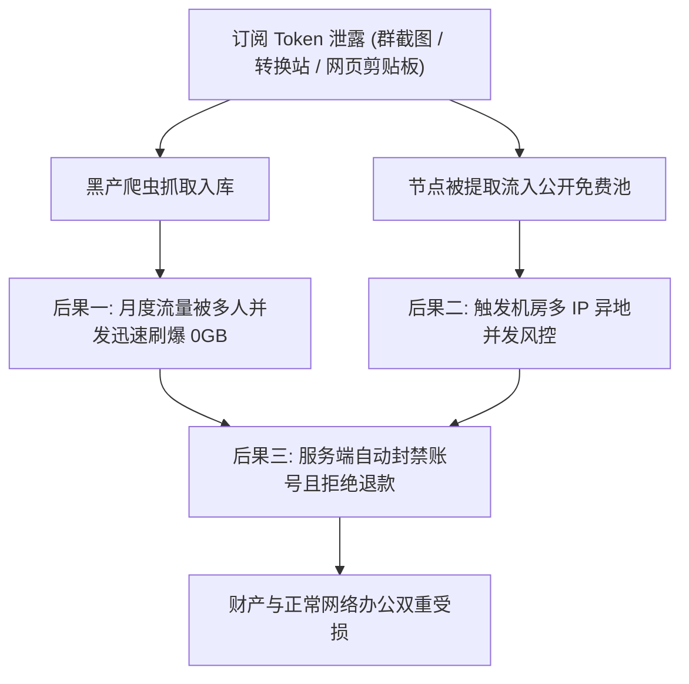
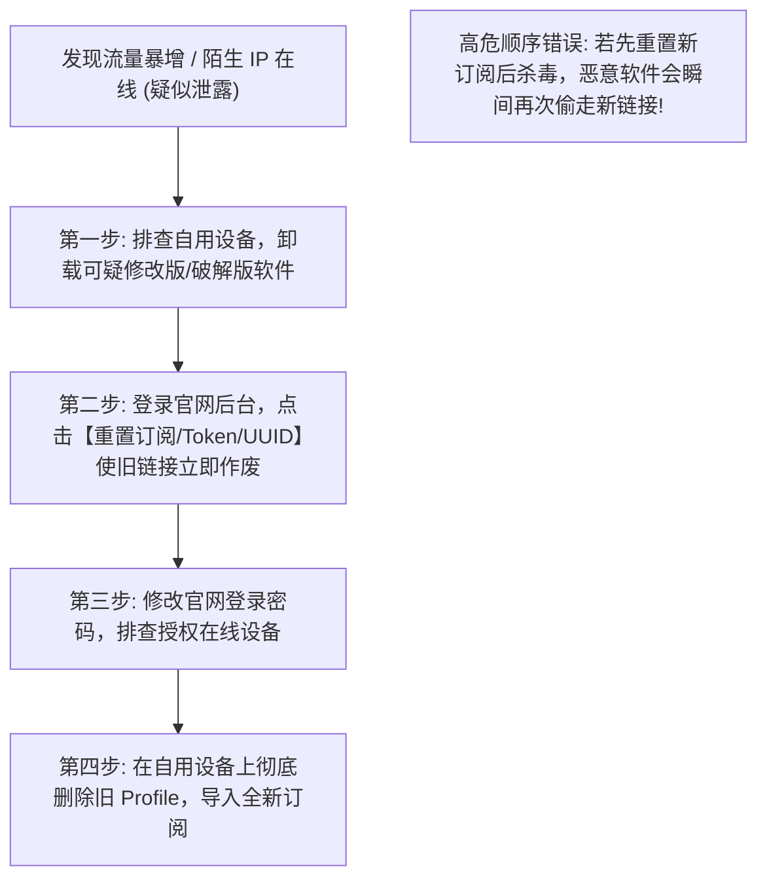
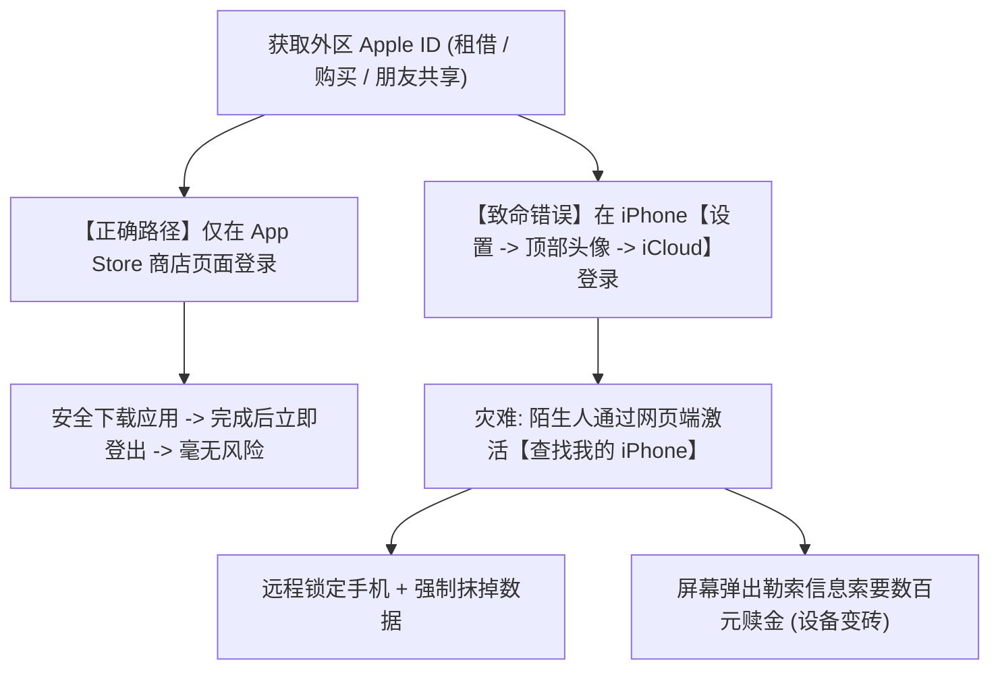

# 账号与订阅安全：保护订阅 Token、重置机制与求助脱敏

> **核心结论（Answer-First）**：在跨境代理客户端的日常使用中，**订阅链接（Subscription URL）内的专属字符串（Token / Code / UUID）在技术效力上 100% 等同于你的明文账号密码**。由于现代开源客户端采用“无状态单向鉴权”协议，任何人只要获取了你的订阅完整 URL，无需任何二次密码验证，就能直接在他们的设备上拉取你的全部专属节点，并瞬间刷空你的套餐流量配额。保护账号资产的核心防线包含四大原则：**严禁在社群求助或公开代码库中裸露完整订阅地址、发生异常时遵循“先查本地后重置 Token”的四步紧急止损程序、注册时实施独立强随机密码隔离防撞库**；而对于苹果 iOS 用户，**在购买或切换外区 Apple ID 下载 [Shadowrocket](/clients/shadowrocket/) 时，绝对严禁在 iPhone「系统设置 → iCloud」中登录陌生账号**，防止手机被远程恶意锁死勒索。

---

## 一、订阅链接的技术本质：为什么 URL 里的 Token 等同于明文凭据？

很多初次接触代理工具的用户，常常将订阅链接误以为只是一串如同普通网站超链接一样的普通网址，因而毫无防备地将其复制给朋友、发布到技术群求助、或随手保存在公共网页剪贴板中。理解订阅分发的底层技术原理，是防范安全风险的前提。

### 1. 现代代理订阅协议的无状态认证机制
观察一条典型的商业机场订阅链接，其 URL 结构通常呈现如下特征：
```text
https://sub.domain.com/api/v1/client/subscribe?token=4f8a9b2c3d1e0f7a6b5c4d3e2f1a0b9c
```
- **参数解析**：
  - 前段 `sub.domain.com` 是服务商用于分发配置文件的订阅接口服务器域名；
  - 路径 `/api/v1/client/subscribe` 是后端服务框架（如 SSPanel、V2Board 等）的标准 API 路由；
  - 查询参数 `?token=4f8a9b...` 是一串由服务端密码学伪随机算法生成的专属字符序列。
- **无状态单向认证（Stateless Bearer Authentication）**：
  - 当你在 [Clash Verge Rev](/clients/clash-verge/) 或 [Shadowrocket](/clients/shadowrocket/) 中点击导入或更新时，客户端直接向该接口发起标准 HTTP GET 请求；
  - 服务端网关读取到这串唯一的 Token 后，在用户数据库中完成毫秒级哈希匹配，确认对应用户身份、剩余流量和套餐有效期，随后直接将该账号名下包含香港、日本、美国等全部数十个节点的连接 IP、端口、加密协议与加密密钥（如 Shadowsocks 密码或 VLESS UUID）完整打包下发为 YAML 或 Base64 格式文本；
  - **核心技术现实**：在整个拉取过程中，**服务端只认 Token，不认发起请求的具体设备是哪一台电脑**。这意味着：**谁拿到了这个 Token，谁就拥有了使用你全部节点和消耗你全部流量的完全等同特权**！

### 2. 订阅链接泄露后的四大破坏性后果



- **后果一：全网爬虫自动化抓取，节点流入公开免费节点池**：互联网上运行着无数专门监控社交平台、论坛求助区和代码托管站点的爬虫机器人。一旦包含敏感关键字的链接被公开抓取，几分钟内就会被解析提取，节点将被整合进公共“免费节点白嫖池”供成千上万陌生人免费蹭网；
- **后果二：月度高额流量几天内被刷空 0GB**：即便购买的是 200GB 甚至 500GB 的大流量套餐，在多方并发下载或批量测速下，数小时内流量配额便会被消耗殆尽，导致自用设备全部断流（相关排查见 [流量耗尽与旧配置区分指南](/troubleshooting/articles/quota-expired-vs-stale-config)）；
- **后果三：触发服务商自动化风控，账号遭永久封停**：绝大多数机场为了防止“一人购买、百人倒卖共享”，后台均部署了严格的并发设备数检测机制。一旦检测到某个 Token 在短时间内同时出现数十个不同省份甚至不同国家的公网 IP 发起并发连接，系统会自动将其判定为“违规合租倒卖”，并立即对该账号执行**封禁（Ban）**处理，且依据服务条款坚决不予退款；
- **后果四：节点出口记录不良访问，连带安全风险**：若他人利用你的专属节点实施暴力破解、违规滥用或发送垃圾邮件，在服务商后台与机房日志中，所有操作流水均牢牢与你的注册身份绑定，带来不可预知的安全审查隐患。

---

## 二、四大最高危订阅泄露场景与防御

根据用户反馈与日常排障日志统计，订阅泄露极少是因为黑客入侵，**超过 95% 的案例源自用户在日常使用中的无意疏忽与不良习惯**。

### 1. 场景 A：公开社群与论坛排障截图未打码
这是最高频的泄露源头：
- 新手在配置 [Clash Verge Rev](/clients/clash-verge/) 或 [v2rayN](/clients/v2rayn/) 遇到报错（如导入报错 403 或无法解析 YAML）时，常常直接随手截取整个软件界面发到 QQ 群、微信群、Telegram 交流群或论坛求助；
- 截图的输入框或配置栏中，清晰完整地暴露出形如 `https://.../subscribe?token=...` 的完整长字符串；
- **防范动作**：截图前养成第一反应——**凡是带有 URL 输入框、Token 字段、节点服务器 IP 的区域，必须先用马赛克或实心黑条涂抹遮挡**。

### 2. 场景 B：使用匿名第三方的免费在线“订阅转换站”
部分用户为了将通用订阅转换为特定客户端格式，习惯在搜索引擎中搜索“免费 Clash 订阅转换”：
- **潜在猫腻**：许多匿名搭建的免费在线转换网站，在后端服务端完整配置了访问日志落盘与抓包提取规则。当你把珍贵的付费订阅 URL 粘贴进网页并点击“生成”时，该网站的服务器后台已经将你的原始 Token 完整持久化记录至数据库中；
- **防范动作**：尽可能使用客户端原生支持的协议导入机制（现代客户端如 [sing-box](/clients/sing-box/)、Clash Verge Rev 均已内置了强大且原生的通用协议解析，无需依赖第三方网页转换）。若确实需要转换，优先使用可核验代码的开源本地转换脚本，绝不向未知公共网页交付付费凭据。

### 3. 场景 C：公开代码仓库与未加密云剪贴板残留
- **开发者误区**：部分程序员在编写自动化部署脚本或软路由初始化配置文件时，顺手将带有真实订阅 URL 的脚本上传至 GitHub 公开仓库或 GitHub Gist 中，瞬间被全网扫描器收录；
- **公共设备残留**：在网吧、公用打印店、实验室电脑或通过未加密的多端剪贴板同步工具粘贴过订阅链接，用完后未登出清理浏览器历史与剪贴板历史，导致凭据被后续使用者捡漏。

### 4. 场景 D：已被第三方接管控制的仿冒客户端静默窃取
正如本站在客户端输入审计（详见 `reports/input-audit.md`）中所特别记录的：
- 开源工具存在被第三方仿冒打包并上架非可信商店的真实历史案例（例如被官方明文警示的 Google Play 版本 NekoBox 被第三方接管事件）；
- 用户从非官方渠道或搜索引擎广告位下载了包含后门的恶意客户端，该软件在本地运行时会静默常驻系统后台，并在检测到剪贴板出现 `subscribe` 或 `token` 关键字时，立即将其静默上传至远程灰产服务器。

---

## 三、怀疑泄露或异常时的四步紧急重置流程

如果你在机场后台仪表盘发现「当前在线设备」中出现了非自己常驻城市的陌生 IP，或者在未使用大流量的情况下套餐配额突然暴跌数十 GB，表明你的订阅极大概率已经泄露。

请严格按照以下**先后顺序**执行四步紧急重置止损（顺序至关重要，严禁颠倒）：



### 步骤一：先排查本地自用设备环境，卸载一切来源不明软件
- **关键逻辑**：如果你电脑或手机上存在被捆绑后门的仿冒客户端，而你直接去后台点击“重置订阅”，新生成的安全链接导入后会立刻被恶意软件再次偷走！
- **清理动作**：首先检查近期是否从非官方渠道安装过可疑应用；退出并卸载非正规客户端，运行系统自带杀毒软件（Windows Defender）进行快速扫描，确保当前操作环境纯净。

### 步骤二：登录服务商后台仪表盘，执行一键重置订阅 Token
1. 使用浏览器直连访问服务商官方控制面板；
2. 进入“用户中心”、“我的服务”或“仪表盘”页面；
3. 查找 **「重置订阅信息」**、**「重置 Token」**、或 **「重置 UUID / 安全凭据」** 按钮；
4. 点击确认重置（部分系统可能需要等待 1–3 分钟后台缓存同步）；
5. **技术效果**：旧的订阅 URL 在服务商数据库中将即刻被注销。任何人即便持有旧链接，再次发起请求也会直接收到 **HTTP 401 Unauthorized** 或 **HTTP 403 Forbidden** 拒绝访问，旧节点的连接通道全线切断（排障参考 [订阅 401/403/404 排障](/troubleshooting/articles/sub-http-401-403-404-503)）。

### 步骤三：同步修改官网登录密码，防范撞库深入侵入
若泄露不仅限于订阅链接，甚至连后台登录凭据也存疑：
- 立即在后台安全设置中更改登录密码（必须使用此前从未在其他网站使用过的新密码）；
- 查看后台的“登录日志”与“当前在线设备 IP”，如果支持“强制踢出所有其他已登录会话”，点击执行登出。

### 步骤四：在正常自用设备上删除旧 Profile，重新导入新订阅
1. 打开你自己正常的客户端（如 [Clash Verge Rev](/clients/clash-verge/)、[Shadowrocket](/clients/shadowrocket/) 等）；
2. **彻底删除（Delete）原先保存的旧订阅 Profile**，切勿在旧配置上盲目反复点击刷新（这会向失效链接持续发包导致客户端报错卡死）；
3. 从新后台复制重置后生成的全新订阅链接，重新导入到客户端中；
4. 开启连接测试，验证节点延迟恢复正常。

---

## 四、社区求助与工单提交时的“安全脱敏清单（REDACTED）”

向开源社区（如 GitHub Issue）、技术交流群或服务商工单反馈报错是排障的常见环节。为了兼顾排查效率与个人信息安全，必须严格执行**信息脱敏规范**。

### 1. 敏感字段分类脱敏对照速查表

| 信息类型 | 安全级别 | 公开求助展示规范 | 违规暴露后果 |
| :--- | :--- | :--- | :--- |
| **完整订阅 URL 与 Token** | **最高机密** | **绝对禁止展示！** 必须将参数值替换为 `***`，如：`https://sub.domain.com/sub?token=[REDACTED]` | 订阅被全网盗刷，流量瞬间归零并封号 |
| **节点具体连接服务器与端口** | **高度敏感** | **必须打码！** 遮挡核心 IP 地址前三段，端口打码，如：`xxx.xxx.xxx.42:**` | 暴露服务商机房中转入口，可能招致针对性网络攻击 |
| **节点底层密钥（UUID/Password）** | **高度敏感** | **绝对禁止展示！** 配置文件中出现的明文密码必须替换为 `[PASSWORD_HIDDEN]` | 他人可直接脱离订阅独立添加单节点使用 |
| **用户注册邮箱与账单信息** | **个人隐私** | **必须打码！** 邮箱前缀打码（如 `a***@gmail.com`），支付交易截图遮挡真实姓名 | 个人实名身份与网络行为关联，面临垃圾邮件骚扰 |
| **HTTP 状态码与报错提示** | **公开安全** | **建议完整展示！** 如 `HTTP 403 Forbidden`、`YAML Parse Error at Line 15`、`Connection Refused` | 无安全风险，是技术专家快速定位问题所必需的核心线索 |
| **客户端名称与完整版本号** | **公开安全** | **建议完整展示！** 如 `Clash Verge Rev v1.7.7 (Meta内核)`、`Windows 11 23H2` | 便于确认是否由于旧内核版本或已知 Bug 导致异常 |

### 2. 规范脱敏示例对比
- **高危错误示范**：
  > “求助！我买的机场今天连不上了，大家帮我看看日志：`[WARN] Failed to fetch https://vip01.example.com/api/v1/client/subscribe?token=9a8b7c6d5e4f3a2b1c0d` 报错 500，我邮箱是 zhangsan1990@qq.com 微信支付单号 42000021...”
  - *分析*：一键送出自己的全部节点、完整 Token、常用邮箱与真实姓名支付特征。
- **合格脱敏示范**：
  > “求助：客户端提示订阅更新失败。
  > 客户端版本：Clash Verge Rev v1.7.7（Mihomo 内核）
  > 报错信息：拉取订阅时返回 `HTTP 500 Internal Server Error`（URL 已脱敏：`https://sub.**.com/api/v1/client/subscribe?token=[REDACTED]`）
  > 本地环境：移动 5G 热点与家庭电信宽带直连均能打开后台，但客户端内拉取均报 500，请问这通常是服务端接口异常还是本地解析问题？”
  - *分析*：完全不暴露凭证，同时精准提供了排查所需的全部技术要点。

---

## 五、Apple ID 安全原则：为什么外区账号严禁登录系统设置 iCloud？

对于使用 iPhone 或 iPad 的 iOS 用户，由于 [Shadowrocket](/clients/shadowrocket/)（俗称“小火箭”）、Stash、Quantumult X 等优秀代理工具在国区 App Store 处于下架状态，用户普遍需要切换至美区、港区或日区的 Apple ID 进行下载安装。

在此环节中，存在一条**触碰即可能导致整台手机报废的绝对安全红线**：



### 1. 致命安全红线：外区账号绝对严禁在手机「系统设置」登录 iCloud！
- **底层技术风险**：
  - iOS 系统的「系统设置 → 登录 iPhone」直接绑定了设备的底层硬件所有权和 **iCloud「查找我的 iPhone」** 特权；
  - 如果你将网上购买、租赁或公开分享的外区 Apple ID 登录进系统设置，该账号的实际控制人（或卖号黑产）可以随时在电脑网页端登录 `icloud.com`，将你的设备远程标记为**“丢失模式（Lost Mode）”**；
  - 手机屏幕将瞬间黑屏并锁死，弹出黑客留下的联系方式并索要 500–2000 元不等的“解锁赎金”。即使刷机或恢复出厂设置，苹果官方的激活锁（Activation Lock）同样会牢牢锁死设备，整台 iPhone 瞬间沦为无法使用的砖头！

### 2. 标准规范的单点应用下载操作指南
下载安装 Shadowrocket 时，必须严格遵循以下三步操作：
1. **第一步：打开手机内置的「App Store」软件**（切记：绝不是系统桌面上的灰色“设置”图标！）；
2. **第二步：点击 App Store 页面右上角的「个人头像」**，滑到最底部点击「退出登录」当前国区账号；
3. **第三步：在 App Store 内输入外区 Apple ID 账号与密码登录**。若系统弹出“Apple ID 安全 - 双重认证”，选择使用短信验证码或点击“其他选项 - 不升级”；
4. **下载与登出**：成功切换外区商店后，搜索下载正版 Shadowrocket。下载完成后，**立即再次点击右上角头像滑到最底部点击「退出登录」**，重新登回自己的主力国区账号。
- *安全总结*：通过 App Store 登录仅赋予该账号下载特定软件的权限，绝不触碰设备底层的 iCloud 与硬件激活锁，即便该外区账号后续被封禁，已经下载好的软件依然可以永久正常使用。

---

## 六、账号隔离防撞库三大铁律

代理服务行业的技术参差不齐。许多中小站点搭建在低成本 VPS 上，后台数据库缺乏企业级安全防护，甚至存在极客脱库、数据库被转售给黑灰产的真实风险。为了确保即便某家机场数据库泄露也不会殃及自身核心数字资产，必须筑牢三道隔离防线：

### 铁律一：非实名专用别名邮箱注册
- 绝不要使用自己日常工作绑定的企业邮箱、网银常用个人邮箱或实名 QQ 邮箱（`QQ号@qq.com` 极易直接关联个人真实身份）注册代理站点；
- 建议使用 Outlook、ProtonMail 等服务注册专门用于技术测试的二级邮箱，或利用域名邮箱设置特定的别名（Alias），实现数字身份与真实生活圈的彻底物理阻断。

### 铁律二：密码管理器生成独立强随机密码
- **杜绝一套密码走天下**：绝对严禁在代理网站使用与自己银行、支付宝、Apple ID、主力社交软件相同的密码；
- 借助成熟的开源密码管理软件（如 Bitwarden）或浏览器内置密码生成器，为每一个注册的机场生成由大小写字母、数字和特殊字符组合的超过 16 位的**完全独立强随机密码**。即便某个中小机场后台遭到“明文脱库”，攻击者也绝无可能通过跨站撞库攻破你的其他重要账户。

### 铁律三：支付隔离与账单凭据妥善保管
- 在结账时，优先使用经过脱敏保护的第三方聚合扫描，避免在不可信网站直接输入银行卡卡号、有效期与 CVV 安全码；
- 妥善保存充值流水与商户订单号，以便在发生掉单时作为维权依据（沟通技巧参考 [机场退款规则与争议解决指南](/security/refund/)）。

---

## 七、常见问题

### 为什么说机场订阅链接里的 Token 等同于你的明文密码，发给别人会有什么后果？
现代代理订阅采用无状态 URL 认证，链接末尾的一长串 Token 字符串正是服务端识别你账号权限与配额的核心凭据。一旦泄露，任何人只需将该 URL 粘贴到他们的客户端中，就能直接同步你的全部节点配置、共享并刷光你的月度流量，甚至因多 IP 异地并发触发服务商系统的防倒卖风控而遭到永久封号。

### 怀疑订阅链接已经泄露，或者在后台看到陌生地区的在线设备 IP，该怎么彻底重置？
严格按四步执行：第一步先排查自用设备，卸载来源可疑的破解版应用防止新链接再次被偷；第二步登录服务商后台仪表盘，点击“重置订阅信息”或“重置 Token/UUID”使旧 URL 即刻失效；第三步修改官网登录密码防撞库；第四步在自己所有正常设备上删除旧配置，重新导入新生成的订阅链接。

### 在论坛、GitHub Issue 或交流群截图求助排障时，哪些信息必须严格打码脱敏？
必须 100% 抹去的隐私数据包括：完整订阅 URL（特别是 token= 后的长字符串）、节点具体服务器 IP 地址与连接端口、节点的 UUID/密码密钥、面板登录邮箱以及订单交易凭据；可以保留用于排查的数据包括：客户端版本号、运行模式（Rule/Global）、以及具体的报错文本或 HTTP 状态码（如 401/403/503/Timeout）。

### iOS 用户借用或购买外区 Apple ID 下载小火箭（Shadowrocket）时，为什么绝对不能在手机“系统设置”里登录？
系统设置里的登录直接关联设备底层的 iCloud 与“查找我的 iPhone”权限。一旦在系统设置登录陌生共享账号，账号持有者可在网页端一键远程锁定你的设备抹除数据，并弹出勒索信息索要赎金。购买 Shadowrocket 时，外区账号绝对只能在“App Store 商店页面右上角个人头像”处单点登录。

### 为什么很多用户在免费订阅转换网站粘贴付费订阅后，流量很快莫名奇妙耗尽？
部分由匿名第三方搭建的非可信在线订阅转换平台，会在其后端数据库中完整记录并缓存用户提交的所有原始订阅 URL。不良运营方通过自动化脚本定时爬取这些有效 Token 并提取可用节点，打包整合进公开的免费节点池供他人滥用，直接导致原用户的套餐配额被迅速窃取耗尽。

### 注册机场账号时，有哪些能够有效防止被跨站撞库的核心密码防范习惯？
坚持三大防撞库铁律：一是使用专用的别名邮箱或二级邮箱注册，绝不暴露日常使用的政务、银行主力邮箱；二是利用密码管理器（如 Bitwarden）为每个机场生成超过 16 位的强随机密码，绝不与任何其他平台密码复用；三是支付环节使用脱敏账户，不轻易向陌生平台留存实名银行卡信息。

### 为什么不要将包含个人私人 Token 的订阅链接保存在公开的代码仓库或未加密笔记中？
互联网上存在大量专门针对公开平台（如 GitHub 公开 Gist、公开 Repository、Pastebin 等）的自动化爬虫，会实时抓取形如 subscribe?token= 的敏感特征字符串。将订阅明文放在公开索引区域，通常在数分钟内就会被黑产脚本抓取入库。

---

## 八、相关入口

- 订阅排查与格式指南：[订阅 HTTP 401/403/404 排障](/troubleshooting/articles/sub-http-401-403-404-503) ｜ [订阅导入与解析教程](/guides/subscriptions/) ｜ [流量耗尽排查](/troubleshooting/articles/quota-expired-vs-stale-config)
- 客户端安全与下载：[Shadowrocket 完整指南](/clients/shadowrocket/) ｜ [Clash Verge Rev 教程](/clients/clash-verge/) ｜ [客户端总览](/clients/)
- 风险控制与隐私：[机场安全性与隐私边界](/security/privacy/) ｜ [机场避坑指南](/security/avoid-pitfalls/) ｜ [服务失联替代方案](/security/alternatives/)
