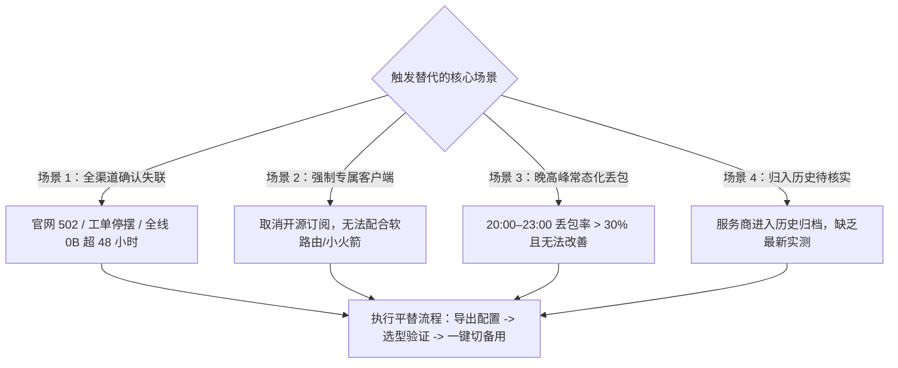
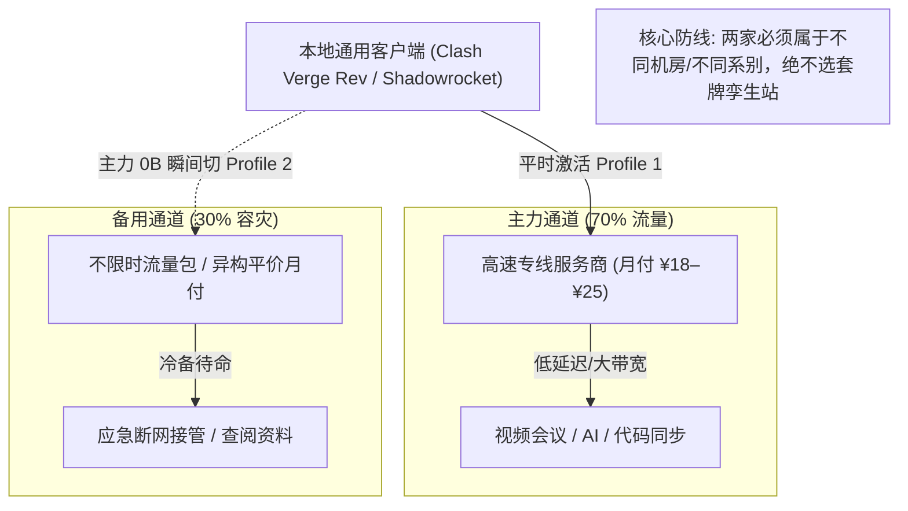

# 机场替代方案：主力失联或专属客户端受限时的平滑迁移

> **核心结论（Answer-First）**：没有任何一家跨境代理服务能保证永久不发生网络波动或运维停机。当面临**主力机场突发失联跑路、原平台强制下线开源订阅转向专属闭源端、或晚高峰骨干网常态化丢包**时，盲目在断网状态下到处病急乱投医往往会陷入“二次踩坑”的死循环。科学的替代策略包含两大支柱：一是**按客户端权限（优先选择支持通用订阅的品牌）与真实月付预算（以 14.9–20 元带实测月付替代无保障模版盘）精准匹配平替候选**；二是**构建「1 主力月付 + 1 不限时冷备」异构双供应商架构**，在 [Clash Verge Rev](/clients/clash-verge/) 或 [Shadowrocket](/clients/shadowrocket/) 中预置多 Profile，实现突发断流时 3 秒一键切换，确保跨境科研、代码协作与远程办公永不单点瘫痪。

---

## 一、迁移决策出发点：什么时候你必须启动服务商替代？

在网络运维中，频繁更换代理服务商会带来重新配置规则、适应不同节点路由和消耗试错资金的摩擦成本。但当出现以下四类关键信号时，表明当前服务的边际成本已显著超过收益，应当果断启动平滑替代程序：

### 1. 场景一：三方交叉核验证实原平台彻底停运跑路
依据 [机场跑路识别与应急止损指南](/security/shutdown/) 的判定标准，若原服务商在纯移动网络下官网无法访问、站内工单数十天无回应、官方交流群全面解散，且客户端内全线节点测速持续返回 0B 超过 48 小时，继续等待原平台复活已无意义，必须立即切断扣款并切换至平替服务。

### 2. 场景二：服务商单方面切断开源订阅，强制绑定闭源专属客户端
在代理行业演进中，部分早期支持通用配置的站点（例如站内记录的 [无忧链接](/brands/wuyou/)、[Firefly 萤火虫](/brands/firefly/) 等）因商业运营策略调整，自 2026 年 10 月起单方面废弃了通用订阅链接下发，改为仅提供官方专属一键客户端。对于依赖软路由（如 OpenWrt）、macOS 独立分流、或习惯使用 [Clash Meta 内核](/clients/clash-meta/)、[sing-box](/clients/sing-box/) 进行精细化流量规则管控的高阶用户而言，专属客户端意味着彻底丧失了配置自由度，必须迁移至全面支持通用订阅的平替生态。

### 3. 场景三：晚高峰骨干网常态化拥塞与严重丢包
若所用机场在白天非高峰时段表现尚可，但在每晚 20:00–23:00 黄金时段，核心跨境节点丢包率长期突破 30%，视频频繁降画质缓冲，AI 交互频繁超时报网络错误（详见 [晚高峰高延迟与丢包排障](/troubleshooting/articles/high-latency-packet-loss-peak)），说明该商家的上游专线带宽超售严重，且运维方无意追加硬件投资，应当升级至带宽充裕的高阶专线平替。

### 4. 场景四：站点进入“历史记录待核实”阶段且信息断层严重
如本站品牌库中标记为 `evidenceStatus: "historical"` 的品牌（如 [灵动云](/brands/lingdong/)、[浪网](/brands/langwang/)、[边缘节点 EdgeNova](/brands/edgenova/)），其原始数据大多停留在数月前，且存在套餐流量遮挡或缺乏测速截图等审计缺陷。继续续费此类历史档案站点的风险极高，应平移至当期有第一手实测证据的活跃站点。

---

## 二、维度一：客户端权限平替矩阵（专属客户端 → 第三方通用开源端）

平替决策的第一道分水岭，是**客户端运行环境的兼容性**。如果你原本使用的是仅限专属 App 的机场，你无法直接导出订阅；反之，若新平台支持通用订阅，你将获得极大的工具自主权。

### 1. 8 家受限专属端品牌现状盘点
根据站内 31 家品牌公开技术档案，以下 **8 家品牌不支持导出 Clash、Shadowrocket、sing-box 等开源通用订阅链接**，仅限使用其打包的闭源客户端：
- **[飞猫云](/brands/feimao/)**（依赖专属客户端，不鼓励通用配置）
- **[无忧链接](/brands/wuyou/)**（2026 年 10 月起改用官方专属客户端，不再提供订阅链接）
- **[Firefly 萤火虫](/brands/firefly/)**（2026 年 10 月起专属客户端，主表明确注明不提供订阅）
- **[灵猫网络](/brands/lingmao/)**（2026 年 10 月起专属客户端，下载登录即用）
- **[SOGO云](/brands/sogo/)**（自研客户端，不支持 Clash、Shadowrocket 等通用工具）
- **[闪跃](/brands/shanyue/)**（专属客户端，下载登录即用）
- **[全球云](/brands/quanqiu/)**（专属客户端，不提供第三方订阅）
- **[隐形人](/brands/yinxingren/)**（自带专属客户端，不支持第三方订阅且官方无试用）

### 2. 转向第三方开源通用生态的平替选型矩阵
如果你希望摆脱闭源客户端的捆绑，迁移至 [Clash Verge Rev](/clients/clash-verge/)、[v2rayN](/clients/v2rayn/) 或 iOS [Shadowrocket](/clients/shadowrocket/)，可对照下表选择具备对等或更优能力的平替品牌：

| 原使用场景特征 | 原受限专属端代表 | 推荐开源平替品牌（支持通用订阅） | 核心技术差异与迁移验证重点 |
| :--- | :--- | :--- | :--- |
| **新手入门 + 偶尔需要一键端过渡** | 飞猫云、无忧链接、灵猫网络 | **[光速云](/brands/guangsuyun/)**、**[极连云](/brands/jilian/)**、**[光年梯](/brands/guangnian/)**、**[速界](/brands/sujie/)**、**[梯子云](/brands/tiziyun/)** | 以上品牌均标注“自研一键客户端 + 第三方通用订阅”双支持；新手可先用自研端连网，随时在后台复制通用链接导入开源软件，不被绑定 |
| **需要多协议支持 + 原生专线 + AI 加速** | Firefly 萤火虫、闪跃、隐形人 | **[一翻云](/brands/yifan/)**、**[速界](/brands/sujie/)**、**[唯兔云](/brands/weitu/)**、**[星岛梦](/brands/xingdaomeng/)** | 均支持通用订阅；其中一翻云支持 Hysteria 2 / VLESS-Reality / SS 三协议，速界主打 AI 场景，唯兔云与星岛梦保留 2026-08-11 实测记录 |
| **多国家节点覆盖（需英法德等冷门区）** | SOGO云、全球云 | **[光速云](/brands/guangsuyun/)**（含 11+ 地区实测记录）、**[U1S1](/brands/u1s1/)**（08-11 实测含英法德土泰越等节点） | 购买前在品牌评测页核对冷门地区吞吐；注意部分欧美长距离节点延迟显著高于港日新近场节点 |

---

## 三、维度二：按预算与供应链抗风险能力平替（低门槛月付 vs 高阶专线）

平替决策的第二道分水岭是**预算结构与供应链质量**。平替的核心目的是“降低试错风险”，绝不能从一个深坑跳入另一个更大的坑。

### 1. 规避 5.6 元极简同质盘后的安全平替路径
正如在 [机场避坑指南](/security/avoid-pitfalls/) 中所深度拆解的，以 [闪电鼠](/brands/shandianshu/)、[大佬云](/brands/dalaoyun/)、[云界线](/brands/yunjiexian/)、[榴莲云](/brands/liulianyun/)、[环球梯](/brands/huanqiuti/) 为代表的“年付 67.2 元（折合 5.6 元/月）”同质集群，普遍存在无第三方实测截图、无地区节点明细、链接格式异常（缺 `#` 或缺 `/`）且缺乏单月试错选项的严重缺陷。

如果你希望寻求**月付在 14.9–20 元区间、拥有第三方实测佐证且支持开源订阅**的平替产品，建议重点参考以下梯队：
- **¥14.9–¥18 月付带实测梯队**：
  - **[唯兔云](/brands/weitu/)**：节假日限时档实付 **¥14.9/100GB**（常规普通版 ¥19.9/150GB），拥有 2026-08-11 实测测速截图，支持通用订阅导入；
  - **[极连云](/brands/jilian/)**：标准月付入门档 **¥18/100GB**，拥有 2026-08-11 实测截图，自研客户端与第三方订阅双支持；
  - **[光年梯](/brands/guangnian/)**：标准月付入门档 **¥18/110GB**，拥有 2026-08-11 实测截图，支持第三方订阅。
- **¥20/月 综合协议与节点平替梯队**：
  - **[一翻云](/brands/yifan/)**：轻享版 **¥20/150GB**，支持 Hysteria 2 / VLESS-Reality / Shadowsocks 多协议，拥有 08-11 测速图（注意官方无试用且有双优惠码冲突记录）；
  - **[二猫云](/brands/ermao/)**：白猫套餐 **¥20/130GB**，拥有 2026-08-11 实测截图（注意正文曾写少了新加坡但表格包含新加坡的口径冲突）；
  - **[U1S1](/brands/u1s1/)**：普通人真够了包 **¥20/120GB**，拥有 2026-08-11 晚高峰实测截图，包含多达十余个地区的节点。

### 2. 高频商务办公与企业级专线平替梯队
对于重度学术查阅、跨国团队音视频会议、或频繁拉取境外大体积代码仓库的用户，单月 20 元以内的轻量机场可能在峰值带宽和突发并发上有所妥协。此时可平移至更高阶的专线平替：
- **[光速云](/brands/guangsuyun/)**：极速版 **¥25/168GB**，流光版 **¥34/268GB**，量子版 **¥68/568GB**。作为站内证据链最为详实的主推品牌之一，拥有 2026-08-11 与 2026-08-19 多批次共 6 张本地实测证据图（涵盖移动、电信、联通三大运营商，以及珠海联通 9Gbps 测速）。虽然存在部分节点 YouTube 送中与 Gemini 视节点而定的限制，但整体带宽容量充裕。
- **[速界](/brands/sujie/)** 与 **[星岛梦](/brands/xingdaomeng/)**：基础月付档 **¥25/150GB**，星岛梦进阶档 ¥50/300GB。拥有 08-11 实测图，主攻高频 AI 工具与流媒体解锁场景。

---

## 四、维度三：双供应商容灾架构与防同系关联准则

想要彻底摆脱“某家机场挂了我就彻底断网”的被动局面，单靠不断寻找新机场是治标不治本的。**在工程设计上建立「双供应商主备容灾拓扑」才是长治久安之道**。

### 1. 什么是双供应商容灾架构？
- **主力通道（Primary）**：采购一家性能优秀的**月付**专线机场（如 18–25 元/月），负责日常 70% 以上的高负载工作流；
- **冷备通道（Standby）**：选购一家支持通用订阅的**一次性不限时流量包**（如站内收录的 50–100 元/100GB 档位）。因为不限时包没有每月到期清零的压力，平时静默存放在客户端中待命，单月均摊成本几乎为零；
- **容灾效果**：一旦主力机场突发网络中断或运维停机，无需手忙脚乱用手机四处求人借节点，打开客户端 3 秒内切换至备用 Profile，网络即刻满血复活。

### 2. 核心防线：严格识别并避开“同系关联”孪生品牌
在选购主备两家机场时，最致命的错误就是**“自以为买了两家不同的机场，实际上两家是同一个老板在同一个机房搭建的套牌孪生站”**。
- **关联案例警示**：在原始档案《32家机场品牌清单.txt》中，[Firefly 萤火虫](/brands/firefly/) 的历史档案中赫然记载着该品牌与微风、飞鸟、一云梯等属于同系关系；而在 5.6 元集群中，闪电鼠、大佬云、云界线等高度同质化的模版盘，极大概率共用了相似的国内入口中转与分销渠道。
- **独立性原则**：备用机场必须与主力机场在**运营年份、接入协议、上游机房和支付渠道**上形成彻底的异构互补（例如：主力使用 Shadowsocks 专线，备用可选用基于 Hysteria 2 或 VLESS-Reality 的公网直连抗封锁节点）。

---

## 五、操作指南：客户端配置安全迁移与平滑切换四步实操

当你选定好替代服务商并完成单月小额付款后，按以下标准化步骤进行无缝迁移与配置导入：

### 第一步：在原客户端中导出并备份本地自定义分流策略
在彻底卸载或清空失效机场前，先保护好自己沉淀的资产：
- 若你在 [Clash Verge Rev](/clients/clash-verge/) 中维护了自定义规则集（如指定国内政务走直连、特定学术镜像直连的 Override 扩展脚本），点击客户端左侧的“订阅（Profiles）”；
- 找到对应的自定义配置，右键选择“导出配置（Export）”或直接在本地文件夹中备份 `.yaml` 文件，详见 [客户端迁移与配置备份指南](/troubleshooting/articles/client-migration-backup)。

### 第二步：在新机场后台复制通用订阅链接
- 登录新服务商后台，找到“仪表盘”或“快速添加节点”区域；
- 优先选择“复制 Clash 订阅”或“一键导入 Shadowrocket”；
- **安全自检**：注意观察复制到的 URL，确保其来自新商家的官方控制面板，**严禁将含有个人 Token 的订阅完整地址截图发送至公开聊天群**（防范订阅泄露见 [账号与订阅安全指南](/security/account-security/)）。

### 第三步：在开源客户端中导入新 Profile 并注入自定义规则
1. 打开 Clash Verge Rev，进入左侧“订阅”菜单；
2. 在顶部输入框粘贴刚复制的订阅 URL，点击“导入”；
3. 导入成功后，右键新配置选择“启用（Use）”；
4. 将第一步备份的本地 Override 规则挂载到新订阅上，确保以往习惯的国内域名直连规则继续生效。

### 第四步：新旧 Profile 预置与一秒容灾切换验收
1. **多 Profile 并存**：在订阅列表中，保留旧机场（若尚未完全停运）与新机场两条记录，并关闭旧机场的自动定时更新；
2. **三步网络验收**：
   - 切换到新 Profile 后，进入“代理（Proxies）”页发起一次节点延迟测试，确认香港、日本、新加坡等常用节点有正常的毫秒级数字返回；
   - 访问 YouTube 观察右下角与视频流，确认没有被错误识别为中国大陆（防范送中机制见 [YouTube 送中排查](/ai-media/youtube/)）；
   - 切换至日本或美国节点，打开 ChatGPT 确认对话畅通（排障参考 [ChatGPT 连不上排查](/ai-media/chatgpt/)）。
3. **清理废弃环境**：若原平台为闭源专属客户端，在确认新开源端工作正常后，通过系统控制面板彻底卸载原专属软件，防止其后台残留的虚拟网卡驱动与系统代理设置产生端口冲突。

---

## 六、常见问题

### 原机场突然失联或取消开源订阅，最先应该做哪三件事避免手忙脚乱？
首先切断原机场自动续费以防重复扣费；其次不要急于全盘清空客户端，先将本地沉淀的自定义分流规则集（Override 或规则文件）导出备份；最后启用平时预存的次要备用订阅（或选购支持通用订阅的 18–20 元低门槛月付），通过客户端多 Profile 机制快速恢复网络。

### 从仅支持官方专属客户端的机场迁移到开源客户端（Clash/小火箭），需要注意什么？
专属客户端机场完全不导出通用订阅 URL，两边的账号、节点数据无法直接跨平台互通。迁移时必须选择明确支持第三方通用订阅的新服务商，按最小月付购买并复制订阅链接导入新客户端，同时在手机与电脑上卸载不再使用的原专属闭源软件以释放本地网络驱动。

### 为什么构建容灾备用机场时，必须刻意避开“同系关联”或“同质模版盘”？
部分看似名称不同的品牌可能属于同一技术团队或共用同一组上游中转机房（例如历史资料中记录的特定关联品牌，以及 5.6 元同质模版盘）。如果主力与备用选在同一系别，一旦上游入口遭受攻击或通报，两家会同时宕机，容灾备份将彻底失效。

### 规避 5.6 元低价同质模版盘后，有哪些性价比较高且保留实测的月付替代档位？
建议重点关注实付 14.9–20 元/月且具备实测证据的档位：如唯兔云节假日 14.9 元/100GB、极连云 18 元/100GB、光年梯 18 元/110GB；若需综合多协议可选一翻云 20 元/150GB、二猫云 20 元/130GB 或 U1S1 20 元/120GB，且均支持通用订阅导入。

### 如何在 Clash Verge Rev 或 Shadowrocket 中预置备用订阅实现数秒无缝故障转移？
在客户端订阅管理中同时添加主力与备用两条订阅链接并开启自动定时刷新。在主力发生断流或 0B 故障时，无需重新到处找机场注册，直接在客户端节点列表顶部切换不同的订阅配置或策略组，3 秒即可完成平滑转移。

### 迁移到新机场后，如何快速验证新节点未发生“流媒体送中”且 AI 正常可用？
导入新节点后，连接香港/台湾/新加坡节点访问 YouTube 查看视频右下角或 Premium 标识，若出现送中则切换其他原生节点；同时连接日本或美国节点访问 ChatGPT 与 Claude，确认不弹 Access Denied 即表明新节点分流正常。

### 为什么推荐重度办公用户日常保留一个“一次性不限时小包”作为冷备？
一次性不限时流量包（如 50–100 元/100GB）无每月到期清零压力，平时静默存放在客户端内成本极低。当主力月付机场突遭不可抗力断网时，可立即作为应急通道提供基础网络，彻底避免无网状态下无法打开注册页面的死循环。

---

## 七、相关入口

- 品牌横向比对与选型：[品牌替代选型总览](/brands/alternatives/) ｜ [品牌索引目录](/brands/directory/) ｜ [品牌运营风险与事件库](/brands/incidents/)
- 价格与计费指南：[月付机场选型指南](/pricing/monthly/) ｜ [低试错预算套餐](/pricing/budget/) ｜ [不限时流量包对比](/pricing/non-expiring/)
- 客户端与排障教程：[Clash Verge Rev 完整指南](/clients/clash-verge/) ｜ [客户端迁移与备份](/troubleshooting/articles/client-migration-backup) ｜ [订阅导入教程](/guides/subscriptions/)
