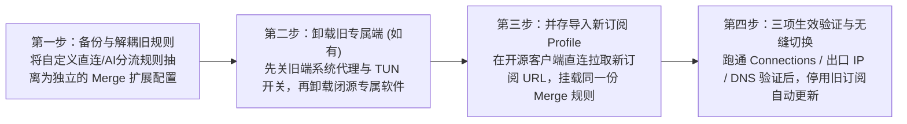

# 更换机场前检查清单：防同系套娃、协议客户端兼容性与配置平滑迁移指南

## 核心结论（Answer-First）

在主力机场即将到期、晚高峰频繁劣化或准备采购第二家容灾备用机场时，盲目下单极易踩中**「买到同系分站一起挂、买完才发现没给通用订阅链接、客户端内核太老刷不出新协议、删旧配置把自定义分流规则全弄丢」**四大迁移陷阱。标准的更换前核验必须逐项通过**「六维前置检查清单」**：第一，查品牌关联与模板特征（**避开同系关联品牌与 5.6 元零实测同质集群**）；第二，查交付体制（**确认支持通用订阅 vs 仅限专属客户端**）；第三，查协议与客户端内核兼容性（`VLESS / Hysteria 2 / AnyTLS` vs 传统 `SS / Trojan`）；第四，查真实测速截图与 AI/流媒体节点级瑕疵（避开 `0B` 与 `送中`）；第五，查真实月付门槛与优惠码排除规则；第六，执行**「先导新订阅并存测试、剥离 Merge 覆写规则、最后卸载旧端」**的零断网平滑迁移与回滚方案。

---

## 一、问题概况：为什么很多人「换了新机场，结果比老机场还难受」？

在日常排障与用户咨询中（详见[机场替代与平滑迁移方案](/security/alternatives/)与[品牌替代选型专题](/brands/alternatives/)），许多用户在对当前机场不满、决定更换服务商时，往往只看了一眼某篇推广软文里的「便宜、速度快」就直接掏钱下单，结果在迁移当天就遭遇了以下四种典型的翻车状况：

1. **状况一（同系套娃翻车）**：原本用的是 A 机场，因为最近两天晚高峰总断连，特意换了一家名字叫 B 的机场作备份；结果一对比节点列表和入口，两家竟然是同一个团队开的同系分站（或者共用同一批低价上游入口），A 断网的时候 B 也一秒不差地跟着一起断网，备用完全失效。
2. **状况二（专属端锁死翻车）**：家里用的是 OpenWrt 软路由（OpenClash / Nikki）和 iPhone 上的 Shadowrocket（小火箭），结果买完新机场登录后台傻眼了——后台只有一个「下载官方专属客户端」按钮，根本不提供任何通用订阅 URL，软路由和小火箭彻底没法用，而且虚拟商品还不支持退款！
3. **状况三（协议与解锁倒退翻车）**：老机场虽然慢一点，但至少日本节点能稳上 ChatGPT 和 Claude，台湾节点能看正版繁体字幕 Netflix；换了新机场后发现，新机场虽然香港测速跑分高，但香港节点访问 OpenAI 显示 `仅APP(HK)`、Gemini 全部失败，新加坡和台湾节点的 YouTube 还全被判了 `送中(CN)`！
4. **状况四（配置丢失与驱动冲突翻车）**：换新机场时先把老订阅直接删了、把老客户端直接卸载了，结果不仅把半年来积累的国内网银/微信直连白名单全删没了，电脑还因为旧客户端卸载时残留了注册表系统代理或虚拟网卡路由而彻底断网。

为了让你在下一次更换机场时实现 **「零踩坑、零断网、零规则丢失」**，我们严格按照 `问题概况 → 证据来源 → 确认事实 → 未确认事项 → 应对建议 → 后续选择` 六步风险应对框架，整理出这份可逐条打勾核对的工程检查清单。

---

## 二、证据来源：基于站内 31 家品牌与 24 款客户端数据库的六大核查底表

在掏钱购买任何一家新机场之前，请先对照本站《原始输入资料与证据资产审计报告》（`reports/input-audit.md`）、`data/brands.json` 与 `data/clients.json` 中的以下三张核心事实审计表，把候选目标过一遍筛子。

### 2.1 第一筛：品牌同系关联、5.6 元同质化模板集群与 `2026-08-09` 历史档案排查表

如果你是因为原机场不稳定而更换，或者是为了组建「主备双机场容灾」，**你的新机场绝对不能与旧机场处于同一个关联集群内**：

| 关联/集群类别 | 涉及的站内品牌名称（据 `data/brands.json`） | 原始资料审计记录与更换避坑要点 |
| :--- | :--- | :--- |
| **1. 历史资料明确标注的「同系关联群组」** | **[微风网络](/brands/weifeng/)、[Firefly（萤火虫）](/brands/firefly/)**（以及历史资料提及的外部同系名称：`飞鸟`、`一云梯`） | 在微风网络与 Firefly 的 `privacyAndRefundNotes` 原始资料中明确注明：**「与微风、飞鸟、一云梯存在同系关联（见 Firefly 历史资料说明）」**。若你当前主力用的是微风网络，切勿再选 Firefly 作为防失联容灾备份（且 Firefly 自 2026-10 起已改为纯专属客户端无订阅）。 |
| **2. 「5.6 元/月年付 IEPL」高度同质化模板集群** | **[闪电鼠](/brands/shandianshu/) (#21)、[大佬云](/brands/dalaoyun/) (#22/详表#5)、[云界线](/brands/yunjiexian/) (#23)、[榴莲云](/brands/liulianyun/) (#24)、[环球梯](/brands/huanqiuti/) (#26)**（及同风格 14 元档 **[神行加速](/brands/shenxing/) (#25)**） | 这 5 家品牌在原始资料中全部标注「IEPL 专线 + 年付约 5.6 元/月 60GB/月 + 季付及以上 7 折 + 自研/第三方双支持」，品牌资料正文直接承认**「与同档位其他 4 个品牌规格几乎完全相同，无独有卖点」**；且全部无测速截图、无节点地区清单，云界线/榴莲云/环球梯还存在推广链接缺 `#` 或缺 `/` 异常。从其中一家换到另一家毫无意义。 |
| **3. `2026-08-09` 历史记录待核实档案** | **[灵动云](/brands/lingdong/) (#29)、[浪网](/brands/langwang/) (#30)、[边缘节点 EdgeNova](/brands/edgenova/) (#31)** | 原始清单后附历史档案，明确注明 **「不保证当前有效」**，存在套餐流量截图遮挡（如灵动云定制档、浪网 `截150G`）、优惠码未核实、缺乏近 30 日实测图等严重缺口。更换主力机场时**严禁在未核实当期状态前直接选入**。 |

### 2.2 第二筛：订阅交付体制排查表（通用开源订阅 vs 仅限官方专属客户端）

这是更换机场前**最容易导致买完没法用**的硬性分水岭！请根据你手头的设备（软路由 / iPhone 小火箭 / 桌面 Clash Verge Rev）核对下表：

| 交付体制分类 | 站内对应品牌完整清单（共 31 家） | 迁移兼容性结论 |
| :--- | :--- | :--- |
| **A. 支持第三方通用订阅导入**（或「自研客户端 + 第三方订阅」双支持，共 **18 家**） | **[光速云](/brands/guangsuyun/)、[微风网络](/brands/weifeng/)、[星岛梦](/brands/xingdaomeng/)、[二猫云](/brands/ermao/)、[唯兔云](/brands/weitu/)、[U1S1](/brands/u1s1/)、[极连云](/brands/jilian/)、[光年梯](/brands/guangnian/)、[一翻云](/brands/yifan/)、[可信云](/brands/kexin/)、[速界](/brands/sujie/)、[梯子云](/brands/tiziyun/)**；以及 5.6 元/14 元年付集群的 **[闪电鼠](/brands/shandianshu/)、[大佬云](/brands/dalaoyun/)、[云界线](/brands/yunjiexian/)、[榴莲云](/brands/liulianyun/)、[神行加速](/brands/shenxing/)、[环球梯](/brands/huanqiuti/)** | **可平滑导入** [Clash Verge Rev](/clients/clash-verge/)、FlClash、[v2rayN](/clients/v2rayn/)、[Shadowrocket](/clients/shadowrocket/)、Karing、v2rayNG 及 OpenWrt 软路由，完整保留你原有的本地分流规则。 |
| **B. 仅限官方专属客户端 / 不提供第三方订阅链接**（共 **8 家**） | **[飞猫云](/brands/feimao/)、[无忧链接](/brands/wuyou/)（2026-10 起）、[Firefly](/brands/firefly/)（2026-10 起）、[灵猫网络](/brands/lingmao/)（2026-10 起）、[SOGO云](/brands/sogo/)、[闪跃](/brands/shanyue/)、[全球云](/brands/quanqiu/)、[隐形人](/brands/yinxingren/)** | **无法导出通用订阅 URL**！必须下载并登录该品牌各自的专属客户端，不支持导入 Clash / Shadowrocket / 常规软路由插件（仅 SOGO 云文案单方面提及软路由支持，待核实）。 |
| **C. 客户端与订阅方式待核实**（共 **5 家**） | **[暮光加速](/brands/muguang/)、[宇宙云](/brands/yuzhou/)**（总表与详表冲突）、**[灵动云](/brands/lingdong/)、[浪网](/brands/langwang/)、[边缘节点 EdgeNova](/brands/edgenova/)** | 原始资料未明确或前后不一致，购买前必须先向其在线客服确认是否提供标准 Clash / 通用订阅链接。 |

### 2.3 第三筛：协议一致性与客户端内核兼容性底表

即使新机场支持通用订阅，你还得核对它的**底层传输协议**你的客户端能不能认出来：
1. **注意「文案宣传协议」与「实际下发/实测图协议」的差异**：
   - 如本站[如何识别未经验证的专线宣传](/routes/articles/how-to-spot-unverified-iepl)所审计：[星岛梦](/brands/xingdaomeng/)、[唯兔云](/brands/weitu/)文案写 `Trojan`，[二猫云](/brands/ermao/)、[光年梯](/brands/guangnian/)、[SOGO云](/brands/sogo/)、[可信云](/brands/kexin/)、[速界](/brands/sujie/)文案写 `VLESS`，但在 `2026-08-11` 实测截图中均显示为 **`Shadowsocks`**；[光速云](/brands/guangsuyun/)则在不同批次实测图中分别涵盖了 **`Shadowsocks`（54/62 节点）、`Vless`（60 节点）与 `AnyTLS`（10 节点）**；[一翻云](/brands/yifan/)宣称 **`Hysteria 2 / VLESS-Reality / Shadowsocks`** 三协议。
2. **淘汰不支持现代协议的老旧客户端（据 `data/clients.json`）**：
   - 如果你要换去使用 **`VLESS（含 Reality）`、`Hysteria 2` 或 `AnyTLS`** 协议的品牌（如微风网络、光速云 Vless/AnyTLS 组、一翻云、宇宙云等）：
     - **iOS 端**：**严禁继续使用 `Potatso`（仅支持 SS/SSR/SOCKS/HTTP，不支持 VLESS/Hysteria 2）或盲目使用 `OneClick`（仅标 VMess/SS/Trojan）**，请使用 [Shadowrocket](/clients/shadowrocket/)、Stash、Streisand、Karing 或 [sing-box (SFI)](/clients/sing-box/)。
     - **Windows / macOS / Android 端**：必须使用搭载现代 **`Mihomo (Clash.Meta)`**、**`sing-box`** 或 **`Xray`** 内核的活跃客户端（如 [Clash Verge Rev](/clients/clash-verge/)、FlClash、[v2rayN](/clients/v2rayn/)、[Clash Meta for Android](/clients/clash-meta/)、v2rayNG、Karing、Hiddify），并确保在拉取订阅时 `User-Agent` 设为 `clash.meta` 或 `mihomo`。

---

## 三、确认事实 vs 未确认事项：更换机场前必须理清的认知边界

### 3.1 更换前可以 100% 确认的事实（Confirmed Facts）

1. **老机场与新机场的「通用订阅 Profile」可以在同一个开源客户端里和平共处**：
   - 在 Clash Verge Rev、FlClash、v2rayN、Shadowrocket 或 Karing 中，你**完全不需要删除旧机场的订阅**，就能直接点击「新建/添加」导入新机场的订阅链接 `https://sub.example.invalid/api/v1/client/subscribe?token=REDACTED`。两家机场的订阅卡片并排存放，点哪张卡片就用哪家的节点，切换耗时不到 2 秒。
2. **新机场是否存在已记录的「节点级 YouTube 送中、AI 仅 APP 或单节点 0B」可提前查表确认**：
   - 换机场前，先查本站[品牌深度评测目录](/reviews/)与[AI 与流媒体解锁兼容性总览](/ai-media/compatibility/)。例如你是因为想用 Gemini 或看台湾原生 YouTube 而换机场，通过查表就能提前知道：在[光速云](/brands/guangsuyun/) `2026-08-19` 归档实测图中，其香港专线节点 OpenAI 多为 `仅APP(HK)`、Gemini 多为失败，且新加坡 `01–10` 与台湾多节点 YouTube 显示 `送中(CN)`（需切换到日本/美国或特定未送中节点）；在[无忧链接](/brands/wuyou/) `2026-07-18` 实测图中，`香港 HKG-01` 显示 YouTube `送中(CN)` 但其余 49 节点正常；在[灵动云](/brands/lingdong/)历史实测中，OpenAI 各地区基本全解锁但 TikTok 多失败且新/台 YouTube 送中。

### 3.2 更换前属于「未确认事项（Unconfirmed Matters）」、必须首月实测的指标

1. **新机场的国内前置 BGP 入口与你家本地宽带（特定省市电信/联通/移动）的晚高峰契合度**：
   - 任何公开测速图（例如本站基于珠海联通 5Gbps/9Gbps 或广西移动/长沙电信/河北联通的实测快照）都只代表测试机所在省份运营商的当时表现。你家所在小区的宽带在晚上 21:00 连新机场的入口是否会被本地省网 QoS 限速，**唯有你自己买一个月（15–27 元）在本地电脑跑过一次晚高峰才能 100% 确认**！
2. **仅标 `vendor` 声明（无独立流媒体/AI 实测图）品牌的真实解锁持续性**：
   - 站内 31 家品牌中，除光速云、无忧链接、灵动云留有流媒体或 AI 专项实测记录外，其余品牌的「支持 Netflix / Disney+ / ChatGPT / Claude / Gemini」均来自品牌方文字资料（`dataStatus: "vendor"`），绝不能在未用月付实测前默认其所有节点都能 100% 解锁。

---

## 四、应对建议：更换机场前的「六步核查清单」与「平滑迁移/回滚操作流程」

当你决定更换机场时，请按顺序执行以下两套标准化工程动作：先用 **6 问核查表** 筛选目标品牌，再用 **4 步并存迁移法** 无缝切换。

### 4.1 购买新机场前的「6 问打勾检查表」

| 检查序号 | 核心检查项 | 合格通过标准（✅ 绿灯） | 危险警告信号（❌ 红灯一票否决） |
| :--- | :--- | :--- | :--- |
| **检查 1** | **是否与旧机场同系或同模板？** | 独立运营架构，且具备本店归档的独立原始测速截图（`measured`）。 | 与刚踩坑的旧机场属于同系关联，或属于 5.6 元五家完全雷同的无图模板盘。 |
| **检查 2** | **是否提供第三方通用订阅 URL？** | 明确支持 Clash / Shadowrocket / 通用订阅（或自研+订阅双支持）。 | 属于 8 家纯专属客户端品牌，而你必须在软路由或 iPhone 小火箭上使用。 |
| **检查 3** | **是否有 15–27 元的真月付档？** | 提供无需年付绑定的单月套餐（如 14.9–27 元/月，100GB–200GB）。 | 拒绝提供月付，强制要求一次性年付、两年付或大额充值（详见[年付套餐风险](/security/articles/long-term-prepaid-risks)）。 |
| **检查 4** | **优惠码与实际结账金额是否对齐？** | 收银台输入优惠码后折后价清晰，知晓特价年付/永久包不打折规则。 | 存在双码冲突却不核对收银台实付价，或轻信把年付折算均价当成月付价。 |
| **检查 5** | **协议是否与本地客户端匹配？** | 本地已安装 Clash Verge Rev / FlClash / v2rayN / Shadowrocket 等现代内核工具。 | 拿着停更的旧版 CFA/CFW 或仅支持 SS 的 Potatso 去买纯 VLESS/Hysteria 2 机场。 |
| **检查 6** | **节点倍率与 AI 地区分布是否合理？** | 拥有充足的 `1x` 倍率港/新/日/美节点，支持将 AI 独立分流至非香港节点。 | 全是 `3x–5x` 高倍率节点，或只有香港节点却宣称网页直连 OpenAI/Gemini。 |

---

### 4.2 客户端「零断网、零丢规则」四步平滑迁移流程（附完整回滚步骤）

买好新机场的月付套餐并拿到新的订阅链接（脱敏示例：`https://sub.example.invalid/api/v1/client/subscribe?token=REDACTED`）后，**千万不要上来就卸载旧软件或删除旧配置**！请严格按以下四步执行平滑交接（详见[从旧客户端安全迁移并备份配置](/troubleshooting/articles/client-migration-backup)）：

> **迁移流程图说明**：上图展示了通过「规则与订阅解耦 + 新旧 Profile 并存切换」实现零断网平滑迁移的标准工程路径。

#### 步骤 1：在删除或停用旧机场前，先抽离并备份你的「自定义分流规则」
- 打开你当前使用的 [Clash Verge Rev](/clients/clash-verge/)、FlClash 或 Stash -> 进入 **「订阅 (Profiles)」**。
- 如果你之前在旧机场的配置文件里手写过「公司内网直连、国内网银直连、`fake-ip-filter` 白名单、ChatGPT/Claude 指定日本节点」等自定义规则，请点击右侧的 **「新建 -> Merge（全局扩展配置）」**，把这些自定义规则粘贴到独立的 Merge 扩展文件中保存。
- **工程收益**：从此以后，你的自定义分流规则与任何一家具体机场彻底解耦！无论你以后换多少家机场，只要开着这个 Merge 扩展，你的个人规则永远自动生效。

#### 步骤 2：安全清理旧机场的「专属客户端」（仅针对从专属端迁出的用户）
- 如果你上一家机场用的是它的「官方闭源专属客户端（如飞猫云、SOGO云、闪跃、全球云或 2026-10 后的无忧链接/Firefly/灵猫网络专属端）」，在改用开源客户端（Clash Verge Rev / v2rayN）之前，**必须先防止两套客户端同时抢占系统代理和虚拟网卡**（详见[VPN 与代理能否同时运行](/vpn/comparisons/)）：
  1. 打开旧的专属客户端 -> **先在界面上手动关闭「连接 / 系统代理 / TUN 增强模式」开关**；
  2. 正常右键托盘图标彻底退出旧专属客户端进程；
  3. 再通过系统「设置 -> 应用 -> 已安装的应用」卸载不再使用的旧专属客户端，避免其开机自启后台服务抢占路由。

#### 步骤 3：在直连状态下将新机场订阅作为「第二张 Profile 卡片」并存导入
- 打开你的通用开源客户端（确保此时系统代理和 TUN 处于关闭状态），点击「新建远端订阅」，粘贴新机场的脱敏订阅地址 `https://sub.example.invalid/api/v1/client/subscribe?token=REDACTED`，将自动更新间隔设为 `1440` 分钟（24 小时）。
- 拉取成功后，点击选中这张**新机场订阅卡片**，切到「代理 (Proxies)」页面确认处于 **`Rule（规则）`** 模式，运行一次 `URLTest` 选定健康的 `1x` 节点，然后重新开启「系统代理（或 TUN 模式）」。

#### 步骤 4：迁移失败或新机场水土不服时的「10 秒无损回滚步骤」

如果在切换到新机场订阅后，你发现新机场的节点在你家宽带上全部超时、或者自定义 Merge 覆写里的策略组名称（如旧机场叫 `🔰 节点选择`，新机场叫 `🚀 代理出口`）对不上导致内核报错断网，请按以下**三步瞬间回滚**：

1. **回滚动作一（剥离冲突覆写）**：在客户端 `Profiles` 页面，先点击关闭刚刚挂载的局部/全局 `Merge` 或 `Script` 覆写开关（因为不同机场模板的顶层策略组名字往往不同，硬套写死了策略组名的覆写会导致 YAML 校验失败，详见[YAML 配置解析失败修复](/troubleshooting/articles/clash-verge-mihomo-yaml-fail)）。
2. **回滚动作二（一键切回旧订阅卡片）**：直接用鼠标点击旁边还没有删掉的 **「旧机场订阅卡片」**（或你的「永久不限时冷备订阅卡片」），内核会在 1 秒内热重载切回原本正常工作的节点池！
3. **回滚动作三（刷新本地 DNS 与 Socket 缓存）**：在终端执行一次 `ipconfig /flushdns`（Windows）或开关一次手机飞行模式（iOS/Android），清空切换过程中残留的旧 DNS 映射，网络即刻 100% 恢复如初（验证方法详见[怎么确认代理分流设置生效](/guides/articles/verify-proxy-is-working)）。

---

## 五、后续选择：按更换动因匹配的站内实测品牌替代矩阵

完成上述六项检查准备后，你可以根据自己**本次更换机场的核心痛点**，从本站留存有真实测速截图（`measured`）且支持第三方通用订阅的品牌库中，挑选最对口的月付替代目标（完整参数与冲突核查请点击对应品牌页或[品牌深度评测总目录](/reviews/)）：

| 你更换旧机场的核心痛点 | 推荐替代选型方向与预算档位 | 站内具备实测截图且支持通用订阅的代表品牌参考（首月均请坚持月付） |
| :--- | :--- | :--- |
| **1. 旧机场强制改用专属客户端，导致软路由 / 小火箭 / Clash Verge Rev 无法使用** | 转向明确承诺 **「支持第三方通用订阅（或自研+通用订阅双支持）」** 的 18–25 元月付品牌 | **[光速云](/brands/guangsuyun/)**（极速版 ¥25/月 168GB，支持 Clash/Shadowrocket 与自研端，留存 08-11 与 08-19 共 6 张实测图）、**[极连云](/brands/jilian/)**（¥18/月 100GB，双支持，08-11 晚间实测）、**[光年梯](/brands/guangnian/)**（¥18/月 110GB，双支持，08-11 实测）、**[二猫云](/brands/ermao/)**（白猫 ¥20/月 130GB，08-11 实测）。 |
| **2. 旧机场协议单一（纯 SS/Trojan）在本地宽带晚高峰频繁被限流或阻断** | 转向支持 **`VLESS`、`VLESS-Reality`、`Hysteria 2` 或 `AnyTLS`** 等现代多协议的实测品牌 | **[一翻云](/brands/yifan/)**（轻享版 ¥20/月 150GB，宣称 Hysteria 2 / VLESS-Reality / SS 三协议，留存 08-11 实测图，注：无试用）、**[光速云](/brands/guangsuyun/)**（08-19 实测图涵盖 Shadowsocks / Vless / AnyTLS）、**[微风网络](/brands/weifeng/)**（乘风 ¥27/月 200GB，07-19 实测 50 节点 VLESS FullCone）。 |
| **3. 需要一个平时不扣月租、仅在主力维护时顶上的「异构第二冷备」** | 选购 **`99–147 元` 百 GB 级一次性永久不限时流量包**（确保与主力不同系） | **[二猫云](/brands/ermao/)**（¥99/100GB 不限时）、**[星岛梦](/brands/xingdaomeng/)**（¥100/100GB 永久不限时，2020 年老牌）、**[唯兔云](/brands/weitu/)**（¥100/100GB 永久不限时）、**[一翻云](/brands/yifan/)**（¥100/100GB 不限时）、**[光速云](/brands/guangsuyun/)**（¥147/247GB 致敬斯诺克永久套餐，注：不打折且特殊商品不支持退款）。 |

---

## 六、常见问题（FAQ）

### 为什么换了一家名字完全不同的新机场，结果老机场晚高峰卡顿断连时，新买的机场也在同一时间卡顿断连？

这是因为你在不知情的情况下踩中了「同系品牌（分站马甲）」或「同质化上游模板盘」！在代理行业中，同一个运营团队或同一条上游中转母鸡往往会开设多个不同名字的品牌（例如本站品牌库历史资料明确记载微风网络、Firefly、飞鸟、一云梯之间存在同系关联；而闪电鼠、大佬云、云界线、榴莲云、环球梯 5 家 5.6 元年付品牌在规格与文案上几乎完全复制）。如果主力与替代选在了同一系别，一旦上游共用的国内 BGP 入口遭受 DDoS 攻击，两家必然同时瘫痪。

### 换新机场前如果不检查「是否提供第三方订阅链接」，在软路由 OpenWrt 或苹果小火箭（Shadowrocket）上会遇到什么大坑？

你会发现付完钱登录后台后，根本找不到任何可以复制的订阅链接！根据本站 31 家品牌数据库核查，目前有 8 家品牌（飞猫云、无忧链接 2026-10 起、Firefly 2026-10 起、灵猫网络 2026-10 起、SOGO云、闪跃、全球云、隐形人）采用纯官方专属客户端模式，不提供第三方通用订阅 URL。如果你依赖 OpenWrt 软路由（OpenClash/Nikki/PassWall2）、iOS 端 Shadowrocket/Stash/Quantumult X 或桌面端自定义 Clash Verge Rev 分流规则，购买这 8 家品牌将无法直接导入使用。

### 为什么换了一家主打 VLESS 或 Hysteria 2 协议的新机场后，我手机上原本好用的旧客户端突然刷不出节点了？

因为部分传统或老旧客户端不支持现代代理协议。根据本站 `data/clients.json` 审计：iOS 端的 Potatso 仅支持 Shadowsocks/SSR 等传统协议，完全不支持 VLESS 与 Hysteria 2；OneClick 仅标注支持 VMess/SS/Trojan；Android 端早已停更的旧版 Clash for Android（CFA）及桌面端停更的原版 Clash for Windows（CFW）也不支持 VLESS Reality 或 Hysteria 2 / AnyTLS。换用现代协议机场前，必须确保客户端已升级至基于 Mihomo（Clash.Meta）、sing-box 或 Xray 的活跃工具（如 Clash Verge Rev、FlClash、v2rayN、v2rayNG、Karing、Shadowrocket）。

### 更换机场订阅时，怎么操作才能不丢失我在旧机场配置里辛苦写好的 AI 分流规则和局域网白名单？

核心原则是「将自定义分流规则与机场远端订阅解耦」。在 Clash Verge Rev、FlClash 或 Clash Nyanpasu 中，千万不要直接去手改机场下发的原始订阅 YAML 文件（因为一下拉更新或换机场就全没了），而应该把你自定义的规则写在独立的全局/局部「扩展配置（Merge）」或「覆写脚本（Script）」中。换新机场时，只需导入新机场的远端订阅 URL 并开启同一个 Merge 扩展开关，所有自定义规则即可零修改无缝继承。

### 导入新机场订阅并卸载旧机场专属客户端后，发现电脑或手机网络异常连不上网，怎么快速回滚？

这是因为旧机场的专属客户端在卸载前没有正常关闭「系统代理」或「TUN 虚拟网卡服务」，或者新订阅的节点组名称与你旧的本地覆写脚本不匹配导致内核启动报错。回滚只需三步：第一，在当前客户端先停用所有自定义 Merge/Script 覆写；第二，在客户端内瞬间切回你尚未到期的旧通用订阅卡片（或在 Windows PowerShell 执行 `ProxyEnable=0` 与 `ipconfig /flushdns` 恢复直连）；第三，检查系统网络连接列表并移除残留的旧虚拟网卡驱动。

---

## 七、关联阅读与延伸排障入口

- **返回上级专题**：[机场替代与平滑迁移方案：主力失联或专属客户端受限时的备选策略](/security/alternatives/) ｜ [品牌替代与同价位选型专题](/brands/alternatives/)
- **同集群风险应对指南**：
  - [机场突然停止服务应该怎么办：先排本地故障再取证止损与切换备用方案](/security/articles/what-to-do-if-airport-stops)
  - [长期预付年付机场套餐有哪些风险：沉没成本与 2026-08-09 历史品牌启示](/security/articles/long-term-prepaid-risks)
  - [如何保留付款记录与工单沟通证据：订单流水、脱敏截图与售后争议应对](/security/articles/how-to-preserve-payment-evidence)
- **客户端迁移与配置实操**：
  - [从旧客户端安全迁移并备份配置文件指南](/troubleshooting/articles/client-migration-backup)
  - [怎么确认代理分流设置生效：三项可验证检查路径与退出回滚](/guides/articles/verify-proxy-is-working)
  - [31 家机场品牌全量索引目录](/brands/directory/)
