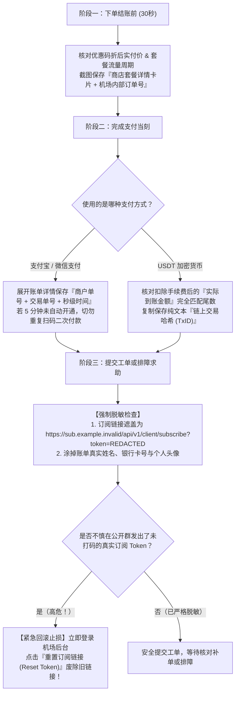

# 机场付款记录与证据留存指南：订单流水、脱敏截图规范与掉单售后工单应对

## 核心结论（Answer-First）

在跨境代理服务的购买与售后排障中，规范留存**「付款流水凭证」**与**「脱敏技术日志」**是解决支付掉单、套餐额度争议与节点故障的唯一有效筹码。用户在操作时必须恪守三大工程规范：第一，支付环节务必完整保存包含**「平台内部订单号 + 支付渠道商户单号/链上 TxID + 秒级时间戳 + 实付金额」**的四要素流水，遇回调掉单严禁盲目重复付款；第二，在提交工单或社群求助时，必须对截图执行严格脱敏，**将订阅地址统一遮盖为 `https://sub.example.invalid/api/v1/client/subscribe?token=REDACTED` 并隐去实名银行卡信息**；第三，一旦在截图或在线转换中不慎暴露真实订阅 Token，必须立即登录官网后台执行**「重置订阅链接」回滚止损**。

---

## 一、问题概况：为什么在机场售后与排障中「没留证据」和「乱发未脱敏截图」同样致命？

在跨境代理服务的使用全生命周期（详见[机场退款与虚拟数字商品争议处理](/security/refund/)）中，用户与服务商客服之间最常爆发摩擦的场景集中在两类极端：

1. **第一类极端：关键交易凭证缺失，导致「付了钱没开套餐（掉单）」或「参数不符」时死无对证**
   - 商业机场普遍采用免签约的第四方聚合支付通道或 USDT 链上收款，高峰期极易因异步回调超时出现 **「微信/支付宝已扣款，但机场面板显示订单未支付或超时关闭」** 的掉单故障。
   - 如果用户随手关掉了支付页面、删掉了账单记录，或者在遇到品牌不同页面套餐参数冲突（如月流量、优惠码适用范围不一致）时没有保存下单快照，在工单沟通中往往会陷入漫长的扯皮。
2. **第二类极端：排障求助时直接晒出「未脱敏全屏截图」，导致订阅被盗刷与个人实名信息裸奔**
   - 许多新手在发现节点连不上或更新订阅报错时，直接截了一张包含**完整明文订阅 URL（带真实 `token=`）**、**个人真实邮箱/手机号**甚至**支付宝实名账单**的高清大图，直接发到几千人的公开 Telegram 群、贴吧或论坛里求助。
   - 结果不到半小时，不仅故障没修好，自己的机场套餐流量反而被群里的爬虫和白嫖者瞬间刷空，甚至因为账号在几十个不同省份的 IP 同时在线而被机场系统自动判定为「恶意共享账号」直接永久封禁（详见[账号与订阅安全防护](/security/account-security/)与[隐私风险防范](/security/privacy/)）！

为了帮助用户建立既能高效解决售后问题、又能 100% 保护个人隐私的标准化习惯，本文按 `问题概况 → 证据来源 → 确认事实 → 未确认事项 → 应对建议 → 后续选择` 六步结构详解证据留存与脱敏实操。

---

## 二、证据来源：站内 31 家品牌审计揭示的支付渠道、退款边界与参数冲突事实

要明白在买机场时「重点该留存哪几张截图」，我们先看本站《原始输入资料与证据资产审计报告》（`reports/input-audit.md`）与 `data/brands.json` 对 31 家品牌的客观审计记录：

### 2.1 支付方式与退款条款披露现状表

| 审计维度 | 站内品牌数据库实证记录（据 `data/brands.json`） | 对用户证据留存的直接要求 |
| :--- | :--- | :--- |
| **主流支付渠道结构** | 已明确披露支付方式的品牌（如[光速云](/brands/guangsuyun/)、[边缘节点 EdgeNova](/brands/edgenova/)）支持 **`支付宝 / 微信 / USDT`**；[Firefly](/brands/firefly/) 历史资料明确标注支持 **`支付宝 / USDT（无微信）`**；[灵动云](/brands/lingdong/)标注支持 **`支付宝 / USDT（微信需联系客服）`**；其余多数品牌在公开文本中支付方式标注为「待核实」。 | 不同支付网关的流水号结构完全不同：法币聚合通道靠 **「商户订单号」** 对账，USDT 加密货币靠 **「链上交易哈希（TxID）」** 与精确尾数对账。 |
| **退款与试用限制条款** | **[光速云](/brands/guangsuyun/)** 明确注明 **「套餐里特殊商品不支持退款」**；**[一翻云](/brands/yifan/)、[SOGO云](/brands/sogo/)、[隐形人](/brands/yinxingren/)** 明确注明 **「官方没有提供试用」**；其余品牌公开资料中无明确退款承诺。 | 既然行业默认「无理由退现几乎不可能」，证据留存的核心目标不是「用完半个月去闹全额退款」，而是确保 **「掉单必补、错扣必纠、故障有据可查」**。 |
| **套餐流量与价格口径冲突** | 1. **[光速云](/brands/guangsuyun/)**：轻量版年付 ¥99 存在顶栏摘要写 **`59GB/月`** 与套餐详表写 **`69GB/月`** 的冲突；<br>2. **[微风网络](/brands/weifeng/)**：基础数据写「年付约7元/月 50GB」，套餐表最低为清风 **`¥137/年 100GB`**；<br>3. **[灵猫网络](/brands/lingmao/)**：基础数据写「19元/150GB + 不限时套餐」，套餐表实为 **`¥25/150GB`** 且无不限时包；<br>4. **[隐形人](/brands/yinxingren/)**：白银纪元存在基础数据 **`100GB`** 与套餐表 **`144GB`** 冲突；<br>5. **[U1S1](/brands/u1s1/)**：正文提「1000GB 一次性包」但套餐表未列。 | **下单当刻必须截取官网商店里的「商品卡片详情图」**！唯有你付款那一秒收银台承诺的流量、重置周期与价格，才是发生额度争议时的硬核依据。 |
| **优惠码双码冲突与排除规则** | **[灵猫网络](/brands/lingmao/)**（`lmao888` vs `lingmao`）、**[隐形人](/brands/yinxingren/)**（`yxr888` vs `moon80`）、**[一翻云](/brands/yifan/)**（`yfy6666` vs `1FLYYUN`）、**[SOGO云](/brands/sogo/)**（`sss777` vs `SOGO10000`）、**[全球云](/brands/quanqiu/)**（`qqy7777` vs `qq88`）、**[暮光加速](/brands/muguang/)**（`muguang5555` vs 正文称无公开码）存在双码或矛盾；且光速云、Firefly、灵猫、闪跃等均规定**特价年付或永久包不参与优惠码打折**（详见[优惠码专题](/brands/promotions/)）。 | 输入优惠码点击验证后，必须核对并截图 **「折后应付总金额」**，确认折扣真正生效后再扫码付款，事后无法要求退还忘输优惠码的差价。 |

---

## 三、确认事实 vs 未确认事项：售后工单中的「有效证据」与「无效抱怨」

在协助用户处理过大量订阅与账单排障后，我们发现：能够被机场技术员在 10 分钟内快速解决的工单，全部提交了**可机器检索的确认事实（Confirmed Facts）**；而拖延数天被客服敷衍或关闭的工单，往往只写了「你们家节点怎么又挂了」「我付了钱怎么没反应」这类缺乏上下文的模糊抱怨。

### 3.1 工单必须提供的三类「确认事实（Confirmed Facts）」

1. **账单掉单/未到账类的确认事实**：
   - **机场面板内部订单号（Order ID）**：例如 `#20261124001289`（在机场后台「我的订单」页面复制，必须提供纯文本以便客服直接粘贴进数据库检索，不要只发一张歪斜的手机翻拍照片）。
   - **支付渠道商户单号（Merchant Order No.）或链上哈希（TxID）**：
     - 支付宝/微信账单点开详情后，会有两行长数字：**「交易单号 / 流水号」** 与 **「商户单号 / 商家订单号」**。其中**「商户单号」**是第四方发卡网关与机场面板对齐的唯一主键！
     - USDT 支付则必须提供 64 位十六进制的 **交易哈希（TxID / Hash）** 纯文本。
   - **精确到秒的支付时间与实付金额**：例如 `2026-11-24 14:22:08 CST`，实付 `¥25.00` 或 `3.582 USDT`。
2. **套餐流量异常扣减类的确认事实**：
   - 机场后台「流量明细 / 节点流量记录」截图 + 本地客户端 `Profiles` 卡片统计截图 + 说明当时使用的是哪一个具体节点（是否误连了 `2x–5x` 高倍率节点或运行了 32 线程测速，详见[线路倍率与测速耗流解析](/routes/multipliers/)）。
3. **订阅拉取失败或节点连接异常类的确认事实**：
   - 本地操作系统版本 + 客户端准确名称与版本号（如 `Windows 11 23H2 + Clash Verge Rev`） + 本地网络运营商（如 `江苏电信宽带` vs `中国移动 5G`） + 直连测试订阅接口返回的准确 **HTTP 状态码（如 `HTTP 403` / `502`）或内核报错日志文本**。

### 3.2 无法作为直接仲裁依据的「未确认事项（Unconfirmed Matters）」

1. **单方面的第三方网页测速低分（未排除本地 Wi-Fi 与单线程限制）**：
   - 如果没有提供测试时间、所选节点名称、本地宽带基准以及多节点对比，仅凭一张某测速网跑出几 Mbps 的局部截图，无法直接定性为机场全线故障（详见[节点延迟低下载速度就快吗](/routes/articles/low-ping-vs-download-speed)）。
2. **第三方推广文章或过时历史档案中的非官方承诺**：
   - 如前文所述，部分早期历史档案（如 `2026-08-09` 记录）或外部博主的评测文中提到的旧价格、旧优惠码，在没有当期官网收银台实时显示佐证前，属于未确认或已过期信息，不能作为强制要求商家按旧价履约的凭证。

---

## 四、应对建议：支付证据留存清单、截图脱敏铁律与标准化排障工单模板

以下为您提供一套可直接照抄执行的**「买前—买中—买后—排障」全流程证据留存与脱敏操作手册**（包含敏感凭证不慎泄露后的紧急回滚步骤）。



> **流程图说明**：上图展示了从下单快照留存、支付流水提取、强制隐私脱敏到 Token 泄露紧急回滚的完整安全闭环。

---

### 4.1 截图脱敏铁律：发工单或群聊求助前必查的「四遮四留」清单

无论是在机场官网后台提交工单（防止机场后台数据库日后被拖库泄露你的实名信息），还是在公开社区发帖求助，上传任何图片或粘贴任何日志文本前，**必须按照下表完成脱敏处理**：

| 信息类别 | ❌ 严禁原样暴露的敏感内容（必须打码/替换） | ✅ 必须清晰保留的有效排障信息（不能遮挡） | 标准脱敏替换示例 |
| :--- | :--- | :--- | :--- |
| **1. 机场订阅链接 (Subscription URL)** | URL 中的真实域名（防关联）与 **`token=` / `key=` / `auth=` 后的鉴权密钥字符串** | URL 的协议头（`https://`）、路径层级与报错的 **HTTP 状态码**（如 `403 Forbidden`） | 统一替换为：<br>`https://sub.example.invalid/api/v1/client/subscribe?token=REDACTED` |
| **2. 支付宝 / 微信支付账单截图** | 你的**真实姓名、付款银行卡号尾号、支付宝账号/微信号、条形码/二维码图案** | **交易单号、商户单号（最关键）、交易时间（精确到秒）、实付金额、当前支付状态（支付成功）** | 用纯黑不透明实心矩形框涂掉姓名与银行卡行（**切勿使用半透明马赛克或荧光笔涂抹，半透明涂层可通过修图软件反推还原**） |
| **3. 客户端配置文件 (YAML / JSON)** | `proxies:` 节点列表里的**服务器真实入口域名/IP、密码（`password`）与 `uuid`** | `dns:` 配置块、`tun:` 配置块、`rules:` 分流规则段落及客户端内核报错提示行 | 将节点 `server` 替换为 `node.example.invalid`，将 `uuid/password` 替换为 `REDACTED` |
| **4. 客户端主界面 / 浏览器截图** | 浏览器书签栏里的**公司内网 OA 地址、个人邮箱右上角头像、Windows 桌面上的私人实名文件名** | 客户端版本号、左下角 `Rule / Global` 模式状态、系统代理/TUN 开关状态、延迟测试结果 | 仅使用区域截图（Windows 按 `Win + Shift + S`）只框选客户端窗口内部，不要截全屏桌面 |

---

### 4.2 拿来即用的三大高频场景「标准化沟通工单模板」

在机场后台提交工单时，客服每天处理大量信息，**「纯文本关键单号 + 一句话核心诉求 + 脱敏截图附件」**的格式能让你获得最高优先级的处理：

#### 模板一：支付宝/微信扫码已扣款，但面板订单显示未支付（掉单补单模板）

```text
【工单标题】支付回调掉单申请人工核对补单（内部订单号：#请填写机场面板订单号）

您好，我刚刚购买了贵站的【请填写套餐名称，如：极速版月付 25元/168GB】套餐，支付宝/微信已成功扣款，但官网后台订单状态未自动同步激活，辛苦后台核对流水协助补单开通，非常感谢！

1. 机场面板注册邮箱：[填写你的注册邮箱]
2. 机场面板内部订单号：[纯文本粘贴，如 #20261124001289]
3. 支付方式与实付金额：[如：支付宝扫码 / 实付 ¥25.00]
4. 精确支付时间：[如：2026-11-24 15:08:32]
5. 支付渠道商户单号（纯文本）：[完整复制粘贴账单详情里的商户单号]
6. 支付渠道交易流水号（纯文本）：[完整复制粘贴账单详情里的交易单号]

（附件已上传脱敏后的支付成功账单详情截图与面板订单列表截图，未重复发起第二次付款。）
```

#### 模板二：USDT 加密货币转账因手续费差额导致未自动入账（链上补单模板）

```text
【工单标题】USDT 充值因提币手续费尾数差额未自动回调，申请核验 TxID 入账

您好，我的订单（#请填写机场面板订单号）要求支付 [如 3.524] USDT（[填写网络，如 TRC20 / BEP20]），因交易所提币扣除了网络矿工费，实际链上到账为 [如 3.400] USDT，导致自动网关未识别。现附上链上交易哈希，烦请人工核验入账或折算补齐：

1. 机场面板订单号：[#2026112400xxxx]
2. 转账公链网络：[如 TRON (TRC20) / BSC (BEP20)]
3. 收款钱包地址：[粘贴机场收银台显示的收款地址]
4. 实际到账金额与时间：[如 3.400 USDT / 2026-11-24 16:12:05 UTC]
5. 链上交易哈希 (TxID 纯文本)：[完整粘贴 64 位哈希字符串，方便客服直接在区块浏览器检索]
```

#### 模板三：已排除本地时间与网络问题，反馈特定节点 `0B` 或订阅接口报错（技术排障模板）

```text
【工单标题】已排本地网络与校时，反馈 [具体节点名称/订阅接口] 异常

您好，我已按照标准排障流程完成本地检查，确认非本地环境问题，现反馈以下具体节点/接口异常供运维排查：

1. 客户端与系统环境：[如 Windows 11 + Clash Verge Rev (Mihomo 内核) / iOS 17 + Shadowrocket]
2. 本地运营商网络：[如 广东电信宽带 & 中国联通 5G 蜂窝网交叉测试结果一致]
3. 已完成的本地自检：
   - 系统时间已 NTP 同步（误差 < 1秒）；
   - 套餐剩余流量充足且未到期；
   - 关闭代理直连状态下更新订阅 / 测试其他地区节点均正常。
4. 具体异常现象：
   - [现象A示例]：订阅内的【香港 02】节点虽然 TCP/RTT 握手显示 16ms，但实际 HTTP/下载吞吐持续为 0B/0B（同组香港 03-08 节点均正常）；
   - [现象B示例]：在直连状态下使用默认 UA 拉取订阅接口（https://sub.example.invalid/api/v1/client/subscribe?token=REDACTED）返回 HTTP 502 / 403 状态码。
```

---

### 4.3 高风险失误的紧急回滚步骤：当真实订阅链接或支付信息已不慎泄露时怎么办？

如果你在阅读本文前，已经不小心把**没打码的真实订阅链接**发到了公开 Telegram 群、贴吧，或者粘贴到了不知名的第三方「在线订阅转换网站」，请立即执行以下**三步回滚止损操作**（详见[订阅链接安全导入与止损教程](/guides/subscriptions/)）：

1. **第一步（核心止损）：登录机场后台立即「重置订阅链接（Reset Token）」**
   - 用浏览器登录机场官网用户面板 -> 找到 **「仪表盘 / 个人资料 / 重置订阅信息（Reset Subscription URL / Reset UUID）」** 按钮并确认重置。
   - **底层机制**：重置操作会在机场数据库中为你生成一串全新的随机 `token=`（同时刷新你名下所有节点的鉴权密码或 UUID）。重置完成的同一秒钟，你之前泄露在群里或留在第三方转换站日志里的旧订阅链接就会立即返回 `HTTP 401 Unauthorized`，所有盗刷你流量的陌生设备会被瞬间踢下线！
2. **第二步：将新生成的订阅链接覆盖回本地客户端**
   - 复制后台新生成的订阅 URL -> 打开你的 [Clash Verge Rev](/clients/clash-verge/)、[v2rayN](/clients/v2rayn/) 或 [Shadowrocket](/clients/shadowrocket/) -> 右键编辑原有的订阅配置卡片 -> 将 URL 替换为新链接并点击「更新订阅」，即可无缝恢复自己的正常连接。
3. **第三步：排查并撤销可疑支付代扣（若账单二维码/条形码未打码泄露）**
   - 如果你不慎把微信或支付宝账单上未打码的「付款条形码」在有效期内发了出去，或担心签约了免密代扣，立即进入支付宝 `设置 -> 支付设置 -> 免密支付/自动扣款` 与微信 `服务 -> 钱包 -> 支付设置 -> 自动续费` 检查并关闭任何异常授权。

---

## 五、后续选择：如何从源头减少售后争议与资金纠纷？

再完善的证据留存与工单技巧，也只能解决「还在正常运营且有客服响应的机场」的掉单与技术问题；如果遇到完全不讲信誉的黑心模板盘或直接关站跑路的服务商，任何工单都将石沉大海。因此，在后续选购与续费中，请坚持以下三项源头防御策略（详见[机场避坑指南](/security/avoid-pitfalls/)与下一篇[更换机场前应该检查什么](/security/articles/checklist-before-switching-airport)）：

1. **优先选择资料透明度高、有本地实测截图且客服机制明确的品牌**：
   - 在本站[31 家品牌数据库](/brands/)中，优先挑选具备 `2026-08-11` / `07-18` / `07-19` / `08-19` 真实测速截图（`measured`）的品牌；对于主动在资料中诚实说明数据边界的品牌（如[可信云](/brands/kexin/)主动标注缺乏统一 AI/流媒体实测数据、[速界](/brands/sujie/)主动提示 AI 可用性受平台规则影响不作永久承诺、[光速云](/brands/guangsuyun/)明确披露支付方式与特殊商品不退款条款），其信息预期往往比满口「100% 完美解锁、永不掉线」却连一张测速图都拿不出来的空壳盘更可控。
2. **坚持「小额月付先行」，绝不用大额年付去赌商家的售后良心**：
   - 首次接触任何品牌，一律只买最低档的**单月月付（14.9–27 元）**。即便发生掉单或线路不合预期，最大争议金额也仅为二十元左右，完全掌握主动权（详见[长期预付年付机场套餐风险](/security/articles/long-term-prepaid-risks)）。
3. **建立本地「代理配置与账单归档夹」**：
   - 在电脑本地新建一个加密或私人文件夹，每次购买新机场或修改客户端自定义分流覆写文件（`override.yaml`）时，随手把「套餐详情截图、脱敏订单号文本、本地自定义分流规则备份」存放在一起，彻底告别换电脑或换机场时的手忙脚乱。

---

## 六、常见问题（FAQ）

### 支付宝或微信扫码付完钱后，机场官网后台订单却一直显示「待支付 / 已取消（掉单）」，应该怎么提交证据补单？

千万不要立刻重新扫码付第二遍！掉单通常是因为第四方聚合支付网关的异步回调（Callback）因网络抖动延迟或丢失。正确做法是：同时截取「机场后台包含订单号与创建时间的状态图」以及「支付宝/微信账单详情页（必须展开显示完整的 28–32 位交易单号、商户订单号、精确到秒的支付时间与实付金额）」，在官网后台新建工单并附上这两项编号，财务人员核对商户后台流水后即可手动激活套餐。

### 向机场客服提交工单或在官方群反馈连接故障时，截图里有哪些信息是绝对必须打码脱敏的？

有三项核心敏感信息必须 100% 打码遮盖：第一是你的「完整订阅链接 URL 中的 `token=` 参数」（必须脱敏为类似 `https://sub.example.invalid/api/v1/client/subscribe?token=REDACTED`，否则任何看到截图的人都能直接导入盗刷你的流量）；第二是支付宝/微信账单上的「个人真实姓名、银行卡尾号与个人收款码」；第三是客户端日志或浏览器截图中可能暴露的「本地其他私人内网域名或个人社交账号 ID」。

### 使用 USDT（TRC20 / BEP20 / Polygon 等）加密货币充值机场时，为什么明明转了账却没自动到账，该留存什么证据？

加密货币支付网关依赖链上监听脚本识别「精确到小数点后多位的特定尾数金额（例如要求支付 `3.524 USDT`）」。如果用户在交易所提币时没有把链上网络手续费（Gas / Withdrawal Fee）额外算在上面，导致实际到账变成了 `2.524 USDT` 或 `3.500 USDT`，自动监听合约就会因金额不匹配而挂起。此时无需重复转账，只需复制该笔转账的「链上交易哈希（TxID / Transaction Hash）」、发送方/接收方钱包地址及区块浏览器截图提交给工单，管理员查验链上入账后即可人工入账。

### 为什么有些品牌的宣传摘要流量、优惠码折扣和实际下单页面不一致，下单前该怎么留存凭证？

根据本站对 31 家品牌资料的合规审计，部分品牌在不同渠道文档中存在套餐参数或优惠码冲突（例如光速云轻量版存在 59GB 与 69GB 两处资料差异；微风网络基础数据写 7元/50GB 而套餐表最低为清风 ¥137/年 100GB；灵猫网络、隐形人、一翻云、SOGO云、全球云存在双优惠码记录，暮光加速优惠码与正文自相矛盾）。因此用户在输入优惠码结账前，务必先看清收银台实际显示的「折后实付金额」与「套餐包含月流量/重置周期」，并随手截图保存下单当刻的商品详情卡片。

### 如果在群里求助排障时不小心把没打码的真实订阅链接发了出去，怎么紧急回滚止损？

哪怕只在公开群组暴露了 10 秒钟，群内的自动爬虫机器人也可能已经抓取并开始共享你的订阅链接。仅仅在群里「撤回消息」是无效的！唯一彻底的回滚止损动作是：立刻登录机场官网后台面板 -> 进入「个人中心 / 安全设置 / 订阅管理」 -> 点击「重置订阅信息 / 重置订阅链接（Reset Subscription Token）」，让已泄露的旧 Token 瞬间永久作废，然后再复制新生成的订阅链接更新到本地客户端中。

---

## 七、关联阅读与延伸排障入口

- **返回上级专题**：[机场退款与虚拟数字商品争议处理：品牌退款限制与工单沟通](/security/refund/) ｜ [账号与订阅安全防护](/security/account-security/)
- **同集群风险应对指南**：
  - [机场突然停止服务应该怎么办：先排本地故障再取证止损与切换备用方案](/security/articles/what-to-do-if-airport-stops)
  - [长期预付年付机场套餐有哪些风险：沉没成本与 2026-08-09 历史品牌启示](/security/articles/long-term-prepaid-risks)
  - [机场服务更换前应该检查什么：防同系套娃、协议兼容性与配置平滑迁移清单](/security/articles/checklist-before-switching-airport)
- **优惠码与订阅排障专题**：
  - [31 家机场优惠码与活动审计：双码冲突与特价年付排除规则](/brands/promotions/)
  - [订阅链接 HTTP 401/403/404/503 错误状态码排障与脱敏工单](/troubleshooting/articles/sub-http-401-403-404-503)
