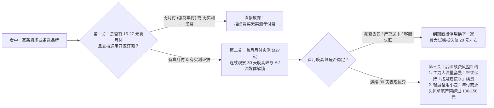

# 机场年付长期套餐有哪些风险：沉没成本、不退款条款与 2026-08-09 历史品牌启示

## 核心结论（Answer-First）

在跨境代理消费中，直接购买**高额年付、两年付、三年付或千元级大额不限时套餐**属于最高风险的决策误区。基于本站对[31 家机场品牌数据库](/brands/)与 `2026-08-09` 历史档案的实证审计，长期预付面临五大不可逆风险：第一，**预付资金与按月带宽成本错配带来的停运沉没风险**；第二，**全行业普遍缺失按比例退款机制（如明确标注「特殊商品不支持退款」）**；第三，**运营中途单方面取消第三方通用订阅、强制锁定专属客户端**（如 2026 年 10 月多品牌政策转向）；第四，**节点 IP 动态被 Google「送中(CN)」或 AI 平台封锁导致的业务失效**；第五，**5.6 元低价年付同质集群的高超售与零实测黑盒风险**。科学的风控铁律是：**主力坚持按月付费（15–27 元/月），任何年付小包或备用不限时包的单笔投入严禁超过 100–150 元沉没成本红线**。

---

## 一、问题概况：为什么机场总是用尽一切办法诱导你买「年付 / 两年付 / 三年付」？

当你打开几乎任何一家商业机场的购买页面或阅读推广文案时，都会发现两套极为普遍的定价设计（详见[机场避坑指南](/security/avoid-pitfalls/)与[平价机场专题](/pricing/budget/)）：

1. **用「年付折算月均价」作为门面最低价**：
   - 宣传大字写着「每月仅需 5.6 元 / 7 元 / 8 元起！」，但当你注册登录点开商店才发现，单月购买（月付）的价格其实是 **`19–27 元/月`**；要想拿到 7 元或 8 元的单价，必须**一次性掏出 `67 元–137 元` 买下一整年的「年付轻量小包」**（且每月流量通常被限制在 `40GB–70GB`）。
2. **在常规月付套餐上叠加诱人的「长周期阶梯折扣」**：
   - 例如「季付 9 折、半年付 85 折、年付 8 折、两年付 75 折、三年付 7 折（甚至叠加新用户优惠码后宣称低至 64 折）」。

为什么服务商宁可让利 20%–35%，也要急着让你一次性交齐一年甚至三年的钱？
因为从现金流视角看，机场租用国内 BGP 前置入口服务器、跨境[IEPL/IPLC 专线](/routes/iepl/)带宽以及海外落地主机，全部是**按月向机房支付的浮动成本**，且随时面临 IP 被封、机房清退、DDoS 攻击防御等突发支出。通过长周期折扣把用户未来 12–36 个月的现金一次性收进自己口袋，不仅能瞬间回笼巨额资金，更把未来一到三年内所有的**「网络封锁风险、线路劣化风险、IP 被墙风险与经营倒闭风险」100% 转移到了预付用户头上**！

---

## 二、证据来源：来自站内 31 家品牌数据库与历史档案的四组客观铁证

为了拒绝空谈理论，我们直接从本站《原始输入资料与证据资产审计报告》（`reports/input-audit.md`）与 `data/brands.json` 中提取四组经过严格核对的真实数据，展示长期预付套餐背后的真实生态。

### 2.1 证据一：`2026-08-09` 历史归档品牌（灵动云 / 浪网 / EdgeNova）的「三年付宏大价格表」与现实反差

在本站原始输入文件《32家机场品牌清单.txt》末尾，保留了 4 条标注为 `2026-08-09` 的历史档案记录（其中 `Firefly 萤火虫` 与主表 `#8 Firefly` 合并，其余 3 家 **[灵动云](/brands/lingdong/)、[浪网](/brands/langwang/)、[边缘节点 EdgeNova](/brands/edgenova/)** 因原始资料注明「位置往后排、不保证当前有效」被隔离标记为 `evidenceStatus: "historical"`）。

让我们看看这几家品牌在历史档案中开出的长周期预付价格表有多么惊人：

| 品牌名称与档案状态 | 套餐档位示例 | 月付单价 | 年付总价 | 两年付总价 | 三年付 / 高额一次性总价 | 2026-11 审计发现的现实风险缺口 |
| :--- | :--- | :--- | :--- | :--- | :--- | :--- |
| **[灵动云](/brands/lingdong/)** (`2026-08-09` 历史记录待核实) | `灵动·拂风` (100GB/月) `灵动·破晓` (700GB/月) `灵动·凌霄` (1.5TB/月) `飞云精英包` (800GB一次性) | ¥20/月 ¥100/月 ¥180/月 — | ¥204/年 ¥1,020/年 **¥1,836/年** — | ¥384 ¥1,920 **¥3,456** — | ¥540 (三年) ¥2,700 (三年) **¥4,860 (三年)** **¥899 (一次性)** | 当期官网入口有效性、优惠码、客户端方式均**待核实**；620元/月私人定制套餐流量「**截图遮挡**」；最后测速停留在 2026-07-20/21（且存在美国01失败、TikTok多失败、新/台 YT 送中）。 |
| **[浪网](/brands/langwang/)** (`2026-08-09` 历史记录待核实) | `浪网 入门` (截150G/月) `浪网 高端` (800GB/月) `浪网 商业` (2000GB/月) `精英流量包` (900GB一次性) | ¥30/月 ¥120/月 ¥200/月 — | ¥306/年 ¥1,224/年 **¥2,040/年** — | ¥576 ¥2,304 **¥3,840** — | ¥810 (三年) ¥3,240 (三年) **¥5,400 (三年)** **¥1,099 (一次性)** | 原始资料明确标注「**未实测**」；入门档流量截图遮挡写为「`截150G`」；协议、节点地区、设备数限制、支付方式、退款规则**全部缺失**。 |
| **[边缘节点 EdgeNova](/brands/edgenova/)** (`2026-08-09` 历史记录待核实) | `极界·标准` (120GB/月) `极界·高级` (500GB/月) `极界·极限` (1000GB/月) | ¥25/月 ¥100/月 ¥200/月 | ¥270/年 **¥1,100/年** **¥2,300/年** | — | — | 2026-08-09 历史记录，**完全未提供逐地区测速与 AI/流媒体测试**；当前入口与协议均待核实。 |
| **[Firefly](/brands/firefly/)** (合并主表 `#8` 与 `08-09` 历史记录) | `Firefly Lite` (150GB/月) `Firefly Blaze` (600GB/月) `Firefly Nova` (1000GB/月) | ¥25/月 ¥85/月 ¥150/月 | ¥240/年 ¥816/年 **¥1,360/年** | ¥420 ¥1,428 **¥2,399** | ¥540 (三年) ¥1,836 (三年) **¥3,119 (三年)** | 主表与历史记录推广链接 `code` 冲突；**无任何独立原始测速截图**；且 **2026 年 10 月起强制改用专属客户端、不再提供第三方订阅链接**。 |

> **历史档案震撼启示**：试想一下，如果一名用户在 2026 年 8 月看到浪网或灵动云的三年付 75 折优惠，掏出 **3,000 元甚至 5,400 元** 买了三年期套餐，或者在 Firefly 掏出 **3,119 元** 买了三年期 Nova 打算挂在家里的 OpenWrt 软路由上全家使用——结果仅仅过了两个月到 2026 年 10 月，有的品牌状态变成「待核实历史档案」，有的品牌直接宣布「取消第三方订阅链接、只能用官方专属客户端（软路由直接报废）」！这就是超长周期预付最血淋淋的教训。

### 2.2 证据二：「年付折算低价」与真实套餐表、优惠码规则的普遍冲突

在站内品牌数据库中，针对「年付套餐」的宣传口径冲突与折扣排除限制比比皆是（详见[优惠码与活动审计专题](/brands/promotions/)）：

1. **年付流量与价格口径冲突**：
   - **[光速云](/brands/guangsuyun/)**：《光速云品牌信息.txt》顶部摘要写「年付折合约 8 元/月，**59GB**」，而同文件套餐表与 32 家清单写「轻量版 年付 ¥99 **69GB/月**」（存在 10GB/月的资料口径差异），且明确注明**「轻量版与致敬斯诺克147永久套餐不打折」**。
   - **[微风网络](/brands/weifeng/)**：基础数据与总表宣传「**年付约 7 元/月 50GB/月**」，但同条详表套餐表中最低档实为「**清风 (Breeze) 年付 ¥137 100GB/月**（折合 11.4 元/月）」，并不存在 84 元/年的 7 元档。
   - **[灵猫网络](/brands/lingmao/)**、**[Firefly](/brands/firefly/)**、**[闪跃](/brands/shanyue/)**：虽然宣传提供 8 折优惠码（如 `lingmao`、`firefly`、`shanyue`），但在细则中均明确标注 **「年付小包 / 年付版不适用优惠码」**。
2. **「5.6 元/月（年付约 67.2 元）」同质化集群的黑盒风险**：
   - **[闪电鼠](/brands/shandianshu/)、[大佬云](/brands/dalaoyun/)、[云界线](/brands/yunjiexian/)、[榴莲云](/brands/liulianyun/)、[环球梯](/brands/huanqiuti/)** 5 家品牌统一标注「年付约 5.6 元/月 60GB/月，季付及以上 7 折」，但**没有提供任何月付试错档位、没有任何测速截图、没有具体节点地区列表**，且云界线、榴莲云、环球梯 3 家的推广链接还存在缺 `#` 或缺 `/` 的格式异常。在完全看不到节点质量的情况下直接掏钱买年付，无异于盲盒赌博。

### 2.3 证据三：不退款条款与「2026 年 10 月专属客户端迁移潮」

- **退款政策审计**：在全部 31 家品牌中，[光速云](/brands/guangsuyun/)明确声明「**套餐里特殊商品不支持退款**」；[一翻云](/brands/yifan/)、[SOGO云](/brands/sogo/)、[隐形人](/brands/yinxingren/)明确声明「**官方没有提供试用**」；其余 27 家品牌的退款政策在公开资料中全部为「**未披露 / 待核实**」（详见[机场退款规则与争议处理](/security/refund/)）。
- **交付模式突变审计**：[无忧链接](/brands/wuyou/)、[Firefly](/brands/firefly/)、[灵猫网络](/brands/lingmao/)三家品牌在总表或早期资料中原本支持常规订阅（如无忧链接总表写「订阅无需转换」且留有 2026-07-18 节点实测图），但在介绍正文中全部改口为 **「2026 年 10 月起直接用官方专属客户端，不用折腾订阅 / 不提供订阅链接」**。

---

## 三、确认事实 vs 未确认事项：客观评估长周期套餐的得失

### 3.1 已经确认的五大长期预付事实（Confirmed Facts）

1. **事实一：年付/多年付无法锁定「网络质量」与「IP 解锁能力」**：
   - 你预付的只是「未来一年的账号有效期与每月账面流量数字」，但机场**绝不会在合同上向你担保未来 365 天内的晚高峰带宽、节点延迟或 ChatGPT/Netflix/YouTube 解锁状态**。如本站实测所示，哪怕是大牌专线机场，也会在部分批次出现单节点 `0B`（如光速云 `HK02`、微风 `台湾02`、宇宙云 `香港01`）或新加坡/台湾节点 YouTube `送中(CN)`。
2. **事实二：一旦服务商中途取消第三方订阅改用专属客户端，年付软路由/高级分流用户将被迫锁死**：
   - 如果你习惯使用 [Clash Verge Rev](/clients/clash-verge/)、[Shadowrocket](/clients/shadowrocket/) 或 OpenWrt 软路由（OpenClash / Nikki / PassWall2）配置精细的 AI 分流与去广告规则，一旦所购年付机场像 Firefly 或灵猫网络那样中途切断通用订阅 URL，你剩下的大半年套餐就无法再在软路由或开源客户端上使用。
3. **事实三：大额一次性永久包同样存在「随平台停运而清零」的归零风险**：
   - 所谓「永久不限时流量包（Non-Expiring Plan）」，其真实含义是**「在该机场存活运营期间流量不过期」**，而不是「物理意义上的永久可用」（详见[不限时流量包专题](/pricing/non-expiring/)）。如果花 959 元（暮光加速 800GB）、1,099 元（浪网 900GB）或 1,199 元（隐形人 1.0TB）购买超高价一次性包，一旦平台停运，损失远超普通月付用户。

### 3.2 尚属未确认的事项（Unconfirmed Matters）

1. **新成立品牌（2025–2026 年上线）的跨年存活率待观察**：
   - 站内如[无忧链接](/brands/wuyou/)、[U1S1](/brands/u1s1/)、[灵猫网络](/brands/lingmao/)、[光年梯](/brands/guangnian/)、[一翻云](/brands/yifan/)、[梯子云](/brands/tiziyun/)、[灵动云](/brands/lingdong/)均标注 2025 年上线，[SOGO云](/brands/sogo/)与[全球云](/brands/quanqiu/)总表标注「2026 年新品牌」。新品牌尚未经历完整的多年期市场周期检验，其长期财务稳定性属于未确认事项。
2. **未披露退款条款的品牌在发生严重故障时的具体售后尺度待核实**：
   - 除明确写出「不支持退款」的品牌外，其余未披露退款细则的品牌在遇到不可抗力故障时是否提供补偿时长，仅能通过工单逐案核实，不能预先假设其会退还现金。

---

## 四、应对建议：用「沉没成本红线公式」与「阶梯试错法」彻底规避年付陷阱

既然长期预付存在如此多的结构性风险，普通用户应该如何管理自己的代理预算？以下为您提供可立即执行的四条风控铁律：

> **决策模型图说明**：上图展示了将最大试错沉没成本严格控制在 20–30 元以内、拒绝跨年大额锁定的科学采购路径。

### 4.1 铁律一：算清「真实风险回报比」，拒绝两年付、三年付与 300 元以上大额包

很多用户觉得「月付 25 元，一年就是 300 元；买年付打 8 折只要 240 元，省了 60 块呢！」
让我们用金融风控的**「风险敞口（Risk Exposure）」**算一笔明白账：
- **坚持按月付费（25 元/月）**：你在任何一天的**最大在途资金风险敞口永远只有 `0–25 元`**。只要下个月这家机场的香港专线被攻击了、或者日本节点上不了 Claude 了，你下个月初直接拍屁股走人换另一家 20 元/月的机场，**灵活性是 100%，最大沉没损失不超过一杯奶茶钱**。
- **为了省 60 元买 240 元年付（或为了省更多买 540 元三年付）**：你在付款那一秒的**在途风险敞口瞬间放大了 10 倍到 20 倍（`240 元–540 元`）**！如果这家机场在第 3 个月跑路或线路劣化到没法用，你不仅没省下那 60 元，反而净亏 `165 元`！**为了年化几十块钱的微薄折扣，去承担本金腰斩甚至归零的无担保风险，在数学期望上是彻底亏本的买卖。**

### 4.2 铁律二：设定「单笔预付 ≤ 100–150 元」的绝对硬顶红线

如果你属于每月流量消耗极小（`< 40GB/月`）的轻度查资料用户，或者想买一个平时不怎么用、专门放在客户端里防失联的「第二冷备机场」，确实可以考虑**入门级年付小包**或**入门级一次性不限时流量包**，但必须满足以下三个硬性前置条件：

1. **单笔实付总金额严格控制在 `79 元–147 元` 以内**：
   - 例如站内留存有真实测速截图（`measured`）的品牌中：
     - **入门年付小包（79–99 元/年区间）**：[唯兔云](/brands/weitu/)年付限量款 `¥79.9/年（45GB/月）`、[二猫云](/brands/ermao/)年付小包 `¥89/年（60GB/月）`、[星岛梦](/brands/xingdaomeng/)贴心小包 `¥96/年（60GB/月）`、[U1S1](/brands/u1s1/)就是好用包 `¥96/年（60GB/月）`、[一翻云](/brands/yifan/)年付小包 `¥98/年（60GB/月）`、[光速云](/brands/guangsuyun/)轻量版 `¥99/年（69GB或59GB/月，注意口径差异）`。*(注：[飞猫云](/brands/feimao/) ¥84/年、[无忧链接](/brands/wuyou/) ¥79/年、[灵猫网络](/brands/lingmao/) ¥85/年、[全球云](/brands/quanqiu/) ¥99/年虽亦有实测图，但均采用或已转向官方专属客户端，不支持第三方通用订阅导入。)*
     - **百元级一次性不限时冷备包（99–147 元区间）**：[二猫云](/brands/ermao/) `¥99/100GB`、[星岛梦](/brands/xingdaomeng/) `¥100/100GB`、[唯兔云](/brands/weitu/) `¥100/100GB`、[一翻云](/brands/yifan/) `¥100/100GB`、[光速云](/brands/guangsuyun/)致敬斯诺克147永久套餐 `¥147/247GB`（均留存有 2026-08-11 实测截图且支持第三方订阅）。
2. **绝不购买同一品牌的高档位大额不限时包**：
   - 许多品牌除了 100 元档不限时包外，还设有 `300 元–1,199 元` 的大额不限时包（如 300GB/500GB/800GB/1TB）。**切记：买冷备包只买最低那一档（100 元左右）！**用完再买都来得及，绝不要一次性囤积上千元的虚拟流量。

### 4.3 铁律三：防范「后台静默跑流」把年付/永久包额度一夜烧光（附客户端止损设置）

对于购买了「每月仅 45GB–69GB 的年付小包」或「100GB–247GB 永久不限时包」的用户，另一个极易导致套餐提前报废的技术风险是：**客户端配置不当导致的后台流量暴走**！
- **真实风险**：如果你把年付小包或永久不限时包设为客户端的当前激活配置，一旦误开了 `Global（全局模式）` 看了一晚上国内 4K 直播，或者在 `2x–5x` 高倍率节点上点了一次全节点多线程测速（如光速云 08-11 测速图单次消耗 `19.4GB`），你小半年的流量额度在 10 分钟内就会被扣光！
- **客户端防护与回滚设置**：
  1. 在 [Clash Verge Rev](/clients/clash-verge/) 或 [Shadowrocket](/clients/shadowrocket/) 中，**平时将「永久不限时冷备包」的 Profile 保持在未选中（非激活）状态**，只有当主力月付机场突发断连时才点选切换过去；
  2. 永远锁定 **`Rule（规则模式）`**，并按照[如何确认客户端分流与 DNS 设置已经生效](/guides/articles/verify-proxy-is-working)验证国内视频与下载 100% 走 `DIRECT` 直连；
  3. 如果发现后台流量出现不明原因的异常飙升，立即登录机场官网后台点击 **「重置订阅链接（Reset Subscription Token）」** 使旧链接作废，然后在客户端粘贴新链接回滚（详见[账号与订阅安全防护](/security/account-security/)）。

---

## 五、后续选择：从「赌一家长周期」转向「主备双轨弹性架构」

总结而言，应对机场行业高流动性的最优解，从来不是去寻找一家「号称永远不会跑路、所以敢买三年付」的神仙机场（这样的机场在物理与商业上并不存在），而是调整你自己的消费与配置结构（详见[高性价比机场计算公式](/pricing/value/)与[服务失联替代方案](/security/alternatives/)）：

1. **主力通道（承接日常 90% 流量）**：选择一家**支持通用订阅、留存有真实测速截图、定价在 `18–27 元/月`（100GB–200GB/月）**的专线或优质中转机场，**坚持按月续费**（最多在连续稳定使用 3 个月以上后考虑季付）。
2. **容灾冷备通道（承接主力维护时的 10% 应急流量）**：在**完全不同系别**的另一家实测品牌中，配置一个 **`99–147 元` 的一次性不限时小流量包**（或 `14.9–18 元` 的异构月付），静置在客户端的第二张订阅卡片里。
3. **证据留存习惯**：无论购买哪一档套餐，下单时随手保存脱敏支付流水与套餐说明截图（详见下一篇[如何保留付款记录与工单沟通证据](/security/articles/how-to-preserve-payment-evidence)），做到进退有据、断网不慌。

---

## 六、常见问题（FAQ）

### 机场宣传「年付 8 折、两年付 75 折、三年付 7 折」，为什么资深用户依然强烈反对直接买两年或三年付？

因为跨境代理服务不是受国家电信法规履约监管的水电宽带，而是高度依赖上游机房租赁与动态抗封锁运维的轻资产虚拟服务。在长达 12 至 36 个月的周期里，任何一家机场都可能遭遇上游专线涨价清退、主力落地 IP 被大面积送中（CN）或被 OpenAI/Claude 封锁、甚至团队资金链断裂失联。为省下 20%–30% 的账面折扣而把数百甚至上千元资金一次性锁定三年，一旦在第 3 个月发生线路严重劣化，你将承担 100% 的沉没成本。

### 买了年付或大额永久套餐后如果觉得晚高峰太卡，能找客服按剩余月份比例退款吗？

绝大多数情况下无法退款。根据本站对 31 家品牌资料的合规审计，虚拟代理服务行业普遍实行极严苛的「无退款保障」：例如光速云在品牌资料中明确注明「套餐里特殊商品不支持退款」；一翻云、SOGO云、隐形人等明确注明「官方没有提供试用」；其余二十余家品牌均未在公开资料中承诺无理由按比例退款。一旦完成支付并产生流量，预付资金即成为不可逆的沉没成本。

### 站内归档的「2026-08-09 历史记录品牌（灵动云、浪网、EdgeNova）」给年付用户带来了什么真实启示？

在本站原始清单末尾归档的 2026-08-09 历史档案中，灵动云、浪网、EdgeNova 均提供了跨度长达季付、半年、年付、两年付至三年付的宏大价格阶梯（例如灵动云凌霄三年付高达 ¥4,860，浪网商业三年付高达 ¥5,400，EdgeNova 极限年付高达 ¥2,300）。然而仅仅数月后，这批记录在当期核查中就已被标注为「历史记录待核实、不保证当前有效」，且存在套餐截图遮挡、优惠码未核实、缺乏近 30 日实测数据等严重缺口。这用铁证说明：价格表写到「三年付」绝不代表服务能稳定维持三年。

### 除了机场彻底跑路，年付用户在一年使用期内最常遇到的「隐性贬值风险」有哪些？

即使机场没有跑路，年付用户也极常遭遇三大隐性缩水：第一是「交付方式强制变更」（如无忧链接、Firefly、灵猫网络在 2026 年 10 月起纷纷改用官方专属客户端、不再提供或折腾第三方通用订阅，导致原本为了在软路由 OpenWrt 或 Shadowrocket 上使用而买年付的用户措手不及）；第二是「流媒体与 AI 解锁劣化」（原本能看台湾 Netflix 或能用 Gemini 的节点，中途变成送中 CN 或跨区跳到 GB/ES）；第三是「晚高峰超售加剧」。

### 难道所有年付和不限时流量包都不能买吗？什么条件下才可以考虑？

并非绝对不能碰，但必须遵守「沉没成本上限原则（≤ 100 元）」与「先月付后小包原则」。第一，单笔年付或一次性流量包的总支出绝对不要超过 100–150 元（即每月风险敞口仅 6–12 元的入门轻量年付小包，或 99–147 元的百 GB 级不限时备用包）；第二，在购买任何长期包之前，必须已经用该品牌的单月月付（15–27 元）亲自实测过至少一个完整月的晚高峰；第三，绝对不要触碰任何超过 300 元的多年期（两年/三年）大额预付。

---

## 七、关联阅读与延伸排障入口

- **返回上级专题**：[机场避坑指南：年付诱导、虚假话术与 AFF 伪装识别](/security/avoid-pitfalls/) ｜ [按月付费机场专题](/pricing/monthly/)
- **同集群风险应对指南**：
  - [机场突然停止服务应该怎么办：先排本地故障再取证止损与切换备用方案](/security/articles/what-to-do-if-airport-stops)
  - [如何保留付款记录与工单沟通证据：订单流水、脱敏截图与售后争议应对](/security/articles/how-to-preserve-payment-evidence)
  - [机场服务更换前应该检查什么：防同系套娃、协议兼容性与配置平滑迁移清单](/security/articles/checklist-before-switching-airport)
- **价格与历史档案专题**：
  - [不限时流量包回本周期公式与风险评估](/pricing/non-expiring/)
  - [平价入门机场：5.6 元集群与 7–14 元年付折算真相](/pricing/budget/)
  - [品牌运营风险与 2026-08-09 历史记录档案库](/brands/incidents/)
