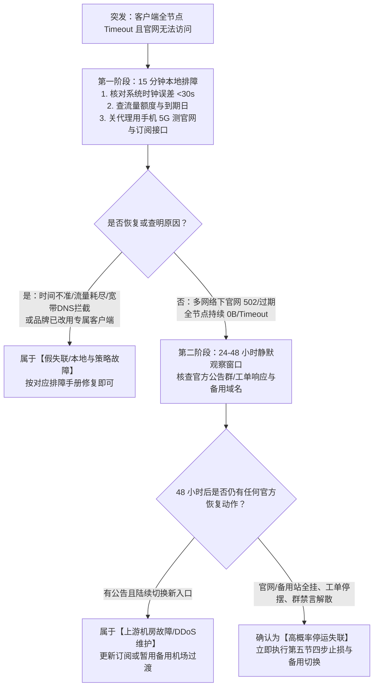

# 机场突然停运怎么办：先排查本地与订阅故障，再执行取证止损与备用方案切换

## 核心结论（Answer-First）

当遭遇机场节点突然全线超时（`Timeout / 0B`）且官网无法打开时，切忌惊慌失措或轻信网上的「平移补偿链接」。标准的工程级应急响应必须严格遵循**「先排假失联、再做四步止损、最后平滑切冷备」**流程：第一步，在 **15 分钟内**通过校准本地系统时钟、切换手机 5G 蜂窝网直连面板、核对流量账单排除本地故障与单点入口维护；第二步，若跨网观察 **24–48 小时**确认主备域名、订阅接口与客服工单全面停摆，立即执行**「关闭支付渠道自动扣款授权、对同密码邮箱执行防撞库改密、导出本地自定义分流规则、拒绝任何第三方补偿木马包」**四项止损动作；第三步，在开源客户端中一键激活异构备用订阅恢复网络。

---

## 一、问题概况：突发「全节点断连与官网失联」的典型冲击场景

在跨境代理服务的使用周期中，「昨天晚上看视频、用 ChatGPT 还一切正常，今天早上开机发现所有节点一片红字 `Timeout`，点更新订阅报错，打开机场官网也一直转圈或提示 `502 Bad Gateway`」是最令用户焦虑的高发危机场景（详见[机场跑路识别与应急止损总览](/security/shutdown/)与[品牌运营风险事件库](/brands/incidents/)）。

一旦突发停运，用户往往面临三重直接冲击：
1. **远程工作与 AI 生产力瞬间停摆**：正在进行的跨国会议、GitHub 代码推送、Claude/ChatGPT API 调用被迫中断，而在断网状态下又很难临时去海外搜索或下载新的替代工具，陷入「没网就找不到梯子、没梯子就上不了网」的死锁困境。
2. **预付资金面临沉没成本损失**：如果用户此前被低价折扣诱导购买了年付、两年付、三年付或大额一次性不限时流量包，突然停运意味着未消耗的剩余周期面临打水漂风险（详见同集群文章[长期预付年付机场套餐有哪些风险](/security/articles/long-term-prepaid-risks)）。
3. **账号隐私与二次诈骗暴露面扩大**：用户在失联机场注册时填写的常用邮箱、相同密码、支付流水，以及在病急乱投医时搜索到的虚假「跑路退款群 / 平移客户端」，极易引发撞库盗号与恶意木马感染。

为了在混乱中做出零失误的理性决策，我们按照本站风险应对标准结构（`问题概况 → 证据来源 → 确认事实 → 未确认事项 → 应对建议 → 后续选择`）为您拆解全流程操作指南。

---

## 二、证据来源：如何用三类客观信号采集「真停运 vs 假故障」证据？

在给一家机场下达「已经跑路停运」的判决书之前，必须先从本地客户端、多网络链路与本站品牌档案库三个维度收集客观技术证据，而不是仅凭单一宽带下的网页打不开就下结论。

### 2.1 第一证据源：本地客户端与命令行 HTTP 状态码

打开你的代理客户端（如[Clash Verge Rev](/clients/clash-verge/)、[v2rayN](/clients/v2rayn/)、[Shadowrocket](/clients/shadowrocket/)）与系统终端，采集以下三项底层状态数据：

1. **订阅卡片最后同步的元数据（`subscription-userinfo`）**：
   - 查看客户端 `Profiles（订阅）` 卡片上显示的已用流量与到期时间（例如 `167.9 GB / 168 GB` 或到期日已过）。很多时候所谓「突然停运」，仅仅是因为前一晚后台挂着自动更新或跑了一次 32 线程全节点测速（单次测速即可消耗 `10GB–20GB` 流量），把当月流量额度彻底跑光了（详见[套餐流量耗尽与订阅过期排查](/troubleshooting/articles/quota-expired-vs-stale-config)）。
2. **直连状态下订阅接口的 HTTP 响应码**：
   - **务必先关闭本地系统代理和 TUN 模式**，在 Windows PowerShell 中对你的脱敏订阅链接执行一次只读探测（请将下方脱敏示例替换为你自己的订阅 URL）：

```powershell
# 适用系统: Windows 10 / 11 (PowerShell)
# 目的: 在不经过任何本地代理的直连状态下，探测机场订阅分发接口的 HTTP 状态码、TLS 握手状态与响应头
# 风险等级: 低（纯只读探测远端响应头，不修改任何本地配置）
curl.exe -I -s -L --connect-timeout 10 "https://sub.example.invalid/api/v1/client/subscribe?token=REDACTED"
```

   - **状态码证据解读**（详见[订阅 HTTP 401/403/404/503 排障](/troubleshooting/articles/sub-http-401-403-404-503)）：
     - 返回 `HTTP/2 200` 且包含 `subscription-userinfo:` 响应头：说明**机场面板与数据库 100% 存活且正常运作**，问题出在你的本地客户端配置或节点入口。
     - 返回 `HTTP/2 401` 或 `403`：说明面板服务器活着，但你的 Token 已失效、套餐已过期，或者你的高频更新触发了机场前端 Cloudflare 防火墙（WAF）拦截。
     - 返回 `HTTP/2 502 Bad Gateway` / `503` / `521` / `522`（Cloudflare 报错无法连接源站）或彻底 `Connection timed out`：说明机场后端的源站面板服务器当前处于宕机、维护或被防火墙阻断状态。
3. **存量节点的真连接测试（URLTest）**：
   - 对客户端里原本保存的香港、日本、新加坡、美国等多地区节点运行一次 `URLTest (generate_204)`。如果只有香港节点超时，而日本或美国节点还能通，说明只是单区入口故障（详见[部分地区节点超时排查](/troubleshooting/articles/nodes-partial-region-timeout)）；如果跨所有地区、跨所有入口 IP 的节点在同一秒钟全部变成 Timeout，则指向全站入口中断或账户被停用。

### 2.2 第二证据源：跨运营商网络（家庭宽带 vs 手机 5G 蜂窝网）交叉测试

国内不同省份、不同运营商（电信/联通/移动）以及家庭光猫的反诈 DNS 拦截策略差异极大：
- **操作方法**：断开手机 Wi-Fi，使用**手机 4G/5G 蜂窝移动数据**，打开无痕浏览器尝试访问该机场的官网主域名、备用发布页或官方 Telegram/邮件通知渠道。
- 如果手机 5G 能正常打开官网并登录看到公告（例如「华南 BGP 入口遭受攻击正在切换 IP，请手动更新订阅」），而家里电脑 Wi-Fi 打不开，则 100% 属于**本地宽带 DNS 污染或路由阻断**，绝非机场停运。

### 2.3 第三证据源：站内 31 家品牌档案库的历史状态与关联记录

对照本站[31 家机场品牌数据库](/brands/)与《原始输入资料与证据资产审计报告》，核查该品牌是否存在以下已知的运营架构变更或历史风险标记：
- **是否发生了「取消通用订阅、强制切换官方专属客户端」的政策变更**：
  - 典型实证：根据本站品牌库记录，**[无忧链接](/brands/wuyou/)、[Firefly](/brands/firefly/)、[灵猫网络](/brands/lingmao/)** 均在资料中明确注明 **「2026 年 10 月起改用官方专属客户端，下载登录即用（不提供订阅链接）」**（此外[飞猫云](/brands/feimao/)、[SOGO云](/brands/sogo/)、[闪跃](/brands/shanyue/)、[全球云](/brands/quanqiu/)、[隐形人](/brands/yinxingren/)亦采用专属客户端模式）。如果你此前一直用旧订阅链接在 Clash 里使用，当服务商彻底关闭旧订阅接口转入专属客户端时，你在第三方客户端里就会看到「订阅无法更新、旧节点失效」的假停运现象！
- **是否属于 `2026-08-09` 历史待核实档案或高同质化低价模板集群**：
  - 如[灵动云](/brands/lingdong/)、[浪网](/brands/langwang/)、[边缘节点 EdgeNova](/brands/edgenova/)在原始档案中即已标注为历史记录（`historical`）且注明「不保证当前有效」；而 5.6 元年付集群（[闪电鼠](/brands/shandianshu/)、[大佬云](/brands/dalaoyun/)、[云界线](/brands/yunjiexian/)、[榴莲云](/brands/liulianyun/)、[环球梯](/brands/huanqiuti/)）则存在无实测图与推广链接格式异常。

---

## 三、确认事实 vs 未确认事项：客观划清判断边界

在完成上述证据采集后，我们必须严格区分哪些是**已经确认的客观事实**，哪些是**尚处于未确认状态的推测**，避免在未确认前做出过激或错误的处置。



> **判定流程图说明**：上图展示了从「15 分钟本地假失联排除」到「48 小时停运定性」的标准工程判断路径。

### 3.1 可以立即确认的客观事实（Confirmed Facts）

1. **本地网络与客户端状态事实**：你可以通过 `Get-Date`、`ipconfig /flushdns` 以及其他备用订阅是否能正常连网，100% 确认「我家的宽带和客户端软件本身是完好的，故障确实发生在该机场的远端服务端」。
2. **存量节点连通性事实**：通过跨地区（港/日/新/美）全部节点的 `URLTest` 与 `curl` 探测，可以 100% 确认该机场当前下发给你的所有入口 IP 均已停止转发数据（详见[全部节点超时排障](/troubleshooting/articles/nodes-all-timeout)）。
3. **消费账单与剩余周期事实**：通过你本地保存的支付宝/微信/USDT 付款凭证及客户端订阅卡片最后一次缓存的配额数据，可以确认你购买的套餐起止日期、实付金额与未履约的剩余流量（详见同集群文章[如何保留付款记录与工单沟通证据](/security/articles/how-to-preserve-payment-evidence)）。

### 3.2 严禁主观臆测的未确认事项（Unconfirmed Matters）

1. **在断连未满 24–48 小时前，无法单凭「节点全红 + 官网 502」直接断定老板一定卷款跑路**：
   - 在跨境代理运维中，如果机场的主面板服务器与国内 BGP 前置入口部署在同一家云服务商（或共用同一个 Cloudflare 账号），一旦遭遇大规模 DDoS 攻击、上游专线机房光缆割接、或域名注册商临时挂起域名（ServerHold），恢复与迁移新域名往往需要 **12 至 48 小时**。
2. **无法核实失联团队的真实身份或内部资金去向**：
   - 商业机场普遍采用匿名化运营与第三方聚合发卡通道，任何网上流传的「某某机场老板被抓了」「某某机场改名叫某某新机场了」的小道消息，在没有官方加密签名公告证实前，全部属于**未经核实的传闻（Unverified Rumors）**，绝不能作为你向陌生新网站打款充值的依据！

---

## 四、应对建议：确认机场突然停运后的「四步止损与安全防御SOP」

如果经过 48 小时多网络交叉验证，该机场的官网主域名、备用发布页、订阅接口全部失效，且官方工单与社群彻底失联，请立即按顺序执行以下四步止损与安全防御操作（**包含高风险操作的回滚与本地配置保护**）：

### 4.1 第一步：资金止损 —— 检查并切断一切第三方自动续费/免密代扣授权

虽然绝大多数国内面向个人用户的机场采用「按次扫码预付（支付宝/微信单次订单或 USDT 转账）」，不支持自动扣款，但仍有少数接入了海外 Stripe、PayPal 或特定发卡网关的平台可能勾选了周期订阅（Recurring Billing）：
- **支付宝检查路径**：打开支付宝 App -> `我的 -> 右上角设置 ⚙️ -> 支付设置 -> 免密支付/自动扣款`，检查列表里是否有不明虚拟商品商户或近期签约的代扣服务，如有立即点击 **「关闭服务」**。
- **微信支付检查路径**：打开微信 -> `我 -> 服务 -> 钱包 -> 底部支付设置 -> 自动续费`，逐项核查并关闭可疑项目的扣费授权。
- **PayPal / 国际信用卡**：若曾使用外币卡绑定，立即登录 PayPal `设置 -> 付款 -> 管理自动付款` 取消授权，或锁死虚拟信用卡限额。

### 4.2 第二步：账号与隐私止损 —— 严防「脱库撞库」与修改关联密码

当一家机场突然非正常停运（无论是弃盘跑路还是服务器被第三方攻破接管），其后台数据库里存储的**用户注册邮箱、登录密码哈希（甚至部分劣质面板存的是明文密码）以及访问日志**就处于完全不可控的高危状态（详见[账号与订阅安全防护](/security/account-security/)与[隐私风险防范](/security/privacy/)）：
- **立即排查同密风险**：回想你在注册这家停运机场时，是否图省事使用了与你**个人主邮箱（Gmail / QQ邮箱 / 163邮箱）、Apple ID、GitHub、网银或其它主力机场相同的密码**？
- **强制改密**：凡是与该失联机场共用过同一套「邮箱 + 密码」组合的其他重要网站，**必须在当天内全部修改为独一无二的高强度随机密码，并开启两步验证（2FA / TOTP）**！

### 4.3 第三步：客户端安全回滚与本地分流规则无损抢救（切勿直接删库卸载）

很多用户一气之下直接把 Clash Verge Rev 或 Shadowrocket 里的订阅删掉甚至卸载软件，结果不仅丢掉了维权证据，还把自己辛辛苦苦写了半年的自定义分流规则也删没了。请按以下**安全回滚与备份步骤**操作：

1. **先关闭系统代理与 TUN 模式，恢复电脑/手机正常国内上网**：
   - 在客户端设置中关闭 `TUN 模式` 与 `系统代理 (System Proxy)`（若 Windows 关闭后国内网页仍打不开，打开 PowerShell 执行 `Set-ItemProperty -Path "HKCU:\Software\Microsoft\Windows\CurrentVersion\Internet Settings" -Name ProxyEnable -Value 0; ipconfig /flushdns` 即可一键回滚直连，详见[Windows 代理客户端配置与回滚教程](/guides/articles/windows-proxy-client-setup)）。
2. **截图留存客户端订阅卡片最后状态**：
   - 对客户端 `Profiles（订阅）` 界面进行截图，保留该机场卡片上显示的**剩余流量、总流量与到期日期**。
3. **导出并剥离你自己的自定义分流规则（Override / Merge）**：
   - 如果你在[Clash Verge Rev](/clients/clash-verge/)或[Mihomo](/clients/mihomo/)中编写过全局或局部的 `Merge` 扩展配置、`Script` 脚本，或者在原始订阅里手动加过 `prepend-rules`，请先点击编辑将你自定义的规则段落复制保存到本地记事本（如 `my-custom-rules-backup.yaml`），以便稍后直接挂载到新机场订阅上（详见[客户端迁移与配置备份指南](/troubleshooting/articles/client-migration-backup)）。
4. **关闭失联订阅的「自动更新」**：
   - 右键点击该失联机场的订阅卡片 -> 选择「编辑信息」 -> 将「自动更新间隔」清空或设为禁用，避免客户端在后台每隔几小时就去请求已经死掉的域名报错弹窗。

### 4.4 第四步：反诈红线 —— 绝对禁止下载任何「跑路补偿客户端 / 维权平移补丁」

> **【最高等级反诈警告】**：机场停运后，你在搜索引擎、Telegram 或贴吧搜该机场名字时，一定会看到有人发帖称：「我是原机场技术员/合作方，老用户加群领免费补偿套餐，下载我们的专用补偿客户端即可恢复剩余流量」。**这 100% 是专门针对断网焦虑用户的钓鱼木马或二次杀猪盘！** 绝对不要下载任何来历不明的 `.exe` / `.apk` 补偿包，绝对不要向所谓「维权代办人」支付任何手续费或提交你的未脱敏个人实名身份证件！

---

## 五、后续选择：如何零中断切换到安全可靠的替代方案？

吃过一次「机场突然停运」的亏后，后续在选择替代服务商与构建个人网络架构时，必须彻底告别「把所有鸡蛋放在一个年付篮子里」的脆弱模式（详见[机场替代与平滑迁移方案](/security/alternatives/)与同集群文章[更换机场前应该检查什么](/security/articles/checklist-before-switching-airport)）。

### 5.1 替代选型的「三选三不选」铁律

| 选型维度 | ✅ 优先选择的特征（降低停运敞口） | ❌ 坚决规避的特征（高停运/高锁定风险） |
| :--- | :--- | :--- |
| **1. 付款周期与试错成本** | **坚持首选「真月付」**（14.9–27 元/月区间），或仅搭配百元以内的小额不限时包作冷备；把单次最大沉没成本锁死在 30 元以内（详见[月付机场专题](/pricing/monthly/)）。 | 拒绝一上来就买年付、两年付、三年付；警惕任何拒绝提供月付、强制要求年付绑定的无实测平台。 |
| **2. 客户端与协议生态** | **优先选择支持「通用开源订阅（Clash / Shadowrocket / sing-box / v2rayN）」**的品牌（或自研端+第三方订阅双支持），确保随时可3秒换机场。 | 谨慎评估「仅限官方闭源专属客户端、不给订阅链接」的品牌（一旦停运或客户端停更，无法在软路由或开源端切换）。 |
| **3. 证据透明度与系别隔离** | **优先选择在本站留存有 `2026-08-11` / `07-18` / `07-19` / `08-19` 真实测速截图（`measured`）**、且与原失联机场**不属于同一同系群组**的品牌。 | 规避无任何实测截图、参数高度复制的 5.6 元同质化模板盘（如闪电鼠/大佬云/云界线/榴莲云/环球梯），以及未经最新核实的 `2026-08-09` 历史档案品牌。 |

### 5.2 站内具备实测截图且支持通用订阅的低门槛月付替代参考

如果你当前正急需一个**支持通用开源订阅、有本地实测截图佐证、且提供 15–27 元低成本月付档位**的替代方案来立刻恢复网络，可按需查阅本站[品牌深度评测目录](/reviews/)与[31 家品牌数据库](/brands/)中的以下代表品牌（**提醒：无论选择哪一家，首月均请坚持按月付费实测**）：

- **18–20 元/月轻量通用订阅档**：
  - **[极连云](/brands/jilian/)**（月付 18 元/100GB，支持自研+第三方订阅，留存 `2026-08-11 22:46` 晚间测速截图）；
  - **[光年梯](/brands/guangnian/)**（月付 18 元/110GB，支持自研+第三方订阅，留存 `2026-08-11` 测速截图）；
  - **[唯兔云](/brands/weitu/)**（常规普通版月付 19.9 元/150GB，另有节假日限时 14.9 元/100GB 及 100元/100GB 不限时包，留存 `2026-08-11` 测速图）；
  - **[二猫云](/brands/ermao/)**（白猫套餐月付 20 元/130GB，另有 99元/100GB 不限时包，留存 `2026-08-11` 测速图）；
  - **[一翻云](/brands/yifan/)**（轻享版月付 20 元/150GB，支持 Hysteria 2 / VLESS-Reality / SS 三协议与 100元/100GB 不限时包，留存 `2026-08-11` 测速图，注：官方无试用）；
  - **[U1S1](/brands/u1s1/)**（月付 20 元/120GB，留存 `2026-08-11 22:33` 晚间测速图）。
- **25–27 元/月多批次实测主力档**：
  - **[光速云](/brands/guangsuyun/)**（2020 年老牌，极速版月付 25 元/168GB，支持自研客户端与 Clash/Shadowrocket 第三方订阅，留存 `2026-08-11` 与 `2026-08-19` 共 6 张多运营商实测图；另有 147 元/247GB 永久流量包可作冷备，注意其特殊商品不支持退款，建议先月付体验）；
  - **[星岛梦](/brands/xingdaomeng/)**（2020 年老牌，月付 25 元/150GB，另有 100元/100GB 永久不限时包，留存 `2026-08-11` 测速图）；
  - **[微风网络](/brands/weifeng/)**（乘风月付 27 元/200GB，VLESS 协议，留存 `2026-07-19` 50 节点实测图，注：与 Firefly 等存在同系关联，选备用时注意错开同系）。

---

## 六、常见问题（FAQ）

### 客户端里的所有节点突然全部显示 Timeout 或 0B，是不是一定代表这家机场老板跑路停运了？

不一定。临床排障中超过 70% 的「疑似突然停运」其实是本地或中间链路假失联：包括电脑系统时间偏差超过 60 秒导致 TLS 握手全拒、套餐当月流量提前耗尽（特别是误用 2x–5x 倍率节点跑了多线程测速）、本地开启了旧代理套娃更新订阅、或者机场国内前置 BGP 入口机房遭遇临时 DDoS 攻击维护。必须先用手机 5G 蜂窝网络直连官网后台并走完 48 小时交叉验证，才能定性是否真停运。

### 订阅分发域名被墙（无法更新订阅）和机场彻底停运关机，在技术表现上有什么区别？

如果只是机场的「订阅链接域名」或「官网前端面板域名」被运营商 DNS 污染阻断，你在客户端点击更新订阅时会报错超时，但此前已经下载保存在客户端本地的节点（只要后端入口与落地服务器没关机）依然可以正常连接上网；而如果机场彻底停运跑路，则是上游入口机与境外落地机全部欠费退租或拔线，此时不仅官网与订阅接口返回 502/404/Connection Refused，本地存量节点做真连接测试也会 100% 全部无响应。

### 确认机场真的突然停止服务后，为什么绝对不能相信电报群或论坛里冒出来的「难友维权补偿群 / 免费平移补丁」？

这是机场停运事件中最危险的二次收割陷阱。每当有知名或平价机场停运失联，黑灰产便会立刻注册同名或近似名称的「维权补偿频道」，谎称「下载专用平移客户端或导入补偿补丁即可恢复剩余时长」，实则在安装包中捆绑窃密木马（盗取浏览器 Cookie 与加密货币钱包），或诱导受害者再交一笔「账号激活保证金」实施二次诈骗。

### 机场突然失联后，我能把客户端里的旧订阅配置直接删掉或者卸载客户端重装吗？

在完成本地规则备份与取证前，切勿立刻清空或卸载客户端！首先，旧订阅卡片上保留着你最后一次同步时的「已用流量 / 总流量、套餐到期日」及订阅域名信息，是留存消费记录的重要依据；其次，如果你在该配置上编写过自定义分流规则（Override / Prepend Rules），直接删除会导致规则丢失。正确做法是在客户端新建一个备用 Profile 切换过去，将失联配置静置归档。

### 为了防止机场突然停运导致工作中断，平时最合理的容灾备份方案应该怎么配？

推荐构建「1 主力月付 + 1 异构冷备（小额不限时流量包或不同系别的低门槛月付）」双轨容灾结构。关键原则是：主力与备用必须选择完全不同技术系别、且支持通用开源订阅（Clash / Shadowrocket / sing-box）的服务商，在客户端 `Profiles` 中同时预置两份订阅配置；一旦主力突发停运，只需鼠标点击一下备用配置卡片即可在 3 秒内恢复外网连接。

---

## 七、关联阅读与延伸排障入口

- **返回上级专题**：[机场跑路识别与应急止损指南：失联前兆与止损切换](/security/shutdown/) ｜ [品牌运营风险与历史事件库](/brands/incidents/)
- **同集群风险应对指南**：
  - [长期预付年付机场套餐有哪些风险：沉没成本与 2026-08-09 历史品牌启示](/security/articles/long-term-prepaid-risks)
  - [如何保留付款记录与工单沟通证据：订单流水与脱敏截图规范](/security/articles/how-to-preserve-payment-evidence)
  - [机场服务更换前应该检查什么：防同系套娃与平滑迁移清单](/security/articles/checklist-before-switching-airport)
- **假失联前置技术排障**：
  - [全部节点突然超时连不上的分层诊断](/troubleshooting/articles/nodes-all-timeout)
  - [订阅链接 HTTP 401/403/404/503 错误状态码排障](/troubleshooting/articles/sub-http-401-403-404-503)
  - [套餐流量耗尽、订阅过期与陈旧配置缓存区分](/troubleshooting/articles/quota-expired-vs-stale-config)
