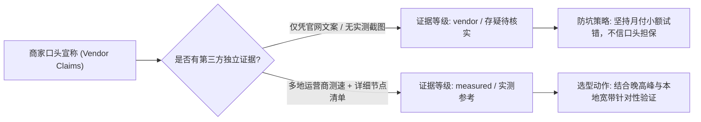
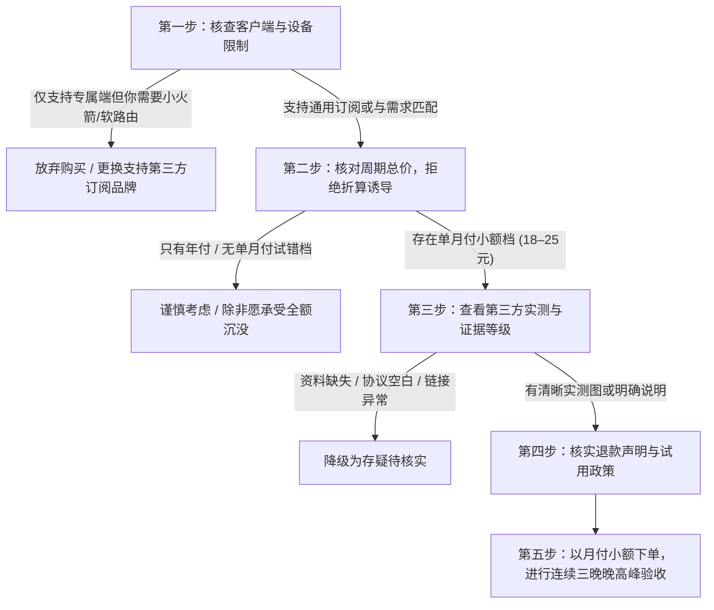

# 机场避坑指南：拆解年付诱导、虚假承诺与 AFF 官网伪装

> **核心结论（Answer-First）**：选购代理服务最容易踩入五大消费深坑：**用年付折算均价伪装低门槛月付**、**超低价 5.6 元同质模版盘缺乏实测与链接异常**、**用“永不跑路 / 全原生 IP / 晚高峰零丢包”等绝对化口头话术诱导大额充值**、**将带返利参数的 AFF 推广链接包装为品牌唯一官网**，以及**买完才发现仅限专属客户端而无法导出 Clash 订阅**。避坑的核心法则在于：**购前先查客户端兼容性、坚持单月小额试错（实付控制在 18–25 元内）、区分品牌宣称与第三方实测数据、永不把推广链接当官网**。

---

## 一、避坑维度一：看穿“年付折算均价”冒充“低门槛月付”的营销陷阱

在跨境代理消费领域，最普遍、最具误导性的营销手段就是**将超长周期年付总价除以 12，包装成极其诱人的“几元钱一个月”**。许多缺乏经验的新手正是被搜索结果中醒目的“月付 7 元起”、“低至 8 元/月”吸引进站，直到进入结账界面才发现必须一次性支付一整年费用。

### 1. 站内 31 家品牌真实资料案例审计
在本站对原始品牌清单的严格审计中（详见 [品牌运营风险事件库](/brands/incidents/) 与 [预算轻量套餐指南](/pricing/budget/)），此类口径反差俯拾皆是：
- **[光速云](/brands/guangsuyun/)**：在推广摘要中宣称“最低入门价格约 8 元一个月”，但对照其真实套餐价目表可知，该数字来自“轻量版 99 元/年”（折合约 8.25 元/月），而其真正支持按月付费的最低门槛“极速版”实付金额为 **25 元/月**（品牌资料本身也诚实注明“8 元/月属于年付套餐折算后的平均月成本，并非普通月付价格”）。
- **[微风网络](/brands/weifeng/)**：基础摘要标注为“年付约 7 元/月 50GB/月”，但实际套餐表中可购的最低门槛为“清风 (Breeze) **年付 137 元 100GB/月**”（折合约 11.4 元/月），而其单月付套餐“乘风 (Riding)”实际定价为 **27 元/月**。
- **[灵猫网络](/brands/lingmao/)**：宣传正文写道“起步价 7.1 元/月起”，实际上对应的是其“灵猫·年付小包 85 元/45GB”，而其真正的月付档位“月付 Small”售价为 **25 元/150GB**。
- **[飞猫云](/brands/feimao/)**：学生版标价 84 元/年（折合 7 元/月），普通月付星耀版为 **25 元/月**。
- **[无忧链接](/brands/wuyou/)**：MINI 链接为 79 元/年（折合 6.58 元/月），常规月付舒心链接为 **19 元/月**。

### 2. 沉没成本与风险不对称测算
为什么商家热衷于推销折算年付？
- **现金流锁定**：对于商家而言，直接收取用户 80–150 元的一年预付款，可以极大锁定资金并抵御用户流失；
- **用户风险全敞口**：对于用户而言，跨境代理服务由于受骨干网波动、上游机房封锁或运维变故影响，其稳定性具有天然的不确定性。如果你花费 99 元购买年付，使用三天后发现本地网络在晚高峰丢包严重或与本地运营商严重八字不合，这 99 元将立刻转化为 **100% 沉没成本**；
- **月付试错原则**：反之，若首次坚持购买 20–25 元的单月套餐，即使三天后体验不佳果断弃用，实际损失仅相当于一杯咖啡的费用，资金敞口完全可控。相关对比可见 [月付套餐选型推荐](/pricing/monthly/)。

---

## 二、避坑维度二：5.6 元极简同质模版盘深度风险拆解

在《32家机场品牌清单.txt》中，有一组极为特殊的品牌集群，本站将其统称为 **「5.6 元同质模版盘」**。这批品牌在定价、流量分配、前台架构乃至数据缺陷上呈现出惊人的一致性。

### 1. 5.6 元模版盘品牌清单与特征矩阵
这一集群包含以下 5 家品牌：
- **[闪电鼠](/brands/shandianshu/)** (`shandianshu`)
- **[大佬云](/brands/dalaoyun/)** (`dalaoyun`)
- **[云界线](/brands/yunjiexian/)** (`yunjiexian`)
- **[榴莲云](/brands/liulianyun/)** (`liulianyun`)
- **[环球梯](/brands/huanqiuti/)** (`huanqiuti`)

| 品牌 | 基础数据标价 | 宣称流量 | 协议说明 | 实测截图证据状态 | 链接格式异常标记 |
| :--- | :--- | :--- | :--- | :--- | :--- |
| **闪电鼠** | 67.2 元/年（5.6元/月） | 60GB/月 | 资料未明确协议细则 | 无实测图（`no-measured-screenshot`） | 正常 |
| **大佬云** | 67.2 元/年（5.6元/月） | 60GB/月 | 资料未明确协议细则 | 无实测图，详表跳号排位错位 | 正常 |
| **云界线** | 67.2 元/年（5.6元/月） | 60GB/月 | 资料未明确协议细则 | 无实测图，双邀请码冲突 | 链接缺少 `#` 路由标识 |
| **榴莲云** | 67.2 元/年（5.6元/月） | 60GB/月 | 原文明确写“协议类型未统一提供” | 无实测图，协议未明 | 链接 `#/` 前缺少正斜杠 `/` |
| **环球梯** | 67.2 元/年（5.6元/月） | 60GB/月 | 资料未明确协议细则 | 无实测图 | 链接缺少 `#` 路由标识 |

### 2. 深入审计：为什么必须对 5.6 元集群保持警惕？
1. **统一的年付 67.2 元刚性锁定，缺乏单月试错**：这 5 家品牌的年付入门档均为统一的 67.2 元，折算正好为 5.6 元/月。但它们均未在原始资料中提供任何小额单月付费选项，必须一次性支付 67.2 元年费才能开通。
2. **严重的实测证据空白**：在 2026-08-11 的 16 个实测测速包中，这 5 家品牌**无一家拥有哪怕一张完整的 MAI-TEST-BOT 或 Miaoko 实测截图**；原始资料中亦无具体的节点地区列表（如是否包含香港、日本、美国等节点），更无流媒体与 AI 解锁记录。
3. **推广链接格式异常频发**：云界线、环球梯的推广 URL 均缺少单页应用标准的 `#/` 锚点路由，榴莲云缺少正斜杠，云界线在详表与总表中还存在邀请码前后不一致的冲突。这些技术细节反映出其运营后台的搭建具有高度模板化、低成本批量生成的痕迹。
4. **抗风险能力存疑**：此类高度同质化的模板平台，往往是由同一套开源发卡源码（如 V2Board）结合低成本公网中转服务器快速打包而成。一旦遇到骨干网络波动或服务器通报，缺乏专门的工程技术团队维护，极易陷入集体失联或长期无响应状态。用户在选购时必须充分权衡其超低价格背后的服务不确定性。

---

## 三、避坑维度三：核验无法证伪的绝对化商家宣传话术

代理服务商在对外宣发时，往往充斥着各种无法量化、无法证伪的极端承诺。理解商家自述宣传（Vendor Claims）与实际客观表现之间的鸿沟，是建立成熟安全观的关键。

### 1. “老牌大厂，绝对永不跑路”
- **技术与运营现实**：没有任何一家第三方监管机构或行业协会能为跨境代理商的履约能力提供担保。即便是宣称开业 5 年以上的品牌，其上游机房、跨境专线、运营团队也始终处于动态变动中。历史运营时间长只能代表过去的存在事实，在数理逻辑上无法推导出“未来永不停服”的必然结论。
- **避坑准则**：永远用“单次可承受的沉没成本上限”来评估任何商家的安全性，绝不因商家自封“大厂”就直接充值三年甚至永久套餐。

### 2. “全线 IPLC/IEPL 纯专线，晚高峰零丢包零卡顿”
- **技术与运营现实**：即使服务商确实租用了部分内网专线（详见 [IEPL 专线深度解析](/routes/iepl/) 与 [IPLC 专线对比](/routes/iplc/)），专线也仅仅保证了跨境段的物理稳定。用户本地到国内中转入口机器的网络抖动、机房入口的带宽拥塞、以及晚高峰骨干网互联互通瓶颈，同样会导致丢包与延迟飙升。
- **实测证据**：在 2026-08-11 的实测截图中，多家宣称高品质线路的品牌在特定节点上依然出现了超时或断流。例如 [微风网络](/brands/weifeng/) 2026-07-19 实测图中，台湾 02 节点测速直接为 0.00B；[可信云](/brands/kexin/) 实测中 JP07 节点下载速度仅为 12.61KB/s。任何声称“零卡顿”的言论均属于夸大营销。

### 3. “全部原生 IP，100% 完美解锁全部 AI 与流媒体”
- **技术与运营现实**：流媒体平台（Netflix、Disney+）与 AI 服务商（OpenAI ChatGPT、Google Gemini、Anthropic Claude）对数据中心 IP 的封锁策略是动态、小时级更新的。服务商的出口落地 IP 往往是共享的，随时可能因同节点其他用户的滥用而触发风控拦截。
- **实测冲突审计**：以 [光速云](/brands/guangsuyun/) 为例，其资料宣称节点全面支持 YouTube 与主流媒体。但在 2026-08-19 珠海联通 9Gbps 的 Miaoko 实测截图中，新加坡 01–10、台湾 01–06/08–10 节点打开 YouTube 均明确显示 **「送中 (CN)」**（即被识别为中国大陆 IP 导致无法使用 Premium 后台播放与免广告功能）；在其河北联通与长沙电信的实测图中，香港节点的 Gemini 测试均返回 **「失败」**。有关解锁机制与避免送中的底层排查，参见 [流媒体送中与节点解锁排查](/ai-media/youtube/) 与 [ChatGPT 香港节点报错排障](/ai-media/chatgpt/)。

### 4. “1 小时修复承诺 / 独享带宽”
部分品牌在总表中高调宣称“1 小时线路故障修复承诺”或“独享私人定制”。但通读其详表正文与服务条款，完全找不到任何具体的违约赔付细则（如超时未修复如何按比例退还余额）。在缺乏惩罚性赔付条款的前提下，此类“修复承诺”在法律与商业意义上均属于单方面的口头宣传。

---

## 四、避坑维度四：AFF 推广链接伪装成“唯一官网”与返利陷阱

许多初学者在搜索引擎中检索某机场品牌时，常常误将各类评测博客、导航站发布的推广重定向页面当作了机场的官方网站，这往往是陷入消费误导的第一步。

### 1. 什么是 AFF 推广机制（Affiliate Marketing）？
代理服务行业普遍存在联盟营销机制：
- 任何注册用户或博主均可在机场后台生成带有专属邀请码的推广链接（参数形式通常带有 `aff` 字段或 `code=` 推广后缀）；
- 当潜在买家通过该链接注册并充值时，推广者可永久获得每笔订单 **10% 至 50% 的现金佣金或余额返还**；
- 在高额返利驱动下，部分不良博主会刻意隐瞒商家的负面缺陷（如晚高峰大面积丢包、不退款条款、仅限专属客户端等），通篇使用煽动性话术强力推荐。

### 2. 识别“李鬼伪装”与链接异常的核心方法

| 链接类型 | 典型特征与 URL 结构 | 属性与披露规范 | 用户识别与自查技巧 |
| :--- | :--- | :--- | :--- |
| **真实品牌官网** | 纯净域名（如 `brand.com`），不带任何 `?code=` 或 `aff` 跟踪后缀 | 品牌所有者自营身份，提供登录、工单与原始服务条款 | 本站因原始输入均为推广链接，统一将 `officialUrl` 标注为 **「待核实」**，绝不将 AFF 当作官网展示 |
| **AFF 推广邀请链接** | 包含 `aff` 标识、带有 `?code=xxxx` 参数、或点击后在地址栏发生 302 跨域重定向 | 商业佣金关联，合规站点必须标注 `rel="nofollow sponsored"` 并明确披露合作关系 | 观察点击按钮前浏览器左下角预览的真实 URL；若发现被直接重定向至非官网发卡页，保持理性警惕 |
| **李鬼/山寨钓鱼网站** | 购买搜索引擎竞价广告排在前列，域名字母拼写微调（如换用 `.top`、`.vip` 或添加多余连字符） | 假冒仿冒站点，专门窃取用户注册账号密码或骗取充值 | 永远不要轻信搜索引擎首条带有“赞助商/广告”标识的机场或客户端下载链接 |

---

## 五、避坑维度五：客户端强制锁死与多重优惠码冲突陷阱

除了价格与宣传话术，客户端使用限制与优惠码有效性同样是高频消费纠纷的重灾区。

### 1. 买前必查：8 家“不提供第三方通用订阅”的专属客户端品牌名单
在选购前，如果你打算在软路由、路由器插件、macOS、或者在 iPhone 的 [Shadowrocket](/clients/shadowrocket/) 上使用，**必须坚决避开那些不支持导出通用订阅链接的品牌**。

在本站审计的 31 家品牌中，有 **8 家品牌明确标注为仅支持官方专属客户端，不提供第三方通用订阅链接**：
1. **[飞猫云](/brands/feimao/)**（专属客户端，不提供通用订阅）
2. **[无忧链接](/brands/wuyou/)**（2026 年 10 月起改用官方专属客户端，不再提供通用订阅）
3. **[Firefly 萤火虫](/brands/firefly/)**（2026 年 10 月起改用专属客户端，主表明确注明不提供订阅链接）
4. **[灵猫网络](/brands/lingmao/)**（2026 年 10 月起官方专属客户端，下载登录即用，不提供订阅链接）
5. **[SOGO云](/brands/sogo/)**（自研客户端，不提供订阅链接，不支持 Clash/Shadowrocket）
6. **[闪跃](/brands/shanyue/)**（专属客户端，不提供第三方订阅）
7. **[全球云](/brands/quanqiu/)**（专属客户端，下载登录即用，不提供第三方订阅）
8. **[隐形人](/brands/yinxingren/)**（自带专属客户端，明确不支持 Clash、Shadowrocket 等第三方客户端）

> [!WARNING]
> **慎重权衡专属客户端**：闭源专属客户端虽然对零基础小白而言操作看似简单（一键登录即可），但你将完全失去使用开源内核进行高级分流、设置本地 DNS 防泄漏、配置软路由以及多设备统一管理的自由度；且专属客户端无法直接将订阅迁移至其他软件。

### 2. 多重优惠码冲突与年付小包禁用陷阱
在多渠道推广资料中，不同时期的优惠码常常自相矛盾：
- **双码冲突**：[一翻云](/brands/yifan/) 基础数据标注优惠码为 `yfy6666`，正文介绍却写 `1FLYYUN`（9折）；[SOGO云](/brands/sogo/) 总表标注 `sss777`，正文却为 `SOGO10000`；[全球云](/brands/quanqiu/) 存在 `qqy7777` 与 `qq88` 冲突；[暮光加速](/brands/muguang/) 总表给出了优惠码，但在正文却赫然写着“目前没有查到公开的优惠码信息，建议直接联系客服”；
- **小包禁用优惠券**：如 [灵猫网络](/brands/lingmao/) 明确提示其 8 折优惠码 `lingmao` 对“年付小包不适用”；
- **买家对策**：付款前在结算页务必亲自输入优惠码并点击“验证”，确认账单应付总额确实发生核减后再点击支付。若优惠码报错失效，切勿按打折后的心里预期盲目原价付款。

---

## 六、购前低试错决策清单：5 步避开 99% 的消费纠纷

在点击任何机场的“立即付款”按钮前，严格花 2 分钟对照以下 5 步核对清单进行自检：

1. **第一步：查客户端兼容性**：你需要在什么设备上使用？是否支持 [Clash Verge Rev](/clients/clash-verge/)、[Shadowrocket](/clients/shadowrocket/) 或 [sing-box](/clients/sing-box/)？若目标品牌被列在上述 8 家“仅限专属端”名单中，确认自己是否能接受其闭源环境。
2. **第二步：只看实付现金，无视折算均价**：结算面板上显示的“本次实际支付总金额”是多少？首次试错单笔预算严格卡死在 **18–25 元** 之间；即便年付算下来每月只要 5 元钱，也坚决不要在第一单付一整年。
3. **第三步：核查协议与实测证据**：该品牌是否公开了协议类型（Shadowsocks、VLESS、Trojan 等）？是否有第三方测速截图？面对无测速、无节点明细的 5.6 元模版盘，做好可能不稳定的心理预期。
4. **第四步：默认“不可退款”，管理预期**：代理服务大多归类为不支持退款的虚拟数字产品（详见 [机场退款规则与争议边界](/security/refund/)）。购买前务必不要抱有“不好用随时找客服退钱”的不切实际预期。
5. **第五步：三晚晚高峰实测验收法**：下单开通后，不要急着在非高峰的白天得出“速度飞快”的结论。连续在三天晚间 **20:00–23:00** 进行日常工作、网页浏览与常用海外服务测试，确认稳定性满足需求后，再考虑后续是否长期使用。

---

## 七、常见问题

### 为什么页面宣传写着“最低 7 元/8 元每月”，点进去买月付却要 20–25 元？
这是典型的“年付折算均价”营销话术。例如部分品牌的轻量版套餐是 99 元/年或 84 元/年，宣传时折算为约 8 元/月或 7 元/月，而真正的单月付费档位往往在 19–25 元起。购前必须看清“计费方式”是月付还是年付。

### 宣传里写着“永不跑路”“晚高峰零卡顿”“全节点原生 IP”可信吗？
任何代理服务都受制于上游运营商骨干网、跨境路由波动和商家财务持续性，绝对不存在技术或商业意义上的“永不跑路”与“零波动”。同时，“原生 IP”需要由实际接入后的流媒体与 AI 解锁检测佐证，仅凭官网文字宣称不能作为确定事实。

### 怎么分辨一个链接是品牌真正的官网，还是推广者包装的 AFF 邀请链接？
观察链接格式与来源披露：包含 aff 字段、#/?code=... 或推广参数跳转的 URL 均属于联盟推广邀请入口，而不是品牌主站身份证明。合规站点会在链接旁明确标明推广关系与 sponsored 属性，不会将推广页直接谎称为官方网站。

### 为什么闪电鼠、大佬云、云界线等 5.6 元模版盘存在较高试错风险？
这类品牌年付 67.2 元/60GB（折合 5.6 元/月），但原始资料中缺乏第三方测速截图、无地区节点明细，且部分推广链接出现缺少哈希符号 # 或缺少斜杠等格式异常，高度趋同的模板表明其供应链抗风险能力待考，缺乏月付试错档位。

### 为什么不同机场之间常出现双优惠码冲突与套餐价格口径不一？
常见于多渠道推广信息不同步。例如灵猫网络资料中存在 lmao888 与 lingmao 双码冲突且价格口径不一，微风网络宣传 7 元月付实为 137 元年付，光速云存在 59GB 与 69GB 描述差异。购前应以结算页最终实付金额与条款为准。

### 购买代理服务时，如何用最低成本验证晚高峰与关键应用解锁？
坚持首单月付试错原则，单次支出控制在 18–25 元内；在连续三天的 20:00–23:00 晚高峰实测常用海外网站与 ChatGPT/YouTube 解锁，确认无大面积丢包和断流后再考虑后续长线使用。

### 为什么不能完全相信未经变量控制的单张测速跑分截图？
测速图多为特定时间、单次并发与特定宽带入口下的瞬时快照，无法反映全天丢包率。且全节点测速一次消耗数十 GB 流量，部分小包可能测一次速就耗尽半月额度，必须结合节点长期在线率与实测证据综合评估。

---

## 八、相关入口

- 品牌与选型审计：[品牌运营风险与事件库](/brands/incidents/) ｜ [品牌索引目录](/brands/directory/) ｜ [月付机场推荐](/pricing/monthly/)
- 风险控制与退款：[机场跑路识别与止损](/security/shutdown/) ｜ [机场退款规则与争议解决](/security/refund/) ｜ [平滑替代方案](/security/alternatives/)
- 客户端与协议指南：[客户端支持全景](/clients/) ｜ [Clash Verge Rev 指南](/clients/clash-verge/) ｜ [订阅格式与导入教程](/guides/subscriptions/)
