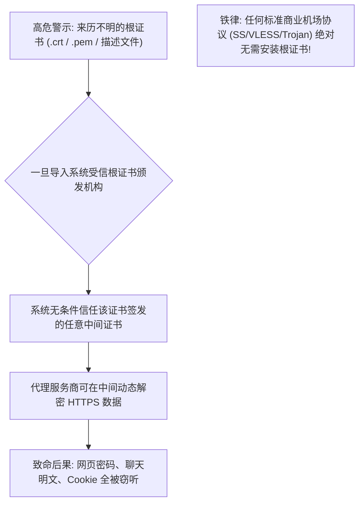

# 机场安全性与隐私边界：协议加密、各方可见性与客户端权衡

> **核心结论（Answer-First）**：使用跨境代理服务**绝不等于实现绝对匿名隐身**。从计算机网络协议工程视角来看，代理的核心功能在于提供跨网连通性并加密“用户终端至中转机房”之间的通信信道，防止本地公共 Wi-Fi 或本地网络窥探链路；但**代理服务商在技术上依然能够完整感知你连接了哪些目标域名（SNI 报文）、何时连接、以及传输了多少流量**。幸运的是，只要目标网站启用了现代 **HTTPS（端到端 TLS）** 且本地系统未被植入恶意根证书，**代理服务器在数理密码学层面绝对无法查看你在网页中输入的密码、正文聊天内容或银行卡信息**。树立清晰的安全认知，关键在于理解“本地运营商、代理服务商、目标网站”三方的可见性边界，坚决拒绝安装任何非必要根证书，并在开源通用端与闭源专属端之间做好理性的信任权衡。

---

## 一、网络工程视角：代理链路“三方可见性”矩阵

一条完整的网络请求从你的终端发出，最终抵达海外目标服务器，通常要经过四个关键层级：**「本地终端设备」 → 「本地家庭宽带/公共 Wi-Fi/ISP」 → 「机场中转入口与境外落地节点」 → 「目标海外网站（如 GitHub、OpenAI、YouTube）」**。

在这条链路上，三个不同的参与方各自在技术上能看到什么、看不到什么，呈现出清晰的密码学隔离：

```mermaid
graph LR
    User["本地终端 (PC / 手机)"] -->|本地网络段 (TLS 隧道)| ISP["本地运营商 / Wi-Fi"]
    ISP -->|跨境中转段| Node["代理服务商 (入口+落地节点)"]
    Node -->|公网出口段 (HTTPS 端到端)| Server["目标网站 (如 OpenAI / GitHub)"]
    
    subgraph Visibility["三方可见性边界"]
        ISP -.->|"仅见: 中转 IP、流量体积、(若泄漏可见 DNS)"| V1["本地网络可见"]
        Node -.->|"可见: 目标域名 SNI、时间戳、(正文不可见)"| V2["服务商可见"]
        Server -.->|"仅见: 落地节点出口 IP、(真实家庭 IP 隐藏)"| V3["目标站点可见"]
    end
```

| 链路参与方 | 在技术上能够清晰看到的信息（可见项） | 在技术上完全不可见的信息（受保护项） | 核心隐私防护建议 |
| :--- | :--- | :--- | :--- |
| **本地网络 / 家庭宽带 / 公共 Wi-Fi / ISP** | 你与机场国内中转服务器 IP 建立的加密连接时间、传输的数据包总大小、连接持续时间；**若客户端发生 DNS 泄漏**，还能看到明文解析的域名 | **绝对看不到**加密隧道内部你具体访问了哪个海外目标域名、请求的网页 URL 路径、网页正文、密码与聊天记录 | 开启客户端加密 DNS（DoH）与 Fake-IP 机制，彻底杜绝本地明文 DNS 泄漏 |
| **代理服务商（中转机房与海外落地节点）** | 你发起请求的**目标网站域名（通过协议报文与 TLS SNI 暴露）**、目标服务器 IP、精确到秒的连接时间戳、消耗的上下行流量大小、你的账号凭据（Token/UUID）与接入真实 IP | 只要访问的是 **HTTPS** 网站且未安装服务商根证书，**绝对看不到**你的网页表单、账号密码、正文文本、信用卡信息或聊天内容 | 绝不在操作系统中安装来源不明的自签名根证书，防止端到端加密被拆解 |
| **目标海外网站（如 Google / OpenAI / 流媒体）** | 机场**海外落地节点的出口公网 IP 地址**、你的浏览器指纹（User-Agent、Canvas、时区）、Cookie 与当前登录凭据 | 通常**看不到**你的真实家庭宽带公网 IP 地址（除非浏览器发生 WebRTC 泄漏或启用了局域网穿透） | 在浏览器中关闭 WebRTC 真实 IP 暴露，并结合多节点合理分流 |

---

## 二、TLS / SNI / DNS 加密边界：HTTPS 保护了什么？

许多用户对代理安全存在两极化的认知偏差：要么盲目轻信“开了代理就谁也抓不到我”，要么过度恐慌“机场老板是不是能把我的网银密码偷走”。理解 TLS 协议的运作机制能消除这两种误解。

### 1. HTTPS 端到端加密如何抵御中继窥探？
现代互联网中超过 95% 的网页流量均默认强制使用 HTTPS（基于 TLS 1.2 或 TLS 1.3 协议）。
- **端到端加密握手**：当你的浏览器访问一个 HTTPS 网站时，浏览器与目标网站的 Web 服务器之间会进行独立的非对称加密密钥交换，并协商生成专属于本次会话的对称加密密钥；
- **管道工角色**：代理服务器（无论是 [Shadowrocket](/clients/shadowrocket/)、[Clash Verge Rev](/clients/clash-verge/) 还是服务商的节点）在整个过程中仅仅扮演**“密文管道工”**的角色。客户端发出的加密数据包被封装在代理协议（如 Shadowsocks、VLESS）内部发给落地机房，落地机房解封后直接将原生的 TLS 密文转发给目标网站；
- **密码学定论**：即使代理机房的管理员对服务器进行全量抓包分析，他们看到的也只是一串经过强加密的随机十六进制乱码。只要目标网站的 SSL 证书合法，中间人没有任何数学手段在合理时间内破解对称加密正文，你的密码与个人隐私在传输层坚如磐石。

### 2. 代理服务端技术上能看到的“元数据清单”
虽然代理商无法解密 HTTPS 正文，但必须清醒认识到：**代理商在技术上能完整掌握你的网络访问元数据（Metadata）**：
- **目标主机名（Target Hostname / SNI）**：
  - 在发起 TLS 握手的第一个数据包（Client Hello）中，为了让目标服务器知道你要访问哪一个虚拟主机，浏览器必须在未加密的扩展字段中附带目标域名，这一技术称为 **SNI（Server Name Indication）**；
  - 代理服务器通过读取客户端请求的目标地址或 SNI 字段，可以精准知道你在 `2026-11-23 20:15:30` 访问了 `api.openai.com` 或 `youtube.com`；
- **会话元特征**：你与该目标域名保持连接了多久、累计消耗了 50MB 还是 2GB 流量；
- **结论**：代理服务商无法知道你在看哪一段具体视频，但能知道你在访问哪个流媒体平台；无法知道你和 AI 聊了什么，但能知道你在频繁调用 AI 接口。这种元数据的暴露是当前代理协议架构下的客观必然。

### 3. DNS 加密与 DNS 泄漏的底层机理
即使代理链路本身加密，若客户端的 DNS 配置出现偏差，同样会导致严重的信息泄漏：
- **明文 DNS 泄漏**：部分配置不当的客户端在解析域名时，直接使用系统默认的本地运营商（如本地电信/联通）DNS 服务器通过明文 UDP 53 端口发起查询。此时，虽然实际访问走了解密代理，但本地运营商的 DNS 日志中已经完整记录了你的域名访问轨迹；
- **防范体系**：在 [Clash Verge Rev](/clients/clash-verge/) 或 [sing-box](/clients/sing-box/) 中，必须规范启用基于 HTTPS 的加密域名解析（DoH / DoT）以及 **Fake-IP 模式**（客户端在本地直接响应假 IP，将真实域名封装进代理隧道交由远端落地节点解析），从根本上阻断本地 DNS 窥探。具体排障见 [DNS 泄漏与劫持修复](/troubleshooting/articles/dns-leak-hijack-fix) 与 [Fake-IP 机制原理](/troubleshooting/articles/fake-ip-explained-fix)。

---

## 三、高危安全红线：严禁安装非必要自签名根证书（CA Certificate）

在所有针对终端用户的安全威胁中，**诱导安装非必要的自签名根证书（CA Certificate / Root Certificate）是破坏力最大、最致命的中间人攻击（MITM）手段**。



### 1. 为什么“要求安装根证书”是极度危险的信号？
- **操作系统的信任锚点**：操作系统（Windows、macOS、iOS、Android）内置了一套高度权威的受信任根证书颁发机构列表（如 DigiCert、Let's Encrypt 等）。凡是由这些权威机构签发的网站证书，系统均予以信任并展示安全绿锁；
- **中间人攻击机制（MITM）**：一旦你听信某些不良客户端或教程的诱导，将某个未知的自签名根证书导入了系统的“受信任的根证书颁发机构”中，该证书的持有者便拥有了**在网络中伪造任意网站证书的合法特权**；
- 当你访问网上银行或私人邮箱时，代理服务器可以在中途拦截连接，向你的电脑出示一张用该自签名 CA 动态签发的“假证书”。由于你的系统已经盲目信任了该根证书，浏览器不仅不会弹红字警告，还会正常显示绿锁！此时，端到端加密被彻底撕毁，你的明文密码与个人数据在服务商面前将一览无遗。

### 2. 标准代理协议与根证书的绝缘属性
读者必须牢记一条不可逾越的安全铁律：
- **现代标准商业代理协议（Shadowsocks、VMess AEAD、VLESS、Trojan、Hysteria 2）在运行过程中，绝对不需要在操作系统中安装任何额外的根证书！**
- 服务端使用的 TLS 证书（如 Trojan 或 VLESS Reality）要么是由正规权威机构公开发行的，要么采用了无需客户端安装 CA 的双向公钥校验机制；
- **唯一例外场景**：只有开发者在本地使用抓包调试工具（如 Fiddler、Charles）进行逆向分析，且完全明确风险时，才会主动导入本地根证书。日常使用代理翻墙时，任何声称“必须安装专属安全证书才能解锁节点”的软件，99% 属于恶意间谍程序或存在后门，必须立即终止安装并彻底删除。

---

## 四、客户端信任权衡：第三方开源客户端 vs 闭源专属客户端

客户端是直接常驻在用户本地操作系统、拥有网络接口管理权限甚至驱动级权限（TUN 虚拟网卡）的核心软件。选择开源客户端还是闭源专属端，是隐私防御的关键抉择。

### 1. 第三方开源通用客户端的技术优势与审计机制
成熟的第三方开源通用工具（如基于 [Clash Meta 内核](/clients/clash-meta/) 开发的 [Clash Verge Rev](/clients/clash-verge/)、[v2rayN](/clients/v2rayn/)、[sing-box](/clients/sing-box/) 以及 iOS 平台经过严苛 App Store 审查的 [Shadowrocket](/clients/shadowrocket/)）：
- **代码可审计性**：核心转发逻辑、TUN 网卡驱动与配置解析源码全部托管在 GitHub 等公开代码托管平台，全球成千上万的开发者与安全研究员可随时对其进行代码审计，一旦存在恶意窃密行为极易被迅速曝光；
- **纯粹的工具属性**：开源工具本身不提供任何节点服务，开发者与具体的机场服务商之间不存在利益绑定，其工作机制严格遵循本地配置文件制定的规则路由；
- **配置与数据自主权**：用户可以自主编写分流策略，决定哪些流量走代理、哪些直连，所有操作日志与订阅数据完全保留在本地。

### 2. 闭源专属客户端的潜在信任赤字
正如在 [机场避坑指南](/security/avoid-pitfalls/) 与 [服务替代方案](/security/alternatives/) 中所提及的，部分品牌（如站内记录的 8 家仅限专属客户端品牌）强制要求用户使用其定制打包的闭源软件。对于此类闭源程序，用户必须理解其潜在风险：
- **行为不可观测**：闭源打包的安装包（尤其是 Windows 的 `.exe` 安装程序或 Android 的独立 `.apk`）在后台运行时，用户无法获知其是否在静默收集电脑的硬盘序列号、MAC 地址、操作系统已安装应用列表；
- **进程驻留与驱动接管**：部分专属客户端退出后，后台服务依然开机自启并占用系统代理端口，甚至在用户不知情的情况下注入难以清理的虚拟网卡驱动；
- **安全建议**：如果工作或学习涉及高敏感资产，建议优先选择支持通用订阅的品牌并搭配开源客户端；若因新手阶段怕麻烦暂时使用专属客户端，切勿在该设备上进行涉及核心企业机密或大额金融交易的操作。

---

## 五、仿冒软件防范与本地安全防御策略

随着代理工具普及，针对客户端软件本身的黑色产业链日益猖獗，各类“李鬼”软件与仿冒下载站成为终端安全的最大隐患。

### 1. 仿冒开源软件事件警示：以 NekoBox 被第三方接管为例
在本站编纂的第三方客户端安全规范与输入审计报告（详见 `reports/input-audit.md`）中，记录了一起典型的行业安全事件：
- **事件警示**：开源安卓客户端 **NekoBox for Android** 在 Google Play 商店的发布条目曾发生过**已被第三方恶意接管控制**的严重安全变故；
- **防范准则**：即使在看似权威的应用商店中，若原开源作者账号被盗或转让，恶意第三方同样可能推送包含后门的升级包。本站特别警示：**下载 Android 平台代理工具，切勿盲目信任应用商店搜索结果，必须认准官方 GitHub 仓库源码发布页（Releases）下载经过校验的 APK 安装包**。

### 2. 搜索引擎李鬼竞价广告与假冒下载站甄别
在各类搜索引擎中检索“Clash 下载”、“v2rayN 官网”等关键词时，排在首页前列的往往充斥着大量购买了商业推广广告的山寨李鬼网站：
- **套路识别**：这些假冒网站通常使用高度仿真的页面UI，诱导用户下载捆绑了挖矿木马、远控后门或浏览器劫持插件的“特别修改版”；
- **甄别铁律**：正规的开源项目绝不会在搜索引擎投放付费推广广告！认准 GitHub 官方开源地址或本站提供的正规客户端导航（如 [客户端总览](/clients/) 与 [Clash Verge Rev 指南](/clients/clash-verge/)），在下载前仔细核对安装包的 SHA-256 哈希值。

### 3. 本地分流最小权限与系统安全加固
无论使用何种代理服务，本地操作系统的底线安全配置绝不能妥协：

| 防御维度 | 正确安全操作规范 | 严禁触犯的高危操作 |
| :--- | :--- | :--- |
| **金融与政务分流** | 在客户端中配置严格的规则分流（Rule Mode），将网上银行、证券交易、个人所得税、公积金及国内实名社交应用强制指定为 **DIRECT（直连）** | 长期开启全局代理（Global Mode）访问国内网银，导致真实身份与敏感金融交易绕行境外不可控节点 |
| **系统防火墙与 UAC** | 始终保持 Windows Defender、系统自带防火墙与用户账户控制（UAC）处于开启状态 | 听信网络不良教程，在排障时直接彻底“关闭系统防火墙”或“退出全部杀毒软件”，使电脑在局域网内裸奔 |
| **局域网共享权限** | 仅在确实需要为家庭其他设备提供中继时才谨慎开启 `allow-lan`（允许局域网连接），且务必在控制面板配置强密码认证（Secret） | 在公共 Wi-Fi 或校园网环境下无密码开启 `allow-lan`，导致本机代理端口被陌生人扫描并免费蹭网盗刷流量 |

---

## 六、常见问题

### 用了加密协议机场之后，是不是就完全“匿名隐身”、谁都看不到我在访问什么了？
不是。加密隧道只是在“你的设备到机场入口节点”之间建立加密传输，防止本地网络和公共 Wi-Fi 窥探内部具体网页内容；但你的目标域名、连接时间、流量大小甚至未加密请求头对于代理服务商自身及其落地服务器在技术上仍然是可见的（HTTPS 端到端加密保护的具体页面正文和账号密码除外）。

### 第三方开源通用客户端和机场自研的闭源专属客户端，在隐私上有什么区别？
开源通用客户端（如基于可核查源代码发布的 Clash Verge Rev、v2rayN、sing-box 等）代码逻辑可接受社区审计，主要专注本地转发；部分闭源专属客户端由机场或外包方打包编译，用户无法自行核验其是否在本地额外收集设备识别信息、浏览器历史或注入额外规则，因此在敏感设备上需要更高的信任前提。

### 为什么保护隐私还要特别检查 DNS 泄漏与高风险浏览器权限？
即使代理隧道本身已加密，如果客户端 DNS 配置不当导致域名直接从本地明文发往 ISP（即 DNS 泄漏），本地网络依然能记录你查询过的所有域名清单。同样，切勿随意在设备上安装不明来源的根证书（MITM）以免破坏端到端 HTTPS 加密保障。

### 访问 HTTPS 加密网站时，机场落地节点和中转服务器能看到我的账号密码或聊天记录吗？
只要访问的是合规的 HTTPS 网站，且终端未被安装恶意第三方根证书（CA 证书），TLS 握手是用户浏览器与目标网站服务器之间直接建立的端到端加密通道。代理服务器充当的只是加密 TCP/UDP 报文的搬运工，在数理密码学层面无法解密查看正文数据、密码或银行卡号。

### 为什么绝对不要在操作系统中安装来历不明的自签名根证书（CA Certificate）？
根证书拥有操作系统最高等级的信任权限。一旦安装了来历不明的根证书，恶意软件或代理服务商就可以实施中间人攻击（MITM），在本地伪造任意 HTTPS 网站的合法身份，从而直接解密并明文窃听你原本受端到端加密保护的所有账号密码和私人通信。

### 为什么要求网银、证券投资与国内政务实名应用必须强制走 DIRECT 直连分流？
避免触发金融机构与政务系统的异地/境外登录异常风控（如银行账户被临时冻结要求柜台核实），同时彻底杜绝境内敏感金融流量绕行境外节点，从源头确保资金与实名数据仅在本地与银行直连通道中传输。

### 类似 NekoBox 官方警告的“第三方接管 Play 商店版本”事件，对用户下载客户端有什么警示？
警示用户开源客户端并非只要在应用商店搜到就一定是安全的。当原开发者放弃维护或账号易手后，第三方可能打包植入后门或窃取订阅链接。下载开源工具务必认准官方 GitHub Releases、可信开发者主页或正规应用商店官方渠道。

---

## 七、相关入口

- 客户端选择与安全：[第三方客户端总览](/clients/) ｜ [Clash Verge Rev 完整指南](/clients/clash-verge/) ｜ [sing-box 客户端生态](/clients/sing-box/)
- 网络与协议深度排查：[DNS 泄漏与劫持排障](/troubleshooting/articles/dns-leak-hijack-fix) ｜ [Fake-IP 机制原理解析](/troubleshooting/articles/fake-ip-explained-fix) ｜ [系统时间与 TLS 证书排查](/troubleshooting/articles/time-sync-tls-cert-error)
- 账号凭据与风险防范：[账号与订阅安全指南](/security/account-security/) ｜ [机场避坑指南](/security/avoid-pitfalls/) ｜ [机场跑路识别与止损](/security/shutdown/)
