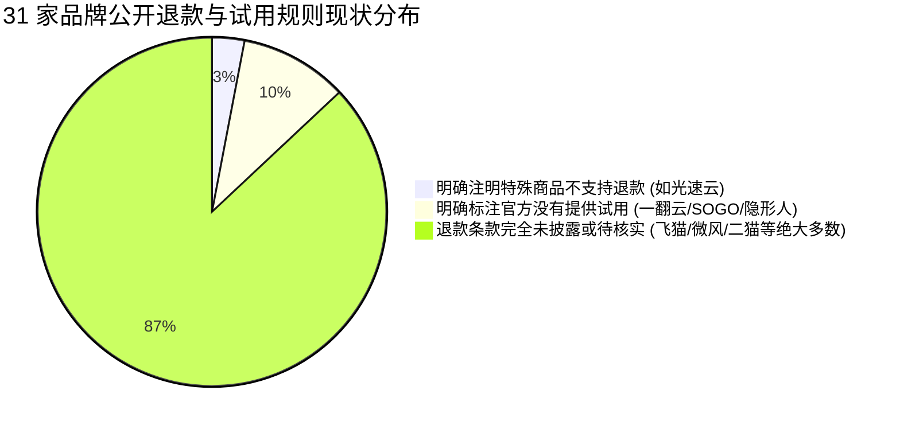
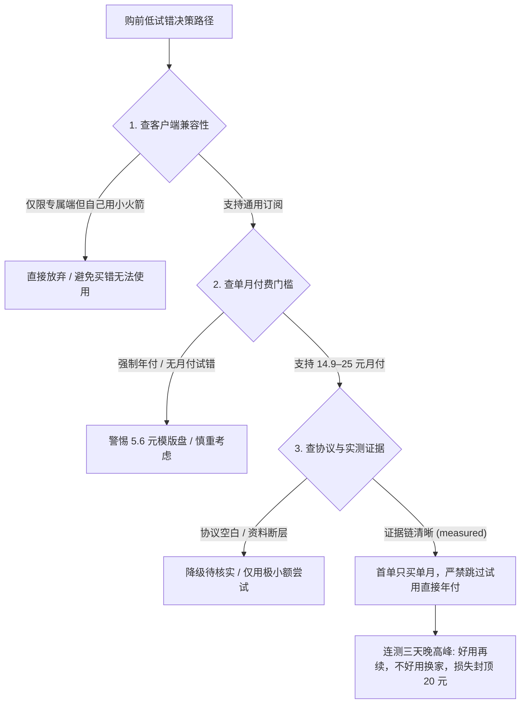

# 退款与购前核验：数字商品退款局限与低试错原则

> **核心结论（Answer-First）**：在跨境网络代理服务消费中，**“申请退款”是维权成本最高、成功概率最低的解决途径**。根据对本站收录的 31 家品牌公开技术档案审计，绝大多数品牌将代理套餐定义为“交付即履约的特殊虚拟数字商品”，明确或默示执行**“不支持退款”与“不提供免费试用”**政策。一旦订单支付、订阅链接下发或产生少量网络流量，因网络主观体验（如晚高峰卡顿、特定节点丢包）要求退还年费，几乎都会遭到商家的合规抗辩与拒绝。对抗退款难的最有效手段不是事后纠纷，而是**事前的低成本控制机制：严格坚持单月小额试错（实付控制在 18–25 元内）、购前核查客户端与协议限制、管理心理预期**；并在遭遇真正账务异常（如掉单或重复扣费）时，运用标准化脱敏工单凭证理性维权。

---

## 一、31 家品牌退款与试用政策现状深度审计

为了向读者揭示真实的行业规则，本站对底层证据库中的 31 家品牌公开技术资料进行了全面清点（详见 [品牌索引目录](/brands/directory/) 与 [品牌运营风险事件库](/brands/incidents/)）。审计发现，商家的退款与试用规则可清晰划分为三大现状阵营：



### 1. 明确注明特殊商品不支持退款的代表
- **[光速云](/brands/guangsuyun/)**：作为站内主推品牌之一，在其官方套餐详情与品牌信息资料中，明确以警示文字注明：**「套餐里特殊商品不支持退款」**。同时，其资料在建议指南中也诚实地向用户提示：“建议优先选择月付或者小额套餐，实测晚高峰速度和稳定性之后，再考虑要不要长期使用，不要直接长周期大额充值”。
- 这表明即便是头部成熟站点，也将退款门槛设为极高，依靠合同条款明确排除无理由退费的可能。

### 2. 明确标注官方不提供免费试用的代表
在用户普遍希望“先免费试用、好用再付款”的心理驱动下，部分品牌直接在规则正文中堵死了试用入口：
- **[一翻云](/brands/yifan/)**：在资料介绍正文中明确说明 **「官方没有提供试用」**，用户必须先选购轻享版（20元/月）或小额包进行自费测试；
- **[SOGO云](/brands/sogo/)**：资料明确写道 **「官方没有提供试用」**，且由于其强制使用闭源自研端，用户无法在零门槛下验证其连接质量；
- **[隐形人](/brands/yinxingren/)**：资料明确标注 **「官方没有提供试用」**，且不支持第三方开源订阅，进门门槛完全刚性。

### 3. 退款条款完全未披露或待核实的普遍现状
除了上述少数有明文注记的品牌外，在整理 [飞猫云](/brands/feimao/)、[微风网络](/brands/weifeng/)、[星岛梦](/brands/xingdaomeng/)、[无忧链接](/brands/wuyou/)、[二猫云](/brands/ermao/)、[唯兔云](/brands/weitu/)、[极连云](/brands/jilian/)、[可信云](/brands/kexin/)、[速界](/brands/sujie/) 以及 5.6 元模版集群（[闪电鼠](/brands/shandianshu/)、[大佬云](/brands/dalaoyun/) 等）的资料时，一个触目惊心的事实是：
- **绝大多数品牌在公开的推广与介绍文案中，对退款规则、退费计算公式、手续费扣除标准完全只字不提**；
- 在本站数据结构中，此类品牌的退款字段均被客观赋予了 `privacyAndRefundNotes: "支付方式与退款条款未披露，归类待核实"` 的状态；
- **行业安全准则**：在代理服务领域，**未明确承诺退款的，100% 必须在心理上按“绝对无法退款”进行顶层风险管理**。切勿心存侥幸，幻想商家会在你体验不佳时主动大发善心退还年费。

---

## 二、虚拟数字商品争议的行业现实：为什么代理退款难如登天？

许多初学者常常拿实体电商或国内合规软件的“七天无理由退货”来要求跨境代理商，这在技术底层与商业逻辑上是完全脱节的。理解以下三大现实，有助于认清退款争议的本质：

### 1. 交付即履约的技术特征与流量消耗成本
- **实质交付完成**：与实体商品不同，当你在机场后台点击付款并成功生成订单的一瞬间，系统便为你分配了专属的数据库记录、独立的订阅密钥（Token）或 UUID。在网络工程意义上，服务商的基础设施与专线出口已经为你开辟了带宽配额与并发会话通道，履约过程在第一秒即告完成；
- **成本预扣**：代理服务商向上游骨干机房租赁带宽时，机房通常按月度保底带宽或 95 计费法收取费用。用户即便只连接了几分钟、跑了 100MB 流量，对服务商而言也已经产生了上游资源的占用与算力开销。因此，“我才用了两天，凭什么不给退全款”的主张在服务商的成本核算逻辑中是无法成立的。

### 2. 跨境匿名结算主体的法律与监管盲区
- **主体隐匿**：绝大多数代理团队由于众所周知的原因，其团队成员、服务器运维均处于境外或匿名分布式办公状态，前台不存在任何具备法律实体的公开主体名称与营业执照；
- **第四方聚合支付网关**：用户在结账时扫描的支付宝、微信二维码，实际上是跳转至境外或民间的第四方聚合发卡平台。银行流水与账单上显示的收款方，往往是频繁变更的“XX网络科技有限公司”、“XX文具百货商行”、“XX日用品经营部”等空壳个体户或虚拟发卡商户；
- **维权路径阻断**：当发生退款争议时，用户根本无法通过国内 12315、工商消协或法院诉讼对其实施有效追责。你甚至连真正的被告是谁都无法取证。

### 3. 主观网络体验的举证困境与商家抗辩
当用户因“网速慢、晚高峰打不开 YouTube 4K、或 ChatGPT 报 Access Denied”发起退款申请时，极易陷入无法自证的拉锯战：
- **商家抗辩四连**：
  1. “我后台监控显示机房入口服务器负载仅为 30%，网络一切正常”；
  2. “你打不开是因为你本地宽带（如移动或广电）出口被本地运营商阻断，属于用户本地网络问题”；
  3. “AI 平台拦截是因为 OpenAI 官方风控收紧，属于第三方服务策略调整，非代理服务商责任”；
  4. “几十个节点中只要还有 1 个节点能连上，就表明服务处于履约状态，不予退款”。
- 在缺乏中立、权威的第三方技术仲裁机构介入的前提下，争议的最终解释权完全归商家所有。强行争辩往往导致客服直接关闭工单，甚至以“恶意纠缠”为由直接封禁你的账户，导致剩余服务也一并丢失。

---

## 三、月付小额试错降损法：把退款纠纷消灭在付款之前

既然事后退款极其艰难，最高明、最省心的方法就是在**付款发生的前一刻，通过制度化手段将潜在风险封死在萌芽状态**。



### 1. 算清两笔账：沉没成本 vs 维权时间成本
- **大额年付的沉没陷阱**：购买 120–200 元的年付套餐，如果使用一周后发生机房变故或晚高峰大面积断流，你的直接经济损失是上百元现金，同时还要伴随数周漫长、愤怒却毫无结果的工单纠纷；
- **月付试错的高确定性**：首次坚决只购买 **18–25 元** 的单月套餐。18 元对于绝大多数用户而言是一笔即便完全打水漂也完全不会影响日常生活的微小支出。如果三天后发现节点不适合自己的宽带，不续费、直接在客户端换家即可。你用极低的代价换取了对真实网络环境的完整验证权。

### 2. 购前五步必查清单（下单前花 2 分钟对照）
在点击支付前，严格核实以下五项指标：
1. **核实客户端限制**：明确目标品牌是否支持 [Clash Verge Rev](/clients/clash-verge/)、[Shadowrocket](/clients/shadowrocket/) 等通用工具。坚决看清站内审计出的 8 家“仅限专属客户端”品牌，避免买完发现软路由和 Mac 根本装不上；
2. **核实真实实付总额**：识破“折算 7 元/月”的年付障眼法（详见 [机场避坑指南](/security/avoid-pitfalls/) 与 [预算轻量套餐指南](/pricing/budget/)），确认结算页显示的应付金额确实为单月金额；
3. **核查实测证据等级**：优先选择拥有第三方测速截图（`evidenceStatus: "measured"`）的品牌，避开无实测截图、无地区节点清单的 5.6 元模版盘；
4. **核查核心解锁能力**：若为了使用 ChatGPT、Claude 或 Netflix，核对评测页的历史解锁记录，理解共享节点送中的客观存在（参考 [流媒体送中排查](/ai-media/youtube/) 与 [ChatGPT 连接排查](/ai-media/chatgpt/)）；
5. **排查本地配置再作判断**：新购套餐连不上，往往是由于本地时间偏差、客户端模式选错或系统代理冲突引起。付款后若遇到连不上，先对照 [订阅失败排障](/troubleshooting/subscription-failure/) 排查本地，不要盲目归咎于商家。

---

## 四、客观交易异常处理规范：掉单、重复扣款与工单沟通模板

并非所有的支付问题都属于主观退款争议。在日常运营中，常常会出现因网络抖动、支付接口异步回调失败而导致的**客观账务异常**。对于此类客观问题，只要证据充分、沟通规范，绝大多数商家均能快速人工核对并妥善补单。

### 1. 三大高发客观账务异常成因
- **现象 A：支付成功但后台订单显示“未支付/超时”（掉单）**
  - *成因*：用户在微信或支付宝成功完成扫码扣款，但第三方发卡网关在向机场面板服务器发送 Webhook 异步回调通知时，因跨境网络延迟或丢包导致回调超时，面板未能自动触发激活脚本。
- **现象 B：页面卡顿重复点击扫码导致同一订单被扣两笔**
  - *成因*：结账页面加载缓慢，用户误以为第一笔未成功，刷新后再次扫码，导致银联或第三方账户实际发生两笔独立扣费。
- **现象 C：USDT/加密货币转账少算矿工费（Underpaid）**
  - *成因*：使用加密货币支付时，用户从交易所提币时未把交易所收取的提币网络手续费（如 TRC20 的 1 USDT 矿工费）额外加在提币金额中，导致实际到达网关收款地址的金额比应付金额少了一点，网关智能合约因金额不符拒绝自动放行。

### 2. 提交工单的“必须提供”与“严格脱敏”清单
当向官网提交技术支持工单时，信息的精准度直接决定了处理速度。对照下表准备凭据：

| 信息大类 | 必须完整提供的信息项 | 绝对严禁提供 / 必须涂抹脱敏的信息项 |
| :--- | :--- | :--- |
| **机场站内信息** | 机场注册邮箱、后台生成的未支付订单编号（Order ID）、购买的套餐名称 | 登录密码（任何情况下客服均不需要你的明文密码） |
| **第三方支付信息** | 支付宝/微信账单详情截图：必须清晰可见**商品说明、交易单号、商户订单号、精确到秒的创建与支付时间、实付款金额** | 你的个人真实姓名（打码）、绑定的银行卡后四位及卡号、余额信息 |
| **加密货币转账** | 完整的区块链交易哈希值（TXID / Transaction Hash）、付款钱包地址、出款时间戳 | 你的钱包助记词、私钥（防范恶意钓鱼） |
| **客户端配置信息** | 报错界面的 HTTP 状态码截图（如 401/403/503） | **绝对严禁在工单附图中包含带有完整 Token 的订阅 URL**，防止客服工单被内部泄露导致流量被盗 |

### 3. 标准理性工单沟通证据模板
提交工单时，保持客观、克制、事实驱动的陈述，切忌使用攻击性侮辱字眼，可直接套用以下规范格式：

```text
【工单标题】：关于订单 #[订单号] 支付成功但后台未激活（掉单）处理申请

尊敬的技术支持团队：
您好！我在 [年/月/日 时:分:秒] 购买了贵站的 [套餐名称]，应付金额为 [¥XX 元]。
我已通过 [支付宝/微信支付] 完成全额付款，但返回后台发现该订单状态仍显示为“待支付”或“已超时”，套餐流量与节点列表未能自动下发。

经核对，本次交易的客观支付凭据如下：
1. 站内订单号：[如 20261123XXXXXX]
2. 聚合支付商户单号：[从微信/支付宝账单中复制的完整商户订单号]
3. 交易流水号：[从支付凭据中复制的交易流水号]
4. 实际扣款时间：[2026-XX-XX XX:XX:XX]
5. 附件：已附上包含上述交易单号、时间戳与扣款金额的账单详情截图（敏感个人实名信息已打码）。

麻烦管理员在后台人工对账后协助补单激活，或将款项充值至站内账户余额由我手动重新下单。非常感谢！
```

---

## 五、套餐升降级与折算补差价的潜在陷阱

除了新购订单，老用户在日常使用中升级套餐时同样存在隐性规则陷阱：

### 1. 套餐升级清零陷阱（流量与天数非线性叠加）
许多中小机场使用的开源面板（如 SSPanel、V2Board 等）对于“套餐变更”的底层逻辑设计较为粗糙：
- **高危现象**：当你本月 20 元的套餐尚有 15 天到期、剩余 80GB 流量未用完，此时若直接在后台购买更高档位的 40 元套餐；
- **清零风险**：系统往往会直接执行“覆盖（Overwrite）”操作，即旧套餐的剩余天数与剩余流量直接被系统判定清空，重置为新套餐的周期，原套餐的剩余价值直接蒸发，并不会自动折算为现金抵扣新订单；
- **防坑动作**：在进行任何套餐升级前，先通过工单咨询客服：“中途升档是补差价顺延，还是直接覆盖清零原套餐”。若系统不支持折算，建议等待当前周期完全用尽后再行购买新套餐。

### 2. 误购专属客户端套餐的协商补救边界
正如前文所述，若你因未看清说明，误购了仅支持专属客户端的品牌套餐（如飞猫云、无忧链接、Firefly 等），且你的主力设备是无法安装其专属 App 的平台（如 Linux 服务器、软路由或 iOS 越狱工具）：
- **理性补救**：在账号未产生任何流量（剩余流量 100% 完整）的前提下，第一时间通过工单礼貌联系客服，说明误购原委，请求客服协助撤销订单并退还站内余额，或者协商转为支持通用订阅的特殊通道；
- **心理准备**：若商家以“条款已明确写明”为由拒绝，依据行业现状属于正常商业抗辩，切勿在公开社群实施非理性人肉或违规报复，保持财产与账号安全。

---

## 六、常见问题

### 买了机场年付套餐后发现晚高峰卡顿或连不上，能以“服务不好”为由申请全额退款吗？
绝大多数情况下无法退款。跨境代理服务属于虚拟数字商品，其服务条款中通常明确标注“不支持退款”或“一经开通/产生流量概不退费”。由于各地运营商网络环境差异大且缺乏客观第三方仲裁机制，商家通常以“部分节点可用”或“本地网络配置问题”为由拒绝退款。

### 站内收录的 31 家品牌中，关于“退款政策”与“免费试用”的披露现状是怎样的？
审计结果显示：极少数品牌明确标注退款限制（如光速云明确注明“套餐里特殊商品不支持退款”）；部分品牌明确标注“官方没有提供试用”（如一翻云、SOGO云、隐形人）；而其余绝大多数品牌在公开资料中对退款条款完全处于“未披露或待核实”状态。因此用户必须默认全行业“无退款保障”进行预期管理。

### 遇到支付宝或微信扫码已扣款，但机场后台订单显示“未支付/超时”（掉单）怎么办？
这通常是第三方发卡接口异步回调延迟或网络抖动所致。切勿立刻重复扫码二次付款。应立即保存支付账单详情（含交易单号、商户单号、实付金额与秒级时间戳），在机场官网后台提交工单并附上脱敏后的支付凭证，由管理员人工核对流水补单。

### 如果使用 USDT 加密货币支付，因少算链上矿工费导致实际到账差了 0.1U 无法激活怎么办？
加密货币网关通常依赖精确金额的智能合约或地址监听，少算 0.1U 会导致网关判定为未足额支付而挂起。此时不要反复小额转账（每次都会产生高额矿工费），应复制交易哈希（TXID）联系官网工单，由客服人工查验链上入账记录并手动补齐开通。

### 发生退款争议或掉单时，向机场客服提交工单有哪些必须严格脱敏的隐私信息？
可以提供的数据包括：机场注册邮箱、后台订单号、第三方支付账单号、支付时间与金额。绝对禁止提交的数据包括：身份证号、银行卡明细、未脱敏的支付实名全名、以及包含个人 Token 的完整订阅链接，防止个人身份与代理凭据二次泄露。

### 为什么说“月付小额试错”是比事后申请退款高效百倍的止损手段？
跨境代理纠纷维权时间成本极高。若首次坚决只买 18–25 元的单月套餐，相当于把潜在损失封顶在一杯咖啡的金额之内；即便晚高峰体验不满意，放弃续费换家的成本极低，彻底免去了与客服数十天扯皮甚至账号被封禁的风险。

### 因为没看清“仅限官方专属客户端、不提供第三方订阅”买错套餐，能否向客服申请退换？
成功率取决于商家的客服政策。由于专属客户端节点通常也是基于同一组后端服务器，部分人性化运维的商家在账号尚未产生大额流量时，可能允许协商更换套餐或退还站内余额；但若条款严苛或账号已产生流量，通常会被严格依规拒绝。因此购前核实客户端限制至关重要。

---

## 七、相关入口

- 选型避坑与定价参考：[机场避坑指南](/security/avoid-pitfalls/) ｜ [月付低试错套餐推荐](/pricing/monthly/) ｜ [预算轻量套餐](/pricing/budget/)
- 风险处置与替代方案：[机场跑路识别与止损](/security/shutdown/) ｜ [服务替代与平滑迁移](/security/alternatives/) ｜ [品牌运营风险与事件库](/brands/incidents/)
- 客户端与排障技术：[订阅失败排障](/troubleshooting/subscription-failure/) ｜ [流量耗尽与配置过期区分](/troubleshooting/articles/quota-expired-vs-stale-config) ｜ [订阅导入教程](/guides/subscriptions/)
