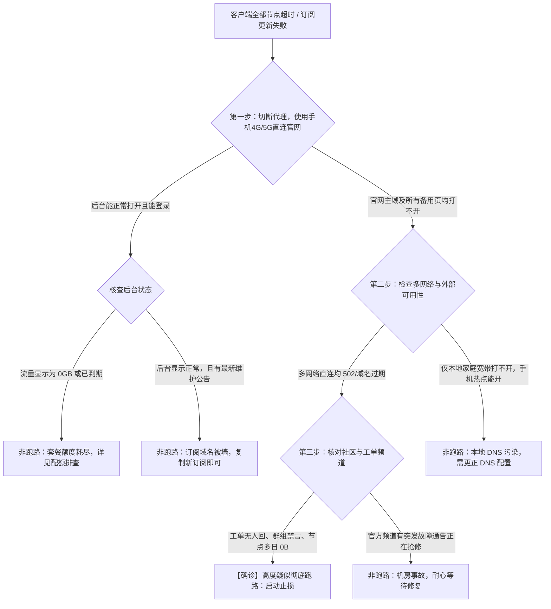
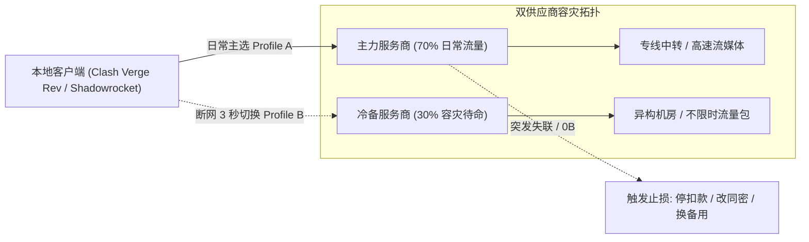

# 机场跑路识别与止损：区分临时故障与彻底失联

> **核心结论（Answer-First）**：客户端内节点集体测速超时（0B / Timeout）或更新订阅失败，并不自动等同于机场服务商卷款跑路。在网络工程实践中，本地电脑系统时间漂移、订阅分发域名被运营商阻断、套餐额度提前耗尽、或上游入口机房临时维护，均会引发类似假象。判定“真跑路”与“假故障”的核心，在于通过 **「移动蜂窝网访问后台」、「多网络环境验证订阅分发接口」、「核查公告频道活性」** 三维交叉验证流程。确认失联后，应立即执行 **「切断自动扣款、严防虚假补偿包、改同密防撞库、导出备份本地规则」** 四步止损，并切至双供应商冷备。

---

## 一、机场跑路的行业本质：为什么代理服务具有高失联流动性？

在探讨应对失联前，必须理性认清跨境代理服务背后的商业与技术模型。许多初学者常将机场视作长青的基础设施，这种认知偏差导致用户极易轻信长周期套餐与口头履约承诺。

### 1. 轻资产运维与重度依赖外部供应链
绝大多数商业代理服务商属于**轻资产集成架构**：
- **入口中转层**：境内入口机器向国内 IDC 机房按月租用，极易因机房通报、IP 被封或网络攻击而中断。
- **跨境传输层**：专线与公网隧道带宽依赖上游带宽批发商。一旦上游渠道变故或未能按时续费，骨干隧道便会瞬间全线宕机。
- **境外落地层**：机房分散租用海外小主机商算力，落地节点的封锁与更换具有高频成本。

### 2. 资金链与预付费模式的时间错配
机场普遍采用预付费制。新平台依靠高额年付折扣和推广返利（AFF）短时间内聚集大量预付资金，但服务器带宽成本却是按月刚性支出的。若运营团队缺乏现金流风控，将长期预付款挪作他用，一旦新增付费放缓或遭遇封锁成本激增，资金链断裂便不可避免。在无法维持高昂带宽租金时，弃盘失联（跑路）成为不良运营方的逃避手段。

### 3. 31 家品牌存活周期与历史档案现状
根据本站对收录的 31 家品牌资产审计（见 [品牌索引目录](/brands/directory/) 与 [品牌运营风险事件库](/brands/incidents/)）：
- 部分早期品牌开业标注为 2020 年（如 [光速云](/brands/guangsuyun/)、[星岛梦](/brands/xingdaomeng/)），但在演进中计费模式与入口域名经历了多次更迭；
- 相当一部分站点集中在 2023–2025 年间成立，且呈现出向专属客户端收拢、取消开源订阅支持的趋势；
- 数家历史记录品牌（如归档的 [灵动云](/brands/lingdong/)、[浪网](/brands/langwang/)、[边缘节点 EdgeNova](/brands/edgenova/)）在 2026-08-09 历史档案中即已注明“不保证当前有效”，存在套餐流量遮挡、缺乏测速截图甚至官方入口不可考的严重缺口。这表明代理市场缺乏外部履约担保，必须以月付降低敞口风险。

---

## 二、机场彻底跑路前常见的五大危险前兆

不良平台在彻底关服前的数周内，通常会呈现以下典型异常信号组合：

### 1. 突发反常的超低折扣与超长周期买断促销
平时常态化运营的商家月付多在 15–30 元。若管理团队突然推出“三年付仅需 99 元”、“永久不限时 2000GB 仅售 69 元”等违背带宽成本的极端方案，且仅支持无法追溯的不可逆支付手段（如 USDT 或私信代付），往往是跑路前榨取现金流的危险信号。

### 2. 骨干线路私自降级与节点大面积持续 0B
正常运营遇到故障会在面板公告栏或通知频道说明。若核心节点连续多日测速全部返回 0B 或超时且毫无说明，或承诺的 IPLC/IEPL 专线被偷换为高丢包的普通公网直连，通常说明已无力向机房续交核心专线租金。

### 3. 官网主站与备用发布页长期处于 502 或域名过期状态
不仅节点瘫痪，连官网主站、备用域名甚至海外发布页也同步出现“502 Bad Gateway”或“Domain Expired”，表明面板服务器与底层数据库已被彻底关停。

### 4. 站内工单停摆与官方社区全面禁言解散
工单超过 72 小时完全无人回应，官方交流群组突然开启全员永久禁言，或官方频道被解散、清空历史消息，客户服务通道彻底瘫痪。

### 5. 客户端强制锁死与旧订阅全部报错 404
部分服务商在停运前突然废弃开源订阅接口，强制要求下载未知第三方定制程序，且旧订阅链接在拉取时直接返回 **HTTP 404 Not Found**。相关状态码排查见 [订阅 HTTP 401/403/404/503 排查指南](/troubleshooting/articles/sub-http-401-403-404-503)。

---

## 三、三方交叉核验流程：如何科学区分“真跑路”与“假跑路”

社群中超过 70% 的初发断网事件是由本地网络环境受阻或协议冲突引起的。请严格执行以下**三方交叉核验流程**，客观定性断网原因：

### 步骤一：切断本地代理，使用纯净移动蜂窝网络访问后台
1. **关闭本地代理开关**：退出桌面端 [Clash Verge Rev](/clients/clash-verge/) 或 [v2rayN](/clients/v2rayn/)，确认 Windows 设置中代理开关未残留锁定。若关闭后依然断网，参见 [系统代理异常排查](/troubleshooting/articles/v2rayn-system-proxy-fail) 与 [连上代理无网络排障](/troubleshooting/articles/connected-no-internet)。
2. **手机切换为移动蜂窝数据（4G/5G）**：家庭宽带对跨境面板域名的拦截往往早于蜂窝网。在纯移动网络下打开浏览器访问官网或备用发布页。
3. **核对账户数据**：
   - 登录后台查看可用流量与到期时间。很多时候是由于额度耗尽而客户端读取旧缓存，详情参考 [流量耗尽与旧配置区分指南](/troubleshooting/articles/quota-expired-vs-stale-config)。
   - 查看面板首页是否有最新换域名通知，重新复制最新订阅即可恢复。

### 步骤二：排查本地系统时间偏差与 TLS 握手故障
现代安全代理协议（VMess、VLESS、Trojan 等）基于严格时限设计：
- 本地系统时间与标准时间偏差超过 **60–90 秒**，会导致客户端与服务端 TLS 握手失败，所有节点测试全红。
- **操作**：右键时钟选择“调整日期与时间”，点击“立即同步”。校准后重新测试，技术细节见 [系统时间偏差与 TLS 报错排查](/troubleshooting/articles/time-sync-tls-cert-error)。

### 步骤三：区分“订阅域名被墙”与“节点机房停机”的技术边界

| 故障类别 | 订阅拉取表现 | 存量节点转发表现 | 背后技术成因 | 用户自救措施 |
| :--- | :--- | :--- | :--- | :--- |
| **订阅域名被墙（假跑路）** | 客户端更新订阅提示 HTTP 超时或 DNS 失败 | 原先已导入的历史节点列表**依然能正常选中使用并翻墙** | 仅订阅分发 Web 域名受阻，承载实际流量的入口与专线完好 | 开启已有节点代理后再点更新；或去后台复制备用订阅 |
| **机房遭攻击/短期维护（假跑路）** | 订阅可能更新成功，但部分节点无字节回传 | 个别地区节点延迟测试超时，但其他地区仍有速度 | 入口机房遭遇 DDoS 流量轰炸，触发机房清洗保护 | 关注公告，切换至备用国家节点或冷备，等待机房恢复 |
| **服务商关服跑路（真跑路）** | 订阅拉取彻底报错（404/502/域名无解析） | **所有节点全部测速 0B，无法产生任何上下行流量** | 入口与境外落地服务器全部关机退租，数据库销毁 | **放弃等待，停止充值，进入止损与平滑迁移** |

局部节点失效可对照 [所有节点同时超时排障](/troubleshooting/articles/nodes-all-timeout) 与 [部分地区节点超时排查](/troubleshooting/articles/nodes-partial-region-timeout)。

### 步骤四：外部可用性检测工具辅助验证
若无法判断官网是“被阻断”还是“彻底关机”，可用海外多地在线网络检测工具测试其面板域名。若海外测试点发起 HTTP GET 均返回 **Connection Refused** 或 **502 Bad Gateway**，说明源站已关机；若海外测试点返回 HTTP 200 仅国内超时，则属于单纯域名阻断。

---

## 四、确认疑似跑路后的标准取证与四步紧急止损

当三方交叉核验确证全渠道失联超过 48 小时后，按以下标准化规程快速止损：

### 步骤一：切断一切后续资金支出与自动扣款通道
1. **取消第三方免密授权**：若早期通过支付宝、微信或境外虚拟信用卡绑定了循环扣款，立即前往支付设置撤销对应商户代扣协议。
2. **切勿支付任何“解冻金”**：不良跑路团伙在关服前夕可能群发钓鱼邮件，谎称“支付手续费以解冻旧账号”。任何要求追加打款一律无视。

### 步骤二：严防“跑路维权群”与“原价平移补偿”的二次欺诈收割
失联后社群常出现所谓“XX 机场跑路维权群”或“原团队平移补偿工具”。这些多由黑产搭建，诱导受害者下载包含木马的维权程序以窃取隐私。切勿从非可信渠道下载任何工具，对收费中介坚决拉黑。

### 步骤三：个人凭据与同密账号紧急隔离（防撞库攻击）
中小机场使用的开源面板加密机制参差不齐，数据库可能被打包转售。若注册时使用了日常主力邮箱并设置了与网银、社交软件、Apple ID 相同的密码，**必须立刻修改其他关键平台的相同密码**并开启两步验证（2FA），防止遭受撞库扫描。

### 步骤四：安全导出并保全本地自定义分流策略与配置备份
在注销失联机场前，若长期维护了属于自己的分流规则集（Override 策略），先在客户端将自定义配置导出为本地 YAML / JSON 保存，详见 [客户端迁移与配置备份指南](/troubleshooting/articles/client-migration-backup)。随后关闭失效订阅的自动定时更新，释放本地资源。

---

## 五、历史归档品牌警示：以灵动云、浪网、EdgeNova 为例

理解不同品牌的证据层级，是避免踏入失联深坑的重要依据。

### 1. 2026-08-09 历史档案的特殊属性
在原始输入资料中，存在 3 家独立实体被标注为历史档案：**[灵动云](/brands/lingdong/)**、**[浪网](/brands/langwang/)**、**[边缘节点 EdgeNova](/brands/edgenova/)**。原始资料明确注明 **「不保证当前有效」**，本站将其统一标记为 `historical-unverified` 并置底隔离。

### 2. 深入剖析三家历史档案品牌的信息缺失与风险特征

| 历史品牌 | 原始资料记录特征 | 存在的严重信息断层与审计疑点 | 对消费者的警示价值 |
| :--- | :--- | :--- | :--- |
| **灵动云** | 声称提供穿云、拂风等套餐，支持支付宝/USDT | 定制套餐流量数据标注为 **「截图遮挡，待核实」**；协议混提且缺乏规范说明 | 关键参数被遮挡的资料往往来自二道贩子，直接购买极易货不对板 |
| **浪网** | 标注起步价 119 元/年，提供进阶与商业包 | 原始文档明确标注 **「未实测」**；入门套餐流量标注为 **「截150G（截图遮挡）」**；设备数、协议、退款条款全部空白 | 在缺乏第三方实测与明细的前提下，盲信历史口头宣传极易踩坑 |
| **边缘节点 EdgeNova** | 记录限时年付 108 元、月付 25 元至 200 元 | 缺乏逐地区测速数据；缺乏流媒体与 AI 解锁测试；当期入口未经最新验证 | 历史留存的价格表无法反映当下节点的真实负载与存活状态 |

### 3. 代理生态的“半衰期定律”与求真原则
代理服务运营生命周期波动极大。六个月前极快的站点，可能因合约到期或团队变故沦为“僵尸站”。本站坚持区分客观已核实事实、服务商宣传与陈旧历史记录，绝不凭传闻定性某品牌，但会向用户客观揭示其缺乏实测与入口失效的风险属性。面对历史归档站点，**坚决不要进行超长周期的资金锁定**。

---

## 六、长效防御机制：构建高可用双供应商容灾网络

对抗跑路与突发断网的工程化终极解法，是构建科学的「双供应商主备容灾架构」。

### 1. 「1 主力月付 + 1 低成本冷备」标准模型
- **主力通道（Primary Provider）**：选择有清晰实测记录（符合 `measured` 证据分级）、支持通用订阅（如 [Clash Meta 内核](/clients/clash-meta/)、[sing-box](/clients/sing-box/)）的高速专线服务商。**坚持单月付费**（预算建议控制在 18–25 元/月），单次沉没成本极低。
- **冷备通道（Cold Standby Provider）**：选购支持通用订阅的低成本一次性不限时流量包（如 50–100 元/100GB 档位）或平价备用月付，静默拉取配置待命。**主力与备用必须来自完全不同的上游机房与运营系别**，避免同系套牌连带宕机。平替决策见 [服务失联替代方案与平滑迁移选型](/security/alternatives/)。

### 2. 客户端内 Profile 预置与一秒容灾切换实操
主流开源通用客户端（[Clash Verge Rev](/clients/clash-verge/)、[Shadowrocket](/clients/shadowrocket/) 等）均原生支持多 Profile 管理。在客户端内同时导入主力与备用两条订阅链接，备用订阅开启定时更新但不激活节点。主力节点突发故障时，只需在订阅列表中切换 Profile，3 秒内即可恢复网络，随后从容处理后续止损。

---

## 七、常见问题

### 机场彻底跑路前通常有哪些比较明显的异常前兆组合？
常见危险信号组合包括：平时常态定价突然推出超低价三年付或永久不限时大包且要求不可逆方式收款、全线节点多日 0B 且无任何维护或迁移公告、官网主站与备用发布页长期处于 502 或域名过期、站内工单数十天无人回应且官方社群全面开启全员禁言或解散、以及骨干专线在未通知情况下私自降级为极差公网中转。

### 更新订阅显示超时或所有节点亮红灯，如何三步快速区分是“本地与域名故障”还是“老板真跑路”？
第一步，切断本地代理，使用手机蜂窝网络 4G/5G 直连打开服务商官网后台或最新备用发布页，看能否登录、剩余流量是否耗尽；第二步，排查本地系统时间偏差（误差超过 60 秒会阻断 TLS）或尝试更换 Clash/v2rayN 中的订阅 User-Agent；第三步，核对官方公告渠道或提交工单。若多网络环境下官网主域、备用域与所有节点全线持续失联超过 48 小时且客服渠道消失，方可判定为高度疑似跑路。

### 确认服务商彻底跑路后，用户应立即执行的四步紧急止损流程是什么？
一是立即停付并切断一切关联扣款，撤销第三方支付的周期免密续费授权；二是严禁轻信网络流传的所谓“跑路维权补丁”或“原价平移补偿工具”，谨防二次钓鱼木马；三是若在失联机场使用过常用密码与邮箱，立即修改其他关键服务密码防撞库；四是导出并备份本地自定义规则与分流策略，直接切换至提前备用的次要服务商。

### 为什么站内档案中灵动云、浪网、EdgeNova 等品牌被特别标注为「历史记录待核实」且警示「不保证当前有效」？
这 3 家品牌属于 2026-08-09 归档的历史档案条目，其原始资料存在大量关键信息遮挡、缺失实测图或入口不可考（例如灵动云定制套餐流量截图遮挡、浪网未实测且字段大量空白、EdgeNova 缺乏地区测速）。在代理服务高流动性生态中，超过数月未更新状态的站点极易发生失联、换皮或易手，因此必须按 historical 隔离归档，坚决禁止新手按陈旧历史推荐大额充值。

### 订阅域名被墙和机场服务端彻底停机的现象有什么本质技术区别？
订阅域名被墙时，仅在拉取或更新订阅节点清单时返回网络超时或 DNS 污染，但原先已经下载到客户端本地的历史节点若服务器本身正常，依然可以正常转发流量；而机场服务端跑路停机时，则是下层的入口服务器、中转机器或境外落地服务器全部关机退租，客户端不仅无法更新订阅，所有本地存量节点测速也会全部返回 0B 或 Timeout。

### 遇到机场失联后，能否通过微信/支付宝或银行申请“未履行服务恶意退款”追回年费？
追回概率极低且伴随隐私风险。由于代理服务大多通过境外主体或匿名第四方聚合发卡平台结算，收款商户常为频繁变更的空壳虚拟日用品名称。发起恶意投诉不仅难以追索实际控制人，还可能因为向第三方争议通道提交未脱敏的代理账单而暴露个人实名信息；最有效的防护始终是事前“坚持月付、严控沉没成本上限”。

### 如何构建个人科学的“防失联双轨容灾网络”，彻底告别单点断网焦虑？
核心在于建立「1 主力月付（支持通用订阅的高速线路） + 1 次要冷备（不限时流量包或低价月付，来自完全不同机房系别）」的双供应商结构。日常在 Clash Verge Rev 或 Shadowrocket 中同时预置两份订阅 Profile，主力断流时 3 秒即可一键无缝切换，完全无需临时慌乱到处找梯子。

---

## 八、相关入口

- 故障诊断与排除：[订阅 HTTP 401/403/404/503 排查](/troubleshooting/articles/sub-http-401-403-404-503) ｜ [所有节点同时超时排障](/troubleshooting/articles/nodes-all-timeout) ｜ [系统时间与 TLS 证书排障](/troubleshooting/articles/time-sync-tls-cert-error)
- 替代与风险选型：[平滑替代方案选型矩阵](/security/alternatives/) ｜ [品牌运营风险与事件库](/brands/incidents/) ｜ [品牌索引目录](/brands/directory/)
- 客户端与订阅教程：[Clash Verge Rev 完整指南](/clients/clash-verge/) ｜ [订阅导入与格式教程](/guides/subscriptions/) ｜ [客户端迁移与备份](/troubleshooting/articles/client-migration-backup)
