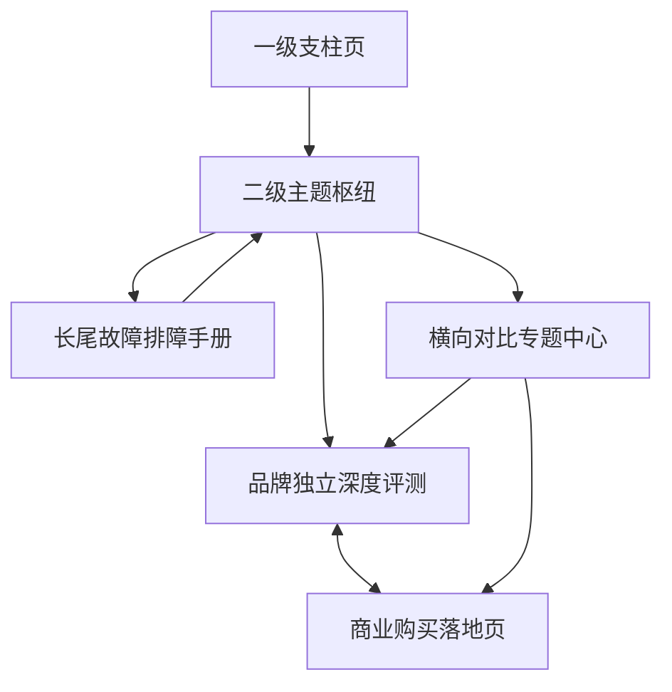

# 站内网状内链与三级分流矩阵

**报告生成日期：2026-11-24** · **审计数据：全站 6,700+ 条内部链接交叉验证**

---

## 一、站内闭环分流体系设计

本站摒弃传统的孤立页面架构，构建了高粘性的「诊断-对比-购买-评测」四维网状链路：

1. **商业与评测互通**：31 家品牌的商业购买页（`/brands/{slug}/`）顶部与底部均设有醒目入口直达其深度技术评测（`/reviews/{slug}/`）；技术评测页底部设有官方购买指引。
2. **横向对比多向引流**：每篇对比文章均精准提供双方的技术评测链接与商业落地链接，形成闭环。
3. **排障文章情景推荐**：长尾排障文章在解析特定故障（如 403 订阅错误）时，直接反向推荐具备高稳定性的专线机场评测。
